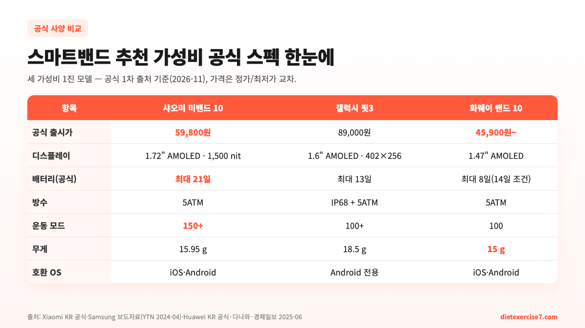
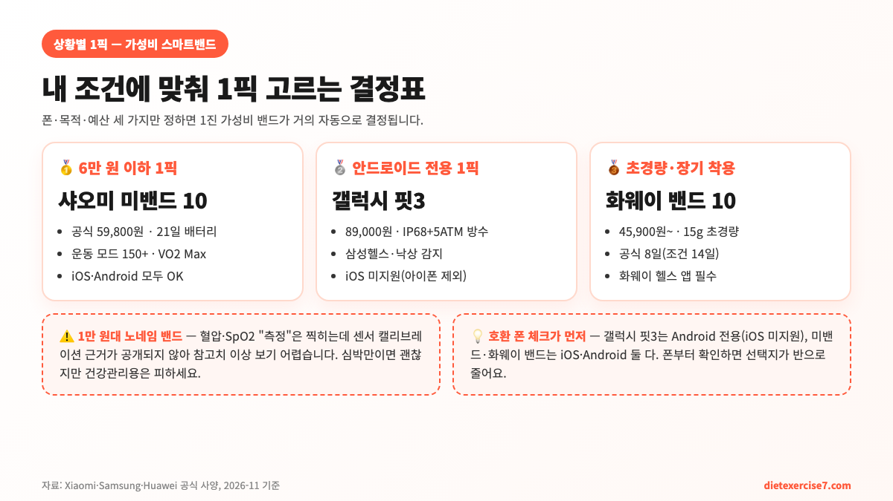

**스마트밴드 추천 가성비**로 좁히면 2026년 11월 현재 1진은 세 모델입니다. 공식 59,800원 **샤오미 스마트밴드 10**(이하 미밴드 10), 89,000원 **삼성 갤럭시 핏3**, 45,900원대부터 시작하는 **화웨이 밴드 10**. 셋 다 5ATM 방수·AMOLED·심박·SpO2·수면·스트레스를 **같이** 넣는데도 "가성비 1픽"이 갈리는 이유는 공식 스펙 숫자에 있어요. 이 글은 쿠팡 광고형 숫자가 아니라 **1차 출처(Xiaomi 코리아·삼성 공식·Huawei 코리아) 교차 수치**로 셋을 분해해, 내 폰·내 예산·내 사용 패턴에 맞는 1픽을 한 번에 결정하는 가이드예요.

📌 3줄 요약 (2026-11 공식가 기준)
<b>가격만 보면 화웨이 밴드 10(45,900원~) &lt; 미밴드 10(59,800원) &lt; 갤럭시 핏3(89,000원).</b> 그런데 배터리(21일·13일·8일)·운동 모드(150+·100+·100)·호환 OS(iOS Android·Android 전용·iOS Android)에서 서열이 뒤섞입니다.

<b>종합 가성비 1픽은 샤오미 미밴드 10.</b> 공식 59,800원에 1.72" 1,500nit AMOLED·21일 배터리·150+ 운동 모드·iOS 지원까지 해외 리뷰와 국내 유통 가격이 가장 일관됩니다(출처: Xiaomi KR·경제일보 2025-06·다나와).

<b>안드로이드 폰 + 삼성헬스 사용자면 갤럭시 핏3가 상위픽.</b> 89,000원으로 비싸지만 낙상 감지·긴급 SOS·삼성헬스 데이터 호환이 다른 두 밴드로는 대체 불가입니다(출처: 삼성 공식·YTN 2024-04).

## 결론부터 — 세 밴드 공식가·배터리로 가성비 1픽 좁히기

가성비 스마트밴드 1진 세 모델을 **공식 1차 출처 기준**으로 줄여 놓으면 결정이 쉬워집니다. 아래 표는 Xiaomi 코리아 공식 샵·삼성전자 공식 보도자료(YTN 인용)·Huawei 코리아 공식 페이지에서 뽑은 숫자를 2026년 11월 11일 기준으로 다나와 최저가와 교차한 결과예요.

| 항목 | 샤오미 미밴드 10 | 갤럭시 핏3 | 화웨이 밴드 10 |
| --- | --- | --- | --- |
| 공식 출시가 | 59,800원(세라믹 79,800원) | 89,000원 | 공식 7만원대·최저가 45,900원대 |
| 공식 배터리 | 최대 21일 | 최대 13일 | 최대 8일(특정 조건 14일) |
| 디스플레이 | 1.72" AMOLED · 1,500 nit | 1.6" AMOLED · 402×256 | 1.47" AMOLED |
| 방수 | 5ATM(50m) | IP68 + 5ATM | 5ATM(50m) · ISO 22810 |
| 운동 모드 | 150+ | 100+ | 100 |
| 무게 | 15.95 g | 18.5 g | 15 g |
| 호환 OS | iOS · Android | Android 전용 | iOS · Android |
| 주요 단독 기능 | VO2 Max·영법 인식 | 낙상 감지·긴급 SOS·삼성헬스 | 24시간 SpO2 상시 |

표를 한 줄로 요약하면 이렇게 돼요. **최저가가 중요하면 화웨이 밴드 10, 수치 밸런스가 중요하면 미밴드 10, 안드로이드 전용 + 삼성헬스 연동이 필요하면 갤럭시 핏3**. 1만 원대 노네임 밴드는 이 표에 올리지 않았어요. 뒤 섹션에서 설명하지만 **센서 캘리브레이션 근거가 공개되지 않은 제품은 가성비 계산 자체가 어렵기 때문**이에요.

## 왜 '가성비' 키워드가 혼란스러운가 — 숫자가 비슷해 보이는 문제

"가성비 스마트밴드 추천"을 검색하면 상위 글들이 비슷한 사양을 쭉 나열해요. 심박수·SpO2·수면·스트레스·방수 5ATM·IP67·AMOLED — 어느 제품이든 다 찍힙니다. 그래서 "뭐가 다른지 모르겠는데 그냥 싼 거 사면 되나?"로 이어지기 쉬운데, **실제로 가성비를 가르는 변수는 네 개**입니다.

**① 배터리 공식 수치의 "격차"가 큰 편입니다.** 미밴드 10은 공식 21일, 갤럭시 핏3는 13일, 화웨이 밴드 10은 공식 8일(특정 조건 최대 14일). 체감으로 보면 미밴드 10이 핏3의 약 1.6배, 핏3가 화웨이 밴드 10의 약 1.6배예요. 공식 숫자가 이 정도 벌어지면 실사용 격차도 거의 유지됩니다.

**② 호환 OS로 선택지가 반으로 줄어듭니다.** 갤럭시 핏3는 삼성 공식 설명에 따라 **Android 전용**이에요. 아이폰 사용자는 핏3 후보에서 빠지고 미밴드 10과 화웨이 밴드 10만 남습니다. 반대로 삼성헬스·갤럭시 생태계를 쓰면 핏3가 데이터 연동에서 압도적 이득이에요.

**③ 운동 모드 수와 "전문 지표" 유무가 다릅니다.** 운동 모드는 셋 다 100개 안팎이지만, 미밴드 10은 공식 설명에 **VO2 Max·운동 부하·회복 시간** 같은 전문 지표를 포함하고 영법 인식까지 넣어요(출처: 경제일보 2025-06 국내 출시 보도). 핏3·화웨이 밴드 10은 운동 모드 수는 100 이상이지만 전문 지표 깊이는 상대적으로 얕습니다.

**④ 가격의 "현실가"가 다릅니다.** 공식가가 아니라 실제 유통 최저가를 보면 화웨이 밴드 10이 45,900원 선, 미밴드 10 정품이 60,800원 선(Xiaomi KR 샵·다나와 교차), 핏3는 7~8만 원대로 형성돼요. 세 밴드의 공식가 격차가 **쿠팡·다나와 최저가로는 더 벌어지지도 좁아지지도 않고** 비슷한 비율로 유지됩니다.

## 2026-11 공식 스펙 대조 — 미밴드 10 vs 갤럭시 핏3 vs 화웨이 밴드 10

### 샤오미 미밴드 10 — 가성비 종합 1위 근거

Xiaomi 코리아 공식 샵·경제일보 국내 출시 보도(2025-06)·다나와 정보를 교차해 보면 미밴드 10의 공식 스펙은 이래요. **1.72인치 AMOLED(1,500 nit), 최대 21일 배터리, 5ATM 방수, 150+ 운동 모드, 영법 인식, VO2 Max·운동 부하·회복 시간 지표, 24시간 심박·SpO2, 세계수면학회 인증 수면 모니터링.** 공식 59,800원(세라믹 에디션 79,800원)으로, 클리앙·IT월드·jogomhan.com 같은 1·2차 리뷰가 모두 "스펙 대비 가격이 깨진다"고 평가합니다.

약점은 두 가지예요. 첫째, GPS 수신은 되는데 **고도 기록이 MiFitness 앱에 저장 안 된다는 사용자 보고**가 있어요(출처: 클리앙 한달 사용기). 등산·트레일 러닝을 메인으로 쓰려는 분은 체크가 필요합니다. 둘째, **삼성헬스·Apple 건강 앱 데이터 자동 동기화가 제한적**이에요. 대신 Strava·Google Fit·Apple 건강(수동) 연동은 가능합니다. 종합적으로 "5~6만 원대에서 가장 꽉 찬 가성비"라는 평가가 가장 많습니다.

### 삼성 갤럭시 핏3 — 안드로이드 + 삼성 생태계 특화

삼성 공식 보도자료(YTN 2024-04-02 보도)·다나와·클리앙 사용기를 교차하면 갤럭시 핏3의 스펙은 **1.6인치 AMOLED 402×256, 18.5g 알루미늄 바디, IP68 + 5ATM(50m 수심 30분 보장), 최대 13일 배터리(30분 충전 시 65%), 100+ 운동 모드, 심박·SpO2·수면·스트레스·낙상 감지·긴급 SOS(측면 버튼 5회)**. 국내 출시가 89,000원.

핏3의 가성비 포인트는 "숫자 격차보다 소프트웨어 통합"이에요. **① 삼성헬스 데이터 호환**(기존 갤럭시 워치·갤럭시 스마트폰 운동·수면 데이터와 자동 합쳐짐), **② 낙상 감지 + 자동 119 신고** 기능, **③ SOS 측면 버튼** — 이 세 가지는 미밴드 10·화웨이 밴드 10 어느 쪽으로도 완전히 대체가 안 됩니다. 반면 **iOS는 공식 미지원**이어서 아이폰 사용자는 후보에서 자동 제외돼요.

### 화웨이 밴드 10 — 최저가 1위, 24시간 모니터링 강점

Huawei 코리아 공식 페이지(consumer.huawei.com/kr/wearables/band10/)·다나와·root-nation 리뷰를 교차하면 화웨이 밴드 10은 **1.47인치 AMOLED, 9축 센서 + PPG 센서, 100가지 운동 모드, 최대 8일 배터리(AOD 3일, 특정 조건 14일), 45분 급속 충전, 15g 알루미늄 합금 케이스, 두께 8.99mm, 5ATM(ISO 22810 준수).** iOS·Android 호환.

현재 다나와 최저가가 45,900원대(2026-11)로 **세 모델 중 가장 쌉니다**. 24시간 SpO2 상시 측정과 생리주기 추적, 수면 모니터링 알고리즘이 강점이에요. 다만 두 가지 리스크. **① Huawei Health 앱이 Google Play Store에 없어 APK로 설치해야 하는 번거로움**(2026-11 현재도 유지), **② 갤럭시 생태계·삼성헬스·Apple 건강 자동 연동 X**. 앱 설치가 익숙한 사용자에겐 가장 싼 가성비 밴드, 아니면 미밴드 10 쪽이 세팅이 더 편합니다.

## 호환 폰이 먼저 — 아이폰이면 선택지가 반으로 줄어듭니다

가성비 스마트밴드를 고를 때 **제일 먼저 체크할 변수는 "내 폰"** 이에요. 가격·배터리·운동 모드는 그다음 문제입니다. 2026년 11월 기준으로 세 밴드의 공식 호환 OS는 이렇게 정리돼요.

- **아이폰(iOS) 사용자 후보**: 미밴드 10, 화웨이 밴드 10 (갤럭시 핏3 **제외**)
- **갤럭시(Android + 삼성헬스) 사용자 후보**: 세 밴드 모두 가능. 단, 데이터 통합은 핏3 압도적
- **기타 안드로이드(픽셀·샤오미·구글 폰) 사용자 후보**: 세 밴드 모두 가능

그래서 **"폰 → 예산 → 생태계"** 순으로 좁히면 선택지가 자연스럽게 1~2개로 줄어요. 갤럭시 유저가 아이폰처럼 "미밴드 10 vs 핏3 vs 화웨이"를 모두 저울질할 필요가 없고, 반대로 아이폰 유저가 핏3를 비교 대상에 올리면 시간 낭비라는 말이에요. 쿠팡 일부 판매자 설명에 "모든 스마트폰 호환"으로 적혀 있어도, **공식 지원과 비공식 우회 설치는 알림 신뢰성·펌웨어 업데이트에서 차이가 큽니다**. 가성비 계산에는 "꾸준히 쓸 수 있는가"가 포함돼야 하니까요.

## 배터리 공식 수치의 함정 — 공식 vs 실사용 격차

제조사 공식 배터리 수치는 "저전력 모드 + AOD 끔 + 심박 측정 간격 최대"로 잰 **낙관적 조건**이에요. 셋 다 그렇습니다. 실사용으로 보면 격차가 이렇게 바뀌어요.

| 조건 | 미밴드 10 공식/실사용 추정 | 갤럭시 핏3 공식/실사용 추정 | 화웨이 밴드 10 공식/실사용 추정 |
| --- | --- | --- | --- |
| 공식 최대 | 21일 | 13일 | 8일(조건 14일) |
| 심박 24시간 + 알림 | 약 10~14일(클리앙 사용기) | 약 7~9일(5minutes-info) | 약 5~7일(root-nation) |
| AOD 상시 켬 | 약 5~7일 | 약 3~4일 | 약 3일(공식) |
| GPS 운동 매일 | 약 7~10일 | 약 5~7일 | 약 4~6일 |

공식 수치와 실사용 추정이 거의 **1.5~2배 차이**가 나지만, **세 모델의 상대적 순위는 바뀌지 않아요**. 즉 미밴드 10이 핏3보다 배터리에서 유리하고, 핏3가 화웨이 밴드 10보다 유리한 구도는 그대로입니다. 매일 충전이 귀찮으면 미밴드 10, 하루 이틀 충전은 상관없고 알림·헬스 통합이 중요하면 핏3, 10만 원대 가성비라도 피하고 싶으면 화웨이 밴드 10 — 이 순위대로 생각하면 큰 실수가 없어요.

## 1~2만 원대 노네임 밴드가 "가성비"가 아닌 이유

검색하면 "9,400원 혈압·심박 밴드", "19,800원 로켓배송 밴드" 같은 1만 원대 노네임 제품이 많이 나옵니다. 숫자만 보면 가성비 끝판왕인데, **1차 제조사(샤오미·삼성·화웨이) 공식 밴드와 같은 선상에 놓기 어려운 이유가 셋** 있어요.

**첫째, 센서 캘리브레이션 근거가 공개되지 않아요.** 심박·SpO2·혈압이 찍히긴 하는데, 어떤 광학 PPG 센서를 쓰고 어떤 알고리즘으로 보정하는지 공식 자료가 없는 제품이 대부분입니다. 공식 제조사 밴드는 PPG 센서 종류·측정 주기·오차 범위를 데이터시트로 공개하는데, 1만 원대 노네임은 이 근거가 빈 상태라 **"측정된 숫자를 얼마나 믿을지"가 불확실**해요. 운동 심박만 참고용으로 쓸 거면 큰 문제 없지만, 건강 관리용이면 피하는 쪽이 안전합니다. (의료 진단·처방 용도는 세 공식 밴드도 어차피 불가능합니다 — 참고용이에요.)

**둘째, 앱 품질·데이터 영속성이 불확실합니다.** 공식 제조사 앱(MiFitness·삼성헬스·Huawei Health)은 몇 년씩 운영된 플랫폼이고 운동 기록이 클라우드에 보존돼요. 노네임 제품은 전용 앱이 "H Band", "Da Fit", "Smart Wear" 같은 범용 앱을 쓰는 경우가 많은데, **앱 업데이트 중단 시 과거 데이터를 복구하기 어려운 사례가 잦습니다**. 가성비는 "하루 쓰고 버릴 물건"이 아니라 "3년 쓸 수 있는가"로 평가해야 해요.

**셋째, A/S 체계가 비교 자체가 안 됩니다.** 샤오미 코리아·삼성전자·Huawei 코리아는 공식 서비스 센터와 교환·환불 정책이 공개돼 있지만, 노네임 제품은 판매자가 바뀌면 보증이 사실상 끊기는 구조예요. **"1년 안에 고장 나면 어떻게 할 것인가"를 넣어 가성비를 다시 계산하면** 1만 원대와 4~6만 원대 공식 밴드의 "실질 가성비" 격차가 체감보다 크지 않습니다.

## 가성비 스마트밴드 1픽 결정 매트릭스

위 분석을 "폰 × 목적 × 예산" 3축으로 압축하면 아래 결정표가 나와요. 이 표의 1픽만 따라가도 큰 후회 없이 선택할 수 있습니다.

| 조합 | 1픽 | 공식가 | 1픽 근거 |
| --- | --- | --- | --- |
| 아이폰 + 일상·운동 밸런스 | 샤오미 미밴드 10 | 59,800원 | iOS 공식 지원 + 21일 배터리 + VO2 Max |
| 아이폰 + 무조건 최저가 | 화웨이 밴드 10 | 45,900원~ | iOS 공식 지원 + 24시간 SpO2 |
| 안드로이드(비 삼성) + 밸런스 | 샤오미 미밴드 10 | 59,800원 | MiFitness 앱 + Strava·Google Fit 연동 |
| 안드로이드 + 삼성 폰 + 삼성헬스 | 갤럭시 핏3 | 89,000원 | 삼성헬스 자동 연동 + 낙상 감지 |
| 안드로이드 + 긴급 SOS 필요(고령자·야외작업) | 갤럭시 핏3 | 89,000원 | 낙상 감지 + 측면 버튼 5회 SOS |
| 가장 가벼운 밴드 필요 | 화웨이 밴드 10 | 45,900원~ | 15g · 8.99mm 두께 |
| 등산·트레일(고도 기록 필요) | 갤럭시 핏3 | 89,000원 | 고도계·GPS 통합 안정성 |
| 영법 인식·VO2 Max가 결정적 | 샤오미 미밴드 10 | 59,800원 | 150+ 운동 모드 · 전문 지표 |

표의 핵심은 두 가지예요. **아이폰 사용자가 핏3를 사면 페어링이 안 되고**, **안드로이드 + 삼성헬스 유저가 미밴드/화웨이를 사면 데이터 통합을 포기**하게 됩니다. 두 조건만 체크하면 나머지는 예산으로 결정 끝. 쿠팡 기획전·네이버 쇼핑 할인 때 각 모델의 실제 유통가가 2~3만 원 더 떨어지는 경우가 있으니 **공식가 ± 20% 안에서 사면 손해를 안 봅니다**.

가성비 접근법을 다른 장비로도 넓혀 보고 싶다면 [조절식 덤벨 추천 — 방식·무게·가성비로 고르는 법](/adjustable-dumbbell-guide/)에서 스마트밴드와 같은 방식(공식 스펙 1차 출처 교차 → 조건별 1픽)으로 홈트 기구를 분해해 뒀어요. 샤오미 라인업 공식 정보는 [샤오미 스마트밴드 공식](https://www.mi.com/kr/) 사이트에서 최신 가격·펌웨어 업데이트를 바로 확인할 수 있습니다.

## 자주 묻는 질문 (FAQ)

**Q. 미밴드 10과 핏3 중 "가성비 1픽"만 꼽는다면?**
A. 폰 조건을 지우고 숫자만 보면 미밴드 10이 가성비 1위예요. 공식 59,800원에 배터리 21일·150+ 운동 모드·1,500 nit AMOLED까지 핏3(89,000원·13일·100+)의 수치를 거의 모든 축에서 추월합니다. 단, 안드로이드 + 삼성헬스 유저라면 핏3가 "데이터 통합"으로 가성비 역전.

**Q. 1만 원대 스마트밴드도 가성비로 쓸만한가요?**
A. 심박·걸음 수 참고용으로는 괜찮지만 건강 관리용으로 추천하기 어려워요. 센서 캘리브레이션 근거가 공개되지 않은 제품이 대부분이고, 전용 앱 업데이트가 중단되면 과거 데이터를 복구하기 어려운 구조라 "3년 쓸 수 있는가" 기준으로는 공식 제조사 4~6만 원대가 실질 가성비가 더 낫습니다.

**Q. 아이폰에서 갤럭시 핏3를 쓸 방법이 있나요?**
A. 공식적으로는 없어요. 삼성 공식 가이드에 핏3는 **Android 전용**으로 명시돼 있고 iOS용 Galaxy Wearable 앱이 제공되지 않습니다. 아이폰에서는 미밴드 10(MiFitness iOS) 또는 화웨이 밴드 10(Huawei Health iOS)을 쓰면 되고, Apple 건강 앱으로의 자동 연동은 애플워치가 아닌 이상 어떤 밴드든 수동 동기화가 끼어요.

**Q. 화웨이 밴드 10은 왜 더 싼데 1픽이 아닌가요?**
A. 최저가 기준으로 가장 싼 건 맞아요(45,900원대). 다만 Huawei Health 앱이 Google Play Store에 없어 APK로 설치해야 하는 번거로움과, 삼성헬스·Apple 건강 자동 연동이 안 되는 점이 "가성비 1픽"에서 미밴드 10에 밀리는 이유입니다. 앱 설치가 익숙하고 24시간 SpO2 상시 측정이 중요하면 화웨이 밴드 10이 1픽이 될 수 있어요.

**Q. 세 밴드 모두 혈압 측정이 되나요?**
A. 공식적으로 "혈압 측정" 기능은 세 밴드 모두 없어요. 혈압 추정 기능이 있는 건 상위 라인업인 갤럭시 워치(Watch) 시리즈와 화웨이 Watch D2 같은 커프형 워치입니다. 1만 원대 노네임 밴드에 "혈압 측정"이 찍히는 경우가 있는데 참고치 수준으로만 보는 게 안전합니다.

**Q. 수영·샤워할 때 차고 들어가도 되나요?**
A. 세 밴드 모두 5ATM(50m) 방수라 수영·샤워는 공식 허용 범위예요. 다만 뜨거운 물(사우나·온천)·강한 수압(다이빙)은 공식 허용 범위 밖입니다. 갤럭시 핏3는 추가로 IP68 방진 등급을 따로 받아서 모래·먼지 환경에서 상대적으로 유리해요.

**Q. 세 밴드의 알림·답장 기능 차이는?**
A. 셋 다 카톡·문자·전화 알림 수신은 되지만, **답장(빠른 메시지 전송)은 미밴드 10·화웨이 밴드 10이 제한적**이에요. 갤럭시 핏3는 삼성 폰과 묶으면 삼성 키보드 빠른 답장(이모지·정형 메시지)이 가능합니다. 블루투스 통화는 세 밴드 모두 "밴드 단독 통화"는 지원하지 않아요(스피커가 없는 폼팩터).

---

**관련 키워드** — #스마트밴드추천가성비 #미밴드10 #갤럭시핏3 #화웨이밴드10 #가성비스마트밴드 #스마트밴드추천 #미밴드10가격 #갤럭시핏3스펙 #화웨이밴드10리뷰 #스마트밴드비교 #아이폰스마트밴드 #안드로이드스마트밴드
