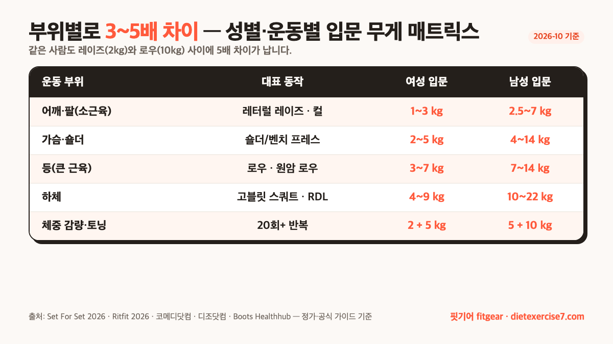

결론부터 말하면요, 아령 무게 추천 입문은 "**성별 × 운동 부위 × 목적**" 세 축으로 결정됩니다. 처음 하나만 사야 한다면 **여성은 2~3kg + 5kg**, **남성은 5kg + 10kg** 두 짝 조합이 가장 실패가 적어요. 다만 같은 사람도 레터럴 레이즈(약 2kg)와 원암 로우(약 10kg) 사이에 **5배 차이**가 나기 때문에, 운동을 꾸준히 할 거라면 처음부터 **다단계 조절식 1쌍**으로 넓게 커버하는 쪽이 공간·비용 모두 유리합니다. 이 글에서는 2026년 10월 공식 자료·운동 가이드를 교차해 성별·부위·목적별 숫자, 10~15회 반복으로 적정 무게 재는 법, 조절식과 고정식 가격·소음 차이, 소재별 특징, 체크리스트까지 한 번에 정리했어요.

📌 3줄 요약
여성 입문자는 <b>2~3kg + 5kg</b>, 남성 입문자는 <b>5kg + 10kg</b> 두 짝으로 시작하면 레이즈·컬·프레스·로우·스쿼트 대부분을 커버할 수 있습니다.

적정 무게는 "<b>10~15회 반복 중 마지막 1~2회가 버거운 무게</b>" — 성별이나 kg 숫자보다 이 공식이 정확합니다.

장기적으로는 다단계 조절식 1쌍이 공간·비용 모두 유리합니다. 다이얼 조절식 24kg이 2026년 10월 기준 8만 원대부터 있어요.

## 결론부터 — 입문자 추천 무게는 이 표 한 장이면 돼요

상위 글들을 모아 보면 숫자가 조금씩 다른데, **공통으로 통하는 범위**만 뽑으면 아래 표로 정리됩니다. 여성·남성 모두 "작은 근육군은 가볍게, 큰 근육군은 무겁게"가 공식이에요.

| 목적 | 여성 입문 | 남성 입문 | 비고 |
| --- | --- | --- | --- |
| 어깨·팔(레이즈·컬) | 1~3kg | 2.5~7kg | 삼두는 이두보다 더 가볍게 |
| 가슴·숄더 프레스 | 2~5kg | 4~14kg | 자세 안정 뒤 올림 |
| 등(로우·원암 로우) | 3~7kg | 7~14kg | 등은 큰 근육이라 더 셈 |
| 하체(스쿼트·런지·RDL) | 4~9kg | 10~22kg | 양손 합산 또는 쌍 들기 |
| 체중 감량·토닝(20회+) | 2kg + 5kg 두 짝 | 5kg + 10kg 두 짝 | 반복 횟수 ↑ 무게 ↓ |

이 표만 봐도 결론이 보여요. **한 가지 무게로 모든 운동을 커버할 수 없다**는 겁니다. 어깨 레이즈를 할 수 있는 2kg으로 로우를 하면 자극이 안 오고, 반대로 로우에 맞춘 10kg으로 레이즈를 하면 어깨·회전근개가 다칠 수 있어요. 그래서 "처음 하나만"이면 두 짝 조합을 권하고, "꾸준히 할 거면" 조절식을 권하는 거죠.

영문 가이드 Set For Set은 입문 남성에게 **2.5~22kg 세트**, 입문 여성에게 **1.3~5.5kg 세트**를 근비대(8~15회 반복) 기준으로 추천합니다. 2026년 Ritfit의 남성 가이드도 비슷하게 이두 컬 10~20lb(약 4.5~9kg), 벤치 프레스 20~40lb(약 9~18kg), 로우 25~50lb(약 11~23kg), 스쿼트 25~50lb(약 11~23kg)로 세분화합니다.

## 성별별 입문 무게 — 자료마다 왜 조금씩 다를까요

같은 "여성 입문자"라도 자료마다 수치가 2kg부터 5kg까지 흩어져 있어서 혼란스럽기 쉽습니다. 결론부터 말하면 **운동 부위·목적을 안 적어 놓은 자료일수록 범위가 넓게 벌어진다**는 뜻이에요. 좁혀 보면 거의 일치합니다.

여성 입문자의 경우 코메디닷컴은 이두 컬 2~3.5kg, 레터럴 레이즈·업라이트 로우 1~2kg을 권하고, Set For Set은 "체중 감량·토닝이면 2kg + 4~5kg 두 짝이 최소"라고 적어요. 영국 Boots 가이드는 성별이 아닌 1~3kg(소근육) · 4~6kg(일반 시작) · 7~10kg(큰 근육) 체급으로 분류하는 쪽이 더 정확하다고 봅니다. 즉 "여성이라 2kg"이 아니라 "**어깨·팔 하면 2kg, 가슴·등은 4~6kg, 하체는 7kg 이상**"이에요.

남성 입문자는 Pgr21·a-ha의 국내 질답과 영문 Set For Set·Ritfit을 교차해 보면 "일반 홈트·근비대"면 **5~10kg**, 큰 근육군(로우·스쿼트·데드리프트)까지 하려면 **10~22kg**이 공통 범위입니다. 재경일보 2026 홈트 아령 추천 글도 남성 초보는 "**20kg 세트**(한쪽 10kg씩 분할)로 시작해 점진적으로 올리라"고 권해요. 반대로 재활·유산소·가벼운 홈트 목적이라면 성별과 상관없이 **0.5~1kg 네오프렌 아령**부터 시작해도 됩니다.

💡 "성별 vs 체급" — 어느 쪽이 맞나요
최근 영문 가이드(Boots·Workoutforless)는 성별 기준을 피하고 "1~3kg / 4~6kg / 7~10kg" 체급 기준으로 추천합니다. 저도 체급 기준이 더 안전하다고 봐요. 똑같은 여성이라도 손목 상태·운동 경력에 따라 적정 무게가 2kg~7kg까지 벌어지기 때문에, "여자니까 2kg"으로 못 박는 게 오히려 자극을 못 받게 만들 수 있습니다.

## 부위별로 들 수 있는 무게가 완전히 달라요

같은 사람도 운동 부위에 따라 쓸 수 있는 무게가 **3~5배 차이**가 납니다. 이건 성별 상관없이 생리적 사실이에요. 큰 근육(가슴·등·엉덩이·대퇴)은 당연히 작은 근육(삼각근·이두·삼두)보다 더 센 힘을 낼 수 있기 때문입니다.

구체적으로 보면, 2026 Ritfit의 입문 남성 수치는 레터럴 레이즈 **5~15lb**(2.3~7kg), 이두 컬 **10~20lb**(4.5~9kg), 숄더 프레스 **15~30lb**(7~14kg), 벤치 프레스 **20~40lb**(9~18kg), 원암 로우 **25~50lb**(11~23kg), 고블릿 스쿼트/RDL **25~50lb**(11~23kg), 파머스 캐리 **30~60lb**(14~27kg)로 벌어져요. 레이즈와 캐리 사이에 거의 **10배 차이**가 납니다. 여성도 비율은 비슷해서, 같은 사람이 "레이즈 2kg → 로우 10kg"로 넘어가는 건 극단적이지 않고 **정상적인 흐름**이에요.

디조닷컴 가이드가 지적하는 포인트도 비슷합니다. 삼두는 이두보다 **1~2kg 더 가볍게** 가라고 권하고, 숄더 프레스는 레터럴 레이즈보다 **더 무거운 무게**를 쓰라고 적어요. 반대로 재활 쪽 가이드(한국사회복지저널)는 "**등·가슴 운동은 상대적으로 무겁게, 어깨·팔은 가볍게**"를 공통 원칙으로 묶습니다. 즉 아령 하나로 끝낼 수 있다는 생각 자체를 접고, **최소 2단계 무게**를 준비하는 게 정석입니다.

## 10~15회 반복으로 내 무게를 직접 재는 법

표만 봐도 범위가 넓어서 "내 무게"가 뭔지 애매하죠. 가장 간단한 공식은 "**10~15회 반복 가능하되 마지막 1~2회가 버거운 무게**" 입니다. 성별·kg 숫자보다 이 공식이 더 정확해요.

디조닷컴 가이드는 "덤벨을 들었다가 원위치로 내려놓는 동작이 1회이며, 이것을 쉬지 않고 **10~15회** 반복할 수 있는 무게가 1세트에 적절하다"고 설명합니다. 코메디닷컴은 "한번에 **8~12번** 정도 반복할 때 피로감이 생기는 정도의 무게"를 권하고, 10회를 가뿐하게 들 수 있다면 더 무거운 아령으로 올리라고 적어요. 영국 Workoutforless 가이드도 "마지막 몇 회가 **challenging**하지만 자세는 유지되는 무게"가 적정이라고 묶습니다.

⚠️ 이 신호가 보이면 무게가 과합니다
Set For Set 가이드는 다음 중 하나라도 보이면 "<b>무게가 과하다</b>"고 판정합니다. ① 반동을 써서 들어 올림(swing), ② 가동범위가 줄어듦(마지막까지 못 폄), ③ 호흡을 과도하게 참음, ④ 관절(어깨·손목·팔꿈치)에 날카로운 통증. 하나라도 보이면 1~2kg 낮추세요.

반대로 "**12회를 세트당 가뿐하게 끝내고 다음 세트까지 쌩쌩함**"이면 올릴 때예요. 디조닷컴은 "근육 성장"을 원하면 반복 횟수를 줄이고 **2~3kg 증가**시키라고, "체중 감량"을 원하면 **반복 횟수를 높이고 무게는 유지**하라고 분리합니다. 이 공식만 지키면 "여자/남자" "2kg/5kg" 같은 라벨에 묶이지 않고 몸의 변화에 맞춰 무게를 올릴 수 있어요.

## 조절식 vs 고정식 — 가격·소음·공간 어디서 갈릴까요

처음 사는 사람이 가장 많이 묻는 질문이 조절식과 고정식 중 뭐를 사야 하냐는 거예요. 결론부터 말하면, "**1~2kg 짜리 가벼운 홈트**"면 고정식, "**꾸준히 근력까지**"면 조절식입니다.

| 유형 | 가격(2026-10 기준) | 공간 | 소음·바닥 | 조작 |
| --- | --- | --- | --- | --- |
| 고정식(일체형) | 저가·1쌍씩 추가 구매 | 쌍마다 자리 필요 | 네오프렌 코팅이면 조용 | 들기만 하면 됨 |
| 원판 조립식 | 가장 저렴(10kg 1만 원대부터) | 중간 | 쇳소리 날 수 있음 | 마개 풀고 조이기 |
| 다이얼 조절식 | 24kg 8만 원대부터 | 가장 작음(1쌍) | 거치대에서 바꿔 조용 | 레버 돌려 몇 초 |

재경일보 2026 홈트 아령 비교에 따르면, 국내에서 흔히 보이는 가격대는 **타니 조립식 10kg 약 1만 원대, 20kg 약 2만 원대, 드래곤핏 3-in-1 20kg 약 3만 원대, 이고웰 20kg 약 3만 원대, 멜킨스포츠 다이얼 24kg 약 8만 원대**예요(세일·세트 구성에 따라 변동). 영문권에서는 Rogue·Bowflex·Powerblock 같은 프리미엄 조절식이 **$300~500**대라 격차가 큽니다.

조절식 중에서도 "**다이얼 퀵조절**"은 거치대에서 레버만 돌려 몇 초 만에 무게를 바꾸기 때문에 운동 흐름이 끊기지 않지만 가격이 높고, "**원판 조립식**"은 마개를 풀고 조이는 시간이 들지만 가격이 저렴하고 바벨로도 변형 가능합니다. 조절식의 다양한 방식 비교와 각각이 맞는 사람 유형은 이 블로그의 [조절식 덤벨 추천 가이드](/adjustable-dumbbell-guide/)에서 더 자세히 다뤘어요. 공간이 2평 미만이거나 매번 양쪽 다 끼우기 번거롭다면 다이얼형이, 바벨까지 쓸 거면 원판형이 더 적합합니다.

## 소재별 차이 — 네오프렌·러버·크롬·철제

겉모양은 비슷해도 소재에 따라 미끄럼·소음·바닥 영향이 꽤 달라요. 공식 정의부터 보면, 위키백과 아령 문서는 아령을 "**플라스틱이나 쇠붙이로 만들어진, 양끝에 무거운 쇠뭉치가 달린 기구**"로 정의하고, 영어 "dumbbell"의 어원이 "소리를 내지 않는 벨"이라고 설명합니다. 그만큼 소음을 줄이는 쪽으로 설계가 발전해 왔다는 뜻이에요.

실제 제품에서는 네 가지 소재가 흔합니다. **네오프렌**은 재경일보 비교에서 "표면이 부드러워 땀이 나도 손에서 쉽게 미끄러지지 않으며, 바닥에 내려놓을 때 소음과 충격을 줄여 실내 홈트에 매우 적합"하다고 묶어요. 1~5kg 가벼운 범위에서 가장 흔합니다. **러버/우레탄 코팅**은 바닥 보호와 내구성이 좋아 10kg 이상 중고가 조절식의 표준이고, **크롬·금속**은 그립이 미끄럽고 쇳소리가 크지만 가격이 저렴해 원판 조립식에서 많이 보여요. **PVC 코팅**은 가볍고 저렴하지만 긁힘·찢김이 쉬운 편입니다.

💡 아파트·오피스텔 홈트라면 소재가 핵심
층간 소음이 걱정이면 1~5kg는 네오프렌 코팅, 10kg 이상은 러버/우레탄 코팅을 고르세요. 재경일보 비교에서 "<b>팔각 디자인(드래곤핏)</b>"이 굴러다님을 막아 바닥 긁힘을 줄인다고 지적한 포인트도 함께 참고하면 좋아요. 그리고 바닥에는 반드시 두꺼운 매트를 깔아야 아래층에 쇳소리가 안 갑니다.

## 가격대와 살 때 체크리스트

지금까지의 범위를 묶어 보면, 2026년 10월 정가 기준으로 아령 가격대는 아래처럼 정리됩니다. 세일·세트 구성·소재에 따라 자주 바뀌니 **참고용**이에요. 상시 가격으로 못박지 마시고, 판매 페이지에서 다시 확인하세요.

| 유형 | 가격 범위(정가 기준) |
| --- | --- |
| 네오프렌 1~3kg 쌍 | 7,000~15,000원 |
| 원판 조립식 10kg | 10,000~20,000원 |
| 원판 조립식 20kg | 20,000~40,000원 |
| 러버 고정식 5~10kg 쌍 | 20,000~50,000원 |
| 다이얼 조절식 24kg | 70,000~150,000원 |
| 프리미엄 다이얼(Bowflex 등) | 300,000원대~ |

살 때 체크리스트는 네 가지입니다. 첫째, **손잡이 두께와 그립 소재**예요. 손이 작은 분은 두꺼운 그립을 쥐면 악력이 먼저 지쳐 운동이 안 되고, 미끄러운 크롬 그립은 땀이 많은 사람에게 위험합니다. 둘째, **마개·체결 상태**(원판 조립식). 운동 중 원판이 풀리면 발등에 떨어질 수 있어 고무 링 패킹 유무를 꼭 보세요. 셋째, **바닥 보호와 소음**이에요. 아파트라면 네오프렌/러버 + 두꺼운 매트는 거의 필수고, 체중이 많이 나갈수록 매트는 더 두꺼워야 합니다. 넷째, **냄새**. 저가 러버·PVC는 초기 고무 냄새가 심할 수 있어 환기 가능한 공간에 둬야 해요.

운동 중 심박·세트 시간을 함께 보고 싶다면 [삼성 갤럭시 워치 공식](https://www.samsung.com/sec/watches/all-watches/) 라인업처럼 홈트 트래킹이 가능한 웨어러블을 함께 쓰는 것도 방법입니다. 심박이 과도하게 올라가거나 다음 세트까지 회복이 안 되면 자세보다 **무게 자체**가 과한 신호이기 때문이에요.

## 자주 묻는 질문 (FAQ)

**Q. 아령 하나만 사도 되나요?**
A. 한 가지 무게로는 레이즈·컬·프레스·로우·스쿼트를 전부 커버할 수 없습니다. 작은 근육(어깨·팔)과 큰 근육(가슴·등·하체) 사이에 3~5배 차이가 나기 때문이에요. 입문자라면 최소 2단계(여성 2~3kg + 5kg, 남성 5kg + 10kg)로 두 짝을 준비하거나, 조절식 1쌍을 사는 쪽이 실패가 적습니다.

**Q. 2kg vs 5kg 중 뭐부터 사야 할까요?**
A. 운동 목적에 따라 다릅니다. 재활·유산소·토닝이면 2kg(네오프렌)부터, 근력·근비대까지 생각한다면 성인 여성은 5kg, 성인 남성은 10kg부터가 자료 간 공통 추천이에요. 다만 처음 들어 보고 10~15회 반복이 너무 쉽다면 바로 다음 단계로 올리세요.

**Q. 조절식과 고정식 중 뭐가 더 유리한가요?**
A. "1~2kg 가벼운 홈트"만 할 거면 고정식 네오프렌, "꾸준히 근력까지"면 조절식입니다. 조절식 중에서도 공간이 좁고 매번 바꾸기 번거롭다면 다이얼형(멜킨 24kg 8만 원대부터), 바벨까지 쓸 거면 원판형이 적합합니다. 가격은 원판형 조립식(10kg 1만 원대)이 가장 싸요.

**Q. 아파트에서 아령 쓰면 층간 소음이 심한가요?**
A. 네오프렌·러버 코팅 + 두꺼운 요가매트/층간소음 매트 조합이면 1~5kg 범위는 거의 문제 되지 않습니다. 다만 10kg 이상 조절식은 바닥에 내려놓는 소리가 커질 수 있어 매트는 필수고, 가능하면 거치대에서 올렸다 내리세요. 쇳소리 나는 크롬 원판은 아파트와는 상극입니다.

**Q. 10~15회 반복이 쉬우면 바로 무게를 올려야 하나요?**
A. 디조닷컴·코메디닷컴 가이드 모두 "모든 세트를 가뿐하게 끝내고 다음 세트까지 쌩쌩하면 올리라"고 권합니다. 다만 2~3kg씩 급격히 올리면 자세가 무너지기 쉬우니 1kg 단위로 올리고, 바로 가볍게 느껴지면 반복 횟수를 먼저 늘려 보세요. 자세가 깨지는 신호(반동·가동범위 축소·관절 통증)가 보이면 이전 무게로 돌아가는 게 안전합니다.

이거 하나만 기억하면 돼요. 아령은 "**숫자**"가 아니라 "**10~15회 반복 가능하되 마지막 1~2회가 버거운 무게**"로 고르는 겁니다. 성별·kg 숫자는 참고용 범위일 뿐이고, 몸이 느끼는 신호가 가장 정확한 기준이에요.

---

**관련 키워드** — #아령무게추천 #덤벨무게추천 #홈트아령 #조절식덤벨 #다이얼덤벨 #네오프렌아령 #여성아령무게 #남성덤벨무게 #아령부위별무게 #10회반복무게 #층간소음아령 #홈트입문
