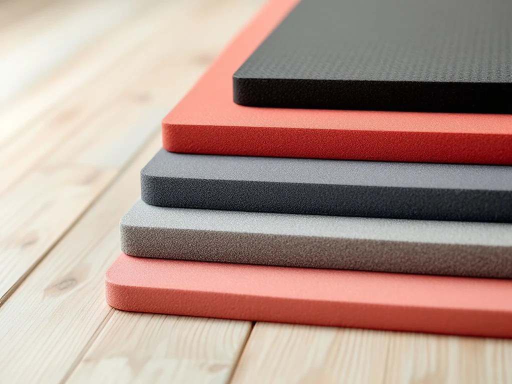
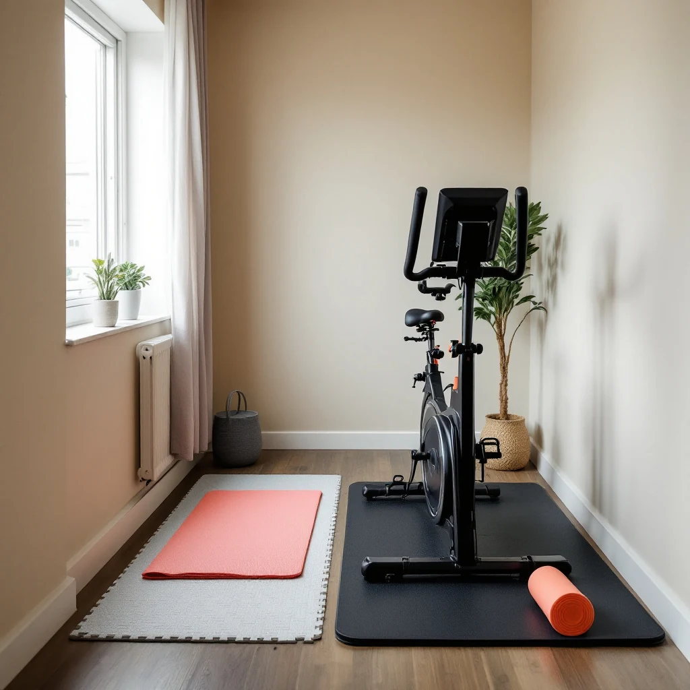

📌 3줄 요약
층간소음 운동매트는 두께보다 내 운동 동작에 맞는 종류를 고르는 게 먼저입니다.

매트는 가벼운 충격음은 크게 줄이지만 쿵쿵 뛰는 무거운 충격음은 몇 dB밖에 못 줄입니다.

스트레칭은 요가매트, 맨몸 근력은 10~15mm 고밀도 매트, 점프·덤벨은 퍼즐·고무 매트에 동작 조절을 더하세요.

층간소음 운동매트, 몇 mm를 깔면 아랫집이 조용해질까요? 결론부터 말하면요, 두께 하나로는 해결되지 않습니다. 매트마다 잘 막는 소리가 다르고 쿵 하는 점프 소리는 어떤 매트로도 다 막기 어려워요. 저도 처음엔 두꺼운 매트 한 장이면 끝인 줄 알았거든요. 그래서 상위 글 10여 개와 소비자원 시험 결과, 법정 기준을 나란히 놓고 비교해 봤습니다. 2026년 10월 기준 법령과 한국소비자원 자료로 정리했습니다.

## 층간소음 운동매트, 후보는 어떤 것들이 있나요?

홈트에 쓰는 층간소음 매트는 크게 다섯 종류로 나뉩니다. 요가매트, 10~20mm 고밀도 홈트 매트, EVA 퍼즐매트, 고무 매트, 그리고 거실용 폴더형 매트예요.

똑같이 매트라고 불러도 두께와 단단함은 제각각이에요. 표로 묶어보면 이렇습니다.

| 후보 | 흔한 두께 | 소재 | 강점 | 아쉬운 점 |
| --- | --- | --- | --- | --- |
| 요가매트 | 4~8mm | TPE·NBR·PVC | 가볍고 그립 좋음 | 충격 흡수 거의 기대 어려움 |
| 고밀도 홈트 매트 | 10~20mm | TPE·NBR | 맨몸 운동 쿠션, 한 장으로 끝 | 점프 많으면 부족 |
| EVA 퍼즐매트 | 10~20mm | EVA | 넓은 면적, 가성비 | 무거운 기구 오래 두면 눌림 |
| 고무 매트 | 10~20mm | EPDM·고무 | 단단해 기구 받침에 강함 | 무겁고 냄새 날 수 있음 |
| 폴더형 매트 | 40mm 안팎 | PE·PU 폼 | 거실 생활소음까지 커버 | 부피 크고 운동 시 꿀렁임 |

가격은 판매처와 구성마다 달라서 판매 페이지에서 직접 확인하는 게 정확합니다.

## 경량충격음과 중량충격음, 매트가 막는 소리는 정해져 있어요

매트는 가볍고 딱딱한 충격음은 잘 줄이지만 무겁게 쿵 울리는 소리에는 효과가 작습니다.

숟가락 떨어지는 소리나 의자 끄는 소리가 경량충격음, 아이가 뛰거나 뒤꿈치로 쿵쿵 걷는 소리가 중량충격음입니다. 중량충격음은 저음이 강해 바닥 구조를 타고 잘 내려가요. 버피, 줄넘기, 덤벨 내려놓는 소리가 이쪽입니다.

한국소비자원이 2025년 12월 발표한 4cm 폴더형 어린이 매트 8종 시험을 보면, 경량충격음은 16~17dB 줄었지만 0.4m 높이 중량충격음은 1~5dB, 1m 높이 고무공 충격은 1~2dB 줄이는 데 그쳤습니다. [시험 결과 보도](https://lady.khan.co.kr/living/article/202512241418001)에도 1m 충격은 "소음 저감 효과가 작았다"고 적혀 있어요. 아동용 매트 시험이지만 4cm짜리조차 쿵 소리 앞에선 분명히 한계가 있습니다.

## 층간소음 기준은 몇 dB이고, 홈트 소리는 어디에 걸리나요?

낮에는 직접충격 소음 1분 평균 39dB, 순간 최고 57dB이 기준입니다. 밤에는 34dB과 52dB로 더 엄격해요.

이 수치는 [공동주택 층간소음의 범위와 기준에 관한 규칙](https://www.law.go.kr/%EB%B2%95%EB%A0%B9/%EA%B3%B5%EB%8F%99%EC%A3%BC%ED%83%9D%EC%B8%B5%EA%B0%84%EC%86%8C%EC%9D%8C%EC%9D%98%EB%B2%94%EC%9C%84%EC%99%80%EA%B8%B0%EC%A4%80%EC%97%90%EA%B4%80%ED%95%9C%EA%B7%9C%EC%B9%99)에 나옵니다. 2023년 1월부터 1분 평균 기준이 주간 43dB에서 39dB로, 야간 38dB에서 34dB로 4dB씩 강화됐어요. 낮은 오전 6시부터 밤 10시까지입니다.

여기서 많이들 헷갈리는데, 점프 착지나 덤벨 낙하는 직접충격 소음에 들어갑니다. 짧은 쿵 소리도 최고소음도 기준에 걸릴 수 있어요. 최고소음도는 1시간 안에 기준을 3번 이상 넘으면 기준 초과로 봅니다. 밤 10시 이후엔 점프를 빼는 게 가장 확실합니다.

## 두께 비교, 10mm·15mm·20mm는 뭐가 다를까?

맨몸 근력 위주라면 10~15mm, 점프가 섞이면 15~20mm 이상을 권하는 의견이 많습니다. 다만 두께보다 밀도가 중요하다는 점은 상위 글 대부분이 짚어요.

스펙을 비교해보니 4~8mm 요가매트는 스트레칭용이지 충격 흡수용이 아닙니다. 10mm를 넘어야 스쿼트나 런지 때 울림이 덜하다는 후기가 늘어요. 반대로 너무 푹신하면 발목이 흔들린다는 지적도 있습니다.

그래서 커뮤니티에선 푹신한 매트보다 고밀도 매트를 권하는 답이 많았어요. 눌렀을 때 쑥 꺼지지 않고 천천히 복원되는 쪽이 운동용으로 안정적입니다. 위에 겹칠 요가매트는 [요가매트 고르는 법](/yoga-mat-guide/)에 소재별로 정리해 뒀어요.

## 소재 비교, TPE·EVA·고무 중 뭐가 조용할까?

조용함은 소재보다 밀도와 두께가 좌우합니다. 소재는 냄새, 밀림, 내구성을 가르는 기준으로 보세요.

TPE는 복원력이 좋고 냄새가 적지만 가격대가 높고 재단이 어렵습니다. EVA는 가성비가 좋아 가장 흔한 대신, 개봉 직후 표면 유분을 닦아야 하고 무거운 기구를 오래 두면 눌린 자국이 남아요. EPDM 같은 고무 매트는 기구 받침에 강하지만 무겁고 냄새나 가루가 날 수 있습니다.

유해물질도 봐야 합니다. 소비자원 시험에서 8종 중 1종이 휘발성 유기화합물 방출 기준을 넘었어요. 넓게 까는 매트라면 유해물질 시험성적서가 공개돼 있는지 확인하세요.

## 내 운동 동작으로 고르는 매트 조합표

가장 실용적인 기준은 내가 주로 하는 동작입니다. 동작별 매트를 한 장으로 정리했어요.

| 주로 하는 운동 | 추천 매트 | 함께 할 일 |
| --- | --- | --- |
| 스트레칭·요가·코어 | 요가매트 6mm 안팎 | 따로 방음 매트 불필요 |
| 맨몸 근력(스쿼트·런지·플랭크) | 고밀도 홈트 매트 10~15mm | 천천히 앉고 일어서기 |
| 점프 유산소(버피·줄넘기) | 퍼즐매트 15mm 이상 위에 요가매트 | 낮 시간에만, 점프 대신 스텝 |
| 덤벨·케틀벨 | 고무 매트나 고밀도 퍼즐매트 | 내려놓을 때 무릎을 굽혀 살살 |
| 실내자전거·러닝머신 | 기구 전용 고무 매트 | 기구 수평 맞추기 |

제가 찾아본 실패담에선 점프 운동에 요가매트 한 장만 깐 경우가 자주 보였어요. 반대로 맨몸 근력만 하는데 4cm 폴더매트를 사서 꿀렁인다는 불만도 많았습니다. 동작과 매트가 어긋날 때 돈이 새더라고요.

살 때는 아래 4가지를 같이 확인해 보세요.

| 체크 항목 | 보는 법 |
| --- | --- |
| 밀도 | 손으로 눌렀을 때 쑥 꺼지지 않고 천천히 돌아오는지 |
| 미끄럼 방지 | 바닥면 돌기나 코팅으로 매트가 밀리지 않는지 |
| 유해물질 | KC 표시나 유해물질 시험성적서가 공개돼 있는지 |
| 이음새 | 퍼즐형은 틈이 벌어지지 않는지, 기구용은 이음새 없는 통매트인지 |

이거 하나만 기억하면 돼요. 점프가 있으면 매트와 동작 조절을 같이, 없으면 매트 한 장이면 충분합니다.

## 상황별 추천, 원룸·거실·홈짐은 이렇게

원룸은 고밀도 매트 한 장, 아파트 거실은 퍼즐매트 위에 요가매트, 기구가 있는 홈짐은 기구 아래 고무 매트가 무난합니다.

원룸은 매번 펴고 접어야 하니 말아서 세워 두는 10~15mm 매트가 편해요. 거실은 퍼즐매트로 바닥을 덮고 운동할 자리에만 요가매트를 겹치면 미끄럼과 위생까지 챙깁니다.

실내자전거나 러닝머신은 쿵 소리보다 계속 이어지는 진동이 문제라 이음새 없는 고무 매트를 기구 크기에 맞춰 까는 편이 낫습니다. 기구 자체 소음은 [실내자전거 추천](/indoor-exercise-bike-recommend/)에서 저항 방식별로 비교해 뒀어요.

## 매트를 깔아도 소리가 난다면 매트 밖에서 할 일

매트를 바꿔도 민원이 이어지면 동작과 시간대를 바꿔야 합니다. 무거운 충격음은 매트가 몇 dB밖에 못 줄이니까요.

점프 스쿼트는 일반 스쿼트로, 버피는 한 발씩 뒤로 빼는 방식으로 바꾸면 쿵 소리를 크게 줄일 수 있습니다. 덤벨은 무릎을 굽혀 살며시 내려놓고, 운동은 밤 10시 전에 끝내세요.

같은 총두께라면 얇은 매트 두 장보다 두꺼운 매트 한 장이 낫다는 의견이 많았어요. 건물 구조마다 효과가 다르니 아랫집과 한 번 이야기해 보는 것도 방법입니다. 대화로 풀기 어렵다면 기후에너지환경부와 한국환경공단이 운영하는 층간소음 이웃사이센터 같은 공공 상담 창구도 있어요.

## 자주 묻는 질문 (FAQ)

**Q. 요가매트만 깔고 홈트하면 층간소음 괜찮나요?**
A. 스트레칭이나 코어 운동이라면 대체로 괜찮습니다. 점프나 덤벨이 섞이면 10mm 이상 고밀도 매트나 퍼즐매트를 아래에 까는 편이 낫습니다.

**Q. 층간소음 매트 두께는 몇 mm가 좋아요?**
A. 맨몸 근력 위주면 10~15mm, 점프가 섞이면 15~20mm 이상을 많이 권합니다. 두께보다 밀도가 중요하다는 점도 같이 보세요.

**Q. 줄넘기는 매트 깔고 집에서 해도 되나요?**
A. 매트를 깔아도 착지 충격음은 다 막기 어렵습니다. 무거운 충격음은 몇 dB만 줄어드니, 줄 없이 제자리 스텝으로 바꾸거나 낮에 짧게 하세요.

**Q. 층간소음 매트 살 때 꼭 확인할 게 있나요?**
A. 두께와 함께 밀도, 미끄럼 방지, 유해물질 시험 여부를 보세요. 소비자원 시험에서 일부 제품이 휘발성 유기화합물 기준을 넘은 적이 있어 시험성적서 확인이 안전합니다.

---

**관련 키워드** — #층간소음운동매트 #홈트층간소음매트 #층간소음매트추천 #층간소음방지매트 #홈트매트두께 #홈트매트추천 #퍼즐매트 #고무매트 #요가매트 #경량충격음 #중량충격음 #아파트홈트
