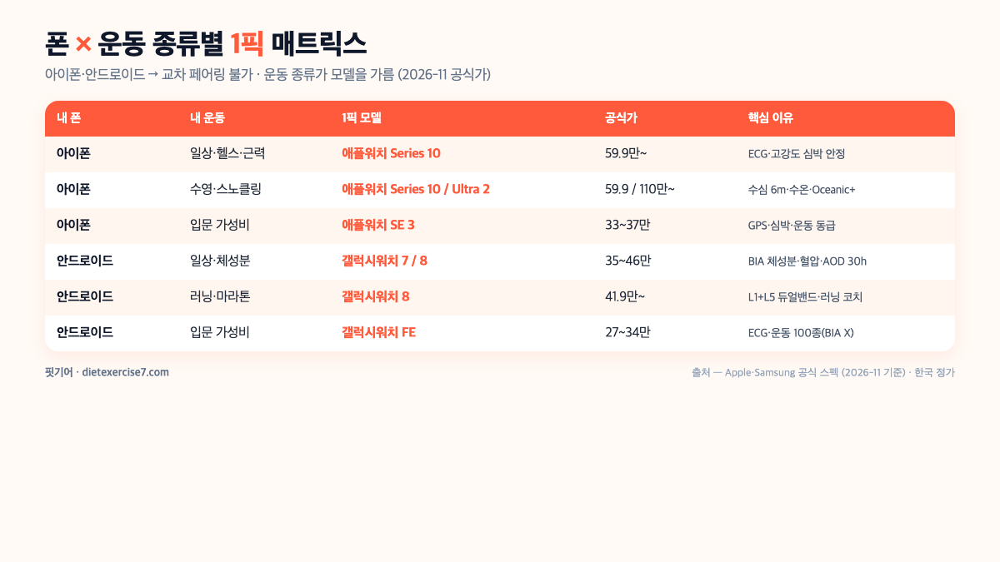
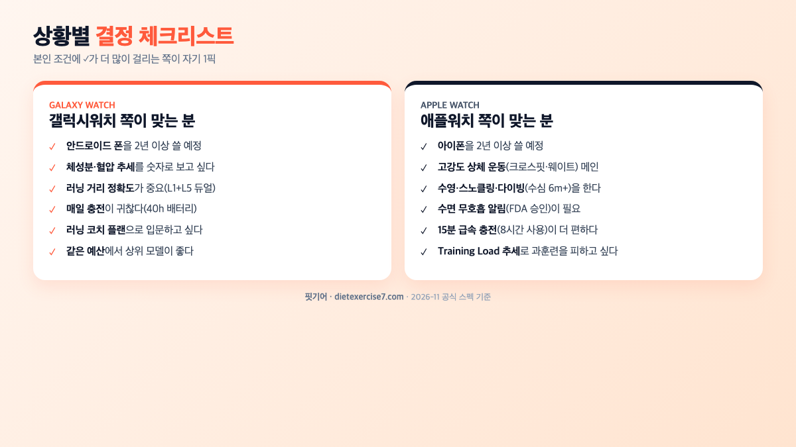
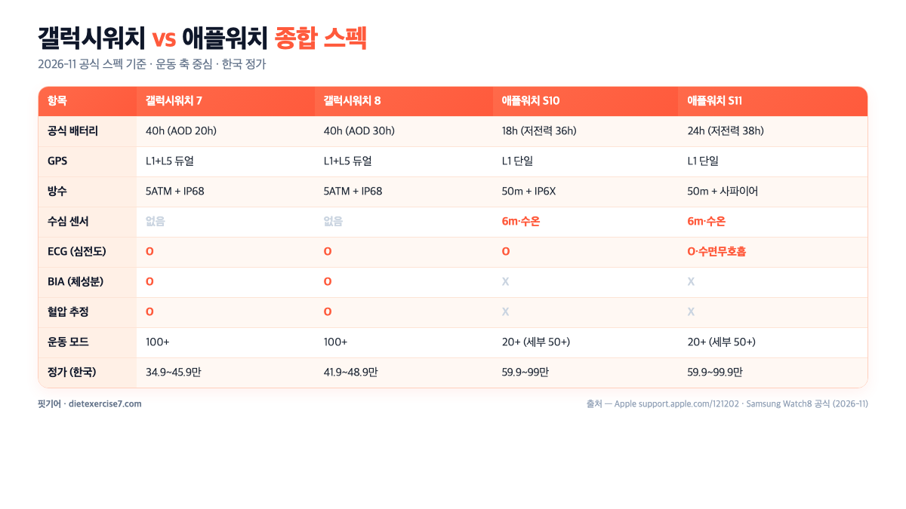

결론부터 말씀드리면, **갤럭시워치 vs 애플워치 운동 기능 비교**는 "둘 중 어느 쪽이 더 좋냐"가 아니라 "어떤 폰을 쓰고 어떤 운동을 하느냐"로 **90% 이상 결정**됩니다. 2026년 11월 기준 공식 스펙과 상위 가이드(factlog·digi-royal·digitaltrends·howtogeek·tilnote·insidenews365·dasaja·edaily) 10편을 교차해 보면, 두 워치는 서로 못 하는 영역이 반반씩 있고 **"내 폰·내 운동 종류"가 틀어지면 추천이 정반대로 뒤집히는 구조**예요.

이 글의 핵심 결론 세 줄은 이렇습니다. **① 아이폰이면 애플워치, 안드로이드면 갤럭시워치가 기본값**이고 다른 조합은 블루투스 페어링 자체가 막혀 선택지가 아니에요. ② 고강도 상체 운동(캐틀벨·크로스핏) 심박 정확도는 **애플워치가 41 BPM 더 안정**(이데일리 실측), 저강도(조깅·산책)·러닝 GPS 정확도는 **갤럭시워치 8이 L1+L5 듀얼밴드로 유리**합니다. ③ 체성분·혈압(BIA)은 **갤럭시워치 단독 기능**, 수심 게이지·수온 센서는 **애플워치 Series 10 단독 기능**이라 "어떤 운동인가"가 모델을 가릅니다.

📌 3줄 요약 (2026-11 공식 스펙 기준)
<b>폰 생태계가 50% 결정합니다.</b> 아이폰 ↔ 애플워치, 안드로이드 ↔ 갤럭시워치. 교차 페어링은 삼성·애플 모두 공식 차단.

<b>심박·GPS 정확도는 종목별로 결과가 갈립니다.</b> 고강도 상체 운동 심박 = 애플워치 시리즈 10(이데일리 실측 168 BPM, 갤워치 7 127 BPM 격차 41 BPM). 러닝 GPS = 갤럭시워치 7/8 L1+L5 듀얼밴드 유리.

<b>단독 기능이 운동 종류별 결정권.</b> BIA 체성분·혈압 추정은 갤럭시워치 단독, 수심 게이지(6m)·수온 센서는 애플워치 Series 10 단독. 배터리는 갤럭시 40h vs 애플 18h.

## 결론부터 — 폰 × 운동 종류별 1픽 매트릭스

갤럭시워치 vs 애플워치 운동 기능 비교를 "그냥 어느 쪽이 좋냐"로 묻기 어려운 이유는, **심박·GPS·배터리·방수·체성분·생태계 여섯 축이 모든 종목에서 동시에 1위인 모델이 없기 때문**이에요. 이걸 "내 폰 + 내 운동 종류" 매트릭스로 좁히면 2026년 11월 공식 스펙 기준 1픽이 이렇게 떨어집니다.

| 내 폰 | 내 운동 | 1픽 모델 | 2026-11 공식가 | 핵심 이유 |
| --- | --- | --- | --- | --- |
| 아이폰 | 일상·헬스·근력 | 애플워치 Series 10 | 59.9만~ | ECG·고강도 심박 안정·수면 무호흡 FDA 승인 |
| 아이폰 | 수영·스노클링·다이빙 | 애플워치 Series 10 / Ultra 2 | 59.9만 / 110만~ | 수심 게이지 6m·수온 센서·Oceanic+ 다이빙 앱 |
| 아이폰 | 입문 가성비 | 애플워치 SE 3 | 33~37만 원대 | GPS·심박·운동 모드는 상위기와 동급(ECG만 빠짐) |
| 안드로이드 | 일상·체성분 관리 | 갤럭시워치 7 또는 8 | 35~46만 원대 | BIA 체성분·혈압·러닝 코치·AOD 30h |
| 안드로이드 | 러닝·마라톤 | 갤럭시워치 8 (듀얼밴드) | 41.9만~ | L1+L5 듀얼 GPS·VO2 Max·러닝 코치 3~5주 |
| 안드로이드 | 입문 가성비 | 갤럭시워치 FE | 27만~34만 원 | ECG·심박·운동 모드 100종(BIA는 빠짐) |

여기서 가장 먼저 걸러야 할 조건은 **폰 생태계**예요. 삼성 공식 셋업 가이드와 Apple Watch Setup 매뉴얼 모두 "iOS ↔ Watch, Android ↔ Galaxy Watch"만 지원한다고 명시하고, 교차 페어링은 블루투스 페어링 단계에서 막힙니다. "두 워치 다 써보고 결정"이 불가능한 구조라, **폰을 안 바꿀 거면 선택지는 반반으로 줄어듭니다.**

## 2026-11 공식 스펙 한눈에 — 갤럭시워치 7/8 vs 애플워치 10/11

두 라인업의 2026년 11월 현재 공식 스펙을 운동 축으로 모으면 이렇게 돼요. 가격은 공식 사이트 정가 기준이고, 실제 유통은 할인·중고가가 빠르게 바뀝니다.

| 항목 | 갤럭시워치 7 (44mm) | 갤럭시워치 8 (44mm) | 애플워치 Series 10 (46mm) | 애플워치 Series 11 |
| --- | --- | --- | --- | --- |
| 출시 | 2024-07 | 2025-07 | 2024-09 | 2025-09 |
| 공식 배터리 | 최대 40h(AOD 20h) | 최대 40h(AOD 30h) | 18h(저전력 36h) | 24h(저전력 38h) |
| 실사용(공식 미기재) | 리뷰 편차 큼 | 리뷰 편차 큼 | 디지털트렌드 실측 24~28h | 리뷰 편차 큼 |
| GPS | L1+L5 듀얼밴드 | L1+L5 듀얼밴드 | L1 단일밴드(+GLONASS/Galileo/QZSS/BeiDou) | L1 단일밴드 |
| 방수 | 5ATM(50m) + IP68 | 5ATM(50m) + IP68 | 50m(5ATM) + IP6X | 50m + IP6X·사파이어 |
| 수심 센서 | 없음 | 없음 | 6m 깊이 게이지·수온 센서 | 6m·수온 센서 |
| ECG | 지원(AFib) | 지원(AFib) | 지원(AFib·수면 무호흡) | 지원(수면 무호흡 알림) |
| BIA(체성분) | 지원 | 지원(손가락 접촉) | 미지원 | 미지원 |
| 혈압 추정 | 지원(월 1회 교정) | 지원 | 미지원 | 미지원 |
| 운동 모드 수 | 100+ | 100+ | 20+ (세부 50+) | 20+ (세부 50+) |
| 2026-11 정가 | 349,000~459,000원 | 419,000~489,500원 | 599,000~990,000원 | 599,000~999,000원 |

> 가격·배터리·GPS 공식 수치는 Apple/Samsung 공식 사양 페이지 기준(Series 10·갤럭시 7/8은 각 1차 출처, Series 11은 Apple 공식 사양 2026-11 기준). Series 10 공식가는 2024-09 출시가 기준으로, 현재는 Apple 공식 샵 재고 상태에 따라 실제 유통가가 달라질 수 있어요.

표에서 바로 보이는 패턴이 두 가지예요. **첫째, 배터리는 갤럭시워치가 체감 2배 수준으로 깁니다** — 40시간(갤럭시) vs 18시간(애플)이라, 매일 충전 루틴이 싫은 분은 갤럭시 쪽이 편해요. **둘째, 센서 수는 비슷하지만 한쪽에만 있는 기능이 선명합니다.** BIA 체성분·혈압은 갤럭시워치, 수심 게이지·수온 센서는 애플워치가 각자 독점하고 있어요.

가격은 공식가 기준 **갤럭시워치가 체감 1.4~1.5배 저렴**합니다. 할인·중고를 끼면 격차가 더 벌어져서, **같은 예산에서는 갤럭시 쪽이 상위 모델을 집기 더 쉽습니다**. 반면 애플워치는 알루미늄 599,000원이 기본이고 티타늄은 999,000원까지 올라가니까 "운동 외 상징성·마감재"까지 보면 쪽이 가격 폭이 커요.

## 심박 정확도 — 고강도와 저강도에서 결과가 갈립니다

심박 정확도는 "어느 쪽이 더 정확하다"로 한 줄 결론을 내릴 수 없는 영역이에요. **운동 강도에 따라 승자가 뒤집히는 데이터가 이미 공개**돼 있습니다. 2025년 이데일리가 갤럭시워치 7과 애플워치 10을 같은 조건(캐틀벨 스윙·실내 조깅·산책)에서 돌린 실측 결과를 보면 이렇게 갈립니다.

**고강도 상체 운동**(캐틀벨 스윙, 팔 움직임 많은 종목)

| 구간 | 애플워치 10 | 갤럭시워치 7 | 차이 |
| --- | --- | --- | --- |
| 1차 테스트 | 150 BPM | 119 BPM | 31 BPM |
| 2차 테스트 | 168 BPM | 127 BPM | 41 BPM |

**저강도·안정 운동**(조깅·산책·런닝머신 걷기)

- 두 워치 모두 ±10 BPM 이내로 수렴
- 거리·걸음 수 정확도는 Tom's Guide 6,000보 실험에서 애플워치 -45보, 갤럭시워치 -57보로 거의 동급

왜 이런 패턴이 나오냐면, **손목 광학 PPG 센서는 땀·움직임·센서 밀착도에 민감**하거든요. 상체 중심 운동은 손목이 많이 흔들려서 PPG 반사광에 노이즈가 더 섞이고, 애플의 3세대 광학 심박 센서가 그 노이즈 제거 알고리즘이 한 세대 앞서 있다는 평가를 받습니다. 반대로 러닝·사이클링처럼 손목이 안정적인 상태의 유산소는 두 워치가 사실상 동급이에요.

그래서 크로스핏·웨이트·상체 격투기처럼 "손목 흔들림이 많고 심박 BPM이 중요한 운동"이 메인이면 **애플워치가 체감 이득**이고, 러닝·사이클·일상 유산소가 메인이면 두 워치 차이가 거의 없어 다른 축(폰 생태계·배터리·가격)에서 **결정**하는 게 맞습니다. 정밀한 심박 훈련(HRV·젖산역치)이 필요하면 손목 광학 센서 자체가 한계라, 가슴 스트랩(폴라·가민 HRM) 병행이 세 회사 공통 권고예요.

## GPS·러닝 정확도 — L1+L5 듀얼밴드와 L1 단일밴드

러닝·사이클·등산 같은 **야외 거리·경로 측정의 정확도는 GPS 수신 방식**에서 갈려요. 갤럭시워치 7/8은 **L1+L5 이중 주파수**(듀얼밴드)를 쓰고, 애플워치 Series 10/11은 **L1 단일밴드**(+ GLONASS·Galileo·QZSS·BeiDou 다중 위성망) 조합입니다.

L1(1575.42 MHz)과 L5(1176.45 MHz)를 동시에 받으면 도심 고층 빌딩·터널·숲에서 신호 반사(멀티패스)로 생기는 **오차를 상쇄**할 수 있어요. 디지로얄·디지털트렌드 리뷰가 공통으로 인용하는 수치는 **단일밴드 GPS 거리 오차 ±3~5%, 듀얼밴드 ±1%** 수준입니다. 10km를 뛰면 단일밴드는 ±300~500m, 듀얼밴드는 ±100m 이하라 페이스 분석 때 체감이 와요.

애플워치는 L5를 쓰지 않는 대신 다중 GNSS 위성(BeiDou·Galileo·QZSS·GLONASS)을 묶어 도심 신호 안정성을 보완합니다. 디지로얄 도심 러닝 비교 리뷰에서는 두 워치 거리 차이가 50~100m(약 1%) 수준으로 수렴했어요. **일반 조깅·동네 러닝은 체감 차이가 없고**, 마라톤·트레일처럼 1% 오차가 페이스 분석에 영향을 주는 구간에서 **갤럭시워치 8의 듀얼밴드가 우위**입니다.

반대로 GPS 지속 시간은 **애플워치 Ultra 2/Ultra 3가 역전**합니다. 애플워치 Ultra 3는 저전력 GPS 모드 72시간, 일반 GPS 모드 42시간이라 트레일·장거리 하이킹에서는 갤럭시워치 울트라(10ATM·GPS 60h)와 맞먹거나 더 길어요. 울트라 라인업까지 올라가면 **GPS 정확도와 지속 시간 둘 다 애플워치가 가져갑니다**(각각 듀얼밴드·42h+).

## 배터리·운동 중 GPS 지속 시간 — 매일 충전 vs 이틀 간격

배터리는 두 워치 중 **갤럭시워치가 체감 2배** 수준이에요. 공식 스펙 기준으로 정리하면 이렇습니다.

- **갤럭시워치 8 44mm**: 공식 "최대 40시간"(AOD 30시간), 실사용 1.5~2일
- **갤럭시워치 7 44mm**: 공식 "최대 40시간", 실사용 20~24시간(AOD 켜면)
- **애플워치 Series 10 46mm**: 공식 "18시간"(저전력 36시간), 15분 충전 8시간 사용
- **애플워치 Series 11 46mm**: 공식 "24시간"(저전력 38시간), 15분 충전 8시간
- **애플워치 Ultra 3**: 공식 "42시간"(저전력 72시간)

여기서 더 중요한 건 **GPS·심박을 켠 운동 모드에서 몇 시간이 가는가**인데, 공식 수치를 걸러보면 이렇습니다.

- 갤럭시워치 8 GPS 모드: 공식 미기재(실측 리뷰별 편차)
- 갤럭시워치 울트라 GPS 모드: 60시간
- 애플워치 Series 10 GPS 모드: 공식 미기재(디지털트렌드 전체 사용 실측 24~28h)
- 애플워치 Series 11 저전력 GPS 모드: 공식 "20시간"
- 애플워치 Ultra 3 GPS 모드: 42시간

**러닝 1시간·주 3회 쓰는 일상 러너**는 두 워치 모두 1~2일 간격 충전으로 충분하고, **풀 마라톤·트레일**(각 4~5시간·6~10시간)로 올라가면 애플워치 Ultra 3 또는 갤럭시워치 울트라가 필수선이 됩니다. 매일 충전이 귀찮으면 갤럭시워치, 15분 급속 충전이 더 편하면 애플워치 쪽 습관이에요.

관련해서 운동 중 충격·진동을 완화하는 매트도 체크해두면 좋은데, 아파트 홈트 환경이라면 두께·소재 선택이 중요해요. 관련해서 [층간소음 운동매트 추천 가이드](/floor-noise-workout-mat/)에서 매트 두께별 홈트 적합도를 정리했으니, 워치와 함께 홈트 환경을 세팅하는 분은 같이 보세요.

## 방수·수영·수심 센서 — 수중 운동이면 체크 포인트

수영·오픈워터·스노클링을 하는 분은 **방수 등급과 수심 센서 유무**가 선택 조건에 들어와요. 공식 스펙으로 교차하면 이렇습니다.

| 항목 | 갤럭시워치 7/8 | 갤럭시워치 울트라 | 애플워치 Series 10/11 | 애플워치 Ultra 2/3 |
| --- | --- | --- | --- | --- |
| 방수 등급 | 5ATM(50m) + IP68 | 10ATM(100m) + IP68 | 50m(5ATM) + IP6X | 100m + MIL-STD-810H |
| 수심 게이지 | 없음 | 없음 | 6m(공식) | 40m·130ft |
| 수온 센서 | 없음 | 없음 | 있음 | 있음 |
| 다이빙 앱 | 없음 | 없음 | Oceanic+(레저 다이빙) | Oceanic+ 공식 지원 |
| 오픈워터 스윔 모드 | 지원 | 지원 | 지원 | 지원 |

여기서 체크 포인트 세 가지예요. **① 실내 수영장 랩 수영**이면 두 워치 모두 5ATM·오픈워터/풀 모드 지원하니까 동급이에요. **② 바다·스노클링·얕은 다이빙**(6m 이내)이면 **애플워치 Series 10/11의 수심 게이지·수온 센서**가 결정권을 가집니다. **③ 레저 스쿠버 다이빙**(40m 이내)까지 가면 **애플워치 Ultra 2/3**가 사실상 유일한 소비자 선택지(Oceanic+ 앱 공식 지원)예요.

**갤럭시워치 라인업은 수심·수온 센서가 없어** 다이빙·스노클링 전용 지표(수심·감압 시간)는 별도 다이빙 컴퓨터가 필요합니다. 반대로 바디 컨디션·근육량·체수분을 수영 전후로 재고 싶다면 **갤럭시워치의 BIA**가 살아나요. "수영은 해도 다이빙까지는 안 간다"면 두 워치 모두 5ATM 상한 안에서 충분합니다.

## 체성분·ECG·혈압 — 건강 센서의 "한쪽에만 있는" 기능

갤럭시워치 vs 애플워치 운동 기능 비교에서 가장 자주 묻는 영역이 **건강 센서**인데, 2026년 11월 현재 "한쪽에만 있는 기능"을 정리하면 이렇게 됩니다.

**갤럭시워치만 지원**

- **BIA 체성분 측정**: 손가락 두 개로 10초간 측정해 체지방률·골격근량·수분량·BMR 제공. 사용자 비교 블로그(all-theliving·insidenews365) 보고 기준 인바디와 상관관계 93~98%이고 **실제 체지방률은 인바디 대비 2~5% 낮게 측정**되는 편이라 **절대값보다 추세 추적용**(주 1회 기록)으로 쓰는 게 맞아요.
- **혈압 추정**: 삼성헬스 모니터 앱으로 측정. **월 1회 가정용 혈압계로 재교정** 필요. 삼성 공식 표기 기준 의료기기 소프트웨어로 등재돼 있어요.
- **항산화 지수**(삼성 공식 표기 기준): 갤럭시워치 8 신기능, 삼성헬스 앱에서 측정값 추이를 확인 가능.
- **에너지 점수·러닝 코치 3~5주 코스**: 운동·수면·심박 조합해 하루 컨디션 예측.

**애플워치만 지원**

- **수면 무호흡 알림**: Apple Watch Series 10부터 FDA 승인. 30일간 데이터를 분석해 알림.
- **Training Load**: Series 10 신기능, 운동 강도·지속 시간을 7일/28일 추세로 비교.
- **혈중산소**(SpO₂): 미국은 특허 분쟁으로 비활성, 한국·유럽·일본은 정상 지원.
- **수심 게이지·수온 센서**: 위 수영 섹션 참고.
- **UWB 정밀 위치**(초광대역): Series 10부터 탑재, 아이폰 찾기·AirTag 탐색 정밀도.

**공통 지원**(차이 거의 없음)

- ECG(심전도)·심방세동 감지: 둘 다 식약처·FDA 승인
- 상시 심박 모니터링·불규칙 리듬 알림
- 수면 단계 분석(렘·깊은·얕은 수면)·수면 점수
- 낙상 감지·충돌 감지·응급 SOS

그래서 선택의 갈림길은 "체성분·혈압 추세를 숫자로 보고 싶냐"(갤럭시) vs "수면 무호흡 알림·Training Load가 필요하냐"(애플), **이 두 질문**이에요. 세부 수치를 제시해주는 [삼성 갤럭시 워치 공식](https://www.samsung.com/sec/watches/all-watches/) 사이트의 사양서에서 모델별 지원 기능표를 직접 대조해보는 걸 추천해요.

## 운동 전용 기능 — 러닝 코치·Training Load·Race 모드·FTP

두 워치의 "운동 전용" 기능도 접근 방식이 많이 다릅니다.

**갤럭시워치 운동 전용 기능**

- **러닝 코치** (3~5주 맞춤 훈련 플랜) — 체력 테스트로 수준(초급·중급·상급)을 분류한 뒤 주 2~3회 세션을 지정해요. 체감은 3주 차부터 와서, 1~2주는 기초 유산소 → 3주 차부터 심박 존 기반 인터벌(존 3~4를 왔다 갔다)이 들어와 "뭘 할지 몰라서 못 뛰던" 러닝 입문자에게 쓸모 있어요.
- **Race 모드** — 같은 경로를 이전 운동 기록과 실시간으로 경쟁해요. 매주 같은 10km 코스를 도는 러너라면 지난주 페이스·구간별 심박 그래프가 워치 화면에 겹쳐 떠서, "지난주보다 2km 지점에서 10초 밀렸다"가 즉시 보입니다.
- **FTP**(Functional Threshold Power) — 사이클링 최대 지속 출력(와트)을 측정하고 파워 존을 자동 배분해요. 실내 스피닝 바이크·로드 사이클 1시간 TT(타임 트라이얼) 테스트 뒤에 존 2(지구력)·존 4(임계) **구간이 자동 설정**돼 체계적인 파워 훈련이 가능해집니다.
- **투게더**(Together) — 지인과 운동 목표를 공유·경쟁할 수 있어요. 같은 피트니스 챌린지를 등록한 친구와 걸음 수·러닝 거리를 실시간 비교하는 방식이라 혼자 뛰면 금방 꺾이는 분에게 지속 동기로 작용합니다.
- **VO2 Max** — 최대 산소 섭취량을 자동 추정해요. 실외 러닝 15분 이상 뛰면 수치가 갱신되고, 월 단위로 추세를 보면 체력 향상 여부(남 40~50대 = 35~45 ml/kg/min 평균)를 객관적으로 확인할 수 있습니다.
- **운동 모드 100종 이상** — 러닝·사이클·수영·근력·요가·클라이밍·필라테스 등 세부 분류가 공식 사양 기준 100개를 넘어요. 복합 홈트(요가 + 근력)를 돌아가며 하는 분에게 종목별 칼로리 공식이 달라 측정값 신뢰도가 조금 더 나오는 편입니다.

**애플워치 운동 전용 기능**

- **Training Load** (Series 10 신기능) — 운동 강도·지속 시간을 7일/28일 추세로 비교해요. 7일 추세가 "매우 높음" 구간(50~100 척도의 상단 경계)에 **오래 머무르면** Apple 피트니스 앱이 과훈련 경고를 띄우는 방식이라, 이미 꾸준히 뛰는 러너·주 5회 이상 홈트 하는 분에게 회복 타이밍을 알려줍니다.
- **Customizable Workout Views** — 러닝 중 표시할 지표(페이스·심박·케이던스·파워·심박 존·고도)를 직접 구성할 수 있어요. 마라톤 대회 준비하면서 "페이스 + 심박 + 케이던스" 3개만 큰 폰트로 보고 싶을 때, 워치 페이스 레이아웃을 통째로 바꿀 필요 없이 운동 모드 안에서만 커스텀이 가능합니다.
- **Multisport 모드** — 트라이애슬론처럼 종목 전환(수영→사이클→러닝)을 자동 감지해요. 각 구간 시작·끝을 수동으로 누를 필요 없이 운동 종료 후 구간별 기록을 자동 분리해주는 방식이라, 듀애슬론·트라이애슬론 훈련하는 분에게 체감이 큽니다.
- **Cooldown 전용 모드** — 운동 후 심박 회복(HRR)을 추적해요. 고강도 인터벌 끝난 뒤 1분·2분 심박 하락 폭을 숫자로 보여주고, 수치가 평소보다 느리게 떨어지면 "오늘 피로도 높음" 알림을 띄우는 방식이라 과훈련 관리에 쓸모 있어요.
- **깊이 게이지·수온 센서** — 수중 활동 전용이라 공식 깊이 6m까지 자동 기록됩니다. 스노클링·얕은 다이빙 중 수심·수온이 실시간 표시돼 별도 다이빙 컴퓨터 없이 레저용으로 체감이 와요.
- **Oceanic+ 다이빙 앱**(울트라 한정) — 레크리에이션 다이빙 컴퓨터를 대체합니다. 40m까지 감압 시간·질소 잔류량을 자동 계산해 Apple Watch Ultra 2/3 한 대로 PADI 레저 스쿠버 다이빙 전 과정을 커버할 수 있어요.

**철학 차이가 선명**해요. 갤럭시워치는 "**플랜·경쟁·수치화**"에 강점이고(러닝 코치·Race·FTP·투게더), 애플워치는 "**지표 추세·과훈련 방지·다종목 전환**"에 강점이에요(Training Load·Multisport·Cooldown). 러닝 초보가 플랜 따라가며 레벨업하고 싶으면 갤럭시, 이미 10년 러너라 과훈련·회복만 보면 애플이 자기 운동 성향에 더 맞습니다.

**가민 포레러너 265 대비 포지션**도 짧게 짚으면, 가민은 공식 사양 기준 **스마트워치 모드 최대 13일·GPS 모드 20시간** 수준이라 러닝·트라이애슬론·심박 훈련 축에서 갤럭시·애플을 앞서지만, 결제·메시지·앱 같은 스마트 생태계는 반대로 최하위예요. 요약하면 **가민 = 훈련 전문·배터리, 갤럭시·애플 = 스마트 생태계 + 운동 보조** 축으로 분기합니다. "운동만" 쓰면 가민, "운동 + 일상"이면 갤럭시·애플이 기본값이에요.

## 가격·LTE 선택 — 24개월 총비용으로 계산해야 합니다

마지막으로 가격·LTE 선택인데, 표에서 "기기값 차액"만 보면 **함정**에 빠지기 쉬워요. 2026년 11월 공식가 기준으로 보면 이렇습니다.

- 갤럭시워치 8 40mm **BT 419,000원 / LTE 449,900원** (차액 30,900원)
- 갤럭시워치 8 44mm **BT 459,000원 / LTE 489,500원** (차액 30,500원)
- 애플워치 Series 10 **GPS 599,000원 / GPS+Cellular 729,000원** (차액 130,000원)
- 애플워치 Series 11 **GPS 599,000원 / Cellular 729,000원~** (차액 130,000원)

여기에 **LTE 요금제 월 11,000~12,100원 × 24개월 = 26~29만 원 추가**가 붙어요. 즉 **기기 차액 3만 원 때문에 LTE를 사는 게 아니라, 24개월 총비용으로 보면 LTE는 알뜰요금제 1회선을 더 사는 셈**입니다.

**LTE가 필요한 경우**

- 러닝·사이클링·수영에 폰을 안 들고 나가는 비중이 주 3회 이상
- 수영 중 알림·결제·음악 스트리밍이 필요
- 아이와 분리돼 있을 때 응급 연락이 필요

**LTE가 불필요한 경우**

- 운동 때도 폰을 들고 나간다
- 집·회사 WiFi 비중이 90% 이상
- 음악은 미리 워치에 다운로드해두는 패턴

결론부터 말하면, "폰 없이 운동"이 핵심 요구가 아니면 **BT 모델이 24개월 기준 30만 원 더 저렴**합니다. 애플워치 LTE는 특히 24개월 요금까지 더하면 티타늄 Series 11 수준이 되니까 "꼭 필요한가" 한 번 더 체크해보세요.

**폰을 바꾸면 손실이 더 커집니다.** 아이폰↔안드로이드 교체 시 기존 LTE 워치는 재페어링 자체가 막혀 중고 매각과 신제품 재구매가 동시에 걸려요. 중고 매각 시세는 2025~2026년 국내 중고 시세 범위를 보고 원가의 50~60% 수준으로 가정했습니다. 이 가정에 다사자 24개월 합산 수치를 대입하면 **LTE 약정 잔여 요금 10~15만 + 중고 매각 손실 30~35만 ≈ 예상 손실 범위 50~60만 원** 선이에요(가정 전제에 따라 폭이 넓어질 수 있음). 2년 내 폰 교체 가능성이 있는 분은 LTE보다 BT 모델이 재매각 측면에서도 덜 아픕니다.

💡 할인·중고 타이밍
갤럭시워치 8·7 모두 블프·연말·설·11.11 쇼핑데이 시즌 할인 시 재고 상태에 따라 가격 변동이 생기는 편이에요. 공식몰·대형 유통사·중고 시세를 함께 비교해본 뒤 구매 타이밍을 잡는 쪽이 안전합니다.

애플워치 Series 10은 Apple 공식 리퍼비시 스토어 재고가 있을 때 공식가 대비 할인된 가격으로 구매 가능해요. SE 3는 아이폰 운동 입문용으로 Series 10과 성능 격차가 거의 없어 20만 원 차액이 "ECG·수심 센서·AOD" 값입니다.

## 자주 묻는 질문 (FAQ)

**Q. 갤럭시워치 vs 애플워치 운동 기능 비교, 결국 뭘 사는 게 맞나요?**
A. 폰 생태계가 50% 결정합니다. 아이폰이면 애플워치 Series 10(일상·수영) 또는 SE 3(가성비), 안드로이드면 갤럭시워치 7/8(일상·러닝) 또는 FE(가성비)가 기본값이에요. 교차 조합(아이폰+갤럭시, 안드+애플)은 삼성·애플 둘 다 공식 차단이라 실제로 사용 불가예요. 폰을 안 바꿀 계획이면 선택지는 반반으로 줄어듭니다.

**Q. 갤럭시워치 7과 애플워치 Series 10, 운동 성능만 보면 어느 쪽?**
A. 거의 동급이고, 종목에 따라 달라요. 고강도 상체(캐틀벨·크로스핏) 심박 정확도는 애플워치가 41 BPM 더 안정(이데일리 실측), 러닝·사이클 GPS 거리 정확도는 갤럭시워치의 L1+L5 듀얼밴드가 유리합니다. 수영·스노클링 수중 지표가 필요하면 애플워치, 체성분·혈압 추세가 필요하면 갤럭시워치 쪽이에요. 일상·조깅 레벨이면 체감 차이가 크지 않아 폰·가격·배터리에서 결정하는 게 맞습니다.

**Q. 배터리가 공식 40시간이라는데 실제로 그만큼 가나요?**
A. 거의 안 갑니다. 공식 수치는 저전력 모드 + AOD 꺼짐 + 알림 최소 상태 기준이라, 실사용은 50~70% 수준이에요. 갤럭시워치 8은 공식 "40시간"이 AOD 켜면 30시간이고, GPS·운동 모드 지속 시간은 삼성이 공식 미기재(리뷰별 실측 상이). 애플워치 Series 10은 공식 "18시간"이 AOD + 알림 켜면 15~17시간(디지털트렌드 전체 사용 실측 24~28h) 수준이에요. GPS를 켠 운동 모드 시간은 공식 표기가 없으니 본인이 쓰는 종목·리뷰 실측을 교차 확인하는 쪽이 현실적입니다.

**Q. 체성분 BIA 측정이 인바디처럼 정확한가요?**
A. 추세는 맞지만 절대값은 다릅니다. 삼성·사용자 비교 블로그(all-theliving·insidenews365) 보고에서 인바디와 상관관계 93~98%이고, 실제 체지방률은 인바디 대비 2~5% 낮게 측정되는 편이에요. 상체만 전극 접촉(손가락 두 개)이라 하체는 알고리즘 추정이고, 인바디는 양손·양발 8지점 전극이라 구조적으로 정밀도 차이가 있습니다. 주 1회 같은 시간·같은 자세(공복·배뇨 후)로 재면 다이어트 추세 추적용으로는 유용해요.

**Q. 러닝 코치·Training Load, 어느 쪽이 초보에게 쓸모 있나요?**
A. 러닝 입문이면 갤럭시워치 8의 러닝 코치가 플랜형이라 더 직관적이에요. 체력 테스트 → 수준 분류(초급·중급·상급) → 3~5주 세션 지정이라 "뭘 할지 몰라서 못 뛰는" 분에게 맞습니다. 애플워치 Training Load는 "지난 7일 대비 과훈련인지 알려주는" 추세 지표라, 이미 꾸준히 뛰고 있는 러너가 회복·오버트레이닝 방지에 쓰는 쪽이에요. 둘 다 VO2 Max는 자동 추정으로 지원합니다.

**Q. 수영까지 하면 어떤 모델?**
A. 실내 수영장 랩 수영이면 둘 다 5ATM(50m)·오픈워터/풀 모드 지원이라 동급이에요. 바다·스노클링·수심 모니터링이 필요하면 애플워치 Series 10/11의 수심 게이지 6m·수온 센서가 유일한 소비자 모델이고, 레저 스쿠버(40m)까지 가면 애플워치 Ultra 2/3가 Oceanic+ 다이빙 앱 공식 지원으로 사실상 독점입니다. 갤럭시워치 라인업은 수심·수온 센서가 없어 다이빙 전용 지표는 별도 다이빙 컴퓨터가 필요해요.

**Q. LTE 모델, 꼭 사야 하나요?**
A. 24개월 총비용으로 계산해보고 결정하세요. 기기 차액 3만(갤럭시)~13만(애플) + LTE 요금제 24개월 26~29만 원이라, "폰 없이 운동"이 핵심 요구가 아니면 BT 모델이 30만 원 더 저렴합니다. 러닝·사이클링·수영에 폰을 안 들고 나가는 비중이 주 3회 이상이거나, 수영 중 응급 연락이 필요한 분만 LTE 값이에요.

**Q. 애플워치 울트라와 갤럭시워치 울트라, 운동용으로 차이가 큰가요?**
A. 영역이 조금 달라요. 애플워치 Ultra 2/3는 수중·다이빙(100m·Oceanic+)과 GPS 지속(42h) 두 축에서 압도적이고, 갤럭시워치 울트라는 트레일·장거리 GPS(60h) + BIA·러닝 코치가 강점입니다. 트라이애슬론·다이빙 겸업이면 애플 Ultra 쪽, 울트라 트레일·마라톤 + 체성분 관리이면 갤럭시 울트라 쪽이 매칭이에요. 가격은 애플 110만~, 갤럭시 85만~으로 25만 원 격차.

**최종 정리 — 갤럭시워치 vs 애플워치 운동 기능 비교, 한 줄로.** 2026년 11월 공식 스펙 기준 **갤럭시워치 vs 애플워치 운동 기능 비교**의 핵심은 세 줄이에요.

- **폰 생태계가 50% 결정**: 아이폰 → 애플워치, 안드로이드 → 갤럭시워치. 교차 불가.
- **운동 종류별 1픽이 갈림**: 고강도 상체 심박·수중/다이빙 = 애플, 러닝 GPS·체성분·혈압·배터리 = 갤럭시.
- 공식 사양표 + 실측 리뷰 2곳 이상으로 **재검증**: 공식 수치는 저전력 조건 기준이라 실사용은 50~70% 수준으로 보는 쪽이 현실적.

그리고 가장 중요한 건, **두 워치 모두 의료기기 대체가 아니라 추세 추적용**이라는 점이에요. 심박 BPM도, BIA 체지방률도, 혈압 추정도 "숫자 하나로 건강을 진단"하는 용도가 아니라 **같은 조건으로 주 1~2회 재면서 추세를 보는 쪽**이 올바른 사용법입니다. 운동 능력 향상·다이어트 추세 확인에는 둘 다 충분하고, 정확한 진단이 필요하면 전문 측정기기·전문의 상담이 맞아요.

---

**관련 키워드** — #갤럭시워치vs애플워치 #갤럭시워치7 #갤럭시워치8 #애플워치10 #애플워치11 #스마트워치비교 #운동용스마트워치 #BIA체성분 #ECG심전도 #듀얼밴드GPS #러닝코치 #TrainingLoad
