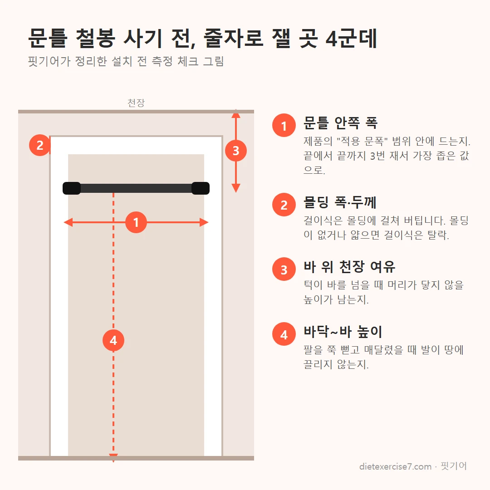
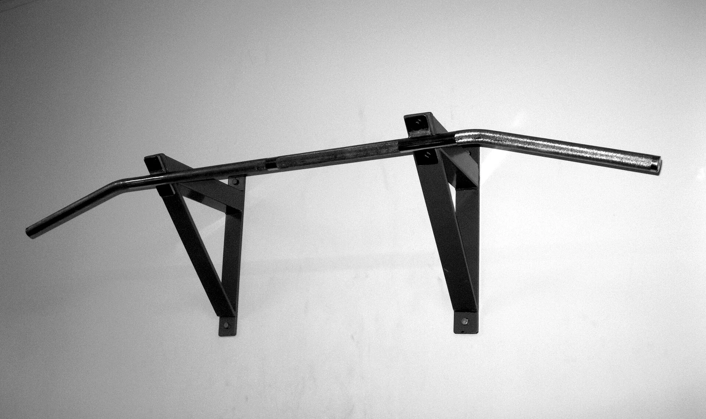

가정용 철봉 추천을 찾는 분이 정말 궁금한 건 "어떤 제품이 제일 좋냐"보다 "우리 집에 달아도 되냐"입니다. 결론부터 말하면요, 문 폭과 문틀 재질이 맞으면 문틀 철봉, 천장이 넉넉하고 바닥 공간이 있으면 치닝디핑, 콘크리트 벽에 구멍을 낼 수 있으면 벽 고정식이 맞습니다. 제품 이름은 그다음 문제예요. 아래 사양은 2026년 10월 제조사·판매 페이지 표기 기준입니다.

📌 3줄 요약
문틀 철봉은 문틀을 양옆으로 밀어서 버티는 구조라, 제품 하중보다 우리 집 문틀 상태가 더 중요합니다.

단축·장축은 봉 길이가 아니라 "권장 문틀 안쪽 폭"으로 고르고, 범위 끝에 걸리는 모델은 피하세요.

치닝디핑은 천장 높이에서 철봉 높이를 뺀 여유가 머리 하나(약 22~24cm)보다 커야 턱걸이가 됩니다.

## 가정용 철봉 추천, 종류부터 비교하면 이렇습니다

가정용 철봉은 문틀 압축식, 문틀 걸이식, 치닝디핑(독립형 스탠드), 벽 고정식의 네 가지로 나뉩니다. 고를 때는 가격보다 설치 조건을 먼저 봐요.

국내 쇼핑몰에서 "문틀 철봉"이나 "풀업바"라고 팔리는 건 대부분 압축식입니다. 걸이식은 해외 제품에서 흔하고 치닝디핑은 턱걸이에 딥스·레그레이즈까지 하는 스탠드형이에요. 표로 묶어보면 이렇습니다.

| 종류 | 고정 방식 | 강점 | 주의할 점 | 맞는 집 |
| --- | --- | --- | --- | --- |
| 문틀 압축식 | 봉을 돌려 늘려 문틀 양옆을 밀어 고정 | 무타공, 가볍고 저렴 | 문틀 재질·폭에 따라 밀림·눌림 | 문틀이 단단한 집, 전세 |
| 문틀 걸이식 | 문틀 위 몰딩에 걸고 벽을 받쳐 지탱 | 매달릴수록 단단히 물림 | 몰딩 턱 필요, 위쪽 벽 찍힘 | 몰딩이 두툼한 문 |
| 치닝디핑 | 바닥에 세우는 독립형 프레임 | 딥스·레그레이즈까지 가능 | 천장 높이·바닥 면적·무게 | 거실·방 한쪽이 비는 집 |
| 벽 고정식 | 콘크리트·원목에 볼트 고정 | 가장 흔들림 적음 | 타공 필요, 석고보드 단독 고정 불가 | 자가, 콘크리트 벽 |

네이버·구글 상위에 나온 추천 글 15곳 넘게 열어 보니, 대부분이 압축식 한 제품의 사용 후기였고 네 종류를 나란히 비교한 글은 드물었습니다. 그래서 이 글은 종류를 먼저 고르고, 그 안에서 확인할 숫자를 정리하는 순서로 갑니다.

## 문틀 철봉은 어떻게 버티나요? 압축식과 걸이식의 차이

압축식은 마찰로, 걸이식은 지렛대로 버티니 망가지는 지점도 다릅니다.

압축식은 봉 안의 나사를 돌려 길이를 늘리고 양 끝 패드가 문틀 안쪽 면을 밀어 생긴 마찰로 고정됩니다. 사람이 매달리면 아래로 당기는 힘이 패드를 통해 문틀을 옆으로 벌리는 힘으로 바뀌어요. 문틀 판재가 약하면 이 힘에 패드 자리가 눌리거나, 문틀 이음매가 벌어집니다. 문틀 구조를 설명한 [인테리어 수리 블로그](https://m.blog.naver.com/banglehomes/224426396262)는 경첩 반대쪽이 먼저 밀리는 경우가 많다고 짚었어요.

걸이식은 봉을 문틀 위 몰딩에 걸치고 받침판이 문 위쪽 벽을 눌러 지렛대처럼 버팁니다. 매달릴수록 더 꽉 물리는 대신, 몰딩 턱이 있어야 하고 받침판이 닿는 벽이 무르면 자국이 납니다. [문틀 철봉 종류를 정리한 블로그](https://m.blog.naver.com/p1000w/224406041000)는 몰딩 턱이 0.7~1cm 이상은 돼야 한다고 안내했어요.

💡 여기서 많이들 헷갈리는데
국내 아파트 문은 몰딩이 얇거나 없는 경우가 있는데, 그러면 걸이식이 안 걸리거나 흔들림이 커질 수 있어요. 해외 리뷰에서 걸이식을 1등으로 꼽았다고 그대로 따라 사면 설치부터 막힐 수 있어요.

## 우리 집 문 폭에 맞을까? 단축·장축 고르는 법

압축식은 "봉 길이"가 아니라 "권장 문틀 안쪽 폭"을 보고 고릅니다. 이 둘을 헷갈리면 맞는 줄 알고 산 철봉이 헐겁게 끝까지 늘어난 채로 달립니다.

제조사 공식몰 스펙을 단축·장축으로 다시 묶어 보니 차이가 분명했어요. 핏에이블 롱패드 [공식몰 상세](https://fitablekorea.com/product/%ED%95%8F%EC%97%90%EC%9D%B4%EB%B8%94-%EB%A1%B1%ED%8C%A8%EB%93%9C-%EA%B0%80%EC%A0%95%EC%9A%A9-%EB%AC%B8%ED%8B%80-%EC%B2%A0%EB%B4%89-%EC%B5%9C%EB%8C%80-%ED%95%98%EC%A4%91-700kg/30/)는 문틀 안쪽 폭 단축 76~95cm, 장축 96~120cm로 적었고 "두 구간을 벗어나면 설치가 어려우니 주문 전에 꼭 재 보시기를 권해 드립니다"라고 안내합니다. 숀리 하이퍼는 판매처 안내 기준 봉 길이가 단축 76~110cm, 장축 96~140cm인데 권장 문틀 폭은 단축 76~95cm, 장축 96~120cm예요. 봉은 110cm까지 늘어나도 권장 폭은 95cm까지라는 뜻입니다.

| 확인 항목 | 단축(일반 방문) | 장축(넓은 문) | 비고 |
| --- | --- | --- | --- |
| 권장 문틀 안쪽 폭 | 76~95cm 안팎 | 96~120cm 안팎 | 제조사 표기 기준, 모델마다 다름 |
| 봉 최대 길이 | 권장 폭보다 더 김 | 권장 폭보다 더 김 | 봉 길이로 고르면 안 됨 |
| 실제 문 폭이 범위 끝일 때 | 피하는 게 안전 | 피하는 게 안전 | 끝까지 늘리면 고정력이 약해짐 |

*▲ 핏기어가 직접 그린 문틀 철봉 설치 전 측정 그림*

줄자로 잴 곳은 그림의 네 군데예요. 문틀 안쪽 폭은 위·중간·아래 세 번 재서 가장 좁은 값을 씁니다. 철봉을 달 높이에서 다시 한 번 재는 게 제일 정확해요. 그립 폭도 생각하세요. [한 블로거](https://m.blog.naver.com/kwonhuiseok/224419179595)는 안방 문틀 안쪽 폭이 92cm라 넓게 잡는 와이드 그립이 어렵다고 적었습니다. 문틀형은 문 폭이 곧 최대 그립 폭입니다. 하나 더, 문틀 옆면의 깊이도 재 보세요. 패드가 문틀 옆면에 다 올라가야 힘이 고르게 퍼지는데, 핏에이블 롱패드처럼 폭 5cm짜리 패드라면 문틀 옆면도 그보다 넓어야 합니다.

## 최대하중 700kg, 믿어도 될까?

하중 표기는 "봉이 견디는 힘"에 가깝고 "문틀에서 안 빠지는 힘"과는 다른 숫자입니다. 결국 고정력은 우리 집 문틀이 정합니다.

국내 압축식 문틀 철봉은 500kg, 700kg처럼 큰 숫자를 내세우는 제품이 많아요. 그런데 같은 문틀형인데 90~120kg으로 적은 제품도 있고, 해외 걸이식 대표 제품은 300파운드(약 136kg) 표기가 흔합니다. 헬스장용 치닝디핑 기구도 160kg 안팎으로 적는 경우가 있어요. 시험 조건이 공개되지 않은 숫자라, 제품끼리 하중 숫자만 비교하는 건 의미가 크지 않습니다.

반동을 크게 주는 턱걸이는 순간적으로 체중보다 큰 힘을 겁니다. 문틀 압축식은 이 순간 힘에 패드가 미끄러지거나 문틀이 눌릴 수 있어요. 그러니 문틀형에서는 하중 숫자보다 패드 면적과 잠금장치를 먼저 봅니다. 핏에이블은 공식몰 사양표에서 패드 크기를 5×23cm로 밝히고 있고(상품 소개 문구에는 25cm로 적힌 곳도 있어요), 여러 제품이 "N중 잠금"을 내세웁니다. 패드가 넓을수록 문틀 한 점에 힘이 덜 몰립니다.

⚠️ 실제로 있었던 일
한국소비자원은 2009년 운동기구 위해사례 자료에서 2008년 8월 20대 남성이 집에 설치한 철봉의 안전장치가 빠지면서 떨어져 압박 골절을 입은 사례를 소개했습니다. 미국 소비자제품안전위원회(CPSC)도 2011년 문틀 설치형 턱걸이 기구를 손잡이 균열로 인한 추락 위험 때문에 리콜했어요.

해외 사례는 [CPSC 리콜 공지](https://www.cpsc.gov/Recalls/2011/Perfect-Pullup-Recalled-by-Perfect-Fitness-Due-to-Fall-Injury-Hazard)에서 원문을 볼 수 있습니다. 약 7,000개를 리콜했고 손잡이 균열 보고가 약 2,200건 들어왔다고 적혀 있어요. 매번 운동 전에 봉을 한 번 당겨 보고 처음 며칠은 발이 바닥에 닿는 높이에서 체중을 천천히 실어 보는 습관이 가장 싼 안전장치입니다.

## 문틀 철봉 단점, 문틀 손상·자국은 왜 생길까?

문틀 철봉의 가장 큰 단점은 문틀 손상입니다. 패드가 눌린 자국은 비교적 가볍지만, 문틀 이음매가 벌어지면 수리가 커집니다.

국내 아파트 문틀은 원목 통짜가 아니라 얇은 판재를 ㄷ자로 짜고 필름을 붙인 구조가 많다는 현장 설명이 있어요. 겉은 단단해 보여도 속이 비어 있으면 패드가 미는 힘을 버티지 못합니다. 커뮤니티 후기에서도 "문틀이 깨졌다", "자국이 남았다"는 얘기가 이런 문틀에서 자주 보였어요.

사기 전에 문틀을 직접 두드려 보면 대략 가늠할 수 있습니다. 판단 기준을 표로 정리했어요.

| 두드렸을 때 | 짐작되는 구조 | 압축식 문틀 철봉 |
| --- | --- | --- |
| 묵직하고 둔탁한 소리 | 원목·집성목, 속이 찬 문틀 | 비교적 무난 |
| 통통 울리는 가벼운 소리 | 속 빈 판재(MDF 등) | 패드 눌림·벌어짐 위험, 피하는 게 안전 |
| 차갑고 금속성 소리 | 알루미늄·철제 문틀 | 미끄럼 주의, 제조사 적용 여부 확인 |
| 문틀이 이미 들뜨거나 틈이 있음 | 이음매 약화 | 설치하지 않기 |

전세나 월세라면 설치 전에 문틀 사진을 찍어 두세요. 패드 자국은 메우기로 손볼 수 있지만, 이음매가 벌어지면 문틀을 다시 시공해야 할 수 있습니다. 걱정되면 패드를 임의로 개조하기보다 제조사가 파는 정품 보호 패드를 쓰거나, 아예 치닝디핑으로 방향을 바꾸는 게 마음 편합니다.

## 치닝디핑 추천 전에, 천장 높이부터 계산하세요

치닝디핑은 천장 높이에서 철봉 높이를 뺀 여유가 머리 하나보다 커야 턱걸이를 끝까지 할 수 있습니다. 상위 추천 글에서 이 계산을 해 준 곳은 없었어요.

국내 일반 아파트 천장고는 약 2.3m가 표준이고 신축 고급 단지는 2.4~2.6m까지 높아졌다는 기사가 있습니다. 반면 판매 페이지 표기를 보면 높이 고정형 치닝디핑은 2m를 조금 넘는 205~215cm 안팎이 많고 조절형은 최대 230cm 안팎까지 올라가는 제품도 있어요. 조절형은 최저 높이가 160~180cm대로 내려가는 모델이 있지만 제품마다 다르니, 원하는 높이로 내려가는지 사기 전에 판매 페이지에서 확인하세요.

턱을 바 위로 올리면 머리 전체가 바 위로 올라옵니다. 제8차 한국인 인체치수 조사는 키를 머리 길이로 나눈 두신지수가 7.2~7.3이고 평균 키가 남성 172.5cm, 여성 159.6cm라고 밝혔어요. 이걸로 나눠 보면 머리 길이는 남성 약 24cm, 여성 약 22cm입니다. 천장고 230cm 집에 두고 계산해 봤어요.

| 철봉 높이 | 천장까지 여유(천장 230cm) | 판단 |
| --- | --- | --- |
| 215cm | 15cm | 머리가 천장에 닿음, 턱걸이 불가 |
| 205cm | 25cm | 머리 길이와 거의 같아 빠듯함, 키에 따라 무릎을 굽히고 매달려야 함 |
| 195cm(조절형) | 35cm | 머리 여유는 있음, 대신 대부분 무릎을 굽히고 매달려야 함 |

천장고 230cm에서 205cm 고정형을 놓으면 남는 여유는 25cm라, 정수리가 천장에 거의 닿습니다. 그래서 천장고가 2.3m인 집이라면 높이 조절형을 사서 195~200cm 안팎에 맞추는 쪽이 현실적이에요. 매달렸을 때 발이 바닥에 끌리면 무릎을 굽혀 해결할 수 있지만, 머리가 천장에 닿는 건 방법이 없습니다.

## 치닝디핑은 바닥 면적과 층간소음도 같이 보세요

치닝디핑은 생각보다 넓고 무겁습니다. 제품 7종의 표기 스펙을 모은 [치닝디핑 비교 글](https://reviewpro.co.kr/best-pull-up-station/)을 보면 바닥 면적은 65×75cm 정도부터 가로 1m가 넘는 것까지, 무게도 10kg대부터 50kg대까지 제품마다 차이가 큽니다.

무거운 프레임은 흔들림이 적은 대신 옮기기 어렵고 바닥재에 눌림 자국을 남깁니다. 시공 매트 위에 둔 집에서 눌림 자국을 묻는 카페 질문도 보였어요. 프레임 아래에 고무 매트를 깔면 바닥과 소음을 함께 지킬 수 있습니다.

턱걸이를 마치고 뛰어내리는 착지 소리는 아랫집에 그대로 전해집니다. 매트 두께와 소재별 차이는 [층간소음 운동매트 비교](/floor-noise-workout-mat/)에 정리해 뒀어요. 밤에는 뛰어내리지 말고 발판을 밟고 내려오는 습관이 제일 확실합니다.

## 벽 고정식 철봉은 누구에게 맞을까?

벽 고정식은 흔들림이 가장 적지만, 콘크리트나 원목처럼 볼트를 받쳐 줄 벽이 있어야 합니다. 석고보드에만 앵커로 고정하면 안 되고, 뒤의 구조재에 고정하는 건 시공 전문가 판단이 필요합니다.

*▲ 벽 고정식 턱걸이 바 — 사진 ⓒ Santeri Viinamäki, CC BY 4.0 (Wikimedia Commons)*

벽에서 바가 떨어져 있어 와이드 그립과 무릎 올리기를 넉넉하게 할 수 있고 문을 막지도 않아요. 하중 표기는 제품마다 차이가 크니 볼트와 벽 조건까지 같이 확인하세요. 대신 타공이 필요하니 자가이거나 집주인 동의를 받은 경우에만 고르세요.

설치 위치는 천장 높이 계산을 똑같이 적용합니다. 바 위로 머리 하나 이상 여유를 두고 콘크리트 벽이면 앵커 볼트 규격을 제조사 안내대로 맞추는 게 기본이에요. 볼트 고정이 자신 없으면 시공을 맡기는 게 낫습니다.

## 상황별 가정용 철봉 추천, 이렇게 고르세요

내 상황에 맞춰 한 줄로 고르면 이렇습니다. 가격과 재고는 수시로 바뀌니 판매 페이지에서 직접 확인하세요.

| 내 상황 | 추천 종류 | 꼭 확인할 것 |
| --- | --- | --- |
| 원룸, 공간이 거의 없음 | 문틀 압축식 | 문틀 안쪽 폭·옆면 깊이, 문틀 두드려 보기 |
| 전세·월세, 문틀이 걱정됨 | 높이 조절형 치닝디핑 | 천장 여유, 바닥 매트 |
| 몰딩이 두툼한 문 | 문틀 걸이식 | 몰딩 턱, 위쪽 벽 재질 |
| 딥스·레그레이즈까지 하고 싶음 | 치닝디핑 | 바닥 면적, 무게, 천장 |
| 자가, 콘크리트 벽 | 벽 고정식 | 볼트 규격, 시공 |
| 아이와 같이 매달리기 | 낮게 설치한 치닝디핑 | 넘어짐 방지, 보호자 동반 |

종류를 정했다면 모델은 아래 합격선으로 거르면 됩니다. 제가 써 본 제품 순위가 아니라, 이 글에서 정리한 조건을 스펙표에 대입하는 체크 기준이에요.

| 종류 | 합격선(스펙표에서 볼 것) | 조건을 맞춘 예시 |
| --- | --- | --- |
| 문틀 압축식 | 우리 집 문 폭이 권장 범위의 끝이 아니라 안쪽에 들어감, 패드 면적이 넓음, 잠금장치 있음 | 핏에이블 롱패드(공식몰 표기 단축 76~95cm·장축 96~120cm, 사양표 기준 패드 5×23cm) |
| 치닝디핑 | 높이 조절형, 최저 높이가 "천장고 − 머리 여유 30cm"보다 낮게 내려감 | 천장고 230cm 집이면 200cm 이하로 내려가는 조절형(예: 판매 페이지 표기 163~227cm 7단 조절 모델) |
| 벽 고정식 | 콘크리트용 앵커 볼트 포함, 설치 벽 조건 명시 | 우리 집 벽이 콘크리트인지 먼저 확인 |

턱걸이를 아직 한 개도 못 한다면 철봉과 함께 매달리기, 반동 없는 네거티브 동작부터 시작하는 사람이 많습니다. 홈트 장비를 처음 꾸린다면 [홈트 입문 장비 정리](/home-workout-beginner-gear/)와 [푸쉬업바 고르는 법](/pushup-bar-recommend/)도 같이 보면 순서를 잡기 쉬워요.

이거 하나만 기억하면 돼요. 가정용 철봉 추천 목록보다 먼저 줄자를 들고 문틀과 천장을 재는 게, 실패 없는 첫 단계입니다.

## 가정용 철봉 FAQ

**Q. 문틀 철봉 떨어지지 않나요?**
A. 문틀이 단단하고 권장 폭 안에 제대로 고정하면 대부분 문제없이 씁니다. 다만 반동이 큰 턱걸이나 속 빈 문틀에서는 빠질 수 있으니 매번 당겨 보고 처음엔 발이 닿는 높이에서 체중을 실어 보세요.

**Q. 문틀 철봉 자국이나 문틀 손상은 꼭 생기나요?**
A. 패드 자국은 흔하지만 크기는 문틀 재질과 패드 면적에 따라 다릅니다. 두드렸을 때 통통 울리는 속 빈 문틀이면 눌림·벌어짐 위험이 커서 다른 종류를 권해요.

**Q. 우리 집 문 폭이 95cm인데 단축과 장축 중 뭘 사야 하나요?**
A. 95cm는 단축 권장 범위의 끝이라 장축 쪽 범위에 들어가는 모델이 더 안전합니다. 모델마다 범위가 다르니 봉 길이가 아니라 권장 문틀 폭을 확인하세요.

**Q. 치닝디핑은 천장이 몇 cm면 되나요?**
A. 철봉 높이에 머리 하나(약 22~24cm)와 여유를 더한 값보다 천장이 높아야 합니다. 천장고 230cm 집이라면 높이 조절형을 195~200cm 안팎에 맞추는 게 무난해요.

**Q. 전세집에 가정용 철봉을 달아도 되나요?**
A. 무타공 문틀형이나 치닝디핑은 가능하지만, 문틀 손상은 원상복구 대상이 될 수 있습니다. 설치 전 문틀 사진을 남기고 걱정되면 치닝디핑을 고르세요.

*이미지 출처 — 대표 이미지: 문틀에 설치한 압축식 철봉, 사진 ⓒ Buidhe, CC BY-SA 4.0 (Wikimedia Commons) 일부 잘라 사용. 벽 고정식 사진 ⓒ Santeri Viinamäki, CC BY 4.0 (Wikimedia Commons).*

---

**관련 키워드** — #가정용철봉추천 #문틀철봉 #문틀철봉추천 #문틀철봉단점 #치닝디핑 #치닝디핑추천 #턱걸이기구 #풀업바 #벽고정철봉 #홈트기구 #가정용철봉설치
