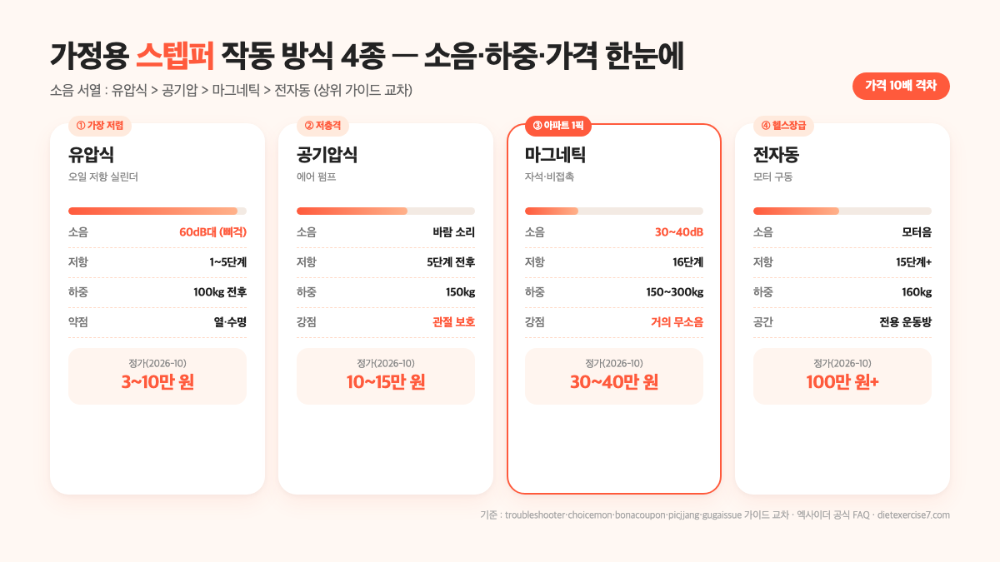

가정용 스텝퍼 추천을 검색하는 사람이 사실 가장 먼저 알고 싶은 건 "**아파트에서 써도 되냐**"와 "**유압식이랑 에어식 중 뭘 사야 돼**" 두 가지입니다. 결론부터 말하면, 2026년 10월 상위 가이드·엑사이더 공식 FAQ·커뮤니티 사례를 교차했을 때 아파트는 **마그네틱 또는 에어식 + 2cm 이상 매트** 조합이 공통 안전선이고, 가격은 입문 **유압식 3~10만 원대**, 중급 **에어·트위스트 10~17만 원대**, 상급 **마그네틱 30~40만 원대**로 묶입니다. 반대로 유압식만 두고 보면 삐걱음·열 때문에 밤에는 쓰기 어렵고 아래층 민원 1순위예요.

이 글에서는 스텝퍼와 "천국의 계단"의 공식 분류 차이, 작동 방식 네 가지의 소음·내구성 서열, 체중 대비 하중을 1.5~2배로 보는 이유, 2026년 10월 실매장 가격대, 상황별 결정표까지 다나와 카테고리·엑사이더 공식 FAQ·82cook/당근/PMC 논문을 교차해 정리했어요.

📌 3줄 요약
가정용 스텝퍼 추천은 <b>작동 방식 · 소음 · 하중</b> 세 축으로 결정됩니다. 아파트는 마그네틱 또는 에어식 + 2cm 매트가 공통 안전선이에요.

소음은 "<b>유압식 > 공기압 > 마그네틱 > 전자동</b>" 순서로 작아집니다(상위 가이드 공통 서열). 유압식은 저렴하지만 밤 사용·중층 이상 아파트에는 부적합.

안전 하중은 <b>본인 체중의 1.5~2배</b>로 보세요. 70kg이면 하중 105~140kg 이상 모델이 안전선이고, 2026-10 정가 기준 유압 3~10만·에어 10~15만·마그네틱 30만 원대가 흔한 가격대입니다.

## 결론부터 — 가정용 스텝퍼 추천은 이 표 한 장이면 돼요

상위 10개 가이드(choicemon·troubleshooter·bonacoupon·gugaissue·picjjang 등)를 모아 보면 추천 제품이 조금씩 다른데, **그 뒤의 결정 축**은 공통이에요. 작동 방식 · 소음 · 하중 세 가지가 사실상 전부입니다. 이 축을 먼저 묶어 두면 가격과 모델명은 자동으로 좁혀져요.

| 내 상황 | 추천 작동 방식 | 핵심 사양 | 2026-10 가격대(정가) |
| --- | --- | --- | --- |
| 좁은 원룸·가끔 유산소 | 유압식 미니 | 하중 100kg+, 유압 실린더 1개 | 3~5만 원 |
| 아파트 중층+·가벼운 토닝 | 에어식(공기압) | 5단계 조절, 저소음, 하중 150kg | 10~15만 원 |
| 아파트 중층+·꾸준한 홈트 | 마그네틱 다단계 | 16단계 저항, 하중 150~300kg | 30~40만 원 |
| 시니어·관절 걱정 | 에어·앉은 자세형 | 저충격, 손잡이·안전바 | 15~17만 원 |
| 체중 90kg+ | 하중 등급 ↑ | 최대 하중 150kg 이상, 스틸 프레임 | 중급 이상 |
| 헬스장급 재현 | 전자동 계단형 | 모터 구동, 15단계+ | 100만 원 이상 |

이 표의 핵심은 "**유압식은 3만 원대 입문용으로만 쓰고, 아파트·꾸준한 홈트는 에어 또는 마그네틱으로 가라**"는 거예요. 상위 가이드 전부가 아파트 조용함을 묻는 질문에 유압식을 지목하지 않습니다. choicemon·troubleshooter 모두 "**아파트 거주자라면 마그네틱**"으로 1픽을 묶고, picjjang 가성비 가이드도 "유압 실린더가 2개 들어간 이중 설계"를 우선 체크로 적어요. 가격이 10배 넘게 벌어지는 이유가 바로 이 소음·내구성 차이에서 나옵니다.

반대로 "체중 감량·입문·3만 원대"로 들어오는 분이라면 유압식 미니 스텝퍼(멜킨 마운틴 3.7만 원대, 이고진 8320 6.6만 원대)로 시작해도 괜찮습니다. 다만 밤 사용·아래층 민원·장기 홈트 셋 중 하나라도 걸리면 바로 다음 단계로 올라가는 쪽이 재구매를 줄여요.

## 스텝퍼와 천국의 계단(스텝밀) — 공식 분류부터 다르다

처음 사는 사람이 가장 많이 섞어 쓰는 두 단어가 "**스텝퍼**"와 "**천국의 계단**"입니다. 다나와 카테고리는 둘을 "**천국의계단/스텝퍼**" 하나로 묶지만, 실제 구조는 완전히 달라요. 상위 가이드 중 troubleshooter만 공식 분류 차이를 명확히 짚고, choicemon·bonacoupon·picjjang은 거의 섞어 다룹니다.

**① 스텝퍼**(stepper) — 발판 두 개가 상하 또는 좌우로 교대 작동하는 소형 기구. 엑사이더 공식 FAQ 설명대로 "**체중을 좌우로 옮기며 발판을 밟는 방식**"이라 뛰거나 착지가 없어요. 본체 무게 5~10kg, 접힘 두께 10~15cm 수준이라 소파 틈·책상 밑에 세워 둘 수 있고, 가격은 3만~40만 원대가 주력입니다.

**② 천국의 계단**(stair climber/stepmill) — 실제 계단 벨트가 돌아가는 산업 설비급 기구. 한 칸 올라가는 데 영문 Wikipedia Stair climbing 문서가 적은 수치로 **15cm 계단 1칸 상승 = 0.11kcal**, 하강 = 0.05kcal입니다. 가정용으로는 멜킨 클라임맥스 엘리트(129만 원·전자동 15단계)가 거의 유일한 가정 라인업이고, 나머지는 전부 상업용 헬스장 기구예요.

| 비교 축 | 스텝퍼 | 천국의 계단(스텝밀) |
| --- | --- | --- |
| 작동 | 발판 상하·좌우 교대 | 계단 벨트가 실제로 회전 |
| 체중 전달 | 체중을 좌우로 옮김 | 계단을 한 칸씩 올라감 |
| 본체 무게 | 5~10kg | 50~150kg(상업용) |
| 가격 | 3만~40만 원 | 129만~400만 원+ |
| 소음 | 유압 삐걱·마그네틱 작동음 | 모터·벨트 구동음 |
| 추천 공간 | 원룸·아파트 | 전용 운동방·단독주택 |

표의 핵심은 "**아파트 가정용은 사실상 스텝퍼 쪽**"이라는 거예요. 천국의 계단은 모터 구동 + 본체 무게 50kg+가 기본이라, 아파트 중층 이상에서 쓰면 모터음(공기 전달)·바닥 진동(고체 전달) 둘 다 문제가 됩니다. "집에서 계단 오르기 느낌"이 목표라면 **전자동 스텝퍼**(멜킨 클라임맥스 같은 15단계 모터형)가 중간 선택지고, 가격은 100만 원대부터 시작해요.

## 작동 방식 네 가지 — 소음·내구성 서열이 가격을 결정한다

가격이 10배 넘게 벌어지는 이유의 핵심이 바로 이 작동 방식 네 가지에서 나옵니다. troubleshooter 가이드가 쓴 공통 서열은 "**소음 크기 — 유압식 > 공기압 > 마그네틱 > 전자동**"이에요. 가격은 반대로 뒤로 갈수록 비싸집니다.

**① 유압식**(유압 실린더) — 엑사이더 공식 FAQ 설명대로 "**실린더 내부의 오일 저항으로 발판이 부드럽게 내려가도록 설계**"된 방식. 가격 3~10만 원대로 가장 싸지만 단점이 분명해요. 공식 FAQ 자체가 "**장시간 연속 사용 시 열이 발생**"하고 "일정 시간 사용 후에는 휴식을 취하는 것이 제품 수명 유지에 도움"이라고 적습니다. 커뮤니티 82cook·당근 사례에서도 "유압 삐걱음과 쿵쿵 충격이 겹쳐 아래층 민원" 사례가 가장 많아요. gugaissue 가이드가 체크 1순위로 "**이중 실린더 방식**(싱글보다 안정)"을 꼽은 이유가 저가 유압식의 내구성·소음 때문이에요.

**② 공기압식**(에어·펌프) — 발판 아래 공기 저항으로 작동하는 방식. 숀리 에어 스텝퍼(10만 원대·초경량 5.4kg)·프로스펙스 에어 스텝퍼가 대표입니다. 유압보다 조용하고 관절 충격이 적어 **시니어·관절 걱정** 사용자에게 상위 가이드 공통 추천이에요. 다만 공기 저항 특성상 다단계 조절이 거의 안 되고(5단계 전후), 바람 소리는 유압보다 적어도 완전 무소음은 아닙니다.

**③ 마그네틱**(자석·비접촉) — 자석의 거리로 저항을 만드는 방식이라 **닿는 부분이 없어 거의 무소음, 마모도 없음**이 핵심 장점입니다. 핏에이블 스텝메이트 PRO(37.9만 원대·16단계)가 대표예요. troubleshooter 가이드가 "**아파트 거주자 1픽**"으로 묶고 choicemon도 상위 추천 중 소음 축을 끌어올립니다. 가격은 30만 원대부터 시작해 유압식의 10배 수준이지만, 밤 사용·중층 이상 아파트에서는 사실상 유일한 안전 선택지예요.

**④ 전자동**(모터 구동) — 모터가 발판 자체를 올려 주는 방식. 멜킨 클라임맥스 엘리트(129만 원·전자동 15단계)가 거의 유일한 가정 라인업입니다. 발판 자체는 조용하지만 모터 구동음이 공기로 전달되고, 본체 중량 50kg+ 때문에 바닥 진동 축은 별도로 매트가 필요해요. "헬스장 그대로"가 목표라면 선택지지만, 아파트보다 전용 운동방·단독주택 쪽이 맞습니다.

💡 작동 방식 한 줄 요약
<b>유압식</b> — 3만 원대 가장 저렴, 삐걱음·열. 입문·낮 사용·단독주택. <b>공기압식</b> — 10만 원대 저충격, 다단계 조절 제한. 시니어·관절. <b>마그네틱</b> — 30만 원대 거의 무소음, 다단계 저항. 아파트·꾸준한 홈트. <b>전자동</b> — 100만 원대 헬스장급. 전용 운동방.

## 스텝퍼 종류 — 상하수직·트위스트·사이드좌우·미니 네 묶음

작동 방식과 별개로 "**발판이 어떻게 움직이냐**"로도 종류가 갈립니다. 상위 가이드 중 bonacoupon이 세 묶음(상하수직·트위스트·사이드좌우)을 가장 명확히 분리하고, seoulhangang가 미니 스텝퍼까지 포함해 네 묶음으로 정리해요. 결정 축이 하나 더 생기는 겁니다.

**① 상하수직**(기본형) — 발판이 위아래로만 교대 움직이는 가장 기본적인 형태. 하체 집중, 조작이 가장 간단해 입문자용으로 공통 추천입니다. 멜킨 마운틴·이고진 8320이 이 묶음이에요.

**② 트위스트형** — 상하 움직임에 **좌우 회전**이 더해진 형태. bonacoupon이 "**옆으로 눌리는 스텝, 코어에 힘**"이라고 정리하고, gugaissue 체크리스트도 "코어·옆구리 자극"으로 분류합니다. 엑사이더 트위스트 스텝퍼(7kg·LCD계기판)가 대표. 다만 유압 실린더 중심이라 삐걱음이 두드러져 아파트에서는 매트 필수.

**③ 사이드좌우형** — 발판이 좌우로 눌리는 방식. "**양옆으로 눌리는 스텝 → 전신 고강도 운동**"으로 bonacoupon이 분류하고, 트라택 스텝핏(6.1kg·좌우운동)이 대표입니다. 트위스트보다 하체 외측·엉덩이 자극이 크지만 숙련도가 필요해 입문자가 처음 사기엔 과한 선택.

**④ 미니 스텝퍼** — 가장 작은 크기·접힘 두께 10cm 전후로 설계된 공간 효율형. 숀리 에어 스텝퍼(5.4kg·초경량)가 대표입니다. 좁은 원룸·사무실 책상 아래 보관까지 생각한다면 이 묶음이 1픽이에요.

처음 사는 분이라면 "**상하수직 유압 미니**"가 실패 확률이 가장 낮습니다. 가격 3~5만 원대로 부담이 적고, 조작이 단순해 꾸준히 쓸지 자신 테스트가 쉬워요. 트위스트·사이드좌우는 하체 자극에 익숙해진 뒤에 다음 단계로 올리는 쪽이 재구매를 줄입니다.

## 하중은 체중의 1.5~2배가 안전선이다

사양표에서 가장 많이 놓치는 숫자가 "**최대 사용자 무게**"예요. 상위 가이드 중 troubleshooter가 유일하게 공식 계산을 보여 줍니다. "**동적 충격은 체중의 1.5~2배**"이고, 따라서 "**체중 70kg이면 허용 하중 100kg 이상**"이라고 적어요. 다른 가이드들은 "100kg 이상 추천"이라고만 쓰고 이유를 설명하지 않습니다.

이 계산은 걸음·착지 역학에서 나와요. 평지에서 걸을 때 지면 반력(ground reaction force)이 체중의 **1.0~1.2배**, 뛸 때는 2~3배로 커집니다. 스텝퍼는 뛰지 않지만 체중을 좌우로 옮기면서 한쪽 발판에 체중 전체가 실리는 순간이 있어서 "**체중 × 1.5~2배**"가 안전선이에요. 체중별로 묶으면 이렇게 정리됩니다.

| 내 체중 | 안전 하중(1.5~2배) | 추천 사양 |
| --- | --- | --- |
| 50kg | 75~100kg | 하중 100kg 이상 유압·에어 |
| 60kg | 90~120kg | 하중 120kg 이상 모든 유형 |
| 70kg | 105~140kg | 하중 150kg 이상 에어·마그네틱 |
| 80kg | 120~160kg | 하중 150~160kg 전자동 또는 상급 |
| 90kg+ | 135~180kg | 하중 180kg 이상 스틸 프레임 |

사양표 숫자가 "최대 하중 100kg"이라고 적혀 있어도 실제 안전 범위는 그 70% 수준에서 쓰는 쪽이 안전해요. gugaissue 체크리스트도 "**프레임 재질 및 구조 — 두껍고 견고한 스틸 프레임**"을 체크 5번으로 묶는 이유가 저가 알루미늄 프레임이 체중 × 2배 반복에 쉽게 변형되기 때문입니다. 체중 80kg 이상이면 처음부터 하중 150kg 이상·스틸 프레임 모델로 가는 쪽이 재구매를 줄여요.

## 아파트 층간소음은 "기계음"과 "충격음" 둘로 나눠 봐야

상위 가이드가 공통으로 지적을 하는데 섞어 다루는 축이 "**기계음**"과 "**충격음**"이 다른 문제라는 겁니다. 82cook 커뮤니티 토론이 가장 깔끔하게 짚어요. "**기계음**(끽끽거리는 소리)보다는 **쿵쿵 하는 충격음**이 주요 문제"라고요. 두 축은 해결책이 다릅니다.

**① 기계음**(공기 전달) — 유압 실린더의 삐걱·에어 펌프의 바람·마그네틱 코어 떨림에서 나오는 소음. 작동 방식 선택으로 **대부분 결정**됩니다. gugaissue 가이드가 "**50dB 이하는 조용한 편**"으로 분류하는데, 유압식 저가 모델은 60dB을 넘기기 쉽고 마그네틱은 30~40dB대까지 떨어져요. WD-40 윤활유를 실린더에 뿌리면 유압 삐걱음은 어느 정도 잡힌다는 커뮤니티 사례가 공통 조언으로 올라옵니다.

**② 충격음**(고체 전달) — 체중을 좌우로 옮기며 발판이 바닥을 치는 "쿵쿵" 소리. 바닥 → 아래층으로 전달되는 축이라 작동 방식과 **별개로** 매트로 잡아야 해요. 82cook 베스트 댓글이 "**매트 3겹 깔고 썼더니 아래층에서 쿵쿵 소리가 안 들렸다**"고 적고, 또 다른 사례는 "**요가 매트 3mm 4개 겹쳐도 울려서 더 두꺼운 매트가 필요하다**"고 지적합니다. 공통선은 **고밀도 매트 2cm 이상** 또는 요가 매트 3겹 조합이에요.

⚠️ 중층 이상 아파트에서 유압식 + 밤 사용은 민원 1순위
유압식의 삐걱음(60dB대)과 체중 좌우 이동 충격이 겹치면 저녁 10~11시 사용에서 민원이 흔히 들어옵니다. 82cook 사례들의 공통 조치는 세 가지예요. ① 작동 방식을 <b>마그네틱 또는 에어식</b>으로 바꾸기, ② 매트는 <b>두께보다 밀도</b>, 고밀도 2cm 이상, ③ 밤 10시 이후 사용 금지. 중층 이상 아파트라면 처음부터 마그네틱 + 매트까지 세트로 묶는 쪽이 가장 안전합니다.

운동 자세도 소음에 영향이 있어요. 82cook 댓글 중 공식 상담 답변급으로 올라온 조언이 "**발이 바닥에 닿지 않게 운동해야** 하며, 올바른 자세로 하면 소음이 거의 발생하지 않는다"는 겁니다. 발판 끝까지 밟고 반대쪽 발이 완전히 올라올 때 체중을 옮기는 식으로 "**두 발이 동시에 아래로 떨어지지 않게**" 쓰면 충격음이 상당히 줄어들어요.

## 운동 효과와 칼로리 — 30분 150~300kcal, 하체·심폐 둘 다

가정용 스텝퍼 추천 글에서 가장 흔히 섞여서 적히는 수치가 "**30분 칼로리**"입니다. 상위 가이드 수치를 모아 보면 **체중 60kg 기준 30분 150~250kcal**, 전체 범위 **200~360kcal**가 공통선이에요. v.daum 가이드는 "30분 운동으로 약 200~300kcal", yogasunny1은 "체중 60kg 성인 여성 기준 30분 150~250kcal"로 적고, choicemon이 묶은 범위는 "**스텝퍼 30분 240~360kcal**, 천국의계단(계단형) 30분 350~500kcal"로 나와요. 체중·강도·시간에 따라 ±30% 변동이 있다고 보면 됩니다.

| 체중·강도 | 30분 칼로리 | 60분 환산 |
| --- | --- | --- |
| 50kg·가벼운 토닝 | 120~180kcal | 240~360kcal |
| 60kg·중강도 | 150~250kcal | 300~500kcal |
| 70kg·중강도 | 200~300kcal | 400~600kcal |
| 80kg·고강도 인터벌 | 250~360kcal | 500~720kcal |

운동 효과 쪽은 공식 자료가 더 깔끔해요. NCBI(PMC) 2021년 "**가정 기반 스테어 클라이밍**" 통제군 연구는 성인 여성에게 8주간 주 5일 가정 계단 운동을 시킨 결과를 이렇게 보고합니다. **VO₂max +1.63 mL·min⁻¹·kg⁻¹**(유산소 적응력↑), **체중 -0.99kg**, **LDL 콜레스테롤 -0.20 mmol·L⁻¹**, **중성지방 -0.21 mmol·L⁻¹**, **다리 파워 +5.9%**. 가정 계단 운동이 "**피트니스 센터 운동과 동등한 효과**"를 냈다는 결론이에요. 가정용 스텝퍼는 그 축소판으로 보면 됩니다.

하체 자극은 상위 가이드가 공통으로 짚어요. 엉덩이(둔근)·허벅지 앞(대퇴사두근)·허벅지 뒤(햄스트링)·종아리까지 "**신체 근육의 70%가 모여 있는 하체 집중**"입니다. 특히 yogasunny1 가이드가 짚은 포인트가 "**발바닥이 발판에서 떨어지지 않은 채 체중을 싣기 때문**"에 무릎·발목 관절 보호가 된다는 거예요. 러닝머신 대비 저충격이라 체중 90kg+ 사용자나 무릎이 약한 분에게 상위 가이드 공통 추천입니다.

## 가격대 — 2026년 10월 실매장 기준 분포

가격은 세일·세트 구성에 따라 자주 바뀌니 **정가 기준·참고용**으로만 쓰세요. 2026년 10월 troubleshooter·choicemon·bonacoupon·picjjang·gugaissue가 공통으로 다룬 모델들을 교차해 작동 방식 × 종류별 범위로 묶으면 이렇게 정리됩니다.

| 가격대(정가) | 작동 방식 | 특징 | 대표 모델(상위 가이드 교차) |
| --- | --- | --- | --- |
| 3~5만 원 | 유압식·미니 | 초경량 입문 | 멜킨 마운틴(3.79만), 다이어트학교 RAST24(3.34만) |
| 6~10만 원 | 유압식·상하/트위스트 | 저가 베스트셀러 | 이고진 8320(6.63만), 트라택 TS-B500(8.91만), 트라택 스텝핏 |
| 10~15만 원 | 공기압(에어) | 저소음·관절 보호 | 숀리 에어 스텝퍼(10.8만), 프로스펙스 에어(9.9만) |
| 13~17만 원 | 유압 자동·에어 상급 | 코어·안전바 | 엑사이더 스카이 스텝(13.9만), 로베라 EST-300(17.7만), 멜킨 다나을(16.7만) |
| 15만 원대 | 유압·백스텝 | 안전성 중시 | 이고진 백스텝 ST7(14.9만) |
| 30~40만 원 | 마그네틱 다단계 | 아파트 1픽·16단계 | 핏에이블 스텝메이트 PRO(37.9만) |
| 100만 원 이상 | 전자동 계단형 | 헬스장급 | 멜킨 클라임맥스 엘리트(129만) |

가격 격차의 핵심은 **작동 방식 × 하중 등급** 두 축에서 나와요. 유압식은 10만 원대 안에서 끝나고, 공기압이 10~15만 원대, 마그네틱이 30만 원대부터 시작합니다. 반대로 하중이 150kg을 넘기면 어떤 방식이든 20만 원대 이상으로 올라가고, 300kg급(핏에이블 스텝메이트 PRO)이면 30만 원대로 뛰어요. 유형과 상황이 맞으면 그 범위 안에서 세일가·배송 조건으로 좁히는 쪽이 가장 효율적입니다.

모델별 세일 가격·배송 조건을 바로 확인하려면 [쿠팡 헬스·운동기구](https://www.coupang.com/np/categories/115749) 카테고리에서 "스텝퍼"·"천국의계단"으로 각각 필터링해 보면 범위가 한눈에 들어옵니다. 스텝퍼와 함께 홈트 중량 기구까지 세팅할 거라면 [케틀벨 무게 추천 — 남자·여자·초보는 몇 kg](/home-kettlebell-guide/)에서 다룬 체중별 세팅 기준을 함께 보시면 공간·예산을 묶어서 결정하기 좋아요.

## 상황별 결정표 — 원룸·아파트·시니어·고체중

지금까지 축을 다 모아서 상황별 결정으로 묶으면 아래 다섯 묶음입니다. 저장해 두고 살 때 바로 꺼내 보세요.

| 내 상황 | 작동 방식 | 종류 | 가격대 | 대표 모델 |
| --- | --- | --- | --- | --- |
| 원룸·좁은 공간·가끔 유산소 | 유압식 | 상하수직 미니 | 3~7만 원 | 멜킨 마운틴, 이고진 8320 |
| 아파트 저층·입문 토닝 | 유압 자동·에어 | 상하수직·트위스트 | 10~17만 원 | 엑사이더 스카이 스텝, 로베라 EST-300 |
| 아파트 중층+·꾸준한 홈트 | 마그네틱 | 상하수직 다단계 | 30~40만 원 | 핏에이블 스텝메이트 PRO |
| 시니어·관절 걱정 | 공기압(에어) | 저충격·안전바 | 10~17만 원 | 숀리 에어 스텝퍼, 이고진 백스텝 ST7 |
| 체중 90kg+ | 마그네틱·전자동 | 하중 150~300kg | 30만 원 이상 | 핏에이블 스텝메이트 PRO, 멜킨 클라임맥스 |
| 전용 운동방·헬스장급 | 전자동 | 계단형 15단계 | 100만 원 이상 | 멜킨 클라임맥스 엘리트 |

핵심은 "**작동 방식·하중은 바꿀 수 없다**"는 거예요. 유압식을 10만 원 아끼려고 사면 중층 아파트 밤 사용이 막혀서 결국 처분 1순위가 되고, 반대로 처음부터 100만 원대 전자동을 들이면 가끔 유산소밖에 안 하는 분에게는 자리와 돈이 90% 안 쓰입니다. "**어디서 쓸지 × 얼마나 자주 쓸지**" 두 질문에 솔직한 답을 먼저 적고 그 숫자에 맞게 작동 방식·하중을 정하는 게 가장 안전해요.

운동 중 심박·세트 시간을 함께 보려면 블루투스로 심박 모니터와 연동되는 중급 이상 모델을 고르면 되고, 가격을 올리지 않고 심박만 보고 싶다면 손목 밴드형 측정기로도 충분합니다. 스텝퍼 자체에 "앱 연동"이 적혀 있어도 제조사 전용 앱이면 범용 심박 센서와 안 맞을 수 있으니 블루투스 BLE 호환인지 사양에서 확인하는 게 안전해요.

## 자주 묻는 질문 (FAQ)

**Q. 가정용 스텝퍼 추천, 아파트에서 밤에도 써도 되나요?**
A. 작동 방식에 따라 다릅니다. 유압식은 삐걱음·충격음이 겹쳐 밤 10시 이후는 민원 1순위예요. 마그네틱(30만 원대)이나 공기압(10~15만 원대) + 고밀도 매트 2cm 이상 조합이면 밤 사용도 대체로 안전합니다. 엑사이더 공식 FAQ도 "**아파트·오피스텔에서 비교적 부담 없이 사용 가능**"하되 매트 사용을 공식 권장해요.

**Q. 유압식과 에어식, 10만 원 차이를 왜 둬야 하죠?**
A. 소음과 다단계 조절 때문입니다. 유압식은 3~10만 원대로 가장 싸지만 ① 삐걱음·열, ② 저항 조절 단계가 적음(1~5단계), ③ 장시간 연속 사용에 약한 세 가지 단점이 공식 FAQ에 적혀 있어요. 에어식은 15단계까지 조절되고 관절 충격이 더 적어 시니어·중층 아파트 사용자에게는 10만 원 차이를 둘 가치가 있습니다.

**Q. 체중 80kg인데 하중 100kg 모델 사도 되나요?**
A. 안전 여유가 부족합니다. troubleshooter 가이드가 공식으로 "**동적 충격은 체중의 1.5~2배**"를 적용하라고 하는데, 80kg × 1.5~2배 = 120~160kg이 안전선이에요. 하중 100kg 모델은 체중 50~60kg까지가 적정 범위고, 80kg 이상이면 하중 150kg 이상 + 스틸 프레임 모델로 가는 쪽이 변형·고장을 줄입니다.

**Q. 스텝퍼 30분이면 살이 얼마나 빠지나요?**
A. 체중·강도에 따라 다른데, 상위 가이드 공통 수치는 **체중 60kg 기준 30분 150~250kcal**, **체중 70kg 중강도 200~300kcal** 수준입니다. 밥 한 공기(약 200~250kcal) 수준이에요. NCBI 2021년 가정 계단 운동 연구는 8주 주 5일로 **체중 -0.99kg, LDL 콜레스테롤 -0.20 mmol/L** 감소를 보고했으니, 꾸준히 하면 체중·혈중 지질 둘 다 효과가 납니다. 다만 식이 조절 없이 유산소만으로 큰 체중 감량은 어려워요.

**Q. 미니 스텝퍼 3만 원대랑 중급 15만 원대, 뭐가 다른가요?**
A. ① 유압 실린더 수(싱글 vs 이중), ② 저항 조절 단계(고정 vs 5~16단계), ③ 하중 등급(100kg vs 150kg+), ④ 프레임 재질(알루미늄 vs 스틸), ⑤ LCD 계기판 유무, ⑥ 손잡이·안전바 유무가 주요 차이입니다. 체중 70kg 이하 + 하루 15~20분 가벼운 유산소면 3만 원대로도 충분하고, 그 이상 조건이 겹치면 15만 원대 중급이 재구매를 줄여요.

**Q. 트위스트 스텝퍼가 다이어트에 더 좋나요?**
A. 운동 부위가 다릅니다. 트위스트는 상하 움직임에 좌우 회전이 더해져 **코어·옆구리·복사근**까지 자극이 들어가는 반면, 일반 상하수직은 **하체 집중**이에요. 칼로리 소모 자체는 비슷하지만 "허리 라인·옆구리"가 목표면 트위스트, "엉덩이·허벅지" 라인이 목표면 상하수직이 더 맞습니다. 다만 트위스트는 유압 삐걱음이 더 두드러져 아파트 사용 시 매트가 필수예요.

**Q. 스텝퍼 밟을 때 삐걱 소리는 왜 나나요?**
A. 거의 전부 유압 실린더의 마찰음입니다. 82cook·당근 커뮤니티 공통 조치는 ① **WD-40 윤활유**를 실린더 연결부에 분사, ② 발판 베어링 부위에 그리스 보강, ③ 발판 끝까지 완전히 눌러 짧은 왕복을 피하는 세 가지예요. 윤활 작업으로도 안 잡히면 실린더 수명이 끝난 신호라, 유압식은 교체 비용보다 중급 에어·마그네틱으로 넘어가는 쪽이 효율적입니다.

**Q. 운동화·양말 꼭 신어야 하나요?**
A. 네. yogasunny1 가이드가 공식으로 적는 조건이 "**양말 + 운동화 필수**"입니다. 맨발로 쓰면 ① 발판 미끄럼이 생겨 넘어질 위험, ② 유압 열이 바로 발바닥에 전달, ③ 발바닥·족저근막 피로가 급격히 쌓이는 세 가지 문제가 있어요. 쿠션 운동화를 신으면 바닥 충격 전달도 줄어 아파트 층간소음 축에서도 조금 유리합니다.

가정용 스텝퍼 추천은 결국 "**어디서 쓸지 × 얼마나 자주 쓸지**" 두 축으로 결정됩니다. 가끔 유산소면 유압식 미니 3만 원대로 충분하고, 아파트 중층 이상에서 꾸준히 홈트할 거면 마그네틱 30만 원대 + 매트 2cm 세트까지 묶어 두는 쪽이 재구매를 줄여요. 모자라게 사서 두 번 사거나 넘치게 사서 자리만 차지하지 않도록, 작동 방식 · 소음 · 하중 세 축을 먼저 고정해 두시면 좋습니다.

---

**관련 키워드** — #가정용스텝퍼추천 #스텝퍼추천 #미니스텝퍼 #트위스트스텝퍼 #마그네틱스텝퍼 #에어스텝퍼 #유압스텝퍼 #천국의계단가정용 #아파트스텝퍼 #층간소음스텝퍼 #스텝퍼칼로리 #홈트스텝퍼
