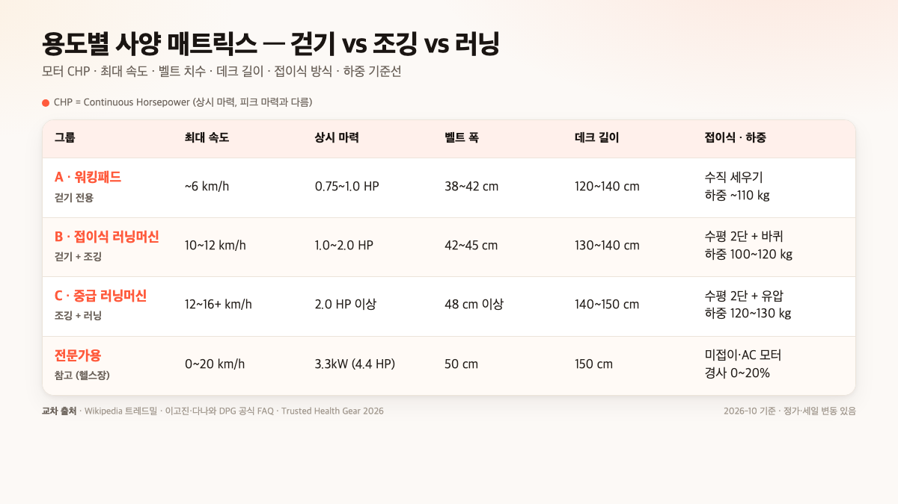
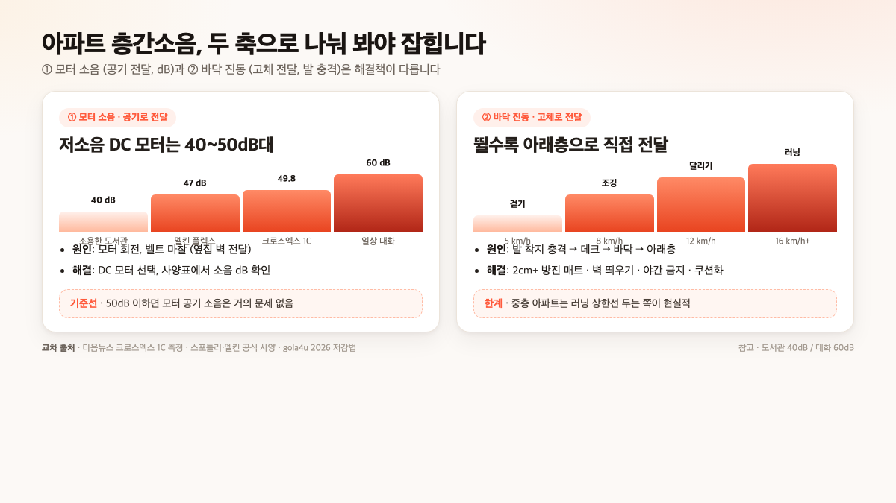

집에서 유산소를 돌릴 거라면, 가정용 런닝머신 추천은 "**걷기만 할 건지, 조깅까지 뛸 건지, 러닝까지 돌릴 건지**" 세 그룹부터 가르는 게 가장 빠릅니다. 걷기만이면 **워킹패드**(DC 0.75~1HP, 최대 6km/h, 벨트폭 38~42cm), 조깅까지면 **접이식 러닝머신**(DC 1.0~2.0HP, 최대 10~12km/h, 42~45cm), 본격 러닝까지면 **중급 러닝머신**(DC 2.0HP+, 최대 16km/h+, 48cm+)이 2026년 10월 상위 자료들의 공통 범위예요.

소음·공간·가격은 그다음 결정 축입니다. 이 글에서는 세 그룹의 기준선, 벨트·모터·접이식 종류의 차이, 아파트 층간소음을 모터 소음(dB)과 바닥 진동 둘로 나눠 보는 법, 2026년 10월 실매장 가격대까지 공식 자료·판매 페이지 사양을 모아 정리했어요.

📌 3줄 요약
가정용 런닝머신 추천은 <b>걷기·조깅·러닝</b> 세 그룹부터 가르면 모터 CHP·벨트폭·접이식 종류가 자동으로 묶입니다.

아파트는 "모터 소음"과 "바닥 진동"이 다른 문제라, 저소음 DC 모터 + 방진 매트 + 벽에서 띄우기까지 동시에 해야 걷기 수준 소음이 잡힙니다.

2026년 10월 기준 워킹패드 15~50만 원, 접이식 러닝머신 25~60만 원, 중급 러닝머신 40~80만 원대가 흔한 가격대예요.

## 걷기만? 조깅까지? 러닝까지? — 세 그룹부터 가르자

상위 TOP 리스트 글들을 모아 보면 가격·사양이 다 뒤섞여 혼란스러운데, "어디까지 뛸 건지"만 먼저 정하면 모터·벨트·소음·가격이 자동으로 묶입니다. 2026년 10월 영문권·국내 가이드가 공통으로 쓰는 세 그룹 기준선은 아래와 같아요.

| 그룹 | 운동 범위 | 최대 속도 | 모터(상시, DC) | 벨트 폭 | 가격 범위(정가 기준) |
| --- | --- | --- | --- | --- | --- |
| A. 워킹패드 | 걷기·파워워킹 | 6km/h | 0.75~1.0HP | 38~42cm | 15~50만 원 |
| B. 접이식 러닝머신 | 걷기+조깅 | 10~12km/h | 1.0~2.0HP | 42~45cm | 25~60만 원 |
| C. 중급 러닝머신 | 조깅+러닝 | 12~16km/h+ | 2.0HP+ | 48cm 이상 | 40~80만 원 |

이 표의 핵심은 "**속도가 올라가면 모터·벨트·가격이 함께 올라간다**"는 겁니다. 반대로 걷기만 할 거면 비싼 중급 러닝머신을 들여도 쓰이는 사양은 전체의 20%도 안 돼요. 그래서 홈트를 처음 시작한다면 자기가 실제로 뛸 속도부터 솔직히 정하고, 그 속도의 +2km/h 정도 여유만 두는 게 가성비 최적입니다.

상위 가이드 공통 지적도 같습니다. gola4u·cleverreview가 모두 "**모터와 벨트는 늘릴 수 없고 바꾸려면 처분해야 하는 영역**"이라고 짚어요. 처음에 모자라게 사면 두 번 사게 되고, 넘치게 사면 자리와 돈만 날리는 겁니다. 세 그룹의 기준선을 정했으면, 아래부터는 왜 그 숫자가 나오는지 모터·벨트·접이식·소음·가격 순서로 하나씩 풀어 봅니다.

## 워킹패드와 러닝머신, 공식 차이는 뭔가요

처음 사는 사람이 가장 많이 묻는 질문이 "워킹패드는 그냥 작은 런닝머신 아닌가요?"입니다. 결론부터 말하면 **공식적으로는 다릅니다.** 위키백과 러닝머신(treadmill) 문서는 러닝머신을 "실내에서 달리기와 걷기를 위한 운동 기구"로 정의하고, 전문가용 사양을 **데크 150×50cm, 속도 0~20km/h, 경사 0~20%, 모터 약 3.3kW**(4.4HP)로 적어요. 즉 러닝머신은 "달리기까지 포함"이 전제입니다.

워킹패드는 이 중 "걷기"만 떼어 낸 축소 버전이에요. 다수 비교 글에서 공통으로 적는 수치는 **최대 속도 6km/h 전후, 벨트 폭 38~42cm, 데크 길이 120~140cm, 모터 상시 1HP 이하**입니다. 뛰지 않는다는 전제가 깔려 있어서 데크·모터가 가볍고, 그래서 접었을 때 **5~15cm 두께**로 책상 밑이나 소파 틈에 세워 수납할 수 있습니다. 반대로 뛰려고 하면 벨트가 짧아 보폭이 안 나오고, 모터가 금방 열이 올라와 쉽게 멈춥니다.

💡 "러닝머신"은 콩글리시, 공식 용어는 "트레드밀"
위키백과는 "러닝머신"을 영어 running machine이 아니라 한국식 영어라고 명시합니다. 영어권에서는 treadmill로 통일되고, 워킹패드(walking pad)는 그 안에서 걷기용 축소 라인업을 가리키는 세부 카테고리예요. 쿠팡·오늘의집 검색 결과에서도 "워킹패드"와 "런닝머신"이 다른 카테고리로 분리돼 있는 이유가 이 때문입니다.

## 모터 마력(CHP) — 걷기 1HP, 조깅 1.5HP, 러닝 2HP+가 기준선

사양표에서 가장 혼란스러운 숫자가 "모터 마력"이에요. **상시 마력**(CHP, Continuous Horsepower)과 **피크 마력**(최대 마력)이 섞여 있어서 비교가 어긋나기 쉽습니다. 이고진 공식 FAQ와 cleverreview·coufinder의 TOP 리스트가 공통으로 짚는 포인트가 "사양을 볼 때는 반드시 **상시 마력**(CHP)을 보라"는 거예요. 피크 마력은 순간 끌어내는 힘이라 실제 운동에서 유지되지 않습니다.

CHP 기준으로 묶으면 범위가 꽤 깔끔해져요. **걷기 전용이면 상시 0.75~1.0HP**, **걷기+가벼운 조깅까지면 상시 1.0~1.5HP**, **본격 러닝까지면 상시 2.0HP 이상**이 공통 기준선입니다. 교차 사양으로 보면 멜킨 마실로(cleverreview 교차 상시 0.75HP, 최대 6km/h)가 걷기용 대표, 이고진 ET3(cleverreview 교차 DC 2.0HP, 최대 16km/h)가 러닝용 대표 예시고, 그 사이가 조깅용 접이식 라인업이에요. 교차 안 된 마력 수치가 적힌 저가 모델은 **상시 2HP+** 범위에 드는지만 확인해도 충분합니다.

모터 종류도 결정축입니다. 국내 유통사 이고진이 공식 FAQ에 적은 바로는 "**가정용은 DC 모터, 클럽용은 AC 모터**"가 기본이에요. DC 모터는 크기가 작고 소음·전력 소비가 낮으며 미세 속도 조절이 잘 돼서 가정 홈트에 맞고, AC 모터는 힘·내구성은 좋지만 소음이 크고 전기세가 더 나와 상업용 쪽입니다. 가정용으로 가면서 "AC 모터"가 적혀 있으면 소음·전력부터 다시 보는 게 좋아요.

## 벨트 폭·길이는 체격보다 보폭이 기준

벨트 폭도 혼란이 많은 축인데, 성인 기준 공통 최소선은 **42cm**입니다. v.daum의 2026 가정용 러닝머신 완벽 가이드는 "성인 기준 최소 폭 42cm 이상, 안전핀과 손잡이 필수"로 적고, 영문권 가이드도 걷기용은 40~45cm, 조깅은 45~50cm, 러닝은 50cm 이상을 기준선으로 묶어요. 벨트 폭이 42cm 미만이면 자연 보폭에서 발이 가장자리로 밀려 자세가 무너집니다.

벨트 길이는 보폭에 따라 더 민감합니다. 걷기 보폭은 약 60~70cm, 조깅은 80~100cm, 러닝은 100cm에서 130cm 수준이에요. 그래서 걷기용 워킹패드는 **데크 120~140cm**로 짧게 나오고, 조깅까지 하려면 **데크 130cm 이상**, 러닝까지는 **데크 150cm**가 필요합니다. 위키백과가 전문가용을 150×50cm로 적은 이유가 "러너의 보폭을 다 받는 길이"라는 거죠.

실제 제품으로 보면 이고진 ET3(120×52cm)·멜킨 마실로(133.5×63.5cm)·킹스미스 G1(143×62cm) 같은 중급 모델이 조깅까지 커버하는 벨트 치수를 보여 줘요. 참고로 전문가용 선수 트레드밀은 길이 300cm, 폭 100cm, 최대 45km/h까지 나오는데 가정용 범위를 완전히 벗어난 사양이라 "참고선"으로만 알아 두면 됩니다.

## 접이식은 두 종류 — 수직 세우기 vs 수평 2단

"접이식"으로 묶여 올라오는 제품도 접히는 방식이 두 가지로 갈립니다. 상위 글들이 거의 다루지 않는 포인트인데, 수납 공간을 완전히 다르게 만듭니다.

| 접이식 종류 | 어떻게 접히나 | 접었을 때 두께 | 어울리는 공간 |
| --- | --- | --- | --- |
| 수직 세우기(워킹패드) | 데크 뒤쪽 핸들이 없고, 전체를 세워서 수납 | 5~15cm | 책상 밑·소파 틈·벽 세워 보관 |
| 수평 2단(일반 러닝머신) | 데크를 지지대 쪽으로 접고 바퀴로 밀어 보관 | 접힘 후 가로 60~80cm | 베란다·방 구석(세워도 1m+) |

**좁은 집·원룸이면 수직 세우기 쪽이 압도적입니다.** gola4u의 접이식 TOP 리스트도 "안 접히는 모델은 결국 자리만 차지하다 처분 1순위가 된다"고 지적하면서, 접었을 때 두께와 이동 바퀴 유무를 1순위 체크로 묶어요. 반면 조깅까지 돌릴 거면 벨트 길이가 길어져 수직 세우기가 불가능해지는 지점이 와서, 수평 2단 접이식 + 이동 바퀴 + 바닥 하단 보관이 현실적입니다.

접었을 때 모델을 **바퀴로 밀 수 있느냐**도 꼭 봐야 합니다. 이고진 ET3 같은 중급은 접힘 후 바퀴로 밀리게 돼 있지만, 저가 모델은 접힘만 되고 바퀴가 부실해 결국 "접은 채로 그 자리"가 되기 쉽습니다. 영구 설치용으로 둘 자리가 없다면 처음부터 바퀴 지지 하중까지 사양에서 확인하는 게 안전해요.

## 아파트 층간소음은 "모터 소리"와 "바닥 진동" 둘로 나눠 봐야

상위 글이 거의 공통으로 지적을 하는데 둘을 섞어 다루는 포인트가 "모터 소음"과 "바닥 진동"은 **다른 문제**라는 겁니다. 저소음 모터만 보고 사면 뛸 때 바닥 진동 때문에 아래층 민원이 들어오고, 반대로 방진 매트만 깔면 모터가 돌아가는 공기 소음은 그대로예요.

**① 모터 소음** (공기로 전달) — 저소음 DC 모터는 보통 40~50dB대에서 유지됩니다. 다음 뉴스에 올라온 크로스엑스 트레드밀 1C 리뷰는 "조용한 도서관(40dB)보다는 크고 일반적인 대화 소리(60dB)보다는 적은 **49.8dB 수준**"으로 측정됐다고 보도했어요. 스포틀러 러닝패드 X2는 최대 **40dB대**, 멜킨 플렉스 트레일 워킹패드는 **47dB**로 알려져 있습니다. 모터 소음은 벽을 통해 옆집으로, 공기로 같은 방 안에 전달되는 문제라 모터 사양·방음벽 거리로 잡아요.

**② 바닥 진동** (고체로 전달) — 뛰는 발 충격이 데크를 지나 바닥을 통해 **아래층으로 전달**되는 문제입니다. 모터 소음 수치가 아무리 낮아도 뛰면 이 축은 다른 길로 나가요. 해결책은 ① 두꺼운 방진 매트(2cm 이상), ② 걷기 속도 유지(5km/h 이하), ③ 쿠션 운동화, ④ 벽·바닥 모서리에서 벽에서 띄우기, ⑤ 늦은 밤 금지입니다.

⚠️ 아파트 중층+에서 본격 러닝은 사실상 어려워요
저소음 DC 모터로 모터 소음은 40~50dB대까지 잡히지만, <b>10km/h 이상에서 뛰는 발 충격은 매트로도 완전히 지워지지 않아요</b>. gola4u 접이식 가이드가 묶은 저감 5가지(방진 매트·속도 유지·운동화·벽 띄우기·시간대)를 전부 지켜도 바닥 진동 축은 남습니다. 중층 이상 아파트라면 걷기+가벼운 조깅까지로 운동 상한선을 두고, 러닝 자극이 필요하면 야외 러닝을 섞는 쪽이 현실적입니다.

## 가정용 런닝머신 추천 — 가격대와 2026년 10월 실매장 기준

가격은 세일·세트 구성에 따라 자주 바뀌니 **정가 기준·참고용**으로만 쓰세요. 상시 "○○원"으로 못 박지 말고 판매 페이지에서 다시 확인해야 합니다. 2026년 10월 cleverreview·coufinder·슬램패닉·유즈풀가이드가 공통으로 다룬 모델들을 교차해 유형별 범위로 묶으면 이렇게 정리돼요.

| 유형 | 가격 범위(정가 기준) | 대표 모델 예시 |
| --- | --- | --- |
| 워킹패드 입문 (0.75~1HP, 6km/h) | 15~30만 원 | 두스룬 접이식 워킹머신, 멜킨 마실로 |
| 워킹패드 중급 (저소음·앱 연동) | 30~50만 원 | 스포틀러 러닝패드 X2, 멜킨 플렉스 트레일 |
| 접이식 러닝머신 (10~12km/h) | 25~60만 원 | 이고진 마에스트로 8200, 킹스미스 G1, 정직한형제들 |
| 중급 러닝머신 (12~16km/h, 2HP+) | 40~80만 원 | 이고진 ET3, 크로스엑스 1C |
| 본격 러닝 (16km/h+, 고출력) | 90~150만 원 | 아이러너 P100(99만, 접이식 고가 라인)·공식 사이트 상업급 라인 교차 확인 |

유형 간 가격 차이의 핵심은 **모터와 벨트**예요. 모터는 CHP 1HP당 대략 10~15만 원씩 올라가고, 벨트는 폭 10cm·길이 20cm 늘어날 때마다 10만 원 안팎 뛰어요. 거기에 **경사도 자동 조절**(모터 추가), **앱 연동**(블루투스·심박), **접이식 유압 구조** 같은 옵션이 10~30만 원씩 더 붙습니다.

같은 가격대 안에서 비교할 때는 모터 CHP·벨트 치수·최대 하중을 먼저 보고, 그다음에 소음 dB·접이식 종류·경사도 유무 순서로 좁히는 게 가장 효율적이에요. 유형별 모델 가격을 바로 확인하려면 [쿠팡 헬스·운동기구](https://www.coupang.com/np/categories/115749) 카테고리에서 "러닝머신"과 "워킹패드"로 각각 필터링해 보면 범위가 한눈에 들어옵니다. 러닝머신과 함께 홈트 중량 기구까지 세팅할 거라면 [케틀벨 무게 추천 가이드](/home-kettlebell-guide/)에서 다룬 세팅 기준을 함께 보시면 도움이 돼요.

## 유형별 TOP 추천 — 상황별 1픽

세 그룹과 가격 범위를 묶어도 "그래서 뭘 사야 돼?" 지점이 남습니다. 상위 TOP 리스트 글(cleverreview·coufinder·다음뉴스)에서 사양이 교차된 6종을 **상황 → 핵심 사양 → 2026-10 가격** 순서의 추천 카드로 묶었어요. 세일·리퍼 가격은 자주 변동하니 판매 페이지에서 다시 확인하세요.

🏃 러닝까지 → 이고진 ET3
<b>상황</b> — 단독·저층 아파트, 조깅+러닝까지 돌리고 싶을 때. <b>핵심 사양</b> — DC 2.0HP, 최대 16km/h, 벨트 120×52cm, 15% 자동 경사, 최대 하중 120kg(cleverreview 교차). <b>가격대</b> — 중급 러닝머신 40~80만 원.

🚶 걷기만·좁은 공간 → 멜킨 마실로
<b>상황</b> — 원룸·중층 아파트, 걷기 중심 홈트. <b>핵심 사양</b> — DC 0.75HP, 최대 6km/h, 벨트 63.5×133.5cm(cleverreview 교차). <b>가격대</b> — 워킹패드 입문 15~30만 원.

🥾 걷기+가벼운 조깅 → 킹스미스 G1
<b>상황</b> — 저층·단독, 걷기+최대 12km/h 조깅까지 수평 2단 접이식으로 수납하고 싶을 때. <b>핵심 사양</b> — DC 1.25HP, 최대 12km/h, 벨트 62×143cm, 수평 2단 접이(cleverreview 교차). <b>가격대</b> — 접이식 러닝머신 중가 라인(약 40~50만 원대).

💸 가성비 입문 → 두스룬 접이식 워킹머신
<b>상황</b> — 처음 홈트 입문, 걷기만 돌릴 때 가장 저렴한 지점. <b>핵심 사양</b> — 벨트 폭 47cm, 접이식 워킹패드형(coufinder 교차 19만원대). <b>가격대</b> — 워킹패드 입문 15~20만 원.

🏠 접이식 고가 라인 → 아이러너 P100
<b>상황</b> — 접이식인데 벨트 폭 42cm·본체 중량 여유까지 챙기고 싶을 때. <b>핵심 사양</b> — 벨트 폭 42cm, 본체 중량 53kg(하중·내구 여유), 접이식(coufinder 교차). <b>가격대</b> — 접이식 고가 라인 90만 원대.

🔇 저소음 중심 → 크로스엑스 1C
<b>상황</b> — 아파트 중층+에서 모터 소음 축을 최우선으로 잡고 싶을 때. <b>핵심 사양</b> — 저소음 DC 쿨모터 49.8dB(도서관 40dB·대화 60dB 사이), 8개 범퍼 흡수(다음뉴스 보도 교차). <b>가격대</b> — 중급 러닝머신 정가 49만·리퍼 39만 원.

위 6종은 상위 가이드 사양이 교차된 1픽이고, 같은 그룹 안에서 가격·사양이 비슷한 대안 모델이 많습니다. 유형과 상황이 맞으면 그 범위 안에서 세일가·배송 조건으로 좁히는 게 가장 현실적이에요.

## 상황별 체크리스트 — 뭘 사야 할지 바로 보이는 매칭표

지금까지의 기준선을 상황별로 매칭표로 묶어 봤습니다. 저장해 두고 살 때 바로 꺼내 보세요. 핵심은 "주거 환경 × 운동 상한선"으로 그룹부터 가르는 거예요.

| 내 상황 | 추천 그룹 | 핵심 사양 기준 |
| --- | --- | --- |
| 아파트 중층+·걷기만·좁은 공간 | A 워킹패드 입문 | DC 0.75~1HP, 38~42cm, 수직 접이식 + 방진 매트 |
| 아파트 중층+·걷기+가끔 조깅 | A 워킹패드 중급(저소음) | DC 1.0HP, 42cm, 저소음 40~47dB + 방진 매트 |
| 아파트 저층·단독·조깅까지 | B 접이식 러닝머신 | DC 1.0~2.0HP, 42~45cm, 10~12km/h, 수평 2단 |
| 단독주택·러닝까지 | C 중급 러닝머신 | DC 2.0HP+, 48cm+, 16km/h, 경사도 자동 |
| 체중 90kg 이상 | 하중 등급 ↑ | 최대 하중 120~130kg, 벨트 폭 45cm 이상 |
| 좁은 공간·가끔 운동 | 수직 접이식 워킹패드 | 접힘 두께 5~10cm, 이동 바퀴 유 |

핵심은 "**모터·벨트는 늘릴 수 없다**"는 겁니다. 걷기만 할 거라고 생각하고 샀는데 중간에 조깅까지 하고 싶어지면 그 머신을 처분하고 새로 사는 수밖에 없어요. 반대로 1주일에 1~2번 걷기만 하면서 중급 러닝머신을 들이면 데크 길이·모터 열량이 90%는 안 쓰이고 자리만 차지합니다. 자기 운동 패턴을 솔직히 보고, +1단계 여유만 두는 게 가성비 최적이에요.

운동 중 심박·세트 시간을 함께 보고 싶다면 블루투스로 심박 모니터와 연동되는 모델을 고르면 됩니다. 가격을 올리지 않고도 심박만 보고 싶으면 별도 손목 밴드형 측정기로도 충분해요. 러닝머신 사양표에 "앱 연동"이 적혀 있어도 제조사 전용 앱이면 범용 심박 센서와 안 맞을 수 있으니, 블루투스 BLE 호환인지 사양에서 확인하는 게 안전합니다.

## 자주 묻는 질문 (FAQ)

**Q. 가정용 런닝머신 추천, 처음엔 워킹패드부터 사도 될까요?**
A. 걷기 중심이고 좁은 공간이라면 워킹패드로 시작하는 게 실패가 적습니다. 가격 15~30만 원대로 부담이 적고, 수직 접이식이면 책상 밑에 세워 보관할 수 있어요. 다만 조깅까지 하고 싶어지면 벨트가 짧아 보폭이 안 나오고 모터가 열이 올라와 멈추기 쉬우니, "거의 조깅까지 할 것 같다" 싶으면 처음부터 B그룹 접이식 러닝머신으로 가는 게 두 번 안 사는 길입니다.

**Q. 아파트에서 조깅까지 돌릴 수 있나요?**
A. 저층(1~3층)이면 저소음 DC 모터(40~50dB대) + 방진 매트 + 벽에서 띄우기 조합으로 걷기와 가벼운 조깅(8~10km/h)까지는 대체로 무난합니다. 하지만 중층 이상이면 뛰는 발 충격이 바닥 진동으로 아래층에 전달돼 민원이 생기기 쉬워요. 야외 러닝을 섞고 집에서는 걷기 수준으로 상한선을 두는 쪽이 현실적입니다.

**Q. 모터 마력은 몇부터가 안전한가요?**
A. 반드시 **상시 마력**(CHP) 기준으로 보세요. 피크 마력은 참고값입니다. 걷기 전용이면 상시 0.75~1.0HP, 걷기+조깅까지면 1.0~1.5HP, 러닝까지면 2.0HP 이상이 2026년 10월 상위 가이드들의 공통 기준선이에요. 모터 종류는 가정용은 DC가 기본이고, "AC 모터"로 적혀 있으면 소음·전력 소비가 커 가정에는 과한 선택입니다.

**Q. 접이식 러닝머신은 수납이 얼마나 편한가요?**
A. 접이식도 두 종류가 완전히 달라요. 워킹패드의 **수직 세우기**는 접었을 때 두께 5~15cm라 책상 밑이나 소파 틈에 세워 둘 수 있지만, 일반 러닝머신의 **수평 2단 접이식**은 접어도 가로 60~80cm를 차지하고 세워도 1m가 넘습니다. 이동 바퀴가 부실하면 결국 "접은 채로 그 자리"가 되기 쉬우니, 접힘 두께와 바퀴를 사양에서 꼭 확인하세요.

**Q. 저소음 모델은 소음 몇 dB까지 괜찮은가요?**
A. 저소음 DC 모터는 보통 **40~50dB대**를 유지합니다. 크로스엑스 1C가 49.8dB, 스포틀러 러닝패드 X2가 40dB대, 멜킨 플렉스 트레일이 47dB로 보도됐어요. 참고 수치로 조용한 도서관이 40dB, 대화 소리가 60dB이니, 50dB 이하면 모터 공기 소음은 거의 문제 되지 않습니다. 다만 뛰는 바닥 진동은 dB 수치와 별개로 늘 매트·시간대·속도로 따로 잡아야 해요.

이거 하나만 기억하면 돼요. 가정용 런닝머신 추천의 출발점은 "**어디까지 뛸 건지**"를 솔직히 정하는 거고, 그다음에 모터 CHP·벨트 폭·접이식 종류·소음 dB·가격이 따라옵니다. 처음부터 러닝까지 상정하면 자리와 돈이 90% 안 쓰이고, 조깅까지 하고 싶으면서 워킹패드만 사면 두 번 사게 돼요.

---

**관련 키워드** — #가정용런닝머신추천 #워킹패드추천 #접이식러닝머신 #저소음러닝머신 #아파트러닝머신 #러닝머신모터마력 #CHP상시마력 #러닝머신벨트폭 #층간소음러닝머신 #워킹패드vs러닝머신 #홈트러닝머신 #러닝머신가격대
