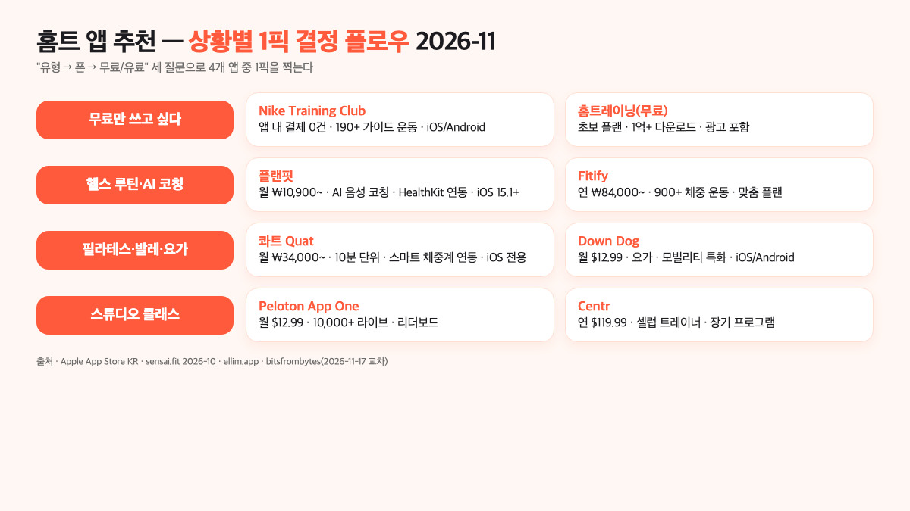

**홈트 앱 추천**을 "TOP10 아무거나"로 받는 글은 많은데, 막상 깔아 보면 영상 클래스가 메인인 앱과 AI 코칭이 메인인 앱이 섞여 있어서 내 운동엔 하나도 안 맞는 경우가 흔합니다. 이 글은 쿠팡형 나열이 아니라 **Apple App Store KR·Google Play·Nike·sensai.fit·ellim.app·bitsfrombytes의 2026-10~11 공식 가격 데이터**를 교차해, 홈트 앱 네 축(AI 코칭·영상 클래스·필라테스·체중 운동)마다 "이 상황이면 이거"라고 1픽만 짚어 드리는 가이드예요.

📌 3줄 요약 (2026-11 공식가 기준)
<b>무료만 쓰고 끝낼 거면 Nike Training Club이 1픽.</b> Apple App Store·Google Play 공식 페이지에서 "앱 내 결제 0건"으로 표시되며 190+ 가이드 운동·멀티주차 프로그램·요가·HIIT·근력까지 전부 무료예요(출처: apps.apple.com Nike Training Club · sensai.fit 2026-10).

<b>한국어 UI + AI 코칭 조합은 플랜핏이 1픽.</b> 월 ₩10,900~·연 ₩64,900~, Apple App Store KR 4.7/5(3만+ 평가), iOS 15.1+·Apple Watch·HealthKit 연동, AI 음성 코칭과 헬스 기구 가이드가 한국어로 돌아갑니다(출처: apps.apple.com/kr Planfit Inc. 공식).

<b>필라테스·발레·요가 전용이면 콰트.</b> 월 ₩34,000~/연 ₩199,000~, Apple App Store KR 평점 4.3/5(약 1,100건), 10분 단위 홈트·스마트 체중계 블루투스 연동이 들어 있어 운동 콘텐츠의 결 자체가 Nike·플랜핏과 달라요(출처: apps.apple.com/kr 콰트 NRISE.INC. 공식).

## 결론부터 — 유형별 1픽을 한 번에 좁히는 세 질문

홈트 앱 선택은 결국 "어떤 운동 유형을 하고 싶은가 → 폰은 iOS인가 안드로이드인가 → 무료로 끝낼 건가 유료로 올라갈 건가" 세 질문으로 좁혀집니다. 네 축을 공식가와 함께 늘어놓으면 1픽이 깔끔하게 결정돼요.

| 상황 | 2026-11 1픽 | 이유 |
| --- | --- | --- |
| "무료로만 쓰고 싶다" | **Nike Training Club** | Apple App Store·Google Play 공식 "앱 내 결제 없음" · 190+ 운동 · iOS/Android 공통 |
| "한국어 + AI 코칭" | **플랜핏**(Planfit) | 월 ₩10,900~·연 ₩64,900~ · 한국어 음성 코칭 · HealthKit · 4.7/5(3만+ 평가) |
| "체중 운동 라이브러리가 넓었으면" | **Fitify** | 900+ 체중·기구 운동 · 월 ₩12,000~22,000·연 ₩84,000~99,000 · iOS/Android |
| "필라테스·발레·요가가 메인" | **콰트**(Quat) | 월 ₩34,000~·연 ₩199,000~ · 10분 단위 영상 · iOS 전용 |
| "스튜디오 클래스 느낌" | **Peloton App One** | 월 $12.99·연 $159 · 10,000+ 라이브/주문형 클래스 · 리더보드 |
| "한국 iOS에서 광고 없이 간단히" | **홈트레이닝**(Caynax) | 무료 기본·연 ₩49,000 맞춤 플랜 · 4.9/5 · 1억+ 다운로드(출처: gazilab.co 2025) |

표를 한 줄로 요약하면 이렇게 돼요. **유형이 바뀌면 1픽이 통째로 바뀝니다.** "홈트 앱 TOP10"으로 한 번에 묶기 어려운 이유도 여기 있어요. 영상 클래스(Nike·Peloton)·AI 코칭(플랜핏)·체중 운동 라이브러리(Fitify)·필라테스 영상(콰트)은 콘텐츠 포맷 자체가 다르기 때문에 "그냥 1등"을 뽑을 수가 없거든요. 그래서 네 축을 먼저 정하고 그 안에서 가격·평점·호환성으로 다시 걸러야 합니다.

세 질문 중 하나라도 답이 애매하다면 "무료부터 깔아서 2주 돌려 보기 → 못 버티는 축 제거 → 유료로 올리기" 순서가 실용적이에요. 유료 구독은 월 ₩10,900(플랜핏)에서 ₩39,000(콰트)까지 격차가 크기 때문에, 2주짜리 체감 테스트가 "2년치 구독 ₩480,000"의 실수를 막아 줍니다.

## 왜 상위 글마다 '홈트 앱 TOP5'가 다를까

"홈트 앱 추천" 검색 상위 글을 열어 보면 라인업이 신기할 정도로 안 겹칩니다. 영문권 상위(sensai.fit·ellim.app·bodymusclematters·bitsfrombytes)는 **Nike Training Club·FitOn·Apple Fitness+·Peloton·Centr·Freeletics**를 돌려가며 꼽고, 한국어 상위(applicationdictionary·gazilab)는 **홈트레이닝·플랜핏·Fitify·7분 운동·콰트**를 나열해요. 같은 키워드인데 리스트가 왜 이렇게 다를까요.

**첫째, 영문권 글은 한국형 iOS 앱을 거의 모릅니다.** 플랜핏(Apple App Store KR 4.7/5·약 3만 평가, iOS 15.1+)·콰트(iOS 전용, 월 ₩34,000~·4.3/5 약 1,100평가)·투모어·BuiltDiff 같은 한국 개발사 iOS 앱은 국내 생태계 안에서 입소문으로 성장한 라인업이에요. 영문권 비교 글은 **Apple 미국 스토어·Google Play 미국 차트**를 기준으로 쓰기 때문에 한국 지역 차트에만 올라온 앱은 거의 다루지 않습니다.

**둘째, 완전 무료의 기준이 글마다 다릅니다.** sensai.fit·bitsfrombytes는 "앱 내 결제가 하나도 없는" Nike Training Club을 완전 무료의 유일한 1픽으로 올리는 반면, 한국어 상위 글들은 **광고 삽입이 있어도 설치·사용은 무료면 무료로 묶어** 홈트레이닝·7분 운동을 TOP에 넣어요. 그 결과 표면적 리스트는 다르지만 "실제로 돈 안 쓰고 쓸 수 있는가?"의 답은 Nike Training Club(영문권 선정)과 홈트레이닝(한국어권 선정)이 둘 다 맞는 겁니다. 다만 Nike 쪽은 공식 페이지의 "앱 내 결제 섹션"이 비어 있는 식으로 근거가 더 분명해요.

**셋째, Apple Fitness+는 한국에서 아직 쓸 수 없어요.** Apple은 2025년 12월 뉴스룸에서 Fitness+를 28개 신규 시장(칠레·홍콩·인도·일본·네덜란드·싱가포르·대만 등)으로 확장한다고 발표했는데, 발표된 목록에 **한국은 포함되지 않습니다**(출처: apple.com/newsroom 2025-12). 영문권 글이 상단에 Apple Fitness+를 꽂아 두어도 한국 Apple 계정에서는 해당 탭이 보이지 않거나 구독이 막혀 있어요. 한국 iOS 사용자는 이 자리를 **플랜핏·콰트·Nike Training Club** 쪽으로 대체해서 읽어야 합니다.

## 유형 분류 — AI 코칭·영상 클래스·필라테스·체중 운동 네 축

홈트 앱은 유형이 바뀌면 "좋은 앱"의 정의 자체가 바뀌는 카테고리예요. 네 축으로 나눠 두면 선택이 단단해집니다.

**① AI 코칭·헬스 루틴 자동 생성형**. 내가 입력한 목표·주기·기구 환경을 바탕으로 매주 루틴을 바꿔 주는 유형이에요. 플랜핏·Fitbod가 대표 선수이고, 세트·중량 로그를 분석해 **다음 주 중량·세트 수를 자동 조정**합니다. 헬스장·홈짐에서 "오늘 뭐 할지"가 자주 막히는 사용자에게 1픽이에요.

**② 영상 클래스·스튜디오형**. Nike Training Club·Peloton App·Apple Fitness+(미국·일본 등)가 여기 해당해요. 트레이너가 등장해 처음부터 끝까지 리드하는 **녹화·라이브 영상 콘텐츠**가 본체이고, 사용자는 "영상을 틀고 따라 한다"는 모드로 운동해요. 따로 루틴을 짤 필요가 없는 게 장점이고, 영상 길이·강도만 고르면 바로 운동이 시작됩니다.

**③ 필라테스·발레·요가 특화**. 콰트·Down Dog가 대표예요. 체중 감량·근성장보다 **자세·유연성·정렬**이 메인이고, 10~30분 단위 짧은 세션이 많아 하루 쪼개 쓰기에 좋아요. 콰트는 한국어 UI·한국인 트레이너 기반이고, Down Dog는 알고리즘이 매번 새로운 요가 시퀀스를 생성해 지루함이 적은 편이에요.

**④ 체중 운동·미니멀 로거형**. 기구 없는 홈트에 특화돼 있어요. Fitify(900+ 체중 운동)·Freeletics(HIIT 중심)·Seven(7분 회로)·홈트레이닝(초보 플랜)이 여기 속합니다. 영상 클래스보다 **운동 데이터베이스가 넓다**는 점이 공통이고, "오늘은 복근만" 같은 부위별 루틴을 꾸미기 쉬워요.

이 네 축은 섞어 쓰는 게 현실적이에요. 예를 들어 **플랜핏 AI 코칭으로 주중 헬스 + Nike Training Club 무료 영상으로 주말 HIIT + 콰트 필라테스로 저녁 자세 교정** 조합이 흔한 2026년 세팅입니다.

🧩 추천 조합 세트 — 상황별 2~3개 묶음
<b>헬스장 + 홈트 병행:</b> <b>플랜핏</b>(헬스 루틴 AI) + <b>Nike Training Club</b>(주말 무료 HIIT). 월 ₩10,900 하나로 평일 끝, 주말은 0원.

<b>자취방 좁은 체중 운동만:</b> <b>Nike Training Club</b>(무료) + <b>Fitify</b>(연 ₩84,000~·900+ 체중 운동). 기구 없이 복근·하체·전신 분산.

<b>저녁 자세 교정·필라테스:</b> <b>콰트</b>(월 ₩34,000·10분 단위) + <b>Nike Training Club 무료 요가</b>. 한국어 필라테스 + 글로벌 요가 라이브러리 묶음.

## 한국 iOS/Android 1픽 — 플랜핏 vs 콰트 vs 홈트레이닝(무료)

한국어 UI·광고·결제 환경·개발사 응답성까지 고려하면 한국 라인업은 영문권 라인업과 다른 축이 됩니다. 2026-11 공식 데이터로 세 앱을 정리하면 이래요.

| 앱 | 2026-11 공식 월·연 | 평점·평가 수 | 플랫폼 | 특장점 |
| --- | --- | --- | --- | --- |
| **플랜핏**(Planfit) | ₩10,900~/월 · ₩64,900~/연 | 4.7/5 · 약 3만 평가 | iOS 15.1+·Mac·Apple Watch·Google Play | AI 코칭·헬스 기구 가이드·HealthKit |
| **콰트**(Quat) | ₩34,000~/월 · ₩199,000~/연 | 4.3/5 · 약 1,100 평가 | iOS·iPad·Mac·Vision·Apple Watch | 10분 필라테스·발레·스마트 체중계 연동 |
| **홈트레이닝**(무료) | 무료 기본·연 ₩49,000 맞춤 | 4.9/5 · 345만+ 리뷰(Google Play) | iOS·Android | 광고 포함·초보 플랜·1억+ 다운로드 |

(출처 · apps.apple.com/kr Planfit Inc. 공식 페이지 · apps.apple.com/kr 콰트 NRISE.INC. 공식 페이지 · gazilab.co 2025 · applicationdictionary 2026-10)

**플랜핏이 한국 1픽이 되는 이유는 세 가지**. 첫째, **AI 음성 코칭과 헬스 기구 가이드가 한국어로 돌아가요**(세트 사이 "휴식 30초" 같은 안내가 번역체가 아니에요). 둘째, **HealthKit 쓰기 연동**이 있어 iPhone·Apple Watch 조합에서 체성분·심박 데이터가 자동으로 Apple 건강에 모입니다. 셋째, 가격이 월 ₩10,900~로, 하루에 350원 수준이라 "이런 앱치곤 쌀 수 있구나"가 체감돼요(출처: 공식 Apple App Store KR 설명·그래이프 블로그 교차 가격).

**콰트는 필라테스 전문이라는 포지셔닝이 분명**합니다. NRISE.INC.가 운영하는 한국형 구독 서비스로, 유명 필라테스·발레·요가 트레이너가 녹화한 10분 단위 영상이 메인이에요. 가격은 ₩34,000/월·₩199,000/연으로 플랜핏보다 3배 이상 비싸지만, 그 자리를 "전문 트레이너 영상 라이브러리"가 채웁니다. 월 3~4회 필라테스 스튜디오를 다니는 사용자 입장에선 1회 ₩50,000 이상 가는 레슨을 월 ₩34,000로 대체하는 셈이라 가성비가 전혀 다른 관점에서 성립해요. 반대로 "헬스장을 다니면서 보조로 쓸" 거면 이 가격은 과해요.

**홈트레이닝**(Caynax 등 복수 개발사 유사 이름)**은 완전 초보용**이에요. Google Play 기준 1억+ 다운로드·4.9/5(345만+ 리뷰)로 지표만 보면 압도적이지만, **광고가 중간중간 들어가고 무료 플랜의 운동 라이브러리가 얕은 편**입니다. "앱을 깔아 10분이라도 움직여 보는 첫 단계"로는 좋지만, 2~3개월 꾸준히 쓸 사용자는 플랜핏·Fitify로 옮겨가는 흐름이 많아요. 다만 "유료 결제가 심리적으로 막힐 때 초보 플랜을 체험하는 용도"로는 여전히 유효한 선택지입니다.

## 글로벌 무료 1픽 — Nike Training Club vs Fitify

유료 구독 없이 글로벌 라이브러리를 쓰고 싶다면 선택지는 결국 Nike Training Club과 Fitify로 좁혀집니다. 2026-11 공식 데이터를 교차하면 이렇게 돼요.

| 앱 | 공식 가격 | 운동 수 | 평점 | 플랫폼 | 콘텐츠 포맷 |
| --- | --- | --- | --- | --- | --- |
| **Nike Training Club** | 무료(앱 내 결제 0건) | 190+ 가이드 운동·멀티주차 프로그램 | 4.8/5 · 약 28만 평가 | iOS · Android | 트레이너 영상·오디오 가이드 |
| **Fitify** | 월 ₩12,000~22,000 · 연 ₩84,000~99,000 | 900+ 체중·기구 운동 | 4.6/5 · 약 994 평가 | iOS·iPad·Apple Watch·Mac(M1)·Vision | 애니메이션·맞춤 플랜 |

(출처 · apps.apple.com Nike Training Club 공식 · apps.apple.com/kr Fitify Workouts s.r.o. · sensai.fit 2026-10·bitsfrombytes 2026)

**Nike Training Club의 결정적 장점은 완전히 무료가 진짜라는 점**이에요. Apple App Store·Google Play 공식 페이지의 "앱 내 결제" 섹션이 비어 있고, 2026-11 기준 **190+ 가이드 운동·멀티주차 프로그램·요가·HIIT·모빌리티·근력**이 모두 무료로 열립니다. COVID-19 때 Nike가 월 $14.99였던 Premium을 무료 전환했고 지금까지 유지되고 있어요(출처: garagegymreviews.com 2026 Nike Training Club 리뷰). 단점은 **운동 로그가 약하다**는 것. 영상을 완료하면 "완료 체크"는 되지만, 세트별 반복 수·중량 추적이나 개인별 맞춤 프로그래밍은 Fitbod·플랜핏 쪽이 훨씬 정교해요.

**Fitify는 체중 운동 라이브러리의 넓이가 다릅니다.** 900+ 운동과 **20+ 미리 짜 둔 워크아웃**, 요가·스트레칭·폼롤링 회복 세션이 들어 있고, 가격은 월 ₩12,000~22,000·연 ₩84,000~99,000(Apple App Store KR 기준)이에요. 무료 플랜도 쓸 수 있지만 핵심 가치는 유료 구독에서 열리는 "개인화 플랜·운동 기구별 세분화"에 있어요. Apple Watch·Vision까지 지원해서 iOS 생태계와의 궁합은 가장 두텁고요. 다만 한국어 UI는 들어 있지만 일부 운동 설명이 번역체로 남아 있다는 Apple App Store 리뷰가 다수 있어요(출처: apps.apple.com/kr Fitify 평가 섹션).

**결정 룰은 이렇게 정리해 둘 수 있어요.** **① 하루 30분 트레이너 리드 영상으로 끝낼 거면 Nike Training Club**(평생 무료, 추가 비용 없음), **② 운동 수를 바꿔 가며 쓰고 싶거나 운동 기구 가이드가 필요하면 Fitify**(연 ₩84,000~·900+ 운동), **③ 둘 다 미니멀 UI라 복잡한 플랜 기능 없음을 선호할 때 1픽**으로 올라옵니다. 반대로 AI 코칭·세트 로깅 깊이가 필요하면 둘 다 부족하고, 플랜핏(헬스 중심)·Hevy(웨이트 로거) 쪽을 써야 해요.

## 필라테스·요가 특화 — 콰트 vs Down Dog

필라테스·요가·발레는 "유연성·정렬·호흡"이 메인이라 체중 운동 앱과 평가 기준이 달라요. 2026-11 기준 비교 라인업은 콰트(한국형)와 Down Dog(글로벌)으로 좁혀집니다.

**콰트**(Quat)는 NRISE.INC.가 운영하는 한국형 홈트 구독 서비스로, 유명 필라테스·발레·요가 트레이너 영상 라이브러리를 보유하고 있어요. 10분 단위 짧은 세션이 많아 "출근 전 10분·점심 10분·자기 전 10분"처럼 쪼개 쓰기 좋고, **블루투스 스마트 체중계 연동**이 들어 있어 체성분 변화를 앱 안에서 바로 추적할 수 있습니다(출처: apps.apple.com/kr 콰트 공식). 단, 영상 라이브러리의 세션 수는 공식 페이지에서 명시된 수치가 없고 "매주 업데이트" 수준으로만 소개돼 있어 구독 전 Apple App Store 스크린샷·최근 업데이트 노트를 확인하는 걸 권장해요.

**Down Dog**는 "매번 새 시퀀스가 생성되는" 알고리즘형 요가 앱으로 유명해요. 미리 녹화된 영상이 아니라 **사용자가 선택한 레벨·시간·강도를 바탕으로 매번 새로운 요가 시퀀스를 조립**해 보여 주는 구조라, "같은 영상이 지겹다"는 피로가 적습니다. 공식 가격은 **월 $12.99·연 $99.99** 수준(출처: sensai.fit 2026-10)이에요. 한국어 UI 지원은 제한적이고, 결제 통화도 USD 기준이라 환율에 따라 월 체감 가격이 달라집니다.

**둘의 차이는 콘텐츠 포맷**이에요. 콰트는 "실존하는 트레이너의 녹화 영상을 가져와 따라 한다"에 가깝고, Down Dog는 "AI가 매번 새로 조립한 수업을 따라 한다"에 가까워요. 한국어 UI·결제·국내 트레이너 선호도가 크면 콰트, 요가 특화·영상 반복이 지겨운 사용자이고 영문 UI 저항이 없다면 Down Dog가 1픽이 됩니다. 두 앱 모두 체중 감량이나 근성장을 메인 목적으로 두면 "축이 안 맞아요". 그 경우엔 Nike Training Club·Fitify·플랜핏 쪽으로 돌리는 게 맞습니다.

## Apple Fitness+는 한국에 아직 없다 — 대체 조합

영문권 상위 글들의 상단에 거의 항상 올라오는 Apple Fitness+는 한국 Apple 계정에서는 **구독 자체가 아직 열리지 않아요**. Apple은 2025년 12월 뉴스룸을 통해 Fitness+를 칠레·홍콩·인도·일본·네덜란드·싱가포르·대만 등 28개 신규 시장으로 확장한다고 발표했지만, 공식 명단에 **한국은 들어 있지 않습니다**(출처: apple.com/newsroom 2025-12 공식 보도자료). 미국 기준 월 $9.99·연 $79.99·Apple One 번들 포함이라 가성비가 좋은 상품인데, 한국 사용자에겐 아직 접근이 안 돼요.

**국적을 우회해서 가입하는 방법은 공식적으로 권하지 않습니다.** Apple 약관상 거주 국가 변경·결제 수단·주소 일치가 필요해서, 구조상 편법 구독은 결제 거절이나 계정 제한으로 이어질 수 있어요. 사용자 관점에서 유용한 선택은 "Apple Fitness+가 열릴 때까지의 대체 조합"을 정하는 쪽입니다. 가장 흔한 대체는 세 가지예요.

**첫째, Apple Watch만 가지고 있다면 Nike Training Club + Apple 건강 조합.** Apple Watch의 운동 링·심박 데이터는 Apple 건강으로 자동 집계되고, 영상 러시는 Nike Training Club 무료 라이브러리가 대체합니다. 비용 0원으로 Apple Fitness+ 약 70~80% 체감을 낼 수 있어요.

**둘째, 한국어 UI·AI 코칭이 필요한 경우 플랜핏으로 대체.** Apple Fitness+가 미국에서 메인으로 하는 "실시간 심박 오버레이 + 트레이너 리드"의 자리를 플랜핏의 **AI 음성 코칭 + HealthKit 연동**이 대체합니다. 플랜핏은 월 ₩10,900~로 미국 Fitness+(월 $9.99 ≈ ₩14,000)보다 오히려 저렴해요.

**셋째, 필라테스·요가·발레에 집중할 거면 콰트.** Apple Fitness+가 요가·필라테스 영상 라이브러리로 쓰이는 영역은 한국형 콰트로 그대로 대체됩니다. 가격은 월 ₩34,000~로 Fitness+(월 $9.99)보단 비싸지만 한국어 트레이너·한국 신체 비율 기준 큐가 강점이에요.

## 무료 vs 유료 — 어디까지가 무료로 충분한가

"무료로 끝낼 수 있냐"는 가장 자주 받는 질문이에요. 네 축별 솔직한 답을 적어 둘게요.

**영상 클래스 — Nike Training Club 무료로 대부분 끝.** 공식 "앱 내 결제 0건"으로 명시돼 있고 190+ 가이드 운동·멀티주차 프로그램이 전부 무료라, "주 3~4회 트레이너 리드 영상"이 목표면 유료 전환 유인이 거의 없어요. Peloton App One(월 $12.99)으로 올라가는 이유는 ① 10,000+ 클래스 라이브러리·② 라이브 리더보드·③ Peloton 기기 연동이 필요할 때예요(출처: bitsfrombytes 2026).

**AI 코칭·헬스 루틴 — 플랜핏은 무료가 맛보기, 유료 전환이 합리적.** 플랜핏 무료는 맞춤 루틴 추천·운동 기록·기본 분석·커뮤니티까지는 되지만, AI 음성 코칭·과거 전 데이터 접근·고급 분석은 유료에서 열려요(출처: korean-apps.com 플랜핏 무료/유료 비교). 월 ₩10,900은 하루 350원 수준이라 "매일 쓰면 가성비가 좋다"는 체감이 강한 가격대예요.

**체중 운동 — Fitify는 무료로도 시작 가능, 900+ 라이브러리는 유료.** 기본 운동 라이브러리의 일부는 무료로 열리지만, **맞춤 플랜·전체 라이브러리·운동 기구 가이드**는 유료 구독에서 사용 가능해요. 월 ₩12,000~22,000은 Nike Training Club·플랜핏 대비 비싼 편이라, 체중 운동 전용 사용자가 아니면 Nike Training Club + 플랜핏 조합이 더 가성비 있어요.

**필라테스 — 콰트는 월 ₩34,000이 레슨 1회 대체 관점에서 정당화.** 콰트의 가격은 월 ₩34,000·연 ₩199,000으로 다른 앱 대비 2~3배 비싸지만, **스튜디오 레슨 1회가 보통 ₩50,000~70,000** 수준이라 "월 1회라도 스튜디오를 건너뛰면 이득"이라는 계산이 서요. 반대로 필라테스를 가끔만 할 거면 Nike Training Club 무료 요가·모빌리티로 대체하는 게 맞습니다.

**정리 — 2026년 무료로 충분한 선은 이렇게 돼요.** 영상 클래스는 Nike Training Club만으로 거의 끝. AI 코칭·필라테스·900+ 운동 라이브러리가 필요하면 각각 플랜핏(₩10,900~)·콰트(₩34,000~)·Fitify(₩12,000~)로 한 축씩 올리는 게 현실적입니다. 홈트에 쓰는 매트·소도구까지 함께 세팅하려면 [층간소음 운동매트 추천 — 홈트 매트 5종 두께·소재 비교와 상황별 선택](/floor-noise-workout-mat/) 글에서 매트 두께와 소재를 고르고, 실제 제품 구매는 [쿠팡 홈트레이닝 용품](https://www.coupang.com/np/categories/178155) 카테고리의 공식 상세 페이지에서 **정가·치수·소재 표기**를 그대로 확인한 뒤 결정하는 걸 권장해요.

## 장기 사용 체크포인트 — 구독 해지·데이터 이전·HealthKit

홈트 앱은 1~2년 쌓은 운동 기록이 "해지 한 번"에 접근 불가가 되기 쉬운 카테고리라, 처음 고를 때 데이터 백업·이전 조건을 함께 확인해야 합니다. 2026-11 기준 네 가지 체크포인트를 적어 둘게요.

1. **공식 Export 기능 유무**. 플랜핏은 HealthKit 쓰기로 체성분·운동 요약 데이터가 Apple 건강에 동기화되고, Fitify도 Apple Watch·HealthKit 연동이 들어 있어요. Nike Training Club은 운동 로그를 CSV로 내려받는 공식 기능이 약한 편이라, 세션 완료 기록은 앱 내 활동 히스토리에 의존해야 합니다.
2. **구독 해지 후 데이터 접근**. 유료 앱은 해지 후에도 "과거 기록 열람"이 되는지가 중요해요. 플랜핏·Fitify·콰트 모두 유료 해지 시 **유료 콘텐츠 접근은 막히지만 과거 자신의 운동 기록은 조회 가능**하다는 Apple App Store 리뷰·이용약관이 다수예요. 다만 앱 업데이트·개발사 정책 변경에 따라 바뀔 수 있으니 결제 직전 각 앱 "이용약관"을 확인하는 게 안전합니다.
3. **HealthKit·Health Connect 쓰기 권한**. iOS는 HealthKit, Android는 Google Health Connect가 표준이에요. 쓰기 권한이 켜져 있어야 운동 요약·심박·체성분 같은 **집합 지표**가 OS 허브에 남아 앱을 바꿔도 역사가 살아납니다. 플랜핏·Fitify·Nike Training Club·콰트 모두 이 권한 요청이 설치 초반에 나오니 "허용"으로 눌러 두세요.
4. **1인 개발 앱·소규모 스튜디오 리스크**. 콰트·홈트레이닝(Caynax 등)·한국형 소형 앱들은 1~2년 사이 정책 변경·서비스 종료 사례가 있어요. 공식 **내가 쌓은 운동 횟수·체중 그래프가 PDF·CSV·HealthKit 중 어떤 형태로 보존되는지**를 가입 전에 확인하는 걸 권장합니다.

⚠️ 가입 전 3줄 체크
① 구독 결제 전 Apple App Store·Google Play "앱 내 구입" 섹션의 실제 가격을 직접 확인하세요(지역·통화별로 자동 환산됨).

② HealthKit·Health Connect 쓰기 권한을 꼭 켜 두세요(기본은 꺼져 있는 앱이 많음).

③ 유료 구독은 월 ₩10,900~₩39,000 격차가 커서 "2주 무료 체험 → 못 쓰는 축은 즉시 해지"가 2년치 지출을 가장 많이 줄여 줍니다.

## 자주 묻는 질문 (FAQ)

**Q. 홈트 앱 "딱 하나"만 꼽는다면?**
A. 상황을 지우고 하나만 꼽는다면 **Nike Training Club**이에요. 완전 무료·190+ 운동·iOS/Android 공통으로 "일단 깔아서 손해가 거의 없는" 유일한 앱입니다. 다만 **AI 코칭·세트 로깅 깊이**가 필요하면 플랜핏(월 ₩10,900~), **필라테스·발레**가 메인이면 콰트(월 ₩34,000~)로 1픽이 갈아타져요.

**Q. 플랜핏은 안드로이드에서도 쓸 수 있나요?**
A. 네, 플랜핏은 iOS(Apple App Store)와 Android(Google Play) 양쪽에 정식 출시돼 있어요. 다만 세부 기능 업데이트는 iOS 쪽이 먼저 반영되는 편이라, 최신 AI 코칭 기능은 iOS 15.1+ 환경에서 가장 빨리 쓸 수 있습니다(출처: play.google.com·apps.apple.com/kr 공식).

**Q. Apple Fitness+는 한국에서 언제 쓸 수 있나요?**
A. Apple은 2025-12 뉴스룸에서 Fitness+를 28개 신규 시장으로 확장한다고 발표했지만 공식 명단에 **한국은 포함되지 않았어요**(출처: apple.com/newsroom 2025-12). 한국 서비스 시점은 Apple이 추가 발표하지 않는 한 공개된 공식 일정이 없습니다. 당분간 한국 사용자는 Nike Training Club(무료) + 플랜핏(월 ₩10,900~) 조합으로 Fitness+ 체감을 대체하는 게 현실적입니다.

**Q. 무료 앱만 쓰고 유료 결제를 안 하면 한계가 있나요?**
A. 2026-11 기준 답은 "거의 없다"예요. Nike Training Club은 완전 무료로 190+ 운동을 제공하고, 홈트레이닝(Caynax 등) 역시 무료로 기본 루틴이 돌아갑니다. **AI 맞춤 코칭·전문 트레이너 영상·필라테스 라이브러리**는 유료에서 열리지만, 일반적인 체중 운동·HIIT·요가는 무료만으로 1년 이상 버티는 사용자가 많습니다.

**Q. 아이폰에서 홈트 앱 데이터가 Apple 건강에 들어가나요?**
A. 플랜핏·Fitify·Nike Training Club 모두 HealthKit 쓰기를 지원해 **운동 세션·칼로리·심박** 같은 공식 표준 데이터가 Apple 건강에 자동 반영돼요. 다만 세트·반복·중량 단위의 세부 웨이트 데이터는 HealthKit 표준 타입이 약해 각 앱 안에 남고, 앱 자체 Export(CSV·PDF) 기능이 있는지 따로 확인해 두는 게 안전합니다.

**Q. 콰트·플랜핏·Fitify 셋을 동시에 구독하면 비싼가요?**
A. 2026-11 공식 월 구독 기준 **콰트 ₩34,000 + 플랜핏 ₩10,900 + Fitify ₩12,000 ≈ 월 ₩56,900**이에요. 1회 PT가 보통 ₩50,000~80,000 수준이라 "PT 1회 대체" 관점에서 보면 저렴한 편이지만, 세 축이 전부 필요한 사용자는 드물어요. 축 하나를 Nike Training Club 무료로 대체(예: 체중 운동 축)하면 월 ₩44,900 수준으로 줄어듭니다.

**Q. 플랜핏 유료 결제를 환불할 수 있나요?**
A. Apple App Store·Google Play 결제분은 각 **스토어 환불 정책**을 따라요. Apple은 결제일 기준 90일 이내 "reportaproblem.apple.com"에서 환불 신청이 가능하고, Google Play는 "구매한 지 48시간 이내" 또는 플랫폼 지원팀 문의로 처리됩니다(출처: 각 스토어 공식 지원 페이지). 플랜핏 자체 환불이 아니라 스토어 결제 정책이 적용된다는 점을 유념하세요.

**Q. 한국어 UI가 제일 매끄러운 앱은?**
A. **플랜핏·콰트·홈트레이닝**이 한국 개발사 기반이라 한국어 UI 완성도가 가장 높아요. Nike Training Club·Fitify는 한국어가 지원 언어에 포함돼 있지만, 일부 운동 설명·UI 문구가 번역체로 남아 있다는 Apple App Store 리뷰가 다수입니다(출처: apps.apple.com/kr Nike Training Club·Fitify 평가 섹션).

**다음에 읽을 거리** — 홈트 앱으로 영상을 틀어도 바닥에 매트가 없으면 층간소음·관절 피로 때문에 10분을 못 넘기기 쉬워요. 같은 "공식 스펙 1차 출처 교차" 방식으로 매트 5종을 두께별로 비교한 [층간소음 운동매트 추천 — 홈트 매트 5종 두께·소재 비교와 상황별 선택](/floor-noise-workout-mat/) 글을 홈트 앱과 세트로 묶어 두면 실제 시작 장벽이 확 낮아지고, 매트·소도구 구매는 [쿠팡 홈트레이닝 용품](https://www.coupang.com/np/categories/178155) 카테고리 공식 페이지에서 **치수·소재·정가** 표기를 직접 확인한 뒤 결정하는 걸 권장해요.

---

**관련 키워드** — #홈트앱추천 #홈트어플 #홈트레이닝앱 #플랜핏 #콰트 #NikeTrainingClub #Fitify #홈트앱무료 #AI코칭앱 #필라테스앱 #아이폰홈트앱 #안드로이드홈트앱
