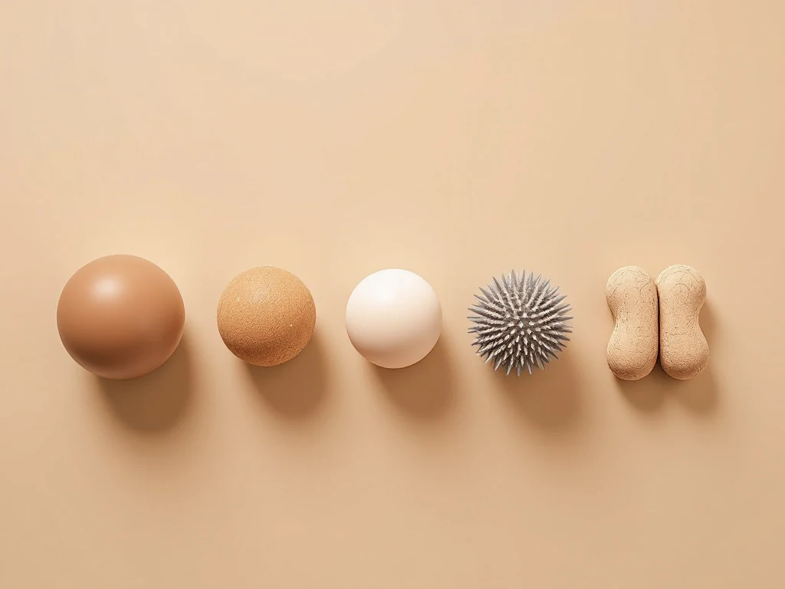
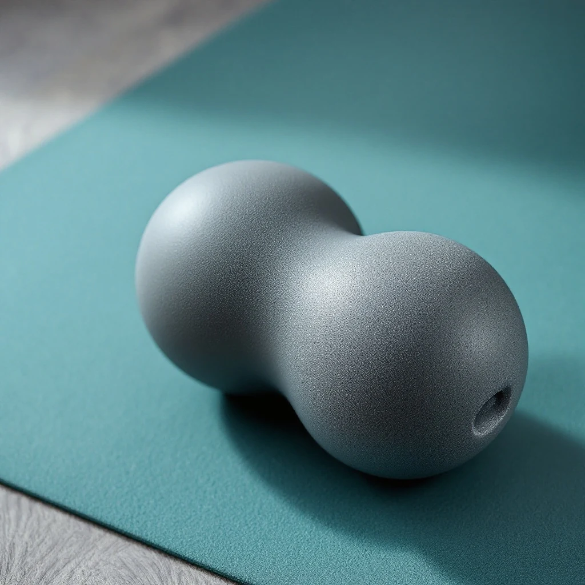
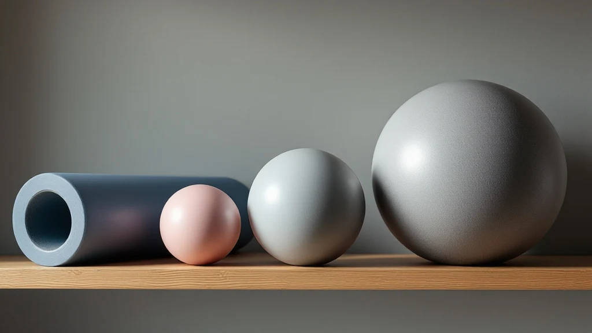

마사지볼 추천을 찾다 보면 라크로스볼, 땅콩볼, 돌기볼, 진동볼이 다 좋다는 글뿐이라 결국 두세 개를 장바구니에 담게 되죠. 결론부터 말하면요, 처음 하나는 **너무 딱딱하지 않은 매끈한 싱글볼**이면 됩니다. 크기는 직경 6cm 안팎이 무난해요. 등 양옆을 자주 풀 거라면 땅콩볼을 두 번째로 더하고, 발바닥만 쓸 거라면 돌기형으로 바꾸면 돼요. 2026년 10월 기준 판매 페이지와 제조사 스펙, 상위 후기를 모아 비교해 정리했습니다.

📌 3줄 요약
입문 1순위는 직경 6cm 안팎, 중간 경도의 매끈한 싱글 마사지볼입니다.

땅콩볼은 척추를 사이에 두고 양옆을 같이 누르는 모양이라 등·목 뒤를 자주 풀 사람에게 맞는 두 번째 볼이에요.

돌기형은 발바닥 전용, 진동 마사지볼은 예산 여유가 있을 때의 선택지로 보면 실패가 적습니다.

## 마사지볼 추천, 하나만 고르라면 무엇인가요?

중간 경도의 싱글볼 1개입니다. 싱글볼은 둔근, 종아리, 날개뼈 주변처럼 좁은 곳을 한 점으로 누르는 기본형이라 쓰임이 가장 넓어요.

저도 처음엔 단단할수록 잘 풀린다고 생각했어요. 그런데 상위 블로그 여러 곳을 열어 비교해보니, 초보는 말랑한 쪽부터 시작하라는 조언이 거의 공통이었습니다. 작고 딱딱한 볼일수록 압력이 한 점에 몰려 훨씬 세게 느껴지거든요.

순서로 치면 싱글볼로 시작하고 등 양옆이 아쉬우면 땅콩볼, 더 강한 압력이 필요하면 라크로스볼로 올리는 식이에요.

## 소재별로 보면 경도가 보인다

마사지볼 경도는 소재와 크기가 같이 정합니다. 상세페이지에 경도 수치가 거의 없으니 소재로 가늠하는 게 현실적이에요.

제품 설명과 후기를 소재별로 모아 표로 묶어보면 이렇습니다.

| 소재·형태 | 느낌 | 잘 맞는 사람 |
| --- | --- | --- |
| 실리콘 | 말랑~중간, 미끄럼 적음 | 압박이 처음인 입문자 |
| TPE | 제품마다 경도 폭이 넓음 | 중간 경도를 찾는 사람 |
| EPP | 아주 가볍고 단단한 편 | 휴대가 중요한 사람 |
| 고무(라크로스볼) | 단단하고 눌러도 잘 안 들어감 | 강한 압력에 익숙한 사람 |

💡 이 표의 판단 근거
실측값이 아니라 제조사 설명과 후기를 모아 판단한 것입니다. 같은 TPE라도 제품마다 경도가 다르니 후기를 함께 보세요.

라크로스볼은 원래 라크로스 경기용 공이라 규격이 정해져 있습니다. [라크로스볼 규격](https://en.wikipedia.org/wiki/Lacrosse_ball)을 보면 라크로스볼은 "단단한 고무(solid rubber)"로 만든 공이고, 직경은 약 6.27~6.47cm입니다. 그래서 입문용으로는 다소 셉니다.

## 싱글볼과 땅콩볼은 무엇이 다른가요?

땅콩볼은 볼 두 개를 이어 붙여 **가운데에 홈이 생긴 모양**입니다. 이 홈에 척추가 들어가도록 두면 뼈는 피하고 양옆 근육 두 지점을 동시에 누를 수 있어요.

싱글볼은 한 지점을 콕 짚기 좋지만 잘 굴러다닙니다. 땅콩볼은 두 점으로 받쳐져 덜 굴러가서 등이나 목 뒤에서 자세 잡기가 편해요.

여기서 많이들 헷갈리는데, 땅콩볼이라도 척추 위를 직접 세게 누르는 용도는 아닙니다. 홈 간격과 볼 크기는 제품마다 달라서 상세페이지 치수를 꼭 확인해야 해요.

## 땅콩볼 추천은 이런 분께만

땅콩볼은 등 위쪽, 날개뼈 사이, 목 뒤를 자주 푸는 사람에게 맞는 두 번째 볼입니다. 이 부위를 안 쓴다면 싱글볼 하나로 충분해요.

후기를 찾아보니 땅콩볼은 벽과 등 사이에 끼우고 무릎을 굽혔다 펴는 방식이 많았습니다. 바닥보다 체중을 덜 실어서 압력 조절이 쉽거든요.

가격은 다이소 저가 제품부터 수입 EPP 듀오볼까지 폭이 넓은데, 등 양옆을 누르는 용도라면 값싼 땅콩볼로도 충분하다는 후기도 있었어요.

## 직경으로 고르는 마사지볼 사이즈표

직경은 **작을수록 한 점 집중, 클수록 압력 분산**입니다. 부위별로 맞는 크기를 표로 정리했어요.

| 직경 | 비슷한 크기 | 잘 맞는 부위 | 느낌 |
| --- | --- | --- | --- |
| 4~5cm | 골프공 | 발바닥, 손바닥 | 좁고 강함 |
| 6~7cm | 테니스공 | 둔근, 종아리, 승모근 | 무난한 표준 |
| 8~10cm 이상 | 소프트볼 이상 | 등 넓은 부위, 엉덩이 | 넓고 부드러움 |

입문자가 하나만 산다면 6~7cm가 가장 무난합니다. 라크로스볼처럼 대중적인 제품도 이 구간에 몰려 있어요. 다노 마사지볼도 출시 당시 보도 자료 기준 직경 6cm, EPP 소재로 소개됐는데, 현재 사양은 판매 페이지에서 다시 확인하는 게 안전합니다.

발바닥 마사지볼을 따로 찾는다면 4~5cm에 돌기가 있는 형태가 맞아요.

## 돌기형·진동 마사지볼은 언제 사야 할까?

돌기형은 발바닥 전용, 진동 마사지볼은 예산 여유가 있을 때의 선택지입니다. 둘 다 첫 구매로는 우선순위가 낮아요.

돌기형은 압력이 여러 점으로 나뉘어 단단한 볼보다 덜 아프게 느껴지고 발바닥 지압용으로 많이 쓰입니다.

진동 마사지볼은 충전식으로 진동을 더한 제품입니다. 대표 제품인 Hyperice 하이퍼스피어 고(예전 제품명 하이퍼스피어 미니)는 판매처 공식 스펙 기준 진동 3단계, 1회 충전 최대 약 2시간이에요. 가격은 몇만 원대 저가형부터 10만 원을 넘는 제품까지 폭이 넓고, 시기와 판매처마다 달라요.

💡 진동볼, 사도 될까? 3문항
① 일반 마사지볼을 4주 이상 꾸준히 써 봤다.

② 출장·여행처럼 들고 다니며 쓸 일이 많다.

③ 일반 볼의 몇 배 가격을 감수할 수 있다.

셋 다 예라면 고려해 볼 만하고, 하나라도 아니라면 일반 볼로 충분합니다.

## 폼롤러·마사지건이 있으면 마사지볼도 필요할까?

필요합니다. 폼롤러는 넓은 면, 마사지건은 손 닿는 곳, **마사지볼은 손이 안 닿는 좁은 곳**을 맡아요.

폼롤러는 허벅지, 등처럼 큰 근육을 한 번에 굴리기 좋지만 날개뼈 사이나 골반 옆 같은 좁은 곳은 잘 안 닿습니다. 아직 폼롤러가 없다면 [폼롤러 추천](/foam-roller-recommend/) 글에서 강도와 길이부터 고르고 오시는 게 순서예요.

마사지건은 정밀하지만 등을 혼자 하려면 팔 각도가 안 나옵니다. 마사지볼이 그 빈자리를 채워줘요. 예산이 더 있다면 [마사지건 추천](/massage-gun-recommend/) 글도 함께 보면 조합이 쉬워집니다.

## 구매 전 체크리스트와 쓰면 안 되는 곳

사기 전에는 경도, 직경, 소재, 표면, 형태, 구성 수량 여섯 가지만 확인하면 됩니다. 특히 사진에 여러 개가 보여도 실제로는 1개 구성인 경우가 있어 수량을 꼭 보세요.

| 확인 항목 | 이렇게 고르세요 |
| --- | --- |
| 경도 | 처음이면 말랑~중간, 라크로스볼급은 두 번째로 |
| 직경 | 범용 6~7cm, 발바닥용 4~5cm |
| 소재 | 실리콘·TPE는 무난, EPP는 가벼움, 고무는 단단함 |
| 표면 | 매끈형은 범용, 돌기형은 발바닥용 |
| 형태 | 한 점은 싱글볼, 등 양옆은 땅콩볼 |
| 구성 수량 | 상세페이지에서 1개인지 세트인지 확인 |

사용은 한 부위에 30초에서 1분 정도, 호흡이 편한 압력으로 천천히 움직이는 정도가 무난합니다. 아플수록 잘 풀린다는 생각으로 체중을 다 싣는 건 피하는 게 좋아요.

⚠️ 직접 누르지 말아야 할 곳
척추뼈 위, 목 앞쪽, 무릎 뒤 오금, 팔꿈치·발목 같은 관절과 뼈 돌출부, 다친 곳에는 볼을 대지 마세요. 사용 중 저림이나 날카로운 통증이 생기면 바로 멈추세요. 통증이나 질환이 있다면 사용 전에 전문가와 상담하는 게 맞습니다.

## 자주 묻는 질문 (FAQ)

**Q. 마사지볼 처음 사는데 어떤 걸 사야 하나요?**
A. 직경 6cm 안팎, 너무 딱딱하지 않은 매끈한 싱글볼 하나면 충분합니다. 둔근, 종아리, 승모근까지 두루 쓸 수 있고 부족하다고 느낄 때 땅콩볼이나 라크로스볼을 더하면 됩니다.

**Q. 땅콩볼이랑 마사지볼 중 뭐가 나은가요?**
A. 쓰는 부위로 정하면 됩니다. 한 점을 콕 짚는 데는 싱글볼, 등 양옆이나 목 뒤처럼 척추를 사이에 둔 부위에는 땅콩볼이 편합니다.

**Q. 다이소 마사지볼도 써도 되나요?**
A. 써도 됩니다. 경도와 직경만 맞으면 쓰임은 비슷합니다. 다만 표면 마감과 냄새는 제품마다 다르니 매장에서 직접 만져보고 고르는 게 좋습니다.

**Q. 라크로스볼은 초보가 써도 괜찮나요?**
A. 단단한 고무 공이라 초보에게는 센 편입니다. 쓰고 싶다면 바닥보다 벽에 대고 체중을 덜 실어 시작하고 너무 세면 말랑한 볼로 바꾸는 걸 권합니다.

**Q. 진동 마사지볼은 일반 볼보다 좋은가요?**
A. 진동이 더해질 뿐 쓰는 방법은 같습니다. 가격이 크게 올라가니 일반 볼을 꾸준히 쓰는 습관이 생긴 뒤에 사도 늦지 않습니다.

이거 하나만 기억하면 돼요. 마사지볼 추천의 정답은 비싼 볼이 아니라 **내 부위에 맞는 크기와 경도**입니다. 처음엔 6cm 안팎 중간 경도 싱글볼로 시작하고, 필요할 때 땅콩볼을 더하세요. 가격과 구성은 시기마다 달라지니 판매 페이지에서 꼭 확인하세요.

---

**관련 키워드** — #마사지볼추천 #땅콩볼추천 #땅콩마사지볼 #라크로스볼 #마사지볼사이즈 #발바닥마사지볼 #진동마사지볼 #다이소마사지볼 #마사지볼사용법 #셀프마사지 #홈트용품
