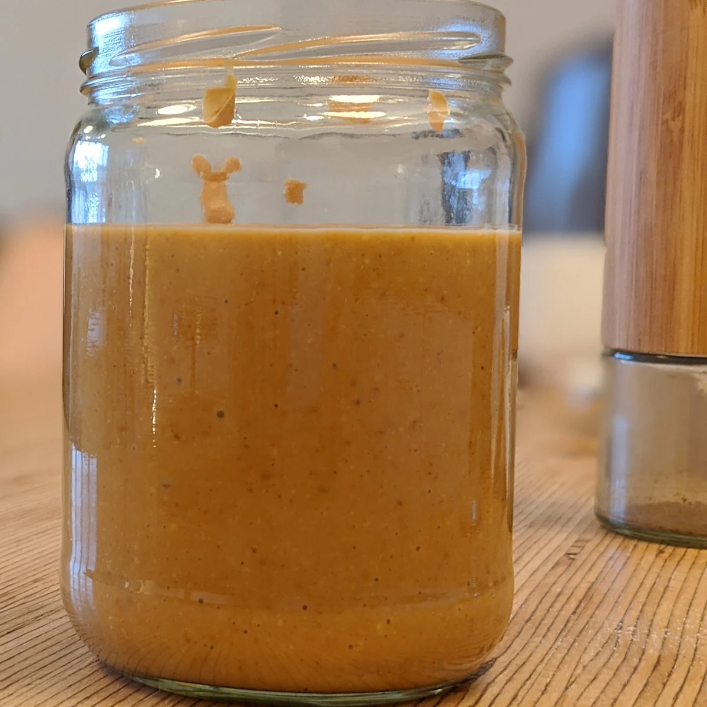

다이어트 땅콩버터를 찾다 보면 "살 빠지는 음식"이라는 글과 "칼로리 폭탄"이라는 글이 동시에 나와서 헷갈리죠. 결론부터 말하면요, 땅콩버터는 살을 빼주는 식품도, 무조건 피할 식품도 아닙니다. 고를 때는 **원재료명과 1회 양**만 정확히 보면 돼요. 저도 처음엔 '100% 땅콩'이라고 적힌 병이면 다 같은 줄 알았는데, 성분표를 나란히 놓고 보니 기준 단위부터 제각각이었습니다. 2026년 10월 기준으로 미국 농무부(USDA) 식품 데이터베이스 수치와 국내 상위 글 11편을 비교해 사람들이 가장 많이 오해하는 다섯 가지를 하나씩 확인했습니다.

📌 3줄 요약
무염 땅콩버터는 100g당 598kcal, 계량스푼 1큰술(16g)이면 약 96kcal입니다(USDA 기준).

열량의 약 77%가 지방에서 나와서, 단백질 식품이라기보다 지방 식품에 가깝습니다.

고를 때는 원재료명이 짧은지(땅콩 또는 땅콩+소금), 당류와 식물성 유지가 들어갔는지, 영양정보가 몇 g 기준인지 세 가지를 보면 됩니다.

## 땅콩버터 1큰술은 몇 칼로리인가요?

계량스푼 1큰술(16g) 기준 약 96kcal입니다. 미국 농무부 [FoodData Central](https://fdc.nal.usda.gov/)의 무염 땅콩버터 항목은 100g당 598kcal이고 2큰술을 32g으로 잡고 있어요.

첫 번째 오해는 "다이어트 식품이니 많이 먹어도 된다"입니다. 100g당 열량으로 보면 땅콩버터는 열량이 높은 편에 속해요. 2큰술(32g)만 떠도 약 191kcal가 되고 빵 한 장에 두껍게 바르면 이 선은 금방 넘깁니다.

땅콩버터 칼로리는 '몇 g을 먹었나'가 먼저입니다. 하루 목표 열량을 아직 모른다면 [다이어트 칼로리 계산법 글](/diet-calorie-calculation/)에서 내 숫자부터 잡고 오시면 1큰술이 얼마만큼의 비중인지 바로 보입니다.

## 땅콩버터는 단백질 식품일까요?

아니요, 영양 구성으로 보면 지방 식품에 가깝습니다. USDA 수치로 1큰술(16g)에는 단백질 약 3.6g, 지방 약 8.2g이 들어 있어요.

두 번째 오해가 "고단백이라 닭가슴살 대신 먹어도 된다"입니다. 열량 비중으로 직접 계산해 보니 지방이 약 77%, 단백질은 약 15%였어요. 100g당 단백질 22.2g이라는 숫자만 보면 높아 보이지만 그만큼 먹으면 598kcal를 같이 먹게 됩니다.

여기서 많이들 헷갈리는데, 땅콩버터의 단백질은 '덤'으로 보는 게 맞습니다. 단백질을 채우는 게 목적이라면 [단백질 보충제 고르는 법](/protein-powder-guide/)처럼 단백질 함량이 높은 제품군을 따로 비교하는 편이 계산이 깔끔해요.

## 저지방 땅콩버터가 다이어트용으로 더 나을까요?

칼로리 차이는 생각보다 작고 탄수화물은 오히려 많습니다. USDA 기준 저지방 땅콩버터는 100g당 520kcal로 일반 무염 제품(598kcal)보다 약 13% 낮을 뿐이에요.

세 번째 오해는 여기서 생깁니다. 같은 자료에서 저지방 제품의 탄수화물은 100g당 35.6g으로 일반 제품(22.3g)의 1.6배였어요. 빠진 지방 자리를 다른 원료로 채우기 때문으로 보여요.

1큰술로 환산하면 차이는 약 12kcal입니다. 이 정도라면 '저지방' 문구보다 원재료명에 무엇이 추가됐는지를 보는 쪽이 더 실용적이에요.

## 위에 오일이 뜨면 상한 건가요? 팜유 땅콩버터와의 차이

상한 게 아니라 땅콩에서 나온 오일이 분리된 것입니다. 유화제나 식물성 유지를 넣지 않은 제품에서 자연스럽게 생기는 현상이라 잘 저어서 먹으면 돼요. 다만 오일 분리와 달리 쩐내나 쓴맛이 나면 산패한 것이니 먹지 마세요.

네 번째 오해는 "오일이 안 뜨는 제품이 품질이 좋다"는 생각입니다. 분리되지 않는 제품은 대개 팜유 같은 식물성 유지나 유화제를 넣어 질감을 고정한 경우가 많아요. 원재료명에서 이 원료가 보이면 땅콩 외 재료가 들어간 제품입니다.

땅콩만 넣은 제품은 바르기 불편하다는 후기가 많았습니다. 냉장 보관하면 더 뻑뻑해지니 이 점도 감안하세요.

## 견과류를 먹으면 무조건 살찔까요? 연구는 이렇게 말해요

관찰 연구에서는 견과류를 많이 먹은 사람의 체중 증가가 오히려 약간 적었다는 결과가 있습니다. 다만 이것이 '먹으면 빠진다'는 뜻은 아니에요.

다섯 번째 오해가 "견과류는 살찌는 음식"입니다. 유럽 10개국 약 37만 명을 5년간 추적한 [EPIC-PANACEA 연구](https://pubmed.ncbi.nlm.nih.gov/28733927/)(European Journal of Nutrition, 2018)에서는 견과류를 가장 많이 먹은 그룹(상위 4분의 1)의 체중 증가가 안 먹은 사람보다 적었다는 결과가 있습니다. 다만 차이는 5년간 약 0.07kg으로 매우 작았고 인과관계를 증명한 연구도 아니에요.

하버드 공중보건대학원의 [견과류 해설 페이지](https://nutritionsource.hsph.harvard.edu/nuts-for-the-heart/)에는 땅콩버터를 다룬 대목이 있습니다. 연구진은 "usually peanut butter is consumed with unhealthy foods, such as white bread or other processed foods"라고 설명했어요. 흰 빵이나 가공식품과 같이 먹는 경우가 많다는 뜻으로, 곁들이는 음식이 한 숟갈보다 큰 변수라는 얘기로 읽힙니다.

## 라벨 유형별 비교 — 땅콩 100%·땅콩+소금·가당·팜유 첨가

땅콩 100%나 땅콩+소금 제품이 다이어트 땅콩버터로 고르기 가장 쉬운 라벨입니다. 제가 국내 판매 제품의 원재료명을 유형별로 나눠 표로 묶어보면 이렇습니다.

| 라벨 유형 | 원재료명 예시 | 특징 | 고를지 |
| --- | --- | --- | --- |
| 땅콩 100% | 볶은 땅콩 | 오일 분리, 무가당 | 1순위 |
| 땅콩+소금 | 땅콩, 정제소금 | 나트륨만 추가 | 나트륨 확인 후 OK |
| 가당 | 땅콩, 설탕, 물엿 | 단맛, 당류 증가 | 당류 수치 비교 |
| 팜유·유화제 첨가 | 땅콩, 식물성 유지, 유화제 | 분리 없음, 부드러움 | 원재료 짧은 쪽 우선 |
| 저지방 | 땅콩, 당류·전분류 | 탄수화물 증가 | 이점 작음 |

💡 이 표의 판단 근거
실측이 아니라 USDA 수치와 국내 판매 제품의 원재료 표시, 상위 글 11편을 종합한 판단입니다. 같은 유형이라도 제품마다 함량이 다르니 실제 성분표를 꼭 확인하세요.

원재료명은 일반적으로 많이 들어간 원료부터 적습니다. 땅콩 바로 다음에 설탕이나 유지가 오면 비중이 작지 않다고 짐작할 수 있으니 무가당 표시가 있어도 이 줄은 꼭 읽어 보세요.

## 100g 기준과 1회 제공량, 같은 기준으로 바꿔 비교하는 법

영양정보 기준은 제품마다 100g당, 1회 제공량당, 총 내용량당으로 달라서 숫자를 그대로 비교하면 안 됩니다. 바꾸는 계산은 간단해요.

공식은 '표시된 열량 ÷ 기준 g × 내가 먹을 g'입니다. 예를 들어(가상의 숫자) A 제품이 "20g당 120kcal", B 제품이 "100g당 610kcal"라면 둘 다 16g 기준으로 바꿔 A는 96kcal, B는 약 98kcal가 돼요. 겉보기엔 A가 훨씬 낮아 보이지만 실제 차이는 약 2kcal입니다.

저는 비교할 때 열량, 당류, 나트륨 세 칸만 16g 기준으로 맞춰 적어 둡니다. 이렇게 세 칸만 맞춰 놓으면 비교가 훨씬 빨라집니다.

## 밥숟가락과 계량스푼은 양이 다르다 — 하루 섭취량 정하는 법

땅콩버터 하루 섭취량에 대한 공식 권장량은 찾지 못했습니다. 참고할 숫자는 미국 라벨의 1회 제공량인 2큰술(32g) 정도이고 상위 글들은 대부분 15~30g을 기준으로 잡고 있었어요.

문제는 밥숟가락입니다. 크기가 집집마다 다르고 수북이 뜨면 계량스푼 1큰술보다 많아지기 쉬워요. 주방 저울로 내 숟가락 한 번이 몇 g인지 한 번만 재 두면 이후 눈대중이 정확해집니다.

✅ 성분표 읽는 순서와 장바구니 체크리스트
① 원재료명이 땅콩 또는 땅콩+소금으로 짧은가요?

② 설탕·물엿·식물성 유지가 들어갔다면 몇 번째에 적혀 있나요?

③ 영양정보 기준이 몇 g인지 확인하고 16g으로 환산했나요?

④ 당류와 나트륨을 같은 기준으로 비교했나요?

⑤ 개봉 후 냉장 보관이 가능한 용량인가요?

⚠️ 먼저 확인하세요
땅콩은 대표적인 알레르기 유발 식품이라 알레르기가 있다면 소량도 피해야 합니다. 체중 감량을 의료적으로 관리 중이거나 질환이 있다면 섭취량은 의사나 영양사와 상의하세요. 이 글은 제품 성분표를 읽는 법을 정리한 것이며, 특정 식품의 체중 감량 효과를 약속하지 않습니다.

## 자주 묻는 질문 (FAQ)

**Q. 다이어트 땅콩버터는 어떤 걸 사야 하나요?**
A. 원재료명이 땅콩 하나이거나 땅콩과 소금뿐인 제품이 가장 고르기 쉽습니다. 그다음 영양정보를 16g 같은 한 기준으로 바꿔 당류와 나트륨을 비교하면 됩니다.

**Q. 땅콩버터 1큰술은 몇 g이고 몇 칼로리인가요?**
A. 계량스푼 1큰술은 약 16g이고 USDA 무염 땅콩버터 기준 약 96kcal입니다. 제품마다 조금씩 다르니 실제 성분표 수치로 다시 계산하세요.

**Q. 무가당 땅콩버터는 칼로리가 낮나요?**
A. 무가당이라고 열량이 크게 낮지는 않습니다. 땅콩 자체의 지방이 열량 대부분을 차지하기 때문에 무가당 제품도 양 조절이 필요합니다.

**Q. 팜유가 들어간 땅콩버터는 피해야 하나요?**
A. 무조건 피할 필요는 없지만 땅콩 외 원료가 추가된 제품입니다. 비슷한 조건이라면 원재료명이 짧은 쪽을 고르세요.

이거 하나만 기억하면 돼요. 다이어트 땅콩버터를 고르는 기준은 '다이어트용' 문구가 아니라 **짧은 원재료명과 정확한 1회 양**입니다. 가격과 구성은 시기마다 달라지니 판매 페이지의 성분표 사진을 꼭 확인하세요.

*이미지 출처 — 대표 이미지 ⓒ Denise Krebs, [Peanut Butter (7104016311).jpg](https://commons.wikimedia.org/wiki/File:Peanut_Butter_(7104016311).jpg), [CC BY 2.0](https://creativecommons.org/licenses/by/2.0/) / 본문 이미지 ⓒ Shisma, [Peanut butter glass.jpg](https://commons.wikimedia.org/wiki/File:Peanut_butter_glass.jpg), [CC BY 4.0](https://creativecommons.org/licenses/by/4.0/), 일부 잘라냄 (Wikimedia Commons)*

---

**관련 키워드** — #다이어트땅콩버터 #땅콩버터다이어트 #땅콩버터고르는법 #땅콩버터칼로리 #땅콩버터1큰술칼로리 #땅콩100땅콩버터 #무가당땅콩버터 #땅콩버터하루섭취량 #땅콩버터성분표 #팜유땅콩버터 #저지방땅콩버터
