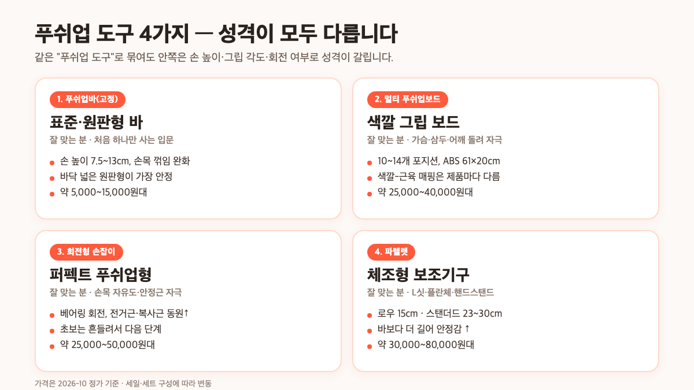
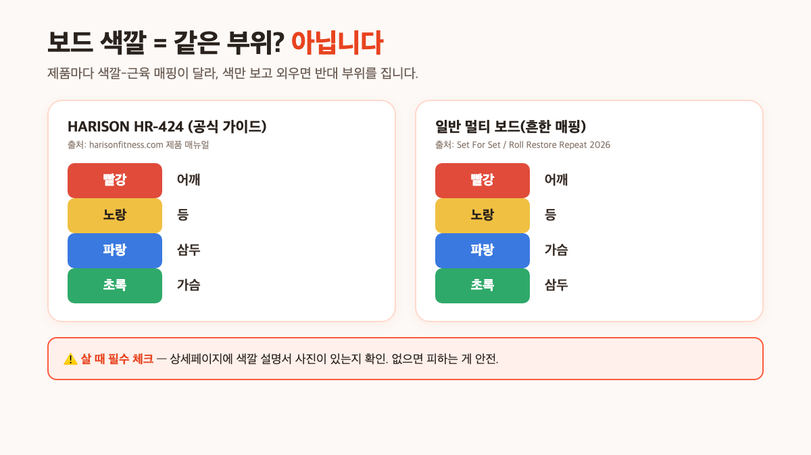

푸쉬업 도구 추천을 검색하면 결과가 거의 "푸쉬업바"로만 쏠려 있어서, 멀티 푸쉬업보드·회전형 손잡이·파렐렛을 함께 비교한 글은 드뭅니다. 결론부터 말하면요, 처음 하나만 산다면 **표준 푸쉬업바**가 가장 무난하고, 운동 부위를 자주 바꾸고 싶다면 **색깔 그립이 있는 멀티 푸쉬업보드**, 체조 동작까지 염두에 둔다면 **파렐렛**, 손목 자유도만 원한다면 **회전형**이 각각의 자리예요. 이 글에서는 네 종류의 차이와 상황별 결정표, 가격대, 그리고 보드마다 색깔-근육 매핑이 다르다는 함정까지 2026년 10월 기준 공식 자료·판매 페이지 사양을 모아 정리했습니다.

📌 3줄 요약
푸쉬업 도구는 바·보드·회전형·파렐렛 네 가지로 요약되고, 처음이면 안정성 좋은 표준 바가 가장 무난합니다.

부위를 자주 바꾸고 싶다면 색깔 그립이 있는 멀티 푸쉬업보드가 편하지만, <b>제품마다 색깔-근육 매핑이 달라</b> 설명서를 꼭 확인해야 합니다.

L싯·플란체·핸드스탠드 연습까지 염두에 둔다면 바보다 높고 긴 파렐렛으로 넘어가는 게 맞습니다.

## 푸쉬업 도구는 사실 네 가지로 나뉩니다

같은 "푸쉬업 도구"로 묶여도 안쪽은 성격이 꽤 다릅니다. 상위 글들을 교차 확인하면 공통적으로 네 가지 축이 등장해요. 바닥에서 손만 들어 올리는 **푸쉬업바**(고정 손잡이), 보드 위 색깔 구멍에 손잡이를 꽂아 각도·너비를 바꾸는 **멀티 푸쉬업보드**, 베어링이 들어 있어 손잡이가 돌아가는 **회전형 손잡이**, 그리고 바보다 더 높고 길어 L싯·플란체·핸드스탠드까지 쓰는 **파렐렛**입니다.

영문 가이드에서는 보통 fixed handles, rotating handles, parallettes 세 축으로 설명하고, 여기에 color-coded push-up board가 하나 더 들어갑니다. 쉽게 말해 바와 보드는 가로축(어떻게 짚을지), 회전형은 세로축(손목이 돌아가는지)에서 선택하는 거라, 두 축을 섞어 조합한 제품도 많아요.

판매 페이지에서 "다기능 푸쉬업바"로 묶여 올라오는 제품도 사실은 보드와 회전형 중 어디에 속하는지가 핵심입니다. 그걸 모르고 사면 "손잡이가 안 돌아가는데 왜 회전형이라고 적혀 있지?"처럼 어긋나기 쉬우니, 아래 비교표부터 보고 가는 게 좋아요.

| 도구 | 특징 | 잘 맞는 경우 | 아쉬운 점 |
| --- | --- | --- | --- |
| 푸쉬업바(표준·고정) | 손만 3~5인치 올려주는 가장 흔한 형태 | 처음 하나만 사고 싶은 입문 | 그립 각도 바꾸기 어려움 |
| 멀티 푸쉬업보드 | 색깔 구멍에 손잡이를 꽂아 부위별 각도 설정 | 가슴·삼두·어깨·등 돌려 자극 원함 | 보관 공간·조립 번거로움 |
| 회전형 손잡이 | 베어링으로 손잡이가 돌아감 | 손목 자유도·안정근 자극 | 처음엔 흔들려 중심 잡기 어려움 |
| 파렐렛 | 바보다 높고 긴 체조 보조기구 | L싯·플란체·핸드스탠드까지 | 바보다 비싸고 자리 많이 차지 |

## 푸쉬업바 — 처음 사는 사람에게 가장 무난한 선택

푸쉬업바는 손을 보통 3~5인치, 즉 7.5~13cm 정도 올려줘 손목 꺾임을 줄이고 바닥 팔굽혀펴기보다 가슴을 조금 더 깊이 스트레치할 수 있게 해 줍니다. 영문 가이드 Trusted Health Gear의 2026년 비교는 "집에 들이는 운동 장비 중 체감 효과 대비 가장 저렴한 업그레이드"라고 묶었고, 국내 리뷰 블로그들도 종류와 상관없이 선택 기준으로 안정성·그립·내구성을 공통으로 꼽습니다.

처음 하나만 산다면 넓은 바닥의 표준·원판형 고정 바가 안전합니다. Chiliguides의 구매 가이드도 원판형(디스크)을 "바닥이 가장 넓어 안정성이 좋고 가격은 중상"으로 분류해요. 그립은 적당히 두껍고 패딩이 감싼 쪽이 손바닥 압력을 분산시키고, 체중 100kg 이상을 지지하는지 하중 표기를 보는 게 좋습니다.

세부적인 종류별 비교(표준·회전·원판·멀티·접이식)와 손목 보호 원리는 이 블로그의 [푸쉬업바 상세 비교 글](/pushup-bar-recommend/)에서 다시 다뤘으니, 바만 좁혀서 보고 싶으면 그 글로 넘어가도 됩니다. 참고로 바닥 팔굽혀펴기 자체는 체중의 약 60~70%를 밀어 올리는 운동이라 체중이 많이 나갈수록 하중 표기와 접지면 넓이를 꼼꼼히 봐야 안전합니다.

## 멀티 푸쉬업보드 — 색깔로 부위를 바꾼다는 아이디어

멀티 푸쉬업보드는 보드 위에 색깔로 구분된 구멍이 뚫려 있고, 그 구멍에 손잡이를 꽂아 각도와 너비를 바꿔 가며 쓰는 방식입니다. 국내에서는 아이워너 멀티 푸쉬업보드가 대표적인데, 하나텍툴 상세페이지에 ABS 소재·61×20×2cm·옐로우/그린/블루/퍼플 색상이 사양으로 올라와 있어요. 보통 10~14가지 위치가 들어 있고, 하중은 제품마다 다르지만 상위권은 200kg(약 500lb) 안팎을 지지한다고 적혀 있습니다.

여기서 중요한 함정이 하나 있어요. **색깔-근육 매핑이 제조사마다 다릅니다.** HARISON의 공식 가이드는 빨강=어깨, 노랑=등, 파랑=삼두, 초록=가슴으로 설명하지만, 다른 보드들을 영문 리뷰에서 모아 보면 파랑=가슴, 빨강=어깨, 노랑=등, 초록=삼두로 쓰는 쪽이 더 흔합니다. 색만 보고 "파랑은 가슴이지"로 외우고 다른 보드를 사면 완전히 반대 부위를 집니다. 그래서 보드 살 때는 상세페이지의 색깔 설명표를 캡처해 두고 쓰는 편이 안전해요.

⚠️ 보드 살 때 반드시 볼 것
포지션 수(10~14), 하중 표기(최소 150kg+), 손잡이 체결 방식(돌려 끼우기 vs 눌러 끼우기), 접이 여부, 그리고 <b>색깔별 설명서 사진</b>. 색깔은 제품마다 다른 부위를 가리키니 설명서 사진이 안 올라와 있다면 피하는 게 낫습니다.

보드의 또 다른 장점은 손잡이가 중립 그립이라 손목이 편하고, 가슴·삼두·어깨를 한 세션 안에 돌려서 자극할 수 있다는 겁니다. 반대 단점은 보관 공간이 꽤 필요하고(60cm 안팎), 매번 손잡이 위치를 바꾸는 게 번거롭다는 점이에요. 홈트를 자주 하지 않거나 좁은 방에서 쓸 거면 바가 더 실용적입니다.

## 회전형 손잡이 — 손목 자유도와 안정근 자극

회전형 손잡이는 베어링이 들어 있어 손잡이 자체가 돌아가는 구조입니다. 대표 제품은 Perfect Fitness Perfect Pushup Elite로, 2026년 10월 공식 판매 페이지 기준 $39.99입니다. 영문 비교 Trusted Health Gear는 이 제품을 "관절에 가장 편한 회전형 1순위"로 꼽았고, Physioroom의 재활 가이드도 회전형이 삼각근·전거근·복사근 같은 **안정근을 더 많이 쓰게 만든다**고 설명합니다.

회전형이 모든 사람에게 좋은 건 아닙니다. The Workout Digest의 비교 글은 "회전형은 안정근 자극이 늘지만, 반대로 고정형이 유리한 아이소메트릭 긴장(어깨·등으로 꽉 버티는 힘)을 흐트러뜨릴 수 있다"고 적어요. 즉 **버티는 힘을 키우고 싶으면 고정형, 손목 자유도와 안정근을 늘리고 싶으면 회전형**이 각각의 자리입니다.

초보에게는 회전형이 처음엔 흔들려서 중심 잡기가 어렵습니다. Physioroom도 "회전형은 통제된 움직임이 익은 뒤에 쓰는 것을 권장"한다고 명시해요. 처음 하나만 산다면 표준 고정형으로 자세를 잡은 뒤, 손목이 유독 뻐근하거나 어깨 안정근을 더 쓰고 싶어질 때 두 번째로 들이는 순서가 실패가 적습니다.

## 파렐렛 — 푸쉬업바와 뭐가 다른가요

파렐렛은 겉모양은 푸쉬업바와 비슷해 보이지만 **더 높고 길다**는 결정적 차이가 있어요. 위키백과 Parallettes 문서는 "체조의 평행봉을 축소한 쌍 기구"로 정의하고, 로우 파렐렛은 약 6인치(약 15cm), 스탠더드 파렐렛은 9~12인치(약 23~30cm)로 소개합니다. 반면 일반 푸쉬업바는 3~5인치(약 7.5~13cm)로 훨씬 낮아요.

이 높이 차이가 쓸모를 가릅니다. 파렐렛은 L싯(엉덩이를 들고 다리를 앞으로 뻗는 자세)·V싯·플란체 린(앞으로 기울어 버티기)·핸드스탠드 푸쉬업까지 다 되는 반면, 푸쉬업바는 그냥 팔굽혀펴기용으로만 쓰기 좋습니다. 가로 길이도 파렐렛이 길어 핸드스탠드처럼 다리가 바닥에서 떨어진 자세에서 안정감이 좋아요.

반대로 바 입장에서는 파렐렛이 과한 선택입니다. 자리를 더 차지하고 값도 비싸며, 그냥 팔굽혀펴기만 할 거라면 바로 충분해요. 체조·칼리스테닉스 쪽 운동을 생각하지 않는다면 파렐렛은 다음 단계로 미뤄도 됩니다. 턱걸이 쪽까지 보고 있다면 [가정용 철봉 추천](/home-pull-up-bar-guide/)에서 설치형 선택지를 먼저 보는 편이 홈트 구성에 더 유리합니다.

## 상황별로 뭘 사야 할까요

지금까지 네 가지의 성격을 봤으니, 상황별로 매칭표를 짜 보면 선택이 꽤 간단해집니다. 저장해두고 살 때 체크리스트로 쓰세요.

| 내 상황 | 추천 도구 | 이유 |
| --- | --- | --- |
| 처음 하나만 사고 싶다 | 표준 푸쉬업바(고정·원판) | 안정성·가성비·설치 공간 모두 가장 무난 |
| 손목이 유독 뻐근하다 | 표준 바 → 두 번째로 회전형 | 바로 꺾임↓, 회전형은 다음 단계 |
| 가슴·삼두·어깨를 돌려 자극하고 싶다 | 멀티 푸쉬업보드 | 색깔 그립으로 각도 전환 |
| 홈트 공간이 매우 좁다 | 접이식 바 또는 S형 바 | 보드는 60cm 보관 공간 필요 |
| 체조·칼리스테닉스까지 가고 싶다 | 파렐렛(로우 또는 스탠더드) | L싯·플란체·핸드스탠드까지 지원 |
| 어깨 안정근을 더 쓰고 싶다 | 회전형 손잡이 | 전거근·복사근 동원↑ |

이 표에서 가장 중요한 건 "처음부터 멀티·회전형·파렐렛을 한 번에 사지 않는다"는 겁니다. 영문 가이드도 공통적으로 **입문자는 고정 바부터 시작하고 필요가 생길 때 다음 도구로 넓히라고 권장**해요. 홈트 기본 장비를 더 폭넓게 보고 싶다면 [홈트 기구 추천 — 입문자가 처음 살 장비](/home-workout-beginner-gear/) 글도 함께 참고하면 도움이 됩니다.

## 가격대와 살 때 주의할 점

푸쉬업 도구는 다른 홈트 장비에 비하면 저렴한 편입니다. 2026년 10월 기준 영문 Trusted Health Gear의 가격 분류와 국내 TOP텐 블로그의 TOP5(코멧 7,990원·레토 14,100원·바디공식 19,800원·멀티 25,900원·세트 31,190원)를 교차해 정리하면 이렇습니다. 다만 세일·세트 구성에 따라 자주 바뀌니 "**정가 기준**"으로만 참고하고 판매 페이지에서 다시 확인하세요.

| 도구 | 가격대(정가 기준) |
| --- | --- |
| 표준 푸쉬업바(기본) | 약 5,000~15,000원 (영문권 $8~$10) |
| S형·접이식 바 | 약 7,000~15,000원 |
| 회전형 손잡이(퍼펙트 푸쉬업 등) | 약 25,000~50,000원 (해외 $20~$40) |
| 멀티 푸쉬업보드(14가지 그립) | 약 25,000~40,000원 (해외 $27~$40) |
| 파렐렛(로우·스탠더드) | 약 30,000~80,000원 |

살 때 주의할 점은 세 가지예요. 첫째, 바닥 접지면이 좁고 미끄럼 패드가 부실한 초저가 제품은 피하세요. 운동 중 바가 미끄러지면 손목·어깨 부상으로 이어질 수 있습니다. Physioroom은 "손은 어깨너비, 몸은 일자, 팔꿈치가 바깥으로 벌어지지 않게"를 공통 자세로 권하고, 초보는 세트당 5~10회로 시작하라고 안내합니다.

둘째, 보드는 색깔 설명서, 바는 하중 표기, 파렐렛은 가로 길이와 미끄럼 패드를 반드시 확인하세요. 셋째, 손목이나 어깨에 통증이 느껴진다면 무리하지 말고 본인 상태에 맞춰 개수와 강도를 조절하는 게 좋습니다. 운동 중 심박·세트 시간을 함께 보고 싶다면 [삼성 갤럭시 워치 공식](https://www.samsung.com/sec/watches/all-watches/) 라인업처럼 홈트 트래킹이 되는 웨어러블을 쓰는 것도 방법이에요.

💡 조합 추천 — 처음부터 2개 사고 싶다면
예산이 2~3만 원대라면 "표준 바 + 멀티 보드"보다 "넓은 바닥의 표준 바 + 저항 밴드"가 조합이 더 넓습니다. 보드는 자리를 많이 차지하고 돌려 끼우기가 번거롭지만, 밴드는 저항을 바꿔 가슴·등·삼두를 모두 커버할 수 있어요.

## 자주 묻는 질문 (FAQ)

**Q. 푸쉬업 도구 처음 사는데 뭐가 가장 무난한가요?**
A. 넓은 바닥의 표준 푸쉬업바(고정·원판)가 가장 무난합니다. 바닥이 넓어 흔들림이 적고 가격도 저렴해 자세를 잡기 좋기 때문입니다. 손목 자유도나 부위 돌리기는 두 번째 도구로 미뤄도 됩니다.

**Q. 멀티 푸쉬업보드와 푸쉬업바 중 뭐가 효과가 좋나요?**
A. 효과 자체보다 "부위를 자주 바꿀 것인가"로 결정하세요. 가슴·삼두·어깨·등을 돌려 자극하고 싶다면 색깔 그립이 있는 보드가 편하고, 그냥 팔굽혀펴기만 할 거라면 바가 자리를 덜 차지해 실용적입니다.

**Q. 멀티 푸쉬업보드 색깔은 어느 보드나 같은 부위를 가리키나요?**
A. 아닙니다. 제조사마다 색깔-근육 매핑이 다릅니다. 예를 들어 HARISON은 빨강=어깨, 노랑=등, 파랑=삼두, 초록=가슴으로 쓰지만 다른 보드는 파랑=가슴, 초록=삼두를 쓰기도 합니다. 상세페이지의 색깔 설명서 사진을 꼭 확인하세요.

**Q. 파렐렛과 푸쉬업바는 뭐가 다른가요?**
A. 파렐렛은 바보다 더 높고 깁니다. 일반 바는 약 3~5인치(7.5~13cm), 로우 파렐렛은 약 6인치(15cm), 스탠더드 파렐렛은 9~12인치(23~30cm)예요. 그 높이와 길이 덕분에 L싯·플란체·핸드스탠드 푸쉬업까지 쓸 수 있지만, 평범한 팔굽혀펴기만 할 거라면 바로 충분합니다.

**Q. 회전형 손잡이는 초보에게도 좋은가요?**
A. 처음엔 흔들려서 중심 잡기가 어렵습니다. 재활·운동 가이드 Physioroom도 통제된 움직임이 익은 뒤에 쓰길 권해요. 입문자는 고정형 표준 바로 자세를 먼저 잡고, 손목이 유독 뻐근하거나 어깨 안정근을 더 쓰고 싶어질 때 두 번째로 들이는 편이 실패가 적습니다.

이거 하나만 기억하면 돼요. 푸쉬업 도구는 **표준 바 → 보드·회전형 → 파렐렛** 순으로 넓혀 가는 게 정석이고, 처음부터 다 사려 할수록 공간과 돈만 낭비하기 쉽습니다.

---

**관련 키워드** — #푸쉬업도구추천 #푸쉬업바 #푸쉬업보드 #멀티푸쉬업보드 #회전형푸쉬업바 #파렐렛 #푸쉬업보드색깔 #팔굽혀펴기기구 #홈트레이닝용품 #푸쉬업바종류 #손목보호 #칼리스테닉스
