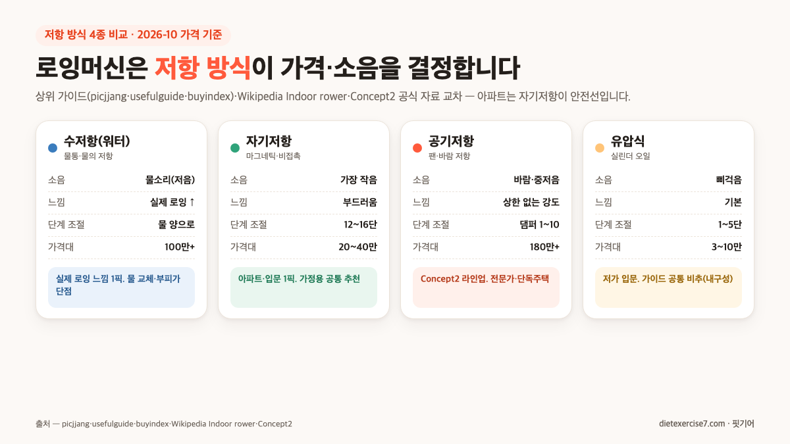
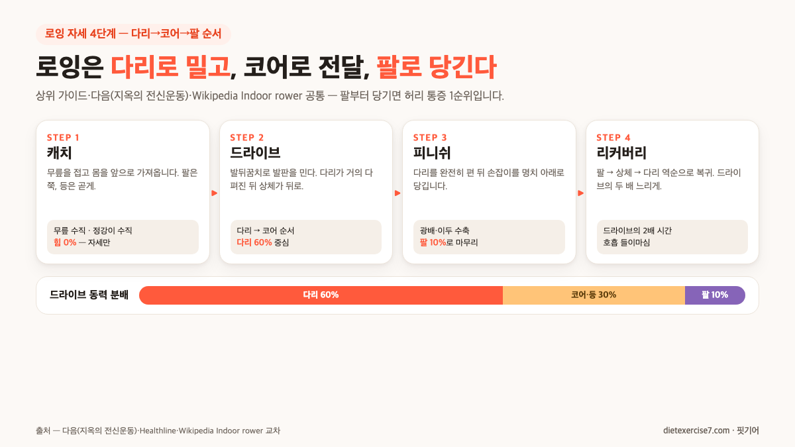

로잉머신 가정용 추천에서 가장 흔한 오해가 "팔운동 기구"라는 겁니다. 사실은 반대예요. Healthline과 다음 "지옥의 전신운동" 기사가 공통으로 적는 분배가 **다리 60% · 코어·등 30% · 팔 10%** 비율이에요. 그래서 추천 기준도 "팔힘 잘 받는 손잡이"가 아니라 **저항 방식**(수·자기·공기·유압)·**레일 길이**·**소음** 세 축에서 거의 다 결정돼요.

결론부터 요약하면, 2026년 10월 상위 가이드(picjjang·sonpang·usefulguide·buyindex)와 Wikipedia Indoor rower·Concept2 공식 자료 교차 결과 **가정용 입문은 자기저항 20~30만 원대**가 공통 정답이고, 수저항·공기저항은 100만 원대 이상 전문가·단독주택용, 유압식 3~10만 원대는 공통 비추입니다. 이 글에서는 "팔운동" 오해를 포함해 로잉머신 가정용 추천에서 가장 자주 틀리는 다섯 가지를 하나씩 바로잡으면서, 아파트 층간소음·자세·가격대·상황별 결정표까지 묶어 드릴게요.

📌 3줄 요약
로잉머신은 <b>다리 60% · 코어 30% · 팔 10%</b> 운동이에요. 손잡이·그립보다 <b>저항 방식·레일 길이·소음</b> 세 축이 선택을 결정합니다.

가정용 입문은 <b>자기저항 20~30만 원대</b>가 상위 가이드 공통 추천이에요. 수저항·공기저항은 100만 원대 이상 전문가·단독주택용, 유압식 3~10만 원대는 내구성·단계 때문에 비추.

아파트 층간소음은 <b>진동(저음) 축</b>이 핵심이라 러닝머신과 다른 매트가 필요합니다. 자기저항 + 접촉부 고무판 + 고밀도 매트 조합이 커뮤니티 공통선이에요.

## "팔로 당기는 운동"이라는 오해부터 깨자 — 다리 60% · 코어 30% · 팔 10%

로잉머신 가정용 추천에서 가장 많이 틀리는 지점이 **동력 분배**입니다. 다음 "지옥의 전신운동" 기사(2024-01)가 적는 수치가 "**로잉은 전체 하체 근력의 60%, 상체·코어 40%**"이고, Healthline 공식 가이드도 "**65~75% leg work, 25~35% upper body work**"로 거의 같은 범위를 묶어요. 즉 로잉은 "**다리로 밀어서 그 반동으로 손잡이가 끌려오는 운동**"에 가깝고, 팔은 마지막 10% 피니쉬에만 쓰입니다.

이 분배를 모르고 사면 선택이 꼬여요. 예를 들어 "팔힘이 약하니 가벼운 저가 유압식부터"로 들어가면 ① 레일이 짧아 다리로 밀 거리가 안 나오고, ② 유압 1~5단계로는 다리 근력에 바로 저항이 부족해지며, ③ 피니쉬에서 팔에만 힘이 들어가 팔꿈치·허리 통증이 생깁니다. 상위 가이드가 공통으로 "유압식은 가정용 입문 비추"로 꼽는 이유도 결국 **다리로 미는 운동**이라는 역학에서 나와요.

Wikipedia Indoor rower 문서가 적은 자세 4단계도 이 분배를 그대로 반영합니다. **캐치**(준비)에서는 힘이 0%, **드라이브**(밀기)에서 다리 → 코어 → 팔 순으로 힘이 전달되고, **피니쉬**는 광배근·이두근으로 명치 아래까지 당긴 뒤, **리커버리**는 드라이브의 두 배 느리게 돌아옵니다. 다음 기사가 적은 "**다리 → 코어·상체 → 팔**" 드라이브 순서는 로잉 교본 공통이고, 반대로 "**팔 → 상체 → 다리**" 리커버리 순서를 반대로 하면 코어 비틀림으로 허리 통증이 흔히 나와요.

## 결론부터 — 가정용은 자기저항 20~30만 원이 입문 정답입니다

처음 사는 분이 가장 먼저 알고 싶은 "그래서 뭘 사야 하냐"의 공통 정답이 **자기저항·마그네틱 20~30만 원대**입니다. 2026년 10월 picjjang·usefulguide·buyindex가 공통으로 1픽에 두는 조합이에요. "**가정용으로는 자기저항식이 무난하고 추천할 만합니다**"가 picjjang 가이드의 원문입니다.

| 내 상황 | 추천 저항 방식 | 가격대(정가) | 대표 모델(상위 가이드 교차) |
| --- | --- | --- | --- |
| 아파트 입문·꾸준한 홈트 | 자기저항·16단계 | 20~30만 원 | 두스룬 WR801, 멜킨 볼트윅, 포스코어 |

세부 상황별(원룸·전문가·체중 90kg+·관절 재활) 분기는 글 끝 **상황별 결정표**에서 저항 방식별로 다시 묶었어요. 유압식 3~10만 원대는 가격만 보이지만 **내구성·단계 조절·소음**에서 세 가이드 모두 비추이고, 수저항·공기저항 100만 원대 이상은 "그 느낌이 꼭 필요한 이유"가 분명한 뒤에 두 번째 기구로 올려도 늦지 않습니다. 그래서 이 압축 추천 표는 가장 많은 분이 걸리는 **아파트·입문·꾸준한 홈트** 조합 한 줄로 좁혀 뒀어요.

가정용 로잉머신이 가격이 10배 넘게 벌어지는 이유도 결국 저항 방식에서 나오는데, 다음 섹션에서 네 종류를 하나씩 뜯어 보겠습니다.

## 저항 방식 4종 — 수·자기·공기·유압이 왜 가격이 10배 차이 나나

Wikipedia Indoor rower 문서는 저항 방식을 공식적으로 네 가지로 나눕니다. **Air · Water · Magnetic · Piston**(hydraulic). 국내 가이드(picjjang·usefulguide·buyindex·namuwiki)도 거의 같은 네 분법을 쓰고, 각각 특징·가격·소음이 분명히 갈려요.

**① 수저항**(워터·물 저항) — Wikipedia의 "**water resistance … paddle rotating in an enclosed water tank**" 설명 그대로, 물통 안의 패들이 돌면서 저항을 만듭니다. 장점은 "**실제 조정에 가장 흡사한 느낌**"과 물소리 특유의 저음이 리듬에 녹는 것, 단점은 ① 가격이 100만 원대 이상, ② 물통 분리가 안 되는 모델이 많아 **물 교체·소독**이 필요, ③ 부피가 가장 크다는 겁니다. 바디스터 버티컬·아디다스 R-21이 국내 대표 라인업이에요.

**② 자기저항**(마그네틱) — 자석의 거리로 저항을 만드는 비접촉 방식이라 **마모·소음이 가장 적습니다**. picjjang 가이드가 "소음이 적어 층간소음 걱정이 덜하고 저항 강도 조절도 수월"로 묶는 이유예요. 2026년 10월 기준 두스룬 WR801(16단계·29만 원대), 멜킨 볼트윅(16단계·마그네틱), 엑사이더 ROW-M(16단계·블루투스)이 중급 라인업이고, 가격은 9만 원대부터 40만 원대까지 가장 넓습니다. **가정용 입문 1픽**이 여기서 거의 다 나와요.

**③ 공기저항**(에어·팬) — 플라이휠에 달린 베인(vane·날개)이 공기를 밀어 저항을 만듭니다. Wikipedia가 적은 그대로 "**vanes on the flywheel to provide braking**"이에요. Concept2(1976년 설립·버몬트 본사)가 공식 라인업이고, 2018년부터 "**CrossFit 공식 규격**"으로 쓰입니다. **상한 없는 고강도**가 장점(댐퍼 1~10단으로 공기량만 조절, 밟을수록 더 세짐)이고 단점은 **바람 소리·중저음 진동 + 가격 180만 원 이상**이에요. 가정 아파트보다는 단독주택·전용 운동방 쪽이 맞습니다.

**④ 유압식**(피스톤) — Wikipedia의 "**piston resistance … hydraulic cylinders attached to handles**" 설명 그대로, 손잡이에 유압 실린더가 달려 있어 당기면 저항이 생깁니다. 가격이 3~10만 원대로 가장 싸고 본체 크기도 가장 작지만 ① 저항 단계가 1~5단에 그치고, ② 실린더 삐걱음·열, ③ 레일이 짧아 **다리로 밀 거리가 안 나와 로잉 자세 자체가 틀어진다**는 공통 지적이 상위 가이드 전체에 반복됩니다. 가성비처럼 보여도 결국 재구매 1순위가 돼요.

💡 저항 방식 한 줄 정리
<b>수저항</b> — 실제 로잉 느낌·물 교체 필요·100만+. 전문가·여유 공간. <b>자기저항</b> — 가장 조용·12~16단 조절·20~40만. <b>아파트·입문 1픽.</b> <b>공기저항</b> — 상한 없는 고강도·바람 소리·180만+. 단독주택·CrossFit. <b>유압식</b> — 3~10만 원대 가장 저렴하지만 레일·단계·내구성 공통 비추.

## 유압식 3만 원대가 가성비처럼 보여도 가이드 공통 비추인 이유

가정용 로잉머신 추천에서 두 번째로 자주 틀리는 지점이 "**가성비 유압식으로 시작하자**"입니다. 숀리 다이어트킹(7.7만), 5in1 슬라이드(3.59만) 같은 모델이 쿠팡 베스트에 자주 올라서 입문용 1픽처럼 보여요. 그런데 picjjang·usefulguide 두 곳이 공통으로 "**저렴한 유압식은 몇 달 쓰다 보면 삐걱거리거나 흔들린다**"고 적는 이유가 세 가지 겹칩니다.

**① 레일 길이가 짧아 자세 자체가 안 나온다** — 유압식은 손잡이·실린더가 본체에 고정돼 있어 레일(시트가 움직이는 트랙)이 흔히 70~90cm 수준이에요. 반면 Concept2 RowErg는 **본체 조립 길이 244cm · 슬라이드 트랙 약 137cm**(Concept2 공식 스펙)로, 시트가 움직이는 트랙만 봐도 유압식의 1.5~2배입니다. 다리를 다 펴고 다시 접기까지 시트가 왕복할 거리가 안 나오니, 결국 **다리 60% 중심 운동이 아니라 팔로만 당기는 운동**이 돼요. 그러면 처음 쓴 "다리 60% 분배"가 깨지면서 허리·팔꿈치 부담만 쌓입니다.

**② 저항 단계 1~5단으로는 체급 변화를 못 따라간다** — 중급 자기저항이 12~16단계인 반면 저가 유압은 실린더 설정값으로 1~3단에 그치는 경우가 많아요. 처음 2~3주 적응기에는 괜찮지만, 다리 근력이 늘기 시작하면 저항이 너무 가벼워 심박이 올라오지 않고 "그냥 왕복만 하는 느낌"이 됩니다. 다음 기사가 적은 **고강도 SPM 28~32**(분당 스트로크)·**저강도 SPM 18~20** 인터벌 자체가 설정이 안 돼요.

**③ 실린더 삐걱음·열이 아파트 밤 사용을 막는다** — 유압 실린더는 오일 저항으로 작동하는데, 반복 사용하면 **내부 열이 올라와 삐걱음이 커진다**는 지적이 picjjang 가이드와 커뮤니티에서 공통 반복됩니다. 삐걱음 자체는 공기 전달이라 매트로는 안 잡혀요. 결국 "저녁에 조용히 홈트" 목적이면 자기저항으로 넘어가는 쪽이 사실상 유일한 해결이고, 그러면 처음 10만 원 아낀 게 두 번 사게 되는 셈입니다.

예외는 두 가지입니다. **① 좁은 원룸 + 월 4~6회 가벼운 유산소만** 할 거면 유압식 미니 3~5만 원대도 괜찮고, **② 아이·시니어 체력 유지용**으로 짧게만 쓸 거면 숀리 다이어트킹처럼 4그립 저가 모델이 공간 효율에서 유리해요. 다만 "꾸준히 홈트" 또는 "체중 감량 목적"이면 처음부터 자기저항으로 가는 쪽이 재구매를 줄입니다.

## 수저항 vs 공기저항 — 전문가급 두 선택지의 분기점

반대편 끝에는 100만 원대 이상 전문가급 두 축이 있습니다. 수저항과 공기저항은 둘 다 "실제 로잉에 가장 가깝다"는 평을 받지만 **느낌·소음·공간이 전혀 다릅니다**. 처음 사는 분이 "비싼 거 사면 되지"로 넘어가지 않도록 분기점을 짚을게요.

수저항은 "**느낌**"이 목적입니다. Wikipedia Indoor rower가 적은 "**smooth, boat-like feel**"이 핵심이고, 물 저항은 패들 회전 속도에 따라 자동으로 커져 **지수적 저항 곡선**을 만들어요. 자연 호수나 강에서 노 저을 때와 같은 리듬이 집에서 재현됩니다. 다만 ① 가격 100~230만 원, ② 물 20L+가 든 통 때문에 **본체 무게 30~50kg**, ③ 세로 2m 이상 공간이 필요하고 **분리·소독 유지보수**가 들어요. 바디스터 버티컬·아디다스 R-21이 대표.

공기저항은 "**강도 상한**"이 목적입니다. Concept2 공식 설명대로 "**공기의 양이 저항의 양**"이라, 세게 밀면 밀수록 저항이 올라가는 **열린 상한** 구조예요. CrossFit·사이클 선수가 공식 훈련용으로 쓰는 이유가 이겁니다. 다만 ① Concept2 RowErg 국내 가격이 **다나와 2026-10 기준 179~183만 원 범위**(sonpang 179만·국내 최저가 183만대 교차), ② 바람 소리와 플라이휠 중저음 진동이 자기저항보다 크고, ③ 본체 **조립 길이 244cm · 슬라이드 트랙 약 137cm · 하중 226kg · 접힘 2단**(Concept2 공식 스펙)이라 공간을 많이 차지합니다.

둘의 공통점은 "**입문자가 혼자 쓰기엔 과한 투자**"라는 거예요. 사이클 선수급 체력이거나, 전용 운동방을 둘 수 있는 단독주택이거나, 또는 집에서 로잉 센터 수준 트레이닝이 분명한 목표가 아니면 1년도 안 돼서 "자리만 차지한다"는 후기가 흔히 나옵니다. "실제 로잉 느낌이 꼭 필요한지"를 먼저 물어보고, 아니면 자기저항 30만 원대에서 멈추는 쪽이 재구매·처분을 줄여요.

## 아파트 층간소음은 "진동" 축이라 러닝머신과 다른 매트가 필요하다

로잉머신 가정용 추천에서 세 번째로 자주 틀리는 지점이 **소음 축의 종류**입니다. 러닝머신 층간소음과 "같은 매트"로 해결하려 하면 아래층에서 민원이 들어와요. 로잉은 쿵쿵 **충격음**이 아니라 플라이휠·시트 레일에서 바닥으로 전달되는 **저음 진동**(고체 전달)이 주요 축이기 때문입니다.

클리앙 "집에서 로잉머신 하시는 분들 층간소음 궁금합니다" 토론의 베스트 댓글이 가장 깔끔하게 짚어요. "**진공청소기랑 비슷한 수준의 소음**"이고, "**밑에 층에선 날카로운 음은 안 들려도 둥둥둥하는 중저음이 느껴진다**"는 겁니다. 즉 데시벨 숫자(dB)만 보면 러닝머신보다 조용한데, 실제 아래층 체감은 **저음 진동**이라 매트가 두꺼워도 못 잡는 경우가 흔해요.

**해결책은 두 축으로 분리**합니다. 커뮤니티 공통 조치가 세 가지 겹칩니다. **① 접촉부마다 고무판 1장씩** — 레일 발·플라이휠 다리 아래에 두꺼운 고무판을 끼워 진동 전달을 1차로 끊습니다. **② 그 아래 고밀도 매트 8~20mm** — 러닝머신용으로 많이 쓰는 EVA 매트가 아니라 **고밀도 고무 매트**가 저음에 더 효과적이에요. **③ 밤 시간대 금지** — 저음은 늦은 밤일수록 더 멀리 전달되니, 22시 이후는 피하는 쪽이 안전합니다.

⚠️ 매트만 믿으면 안 됩니다 — "매트+고무판+시간대" 세트
클리앙 토론 베스트 조언이 "<b>매트 깐다고 진동의 울림을 막을 수 있는 게 아니다</b>"입니다. 공기저항(Concept2)은 특히 바람 소리 + 플라이휠 저음 진동이 겹쳐 중층 이상 아파트에서는 늦은 밤 사용이 어렵고, 자기저항도 접촉부 고무판·고밀도 매트까지 묶어야 안전합니다. 수저항은 물소리가 저음이라 오히려 "울림이 덜하다"는 평이 많아요.

접촉부 고무판은 1~2만 원대, 고밀도 로잉 매트는 3~8만 원대에서 쿠팡·네이버 쇼핑에서 구할 수 있고, [쿠팡 로잉머신 매트](https://www.coupang.com/np/categories/115749) 카테고리에서 두께·밀도별 가격대를 한눈에 비교할 수 있어요. 자기저항 20만 원대 입문 모델이라도 매트 + 고무판 세트로 묶어 두는 쪽이 중장기 민원을 가장 많이 줄입니다.

## 로잉 자세 4단계 — 다리로 밀고, 코어로 전달, 팔로 당긴다

구매 못지않게 중요한 축이 **자세**입니다. 상위 가이드 공통 지적이 "**자세가 틀리면 로잉은 가장 빨리 허리를 다치는 기구**"라는 거예요. 다음 "지옥의 전신운동" 기사가 적은 자세 4단계가 Wikipedia Indoor rower 공식 분류와 거의 일치하니, 그대로 익혀 두시면 됩니다.

**① 캐치**(준비) — Wikipedia의 "**knees are bent with the shins in a vertical position**" 설명대로, 무릎을 접고 **정강이가 수직**이 되도록 몸을 앞으로 가져옵니다. 등은 곧게 세우고 팔은 쭉, 손잡이는 발 바로 위. 이 순간 힘은 **0% 수준**이에요. 자세만 잡는 단계입니다.

**② 드라이브**(밀기) — 로잉의 핵심이에요. **다리 → 코어 → 팔** 순서로 힘이 전달됩니다. 발뒤꿈치로 발판을 **밀면서** 시트가 뒤로 가고, 다리가 거의 다 펴진 뒤에야 상체가 뒤로 넘어가며 코어가 작동, 마지막에 팔로 손잡이를 당깁니다. 다음 기사가 적은 "**다리 → 코어·상체 → 팔**" 순서를 지키지 않고 팔부터 당기면 광배·이두에만 부하가 몰려 팔꿈치 통증이 흔합니다.

**③ 피니쉬**(마무리) — 다리를 완전히 펴고 손잡이를 **명치 아래**로 당깁니다. 상체는 약간 뒤로 기울어진 상태(약 10~15도)로, 팔꿈치는 몸 옆을 스치듯 지나가야 광배근·이두근이 제대로 수축해요. 손잡이가 가슴 위로 올라가면 어깨 승모근에 부하가 몰려 목 통증 1순위가 됩니다.

**④ 리커버리**(복귀) — 반대 순서로 돌아옵니다. **팔 → 상체 → 다리**. 다음 기사가 적은 공식 조언이 "**드라이브보다 두 배 느린 속도**"예요. 숨을 들이마시며 천천히 캐치 자세로 돌아오면 심박이 조절되고, 다음 드라이브에서 다시 다리에 힘이 모입니다. 리커버리가 빠르면 심폐가 안 올라오고, 느리면 리듬이 깨져요.

운동 강도는 **SPM**(Strokes Per Minute)로 조절합니다. 다음 기사가 적은 공식 범위가 **고강도 SPM 28~32 · 저강도 SPM 18~20**이고, 가정용 자기저항 모델도 LCD 계기판에 SPM이 표시됩니다. 40초 고강도 + 20초 저강도 인터벌을 15분 반복하는 세팅은 다음 기사의 "**15분 전력 500kcal**"와 유사한 수준이지만(인터벌·전력 조건이 완전히 같지는 않음), 처음부터 이렇게 하면 자세가 깨지니 **첫 2주는 SPM 18~22의 저강도**로만 20~30분 왕복해 다리로 밀 거리·호흡 리듬부터 익히는 쪽이 안전합니다.

## 운동 효과·칼로리 — 30분 300~400kcal, 다른 유산소보다 효율↑

이제 구매 결정에 영향을 주는 수치를 모아 볼게요. 상위 가이드가 공통으로 적는 수치는 **중강도 30분 300~400kcal**입니다. 다음 기사는 "일반인 중강도 30분 300~400kcal", 헬스경향(k-health) 기사는 "**사이클의 약 2배, 트레드밀의 약 3배**", Healthline은 "**155파운드·70kg 체중 기준 30분 격렬한 로잉 369kcal**"(Harvard Health 데이터)를 적어요. 모두 다른 유산소 기구보다 **칼로리 효율이 높다**는 쪽에서 수렴합니다.

| 체중·강도 | 30분 칼로리 | 60분 환산 | 비고 |
| --- | --- | --- | --- |
| 60kg·저강도 | 180~240kcal | 360~480kcal | SPM 18~20, 적응기 2주 |
| 70kg·중강도 | 300~400kcal | 600~800kcal | SPM 22~26, 꾸준한 홈트 |
| 70kg·격렬한 로잉 | 369kcal(Harvard) | 740kcal | SPM 28+, 숙련자 |
| 80kg·HIIT 인터벌 | 400~500kcal | 800kcal+ | 40초/20초 반복 |
| 15분 전력 | 400~500kcal | - | 다음 "500kcal" 기사 기준 |

운동 부위는 Healthline과 Hydrow·Aviron이 공통으로 짚는 "**86% 전신 근육 참여**"입니다. 큰 근육군만 꼽아도 **대퇴사두근·햄스트링·둔근·광배근·승모근·척추기립근·복근·이두근·삼두근·전완근**까지 10개 이상이 한 번의 드라이브에 다 참여해요. 그래서 다음 기사가 적은 "**지옥의 전신운동**"이라는 수식이 과장이 아닙니다.

로잉이 러닝머신·실내자전거와 결정적으로 다른 지점이 하나 더 있어요. 바로 **저충격**입니다. Healthline은 "**low-impact exercise**"로 분류하면서 "**초기 단계 골관절염 환자에게 적합**"하다고 적고, 2015년 연구에서 "**8주간 주 5일 로잉으로 관절 가동범위 30% 향상**"을 보고합니다. 발바닥이 발판에 고정된 채 체중을 좌우로 옮기지 않고 밀기만 하기 때문에, 무릎·발목 관절 충격이 러닝의 1/3 수준이에요.

로잉머신 외에 홈트 중량 기구까지 세팅할 계획이라면 [케틀벨 무게 추천 — 남자·여자·초보는 몇 kg](/home-kettlebell-guide/)에서 다룬 체중별 세팅 기준을 함께 보시면 유산소·근력 둘을 공간·예산 안에서 묶어 결정하기 좋습니다.

## 2026년 10월 가격대와 상황별 결정표

마지막으로 지금까지 축을 다 모아 상황별 결정표로 정리할게요. 가격은 picjjang·usefulguide·buyindex·다나와·sonpang의 2026년 10월 정가·베스트셀러 가격을 교차한 범위로, 세일·세트 구성에 따라 자주 바뀌니 **정가 기준·참고용**으로만 쓰세요.

| 가격대(정가) | 저항 방식 | 특징 | 대표 모델 |
| --- | --- | --- | --- |
| 3~10만 원 | 유압식 | 입문 저가·레일 짧음 | 숀리 다이어트킹(7.7만), 5in1 슬라이드(3.59만) |
| 9~20만 원 | 자기저항·12단계 | 아파트 입문·접이식 | 코멧(9만 원대), 로베라 폴딩 |
| 20~30만 원 | 자기저항·16단계 | **가정용 1픽** | 두스룬 WR801(29.36만), 멜킨스포츠 스컬(20.4만), 포스코어(23.6만) |
| 30~40만 원 | 자기저항 상급 | 블루투스·하중 150kg | 엑사이더(37만 원대·블루투스), OMYGA(하중 150kg) |
| 100~160만 원 | 수저항(워터) | 실제 로잉 느낌 | 바디스터 버티컬, 아디다스 R-21(228만), 메라크 헬스(159만) |
| 180만 원+ | 공기저항 | CrossFit 공식·전문가 | Concept2 RowErg(179~183만), 컨셉2 Model E(325만) |

이 표의 핵심은 "**20~30만 원대 자기저항이 넓은 입문 영역을 전부 커버한다**"는 거예요. 아파트·초보·꾸준한 홈트 세 조건이 겹치면 이 가격대에서 결정이 거의 다 끝납니다. 반대로 Concept2·수저항은 "진짜 그 느낌이 필요한 이유"가 분명해지는 뒤에 두 번째 기구로 올려도 늦지 않아요.

| 내 상황 | 저항 방식 | 가격대 | 대표 모델 |
| --- | --- | --- | --- |
| 원룸·가끔 유산소·주 2회 | 자기저항·접이식 | 9~20만 원 | 코멧, 로베라 폴딩 |
| 아파트·꾸준한 홈트 | 자기저항·16단계 | 20~30만 원 | 두스룬 WR801, 멜킨 볼트윅 |
| 체중 90kg+ | 자기저항·하중 150kg+ | 30만 원 이상 | OMYGA, 엑사이더 ROW-M |
| 전용 운동방·실제 로잉 느낌 | 수저항(워터) | 100만 원 이상 | 바디스터 버티컬, 아디다스 R-21 |
| 사이클 선수급·HIIT | 공기저항 | 180만 원 이상 | Concept2 RowErg(구 Model D) |
| 노약자·관절 재활 | 자기저항·4그립 | 10~20만 원 | 숀리 2세대 다이어트킹 |

*표에서 유압식(3~10만 원대)을 뺀 이유 — 레일 70~90cm로 짧고 저항 1~5단에 그쳐, picjjang·usefulguide·buyindex 세 가이드 모두 "가정용 꾸준한 홈트 비추"로 묶기 때문입니다. "2~3주 적응기·노약자 체력 유지"처럼 아주 짧고 가벼운 사용만 조건이면 숀리 다이어트킹·5in1 슬라이드 같은 저가 라인이 공간 효율에서는 유리합니다.*

꼭 하나 더 짚어 두면, 상위 가이드 전부가 "**가격보다 레일 길이·하중 등급·단계 조절 수**"를 먼저 체크하라고 합니다. 레일이 짧으면 다리로 밀 거리가 안 나와서 60% 다리 운동이 깨지고, 하중이 체중보다 작으면 프레임이 변형되며, 단계가 1~5단이면 체급 변화를 못 따라가요. 가격을 좁힌 뒤에는 반드시 이 세 숫자를 다시 보시는 쪽이 재구매를 가장 많이 줄입니다.

## 자주 묻는 질문 (FAQ)

**Q. 로잉머신 가정용 추천, 아파트 중층에서도 괜찮나요?**
A. 자기저항 + 접촉부 고무판 + 고밀도 매트 조합이면 대체로 안전합니다. 다만 로잉은 러닝머신의 쿵쿵 "충격음"이 아니라 플라이휠·레일의 "저음 진동"이 축이라, 러닝용 EVA 매트만으론 못 잡아요. 클리앙 토론 공통 조치는 ① 레일 발 아래 고무판 1장씩, ② 그 아래 고밀도 로잉 매트, ③ 22시 이후 금지입니다. 공기저항(Concept2)은 중층 이상에선 특히 밤 사용이 어렵습니다.

**Q. 자기저항 20만 원대와 Concept2 180만 원대, 뭐가 다른가요?**
A. 핵심 차이는 **레일 길이·저항 상한·소음**입니다. 자기저항은 레일 120cm 전후·단계 조절 12~16단·거의 무소음이고, Concept2 RowErg는 레일 229cm·댐퍼 1~10단으로 공기량만 조절해 상한이 열려 있어요(세게 밀면 더 세짐). CrossFit 공식 규격이라 사이클 선수급 훈련이 가능하지만, 가정 입문자가 그 상한까지 쓸 일은 거의 없습니다. "그 느낌이 꼭 필요한가"를 먼저 물어보세요.

**Q. 유압식 로잉머신 3만 원대는 왜 비추인가요?**
A. 세 가지가 겹칩니다. ① 레일이 70~90cm 수준으로 짧아 다리로 밀 거리가 안 나와 "다리 60% 운동"이 안 되고, ② 저항 단계가 1~5단에 그쳐 체급 변화를 못 따라가며, ③ 유압 실린더가 반복 사용 시 삐걱음·열이 생겨 밤 사용이 어렵습니다. 2~3주 적응기나 노약자 체력 유지용에는 괜찮지만 꾸준한 홈트 목적이면 자기저항 20만 원대로 가는 쪽이 재구매를 줄여요.

**Q. 로잉머신 30분이면 몇 kcal 빠지나요?**
A. 체중·강도에 따라 다른데, 상위 가이드 공통 범위는 **70kg 중강도 30분 300~400kcal**입니다. Healthline은 Harvard Health 데이터 "**155파운드 격렬한 로잉 30분 369kcal**"를 인용하고, 다음 기사는 "**15분 전력 500kcal**"까지 적어요. 사이클의 약 2배·트레드밀의 약 3배 수준(k-health 기사)이지만, 처음부터 고강도로 쓰면 자세가 깨지니 첫 2주는 저강도 SPM 18~22로 적응하는 쪽이 안전합니다.

**Q. 레일 길이는 어느 정도 돼야 하나요?**
A. 사용자의 **다리 길이보다 길어야** 캐치~피니쉬 왕복이 됩니다. 공식 기준점으로 **Concept2 RowErg 공식 스펙**(슬라이드 트랙 약 137cm · 조립 길이 244cm)을 상한 참고선으로 두시면 되고, 저가 유압식의 70~90cm는 다리로 밀 거리가 사실상 안 나와 "쪼그려서 당기는" 자세가 되기 쉬워 허리에 부담이 몰립니다. 상위 가이드(usefulguide·picjjang)도 레일 길이 수치를 못 박기보다 "**다리를 완전히 폈다 접을 수 있어야 한다**"는 조건식으로만 권장해요.

**Q. 체중 90kg인데 하중 100kg 모델 사도 되나요?**
A. 안전 여유가 부족합니다. 상위 가이드(usefulguide·sonpang·buyindex) 공통 조언이 "**체중보다 넉넉한 하중 등급 150kg+ 모델 권장**"이에요. 로잉은 앉은 자세에서 발판을 미는 동작이라 체중 외에도 밀기 반력이 프레임에 걸리기 때문에, 체중 90kg 이상이면 하중 150kg 이상 모델(OMYGA 하중 150kg, Concept2 공식 226kg 등)로 가는 쪽이 프레임 변형·고장을 줄입니다.

**Q. 수저항·워터 로잉은 물 관리가 많이 번거롭나요?**
A. 모델마다 다르지만 **분리형 물통**(쿼드 블록 등 상위 라인)은 분리해서 비울 수 있고, **일체형 물통**(바디스터 버티컬 등)은 펌프로 물을 빼고 **염소정·소독약을 넣어** 교체해야 합니다. 1~3개월에 한 번 소독이 공통 권장이고, 물 양으로 저항을 미세 조절할 수 있어 수고 대비 재미는 큰 편이에요. 반대로 아예 관리 축을 피하고 싶으면 자기저항이 깔끔합니다.

**Q. 접이식 로잉머신은 안정성이 괜찮나요?**
A. 자기저항·유압식 중급까지는 접이식이 흔하고, 중급 기준(두스룬 WR801·로베라 폴딩 등)은 "조립 쉽고 안정감 있다"는 후기가 공통입니다. 다만 공기저항(Concept2)·수저항은 **접이식이 거의 없거나 2단 접힘만 가능**해요. 플라이휠·물통 무게 때문에 접힘 메커니즘이 못 버티기 때문입니다. "접어서 세워 둘 수 있어야 한다"는 조건이 1순위면 자기저항 접이식 라인업이 사실상 유일한 선택입니다.

로잉머신 가정용 추천은 결국 "**팔운동이 아니라 다리 60% 운동**"이라는 분배 하나만 머리에 두면 선택이 쉬워집니다. 레일로 다리를 밀 거리가 나오는 자기저항 20~30만 원대부터 시작하고, 꾸준히 몸이 적응한 뒤에 상위 라인(수저항·공기저항)으로 올라가도 늦지 않아요. 모자라게 사서 두 번 사거나 넘치게 사서 자리만 차지하지 않도록, **저항 방식·레일 길이·하중** 세 숫자를 먼저 고정해 두시면 좋습니다.

---

**관련 키워드** — #로잉머신가정용추천 #로잉머신추천 #자기저항로잉머신 #마그네틱로잉머신 #Concept2로잉머신 #수저항로잉머신 #공기저항로잉머신 #유압식로잉머신 #아파트로잉머신 #층간소음로잉 #로잉머신칼로리 #로잉자세
