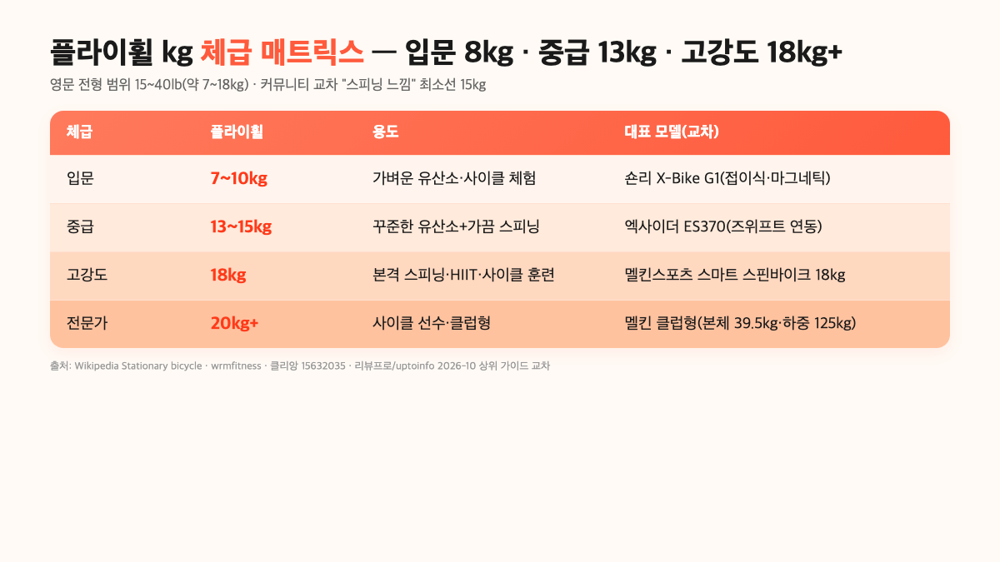
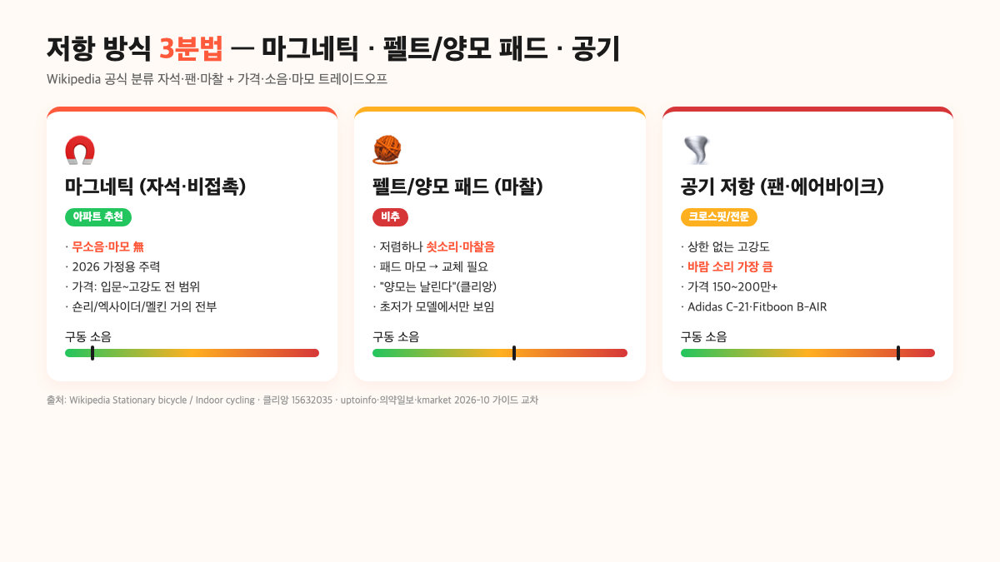

실내자전거 스피닝바이크 추천을 검색하면 결국 세 가지 숫자에서 결정이 납니다. **플라이휠 몇 kg짜리를 살지, 저항은 마그네틱이냐 패드냐, 공간이 얼마나 되냐**예요. 2026년 10월 상위 가이드와 공식 자료를 교차해 보면 입문용은 **플라이휠 7~10kg + 마그네틱**, 중급은 **13~15kg + 마그네틱 + 매트**, 본격 스피닝은 **18kg 이상 + 즈위프트 연동**이 공통 기준선입니다. 반대로 플라이휠이 가벼운 저가 스핀바이크를 사면 "스피닝"의 묵직한 관성 자체가 안 나와서 결국 처분 1순위가 돼요.

이 글에서는 스핀바이크와 일반 실내자전거의 공식 차이, 플라이휠 kg 체급별 기준선, 저항 3분법(마그네틱·펠트/양모 패드·공기), 아파트 공간·소음, 2026년 10월 실매장 가격대까지 Wikipedia·커뮤니티·국내 상위 가이드 수치를 모아 결정표로 묶었습니다.

📌 3줄 요약
스피닝바이크의 핵심은 <b>플라이휠 무게(kg)</b>입니다. 영문 전형 범위 15~40lb(약 7~18kg)에서, 커뮤니티 교차 기준 "스피닝 느낌"의 최소선은 <b>15kg</b>이고 18kg 이상이면 고강도까지 커버해요.

저항은 사실상 <b>마그네틱이 정답</b>입니다. 펠트/양모 패드는 저렴하지만 패드가 날리고 소음이 커 "클리앙·커뮤니티 공통 비추" 평가예요.

2026년 10월 국내 정가 기준 입문 스핀바이크 15~20만 원대, 중급 25~40만 원대, 고강도(멜킨 18kg·플라이휠 즈위프트 연동) 30~50만 원대가 흔한 가격대입니다.

## 스핀바이크 vs 일반 실내자전거 — 공식 차이부터 가르자

"스피닝바이크"와 "실내자전거"를 같은 걸로 알고 사는 분이 가장 많습니다. 공식적으로는 다릅니다. Wikipedia의 Stationary bicycle 문서는 실내자전거의 하위 분류로 "**Indoor cycle**"(스피닝)을 따로 두고, "가중치가 있는 플라이휠(weighted flywheel)을 앞쪽에 단 특수 모델"이라고 정의해요. 플라이휠 위치부터가 일반 실내자전거(뒤·중앙)와 반대입니다.

자세·칼로리·용도도 갈립니다. 영문 가이드 wrmfitness가 묶은 수치로 보면, 스핀바이크는 **플라이휠 15~40lb**(약 7~18kg)를 앞쪽에 두고 로드 사이클처럼 **앞으로 숙인 자세**로 타며, 60분에 **600~900kcal**가 소모됩니다. 일반 업라이트/좌식 실내자전거는 뒤쪽 플라이휠 최대 35lb(약 16kg), 똑바로 앉거나 등받이에 기댄 자세로 **400~550kcal/시간** 수준이에요. Wikipedia Indoor cycling 문서가 적은 평균치도 "60분 300~500kcal"로 일반 실내자전거 쪽 수치와 겹칩니다.

| 비교 축 | 스피닝바이크 | 일반 실내자전거(업라이트/좌식) |
| --- | --- | --- |
| 플라이휠 위치·무게 | 앞·7~18kg(15~40lb) | 뒤/중앙·~16kg(35lb) |
| 자세 | 로드 사이클·앞으로 숙임 | 똑바로/등받이 기댐 |
| 소모 칼로리 | 60분 600~900kcal | 60분 300~550kcal |
| 어울리는 사람 | 고강도 유산소·HIIT·사이클 훈련 | 재활·관절 부담·시니어·꾸준한 유산소 |
| 공간 | 앞플라이휠 때문에 세로가 짧고 세로 중량 | 뒤·중앙 플라이휠로 좌우 폭 ↑ |

표의 핵심은 "**스피닝바이크는 유산소 기구가 아니라 사이클 훈련 기구**"라는 겁니다. 그래서 입문자가 가벼운 유산소만 할 거면 사실 일반 업라이트/좌식이 더 맞고, "집에서 스피닝 센터 느낌으로 땀 빼고 싶다"면 그때부터 스핀바이크가 답이에요. 상위 자료들이 공통으로 짚는 포인트도 같습니다. 리뷰프로·초이스몬·uptoinfo 가이드 전부 "**접이식 가벼운 유산소는 숀리 X-Bike 같은 접이식 쪽, 스피닝 느낌은 멜킨 18kg·엑사이더 ES370 같은 중량 스핀 쪽**"으로 두 묶음을 분리해요.

## 플라이휠 무게(kg) — 입문 8kg, 중급 13kg, 고강도 18kg+가 기준선

사양을 볼 때 가장 혼란스러운 숫자가 플라이휠 kg이에요. 결론부터 말하면, "**플라이휠이 무거울수록 페달링이 묵직해지고 흔들림이 줄지만, 그만큼 소음·중량·가격이 따라 오른다**"는 역학입니다. 영문 wrmfitness 가이드가 묶은 전형 범위는 15~40lb(약 7~18kg)이고, 국내 커뮤니티 클리앙에선 "스핀바이크를 사려면 **플라이휠 20kg 이상**이면 가장 안전하다"는 조언이 올라와 있어요.

교차해서 kg 체급을 다시 묶으면 아래처럼 깔끔해집니다.

| 체급 | 플라이휠 | 용도 | 대표 모델(상위 가이드 교차) |
| --- | --- | --- | --- |
| 입문 | 7~10kg | 가벼운 유산소·실내 사이클 체험 | 숀리 X-Bike G1(접이식, 마그네틱) |
| 중급 | 13~15kg | 꾸준한 유산소+가끔 스피닝 | 엑사이더 ES370(즈위프트 연동) |
| 고강도 | 18kg 이상 | 본격 스피닝·HIIT·사이클 훈련 | 멜킨스포츠 스마트 스핀바이크 18kg |
| 전문가 | 20kg 이상 | 사이클 선수 훈련·클럽형 | 멜킨 클럽형(39.5kg 본체·125kg 하중) |

이 표의 핵심은 "**스피닝 느낌의 최소선은 15kg**"이라는 겁니다. 클리앙 포럼의 사용자들이 공통으로 지적하는 포인트가 "15kg 미만의 가벼운 스핀바이크는 패드/양모를 바꿔 가면서 저항을 올려도 플라이휠 자체가 가벼워 **스피닝 센터의 그 묵직한 관성이 안 나온다**"는 거예요. 그래서 "실내 사이클 체험 → 가벼운 유산소"면 7~10kg 접이식도 괜찮지만, 처음부터 "스피닝을 원해서" 사는 거라면 15kg 아래는 거르는 쪽이 재구매를 줄입니다.

반대로 상한선도 있어요. uptoinfo 가이드가 지적하는 포인트가 "**플라이휠 20kg을 넘어가면 본체가 40kg 이상으로 올라가고 바닥 하중이 집중돼 아파트에서는 오히려 쓰기 불편**"이라는 겁니다. 멜킨 클럽형 스펙(본체 39.5kg·최대 하중 125kg)이 그 상한을 보여 주는 예고, 가정에서 쓰기엔 중급 13~15kg 또는 고강도 18kg 선에서 멈추는 게 현실적이에요.

## 저항 방식 — 마그네틱·펠트/양모 패드·공기 셋 중 뭘 사야 하나

플라이휠 다음 결정축이 "**저항을 어떻게 만드는가**"입니다. Wikipedia Stationary bicycle은 저항 방식 세 가지를 "**자석**(magnetic)·**팬**(fan)·**마찰**(friction) 메커니즘"으로 공식 분류하고, Indoor cycling 문서는 거기에 "**점탄성 유체**(viscous fluid) 브레이크"까지 더해요. 가정용으로 흔히 사는 범위는 앞의 세 가지입니다.

**① 마그네틱**(자석·비접촉) — 자석의 거리로 저항을 만드는 방식이라 **닿는 부분이 없어 거의 무소음, 마모도 없음**이 핵심 장점입니다. uptoinfo 가이드는 "**마그네틱으로 좁히는 게 맞아요**"로 단언하고, kmarket·의약일보 2026 가성비 가이드도 "강도 높은 스피닝을 원한다면 **MeFun 등 마그네틱 투자는 가치 있다**"고 적어요. 2026년 10월 기준 입문 숀리 X-Bike G1부터 중급 멜킨·엑사이더까지 거의 전부 마그네틱 라인업입니다.

**② 펠트/양모 패드**(마찰·접촉) — 패드가 플라이휠에 직접 눌려 저항을 만드는 전통적 방식이에요. 가격이 저렴하고 저항감이 자연스럽지만 **① 쇳소리·마찰음이 큼, ② 패드가 닳으면 교체가 필요, ③ 양모 패드는 날리는 게 단점**이라는 커뮤니티 지적이 공통됩니다. 클리앙 토론에서 "양모 패드는 날리는 게 단점이라 마그네틱 쪽을 추천"이라는 댓글이 공식 상담 답변급으로 올라와 있어요.

**③ 공기 저항**(에어바이크·팬) — Fitboon B-AIR1000 같은 모델이 대표입니다. 밟을수록 바람 저항이 커지는 구조라 **상한 없는 고강도**가 가능한 반면 **바람 소리 자체가 가장 큼**이에요. 2026년 10월 가격이 200만 원대부터 시작할 만큼 비싸고, 전신 운동용·크로스핏 쪽이지 일반 가정용은 아닙니다.

💡 저항 방식 한 줄 정리
<b>마그네틱</b> — 거의 무소음·마모 없음·아파트 가능. 2026년 주력, 거의 모든 가정용 스핀바이크 선택지. <b>펠트/양모 패드</b> — 저렴하지만 소음·패드 교체·날림. 초저가 모델에서만 보이고 비추. <b>공기 저항</b> — 상한 없는 고강도지만 바람 소리·가격↑. 크로스핏·전문 트레이닝용.

## 스마트 연동(즈위프트)과 센서 — 뭘 요구하나

최근 상위 가이드가 공통으로 다루는 축이 "**즈위프트**(Zwift) **연동 가능 여부**"입니다. 즈위프트는 실내 사이클·러닝 가상 라이딩 플랫폼인데, 2026년 10월 국내 스핀바이크 중급 라인업(엑사이더 ES370·멜킨스포츠 스마트 스핀바이크·시몬스포츠 프리미엄 등)이 전부 연동을 전면에 걸어요.

연동 조건은 간단합니다. **① 블루투스 또는 ANT+ 센서가 바이크 내장, ② 케이던스·스피드·파워 중 하나 이상 송출, ③ 즈위프트 앱이 있는 기기 연결**(TV·태블릿·PC)입니다. 숫자가 측정되지 않는 저가 접이식(숀리 G1 입문급)은 연동이 안 되고, 중급 이상에서 "**ANT+/블루투스 듀얼 센서·심박계 지원**"으로 사양에 적힌 모델만 가능해요. kmarket 가이드가 "**무소음 마그네틱 + 즈위프트 연동**"을 묶음 조건으로 걸어 다루는 이유가 이겁니다.

반대로 즈위프트 연동이 필요 없다면 센서값에 돈을 쓸 이유가 없습니다. 커뮤니티 토론에서도 "**심박만 폰 앱으로 보려면 체스트 스트랩 하나 추가가 더 정확**"이라는 조언이 자주 나와요. 혼자서 유산소만 할 거면 LCD에 거리·시간·칼로리·속도만 떠도 충분하고, 그 조건은 10만 원대 입문급도 거의 다 됩니다.

## 아파트 공간·소음 — 플라이휠이 무거우면 왜 소음이 커지나

상위 가이드가 공통으로 지적하는 포인트인데 혼자서 섞어 다루는 축이 "**소음은 두 종류**"입니다. uptoinfo 가이드의 소제목이 그대로 "**소음이 두 종류**"로 뽑혀 있어요. 하나는 저항·플라이휠에서 나오는 **구동 소음**(공기 전달)이고, 다른 하나는 페달링 리듬이 바닥에 전달되는 **진동 소음**(고체 전달)입니다. 둘은 해결책이 다릅니다.

**구동 소음 축**은 저항 방식에서 결정됩니다. 마그네틱은 비접촉이라 조용한 환경에서 약 **30dB 안팎**(사이트 간 편차 있음)으로 적히고, 펠트 패드는 패드 마찰음·쇳소리가 더해져 그보다 큽니다. 반면 **진동 소음 축**은 플라이휠이 무거울수록 리듬 자체는 안정되지만, 바닥에 전달되는 질량이 커져서 아래층 민원 쪽은 오히려 올라갈 수 있어요. uptoinfo가 "**매트는 두께보다 밀도**"라고 짚은 포인트가 이 축의 해결책입니다. **고밀도 고무 매트 8~20mm**가 영문·국내 가이드 공통 권장이에요.

⚠️ 중층 이상 아파트+18kg 플라이휠 조합은 매트가 필수
마그네틱 저항으로 구동 소음은 30dB대까지 잡히지만, <b>플라이휠 18kg + 본체 40kg급 모델</b>은 전체 하중이 70kg 이상으로 올라갑니다(사람 체중 포함). uptoinfo 가이드가 묶은 저감 조합(① 고밀도 고무 매트 8~20mm, ② 벽에서 띄우기, ③ 늦은 밤 금지)을 지키지 않으면 아래층 진동 민원이 들어옵니다. 중층 이상이면 처음부터 저진동 설계(8개 범퍼·고밀도 매트 세트) 모델을 고르는 쪽이 안전해요.

공간 축도 함께 봐야 합니다. 숀리 X-Bike G1 같은 접이식은 **접힘 두께 28cm 수준**으로 책상·소파 틈에 세워 수납할 수 있고, 반대로 멜킨 18kg·엑사이더 ES370 같은 중량 스핀바이크는 **고정식**이라 자리를 통째로 비워 둬야 해요. 상위 가이드가 공통으로 짚는 포인트가 "**본격 스피닝용은 접이식이 거의 없다**"는 겁니다. 플라이휠 무게가 접힘 메커니즘을 버티지 못하기 때문이에요.

## 가격대와 2026-10 실매장 기준

지금까지의 범위를 묶어 보면, 2026년 10월 정가 기준으로 스핀바이크 가격대는 아래처럼 정리됩니다. 세일·세트 구성·즈위프트 연동 여부에 따라 자주 바뀌니 **참고용**이에요. 상시 가격으로 못 박지 마시고, 판매 페이지에서 다시 확인하세요. 쿠팡 등 유통 채널의 가격·배송은 [쿠팡 헬스·운동기구](https://www.coupang.com/np/categories/115749) 카테고리에서 교차해 보는 쪽이 가장 빠릅니다.

| 가격대(정가) | 플라이휠 | 저항 | 대표 모델(상위 가이드 교차) |
| --- | --- | --- | --- |
| 10만 원대 | 7~10kg | 마그네틱 | 이고진 LP125·숀리 X-Bike G1 |
| 15~20만 원대 | 10~13kg | 마그네틱 | 엑사이더 CF-918A·래피즈 원더 미니 |
| 25~35만 원대 | 13~16kg | 마그네틱 | 엑사이더 ES370(즈위프트 연동) |
| 35~50만 원대 | 18kg | 마그네틱 | 멜킨스포츠 스마트 스핀바이크 18kg |
| 50만 원대 이상 | 20kg+ | 마그네틱/듀얼 | 멜킨 클럽형·시몬스포츠 프리미엄 |
| 150~200만 원+ | 공기(팬) | 공기 저항 | Adidas C-21·Fitboon B-AIR1000 |

가격 격차의 핵심은 **플라이휠 kg × 센서 수** 두 축에서 나옵니다. 15kg까지는 가격이 완만하게 올라가다가 18kg·즈위프트 연동이 들어가면 20~30만 원대가 바로 뛰어요. 반대로 10만 원대 입문 라인은 플라이휠 10kg 아래가 흔해 "스피닝 느낌"이 안 나오고, 결국 중급 라인업으로 재구매를 하게 되는 경우가 많다는 지적이 상위 가이드 전반에서 반복됩니다.

## 상황별 결정표 — 원룸·아파트·본격 트레이닝

지금까지 축을 다 모아서 상황별 결정으로 묶으면 아래 네 묶음입니다.

| 내 상황 | 추천 체급 | 저항·연동 | 가격대 |
| --- | --- | --- | --- |
| 원룸·공간 2평 미만·가벼운 유산소 | 접이식·플라이휠 7~10kg | 마그네틱, 즈위프트 X | 10~20만 원대 |
| 아파트·꾸준한 유산소+가끔 스피닝 | 중량 스핀·13~15kg | 마그네틱, 즈위프트 선택 | 20~35만 원대 |
| 아파트·본격 스피닝·HIIT | 중량 스핀·18kg | 마그네틱·즈위프트 연동 | 35~50만 원대 |
| 전용 운동방·사이클 선수급 훈련 | 클럽형·20kg 이상 | 마그네틱/듀얼·파워 미터 | 50만 원대 이상 |

꼭 함께 봐야 할 축이 하나 더 있어요. 실내자전거는 **스피닝바이크만 있는 게 아니라** 좌식·업라이트·미니 페달형까지 선택지가 더 많습니다. "내 상황이 사실 꾸준한 유산소·관절 보호 쪽이면 스핀바이크 말고 좌식·업라이트가 더 맞다"는 결론이 자주 나오는데, 이 네 종류를 종류별로 비교한 글은 [실내자전거 추천 — 원룸·층간소음·무릎까지 내 상황에 맞게 고르는 법](/indoor-exercise-bike-recommend/) 쪽에서 더 자세히 정리했으니 결정 전에 교차해 보시면 좋습니다.

## 자주 묻는 질문 (FAQ)

**Q. 스피닝바이크랑 일반 실내자전거가 그렇게 달라요?**
A. 공식적으로 다릅니다. Wikipedia Stationary bicycle은 스핀바이크를 "앞쪽 가중 플라이휠을 단 특수 모델"로 따로 분류해요. 자세도 로드 사이클처럼 앞으로 숙이고, 60분 소모 칼로리가 600~900kcal로 일반 업라이트/좌식(400~550kcal)보다 1.5~2배 높습니다. 반대로 재활·관절 보호가 목적이면 좌식 쪽이 맞아요.

**Q. 플라이휠 몇 kg부터 사야 스피닝 느낌이 나나요?**
A. 커뮤니티 교차 기준 **15kg 이상**이 공통선입니다. 영문 전형 범위는 7~18kg(15~40lb)인데, 그중 15kg 아래는 "플라이휠이 가벼워 센터의 묵직한 관성이 안 나온다"는 지적이 반복됩니다. "진짜 스피닝"을 원하면 18kg(멜킨 스마트 스핀바이크 등) 라인업으로 올라가세요.

**Q. 아파트에서 마그네틱 + 매트면 층간소음은 괜찮나요?**
A. 구동 소음(공기 전달)은 마그네틱만으로도 30dB 안팎까지 잡힙니다. 다만 플라이휠 무게가 바닥 진동(고체 전달)으로 아래층에 가는 축은 **다른 문제**예요. 고밀도 고무 매트 8~20mm + 벽에서 띄우기 + 늦은 밤 금지까지 묶어야 안전합니다. 중층 이상에서 18kg 플라이휠은 저진동 설계(범퍼·고밀도 매트 포함) 모델을 권해요.

**Q. 즈위프트 연동이 꼭 필요한가요?**
A. 아니오. 혼자 유산소만 할 거면 센서 없는 입문급으로도 충분하고, 돈 아껴 매트·안장 커버에 쓰는 쪽이 체감이 큽니다. 반대로 "집에서 가상 라이딩·사이클 훈련"이 목적이라면 ANT+/블루투스 센서 내장 모델(엑사이더 ES370·멜킨 스마트 등)이 필수고, 그때는 10~20만 원 더 쓰더라도 중급 이상으로 가는 게 재구매를 줄여요.

**Q. 양모 패드 저항은 왜 비추인가요?**
A. 클리앙 포럼의 공통 지적이 "**양모 패드는 날리는 게 단점**"입니다. 패드가 플라이휠에 직접 눌려 저항을 만드는 구조라 ① 쇳소리·마찰음이 크고, ② 패드가 닳으면 교체가 필요하고, ③ 양모 섬유가 날려 바닥에 떨어집니다. 2026년 10월 기준 가정용 라인업의 거의 모든 중급 이상이 마그네틱으로 넘어온 이유가 이 세 가지 때문이에요.

**Q. 안장이 아픈데 하루에 얼마나 타야 적응되나요?**
A. 상위 가이드 공통 지적은 **2주 전후**로 적응됩니다. 다만 사이클링 안장 자체가 좁고 딱딱한 설계라, 아예 쿠션 안장 커버(5,000~15,000원대)를 덧씌우거나 패드 반바지를 입는 쪽이 체감이 가장 큽니다. "2주 안에 자리가 안 잡힌다"면 안장 높이·전후 위치가 안 맞을 가능성이 커요. 안장 끝에 섰을 때 다리가 **살짝 구부러지는 각도**(약 25~35도)가 공통 권장입니다.

**Q. 접이식 스핀바이크는 왜 거의 없나요?**
A. 플라이휠 무게 때문입니다. 접이식 메커니즘은 보통 10~15kg 수준까지만 안정적으로 접히는데, "스피닝 느낌"의 최소선인 15kg을 넘기면 메커니즘 자체가 못 버텨 고정식으로만 나와요. 그래서 상위 가이드 전부 "**접이식 → 가벼운 유산소용·마그네틱 10kg 전후**", "**중량 스핀 → 고정식·18kg**"으로 두 묶음을 완전히 분리합니다.

마지막으로 하나만 더. 실내자전거 스피닝바이크 추천은 "스펙"이 아니라 "**내 쓰임**"으로 고르는 물건입니다. 가벼운 유산소면 접이식·마그네틱 입문급으로 충분하고, "집에서 스피닝 센터 느낌"이 목표면 처음부터 18kg + 마그네틱 + 매트까지 세트로 묶는 쪽이 재구매를 줄여요. 모자라게 사서 두 번 사거나, 넘치게 사서 자리만 차지하지 않도록 플라이휠 kg · 저항 방식 · 공간 세 축을 먼저 고정해 두시면 좋습니다.

---

**관련 키워드** — #실내자전거추천 #스피닝바이크추천 #스핀바이크 #플라이휠무게 #마그네틱저항 #즈위프트연동 #아파트스핀바이크 #층간소음스피닝 #멜킨스핀바이크 #숀리X바이크 #엑사이더ES370 #홈트실내자전거
