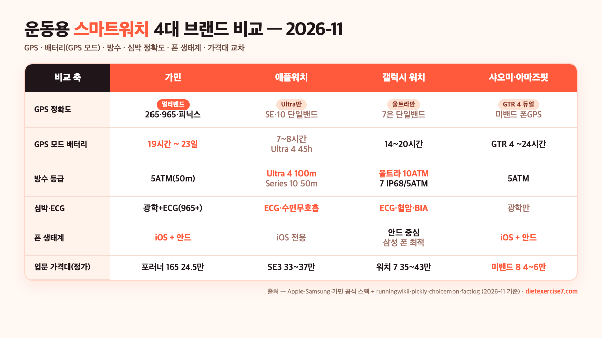
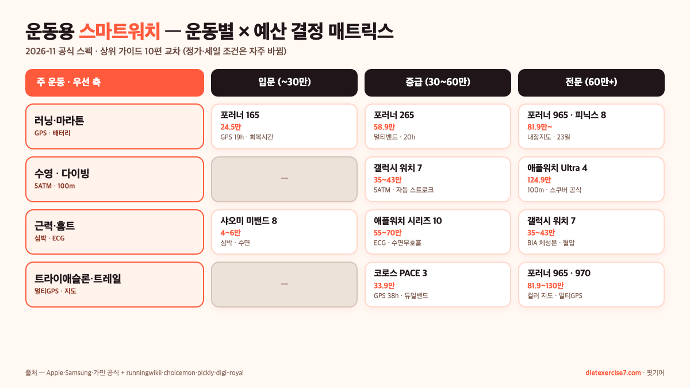

운동용 스마트워치 추천은 "어떤 걸 사야 운동에 쓰기 좋냐"가 아니라 "**어떤 운동을·어떤 폰에·얼마에 쓸지**" 세 질문에 먼저 답해야 좁혀집니다. 2026년 11월 기준 상위 가이드(christiandaily·pickly·choicemon·digi-royal·runningwikii·factlog·horangtech) 10편과 Apple·Samsung·가민 공식 스펙을 교차해 보면, "오직 하나의 베스트"는 없고 **운동 종류별로 1픽이 서로 다른** 구조예요.

결론부터 압축하면, **러닝·마라톤은 가민**(포러너 165~965·멀티밴드 GPS), **일상 올라운드 + 아이폰은 애플워치**(SE3~울트라 4), **삼성폰 + 체성분·수면은 갤럭시워치 7/8**, **입문 가성비 + 심박·걸음만**은 **샤오미 미밴드 8**이 2026년 11월 상위 가이드 공통 1픽이에요. 반대로 "가민을 아이폰·안드로이드 상관없이 쓰는 1픽"도, "애플워치가 모든 운동에 베스트"도 아닙니다.

📌 3줄 요약
운동용 스마트워치는 <b>GPS 정확도·배터리·방수·심박</b> 네 축에 <b>폰 생태계</b>가 따로 걸립니다. 네 축이 모든 운동에서 동시에 1위인 모델은 없습니다.

러닝·마라톤 = <b>가민</b>(포러너 965 23일·멀티밴드), 일상 + iOS = <b>애플워치</b>(Ultra 4 50시간·100m 방수), 삼성 + 체성분 = <b>갤럭시워치 7</b>(5ATM·BIA), 입문 가성비 = <b>샤오미 미밴드 8</b>이 2026-11 공통 1픽.

풀 마라톤·트라이애슬론이면 <b>GPS 10시간 이상 + 멀티밴드</b>가 사실상 필수선이고, 수영이면 <b>5ATM(50m)</b>이 하한, 다이빙까지는 <b>100m/10ATM</b>이 필요합니다.

## 결론부터 — 운동 종류별 1픽 요약표

운동용 스마트워치 추천을 "그냥 베스트"로 묻기 어려운 이유는, 러닝에 좋은 축(멀티밴드 GPS·GPS 20시간+)과 일상에 좋은 축(생태계·결제·알림), 수영에 좋은 축(5ATM·오픈워터)이 서로 다른 모델에 분산돼 있어서예요. 상위 가이드 10편을 모아 운동 × 폰 × 예산 조합으로 묶으면 1픽은 이렇게 좁혀집니다.

| 내 상황 | 1픽 모델 | 2026-11 가격대(정가) | 핵심 이유 |
| --- | --- | --- | --- |
| 아이폰 + 일상 + 가벼운 러닝 | 애플워치 SE3 | 33~37만 원 | 15분 충전 8시간 사용, GPS 18시간 |
| 아이폰 + 울트라·트레일 | 애플워치 Ultra 4 | 124.9만 원~ | 100m 방수·듀얼GPS·최대 50시간 배터리 |
| 삼성폰 + 올라운드 | 갤럭시 워치7 44mm | 35~43만 원 | BIA 체성분·수면 코칭·IP68/5ATM |
| 삼성폰 + 2일 이상 배터리 | 갤럭시 워치 울트라 | 85만 원대 | 듀얼GPS·10ATM·60시간 |
| 안드로이드 + 러닝 입문 | 가민 포러너 165 | 24~25만 원 | GPS 19시간·회복 시간·내구성 |
| 안드로이드 + 마라톤 | 가민 포러너 965 | 81.9만 원대 | 멀티밴드·GPS 모드 23일·내장 지도 |
| 폰 상관없이 가성비 | 샤오미 미밴드 8 | 4~6만 원 | 10~14일 배터리·150+ 운동 모드 |
| iOS·안드 공존 가정 | 코로스 PACE 3 | 33.9만 원 | GPS 모드 38시간·듀얼밴드 |

이 표의 핵심은 "**폰 생태계가 선택지를 반쯤 결정한다**"는 거예요. 애플워치는 아이폰 전용(안드로이드 설치 불가), 갤럭시워치는 삼성 One UI Watch 기능 상당수가 삼성 폰 전용이고, 가민·코로스·샤오미는 iOS·안드로이드 모두 공존합니다. 그 다음으로 **운동 종류**가 GPS 시간·방수·배터리 하한선을 정하고, 마지막으로 **예산**이 그 안에서 모델을 골라요.

아래 섹션들에서 각 결정 축을 하나씩 뜯어 보고, 글 끝 상황별 결정표에서 다시 묶어 드릴게요.

## 운동용 스마트워치 추천, 결정 축은 네 개뿐

상위 가이드 10편을 축으로 분해해 보면, 가격·모델·브랜드와 별개로 **운동 성능**을 결정하는 축은 네 개로 좁혀집니다. runningwikii의 러닝 가이드가 이 네 축을 가장 명확히 짚고, christiandaily·factlog 비교 글도 같은 분해를 씁니다.

**① GPS 정확도** — 멀티밴드(이중 주파수·L1+L5)가 단일밴드보다 도심·숲에서 훨씬 안정적입니다. runningwikii가 적는 수치가 **단일밴드 ±3~5% 오차 · 멀티밴드 ±1% 이내**예요. 2026년 11월 기준 멀티밴드를 공식 지원하는 모델은 가민 포러너 265/965/970, 가민 피닉스 7/8, 코로스 PACE 3·APEX 2 Pro·VERTIX, 수운토 Race, 애플워치 Ultra 2/4, 갤럭시 워치 울트라예요. 이 리스트에 없는 모델(SE·시리즈 10 포함)은 **단일밴드**라 도심 고층 건물 밀집지에서 경로가 튀는 사례가 커뮤니티에 반복 보고됩니다.

**② 배터리**(GPS 모드) — 일상 배터리가 아니라 **GPS 켠 상태**의 지속 시간이 운동에는 더 중요합니다. 풀 마라톤 평균 완주 4~6시간 기준, **GPS 10시간 이상**이 사실상 하한선이에요. 애플워치 SE3·시리즈 10은 GPS 모드 **약 7~8시간**이라 풀 마라톤에는 부족합니다(평균 러너 4~5시간이어도 워밍업·쿨다운 포함하면 시간 모자람). 반면 가민 포러너 165는 GPS 19시간, 포러너 965는 **GPS 모드 23일**·가민 피닉스 8은 **스마트워치 모드 16일**까지 갑니다. 코로스 PACE 3은 **GPS 모드 38시간**으로 동급 최강 수준이고요.

**③ 방수·수영 등급** — 수영을 할 거면 **5ATM**(50m)이 하한, 해수욕·다이빙까지는 **10ATM 또는 100m**가 필요합니다. 애플워치 Ultra 4는 100m, 갤럭시 워치 울트라는 10ATM이고, 일반 갤럭시 워치 7은 **IP68 + 5ATM**, 애플워치 시리즈 10은 50m입니다. 샤오미 미밴드는 5ATM이지만 수영 자동 인식 정확도는 낮다는 평이 많아요(차지 6·갤럭시 핏도 비슷). "가볍게 자유형 하는 정도"가 아니라 "마스터스 수영·바다 수영"까지 가면 100m 등급이 필요한 이유가 이 때문입니다.

**④ 심박 정확도** — 러닝 훈련·HRV 분석이 목적이면 손목 광학 센서 정확도가 중요합니다. runningwikii·digi-royal이 공통으로 적는 평이 "**가민·코로스·애플워치가 안정적**이고, 샤오미·화웨이·아마즈핏은 조금 흔들림"이에요. 심박 100% 정확도를 원하면 모든 브랜드에서 **가슴 스트랩 ANT+/블루투스**를 병행하는 게 공통 권고입니다. ECG(심전도)·심방세동 알림까지 포함하면 애플워치·갤럭시워치 7 쪽이 앞서요.

💡 네 축 한 줄 정리
<b>GPS</b> — 멀티밴드 L1+L5 있으면 도심 오차 ±1%, 단일밴드는 ±3~5%. <b>배터리</b> — GPS 모드 10시간 이상이 풀 마라톤 하한선(애플워치 SE/10은 부족). <b>방수</b> — 5ATM이 수영 하한, 100m/10ATM이 다이빙·바다. <b>심박</b> — 가민·코로스·애플이 안정적, 절대 정확도는 가슴 스트랩 병행.

## 폰 생태계가 선택 범위를 반쯤 결정한다

운동용 스마트워치 추천에서 가장 많이 놓치는 축이 **폰 생태계**입니다. digi-royal·factlog가 공통으로 짚는 지점이 "애플워치는 아이폰 전용이라 안드로이드 사용자는 처음부터 선택지에서 빠진다"는 거예요. 반대로 갤럭시워치도 **One UI Watch의 체성분·수면 코칭 기능 상당수가 삼성 폰 전용**이라, 아이폰·LG V·구글 픽셀에서는 반쪽짜리가 됩니다.

**① 아이폰 사용자** — 애플워치가 거의 유일한 선택입니다. 갤럭시워치·가민·샤오미도 iOS 연동은 되지만, 메시지 답장·Siri·Apple Pay·HealthKit 공유가 애플워치에만 열려 있어요. factlog가 "아이폰 사용자에게는 애플워치가 유일한 선택에 가깝다"고 단정하는 이유가 이 생태계 잠금 때문입니다. 단, "진지한 러닝·트라이애슬론"이 명확한 목적이면 아이폰 + 가민(포러너·피닉스) 조합을 쓰는 경우도 많아요. GPS·훈련 분석 깊이가 다릅니다.

**② 삼성 갤럭시 사용자** — 갤럭시워치가 체성분(BIA)·혈압·수면 코칭에서 유리합니다. 영문 Wikipedia Galaxy Watch7 문서가 적는 공식 센서가 **ECG + 혈압 + BIA + SpO₂ + 온도**인데, 이 중 BIA 체성분·혈압 측정은 **Samsung Health 앱**과 결합해야 완성되기 때문에 삼성 폰 외에서는 기능 대부분이 잠깁니다. 운동 쪽으로 좀 더 가면 가민도 안드로이드·iOS 모두 호환이라 "삼성폰 + 가민" 조합도 러닝 커뮤니티에 흔해요.

**③ 구글 픽셀·LG·기타 안드로이드 사용자** — 애플워치는 선택지에서 빠지고 갤럭시워치 기능은 반쪽이라, 사실상 **가민·코로스·샤오미·아마즈핏**이 주 선택지입니다. 가격대가 다양한 쪽이 이쪽이고, 특히 샤오미 미밴드(4~6만 원)와 아마즈핏 GTR 4(실사용 10~12일 배터리)가 가성비 축에서 자주 올라옵니다.

**④ iOS + 안드로이드 동시 쓰는 집** — 가족 공유·업무 분리로 두 폰을 같이 쓰는 분이라면 **가민·코로스**가 유일한 공존 선택지예요. 애플워치는 iOS만, 갤럭시워치도 안드 전용이라 "오늘은 아이폰에, 내일은 안드로이드에" 연결을 못 바꿉니다. 재구매 없이 폰을 교체하고 싶다면 처음부터 가민·코로스로 가는 쪽이 안전해요.

## 가민 — 러닝·마라톤·트라이애슬론 1픽인 이유

러닝·마라톤·트라이애슬론을 진지하게 할 거면 상위 가이드 공통 1픽은 **가민**입니다. runningwikii·digi-royal·factlog·choicemon 네 곳이 공통으로 "GPS 정밀도와 훈련 분석의 깊이가 다른 브랜드와 비교가 안 된다"로 묶어요. 이유는 세 축이 겹칩니다.

**① 멀티밴드 GPS + 트레이닝 분석 깊이** — 가민 포러너 265 이상·피닉스 7/8은 L1 + L5 이중 주파수를 공식 지원하고, Training Load·Recovery Time·젖산역치 페이스·Race Predictor 같은 전문 지표를 시계 자체에서 계산합니다. 애플워치도 운동 지표가 있지만 가민만큼 세분화되지 않아요. choicemon이 가민 포러너 165 1픽 포인트로 꼽은 문구가 "**오늘 뛸지 쉴지 손목이 판단해 준다**"(회복 시간 제공)인데, 이 "회복 시간"이 가민 핵심 기능이에요.

**② GPS 모드 배터리 — 러닝·울트라에서 압도적** — 가민 공식 스펙 기준 포러너 165는 **GPS 모드 19시간**, 포러너 965는 **GPS 모드 23일**(스마트워치 모드), 피닉스 8은 **스마트워치 모드 최대 16일**·GPS 모드 상시 디스플레이 7일입니다. 반면 애플워치 시리즈 10은 GPS 모드 7~8시간이라 울트라마라톤·100km 트레일에서는 중간에 꺼져요. "4시간 대회도 배터리 넉넉"이 애플워치 Ultra 4의 45시간 야외 운동 모드 쓸 때 가능한 수준이지, 일반 Series에서는 어렵습니다.

**③ 안드로이드·iOS 공존 + 센서 생태계** — 가민은 iOS·안드로이드 모두 호환이고, ANT+ 프로토콜로 **가슴 스트랩·파워미터·풋팟·실내 바이크**까지 전부 외부 센서와 자동 연결됩니다. 자전거 파워미터를 쓰는 사이클리스트·트라이애슬리트가 애플워치·갤럭시워치가 아니라 가민을 쓰는 이유가 이 ANT+ 생태계 때문이에요.

가격대는 **입문 포러너 165**(24~25만 원), **포러너 265**(58.9만 원), **포러너 965**(81.9만 원·내장 지도), **피닉스 8 47mm**(플래그십급 100만 원대)로 넓습니다. runningwikii가 "하프·풀 마라톤이 목표면 포러너 265부터, 기록 단축 중급자면 965"로 묶은 구간이 러닝 커뮤니티 공통선이에요. 단점은 **일상 스마트 기능**(통화·결제·메시지 답장)이 애플·갤럭시보다 훨씬 약하다는 점이고, 이 축이 걸리면 아래 애플·갤럭시 섹션을 보셔야 합니다.

## 애플워치 — 일상 올라운드 + iOS + 다이빙까지

애플워치는 **운동 전문**이라기보다 **일상 올라운드**에 운동 기능이 얹힌 쪽입니다. 아이폰 사용자 + 가벼운 러닝·수영·헬스를 섞어 쓰는 분에게 가장 범용적이에요. christiandaily가 아이폰 사용자 추천으로 "애플워치 시리즈 10"을 1픽에 둔 이유도, pickly가 "FDA 승인 심전도·수면 무호흡 알림"을 장점으로 꼽은 이유도 모두 **헬스·일상·운동이 섞인 사람**을 겨냥합니다.

라인업과 2026-11 공식 가격은 Apple 코리아 공식 스토어 기준으로 아래와 같습니다.

- **애플워치 SE3** — 33~37만 원대. GPS 18시간·단일밴드. "씻는 동안 충전, 바로 출발"(15분 충전으로 8시간). 가벼운 러닝·일상 추적이면 충분해요.
- **애플워치 시리즈 10**(44mm) — 55~70만 원대. GPS 18~24시간. ECG·혈중산소·수면 무호흡 알림. 올라운드 베이스.
- **애플워치 Ultra 4** — **1,249,000원**(Apple 코리아 공식). 최대 **50시간 배터리**(저전력 최대 84시간), **100m 방수**(레크리에이션 스쿠버 다이빙 공식 지원), **듀얼 주파수 정밀 GPS**, S11 칩, 티타늄 케이스. 트레일·울트라마라톤·바다수영·다이빙까지 커버.

단점은 분명해요. **① 안드로이드 미지원**(아이폰 전용), **② 일반 Series는 GPS 모드 7~8시간이라 풀 마라톤·장시간 운동에 부족**, **③ 매일 충전 필요**(저전력 모드 제외)입니다. runningwikii가 "애플워치 Series 10은 풀마라톤 부적합"으로 명시한 이유가 GPS 시간 때문이에요. 반대로 Ultra 4는 50시간까지 가므로 이 축이 사라집니다.

수영은 **SE3·시리즈 10은 5ATM**(50m), **Ultra 4는 100m**로 차이가 큽니다. 자유형·수영장 랩 수영은 모두 OK지만, **다이빙·바다 수영**이 목적이면 Ultra 4 쪽으로 가야 안전해요.

## 갤럭시워치 — 삼성폰 + 체성분·수면 + 가성비

갤럭시워치는 **삼성 폰 + 체성분·수면 추적**이 명확한 축입니다. horangtech·reviewpro·factlog 세 곳 모두 "삼성폰 사용자 + 건강 지표 올인원"에서 갤럭시 워치 7을 1픽으로 두고, 가격이 35~43만 원대로 애플워치 시리즈 10보다 저렴한 점도 자주 꼽습니다.

영문 Wikipedia Galaxy Watch7 문서가 적는 공식 스펙이 이 축들을 그대로 보여 줘요. 센서가 **ECG · 혈압 · BIA · SpO₂ · 온도 · 가속도·기압·자이로**(BIA는 생체전기 임피던스 체성분)까지 들어가고, GPS는 **A-GPS + GLONASS + BeiDou + Galileo**(기본 모델은 단일밴드, Ultra에서만 듀얼밴드), 방수는 **IP68 + 5ATM**(50m), 배터리는 40mm 300mAh·44mm 425mAh·15W 무선 충전입니다.

운동 기능 핵심은 세 가지로 좁혀집니다. **① 체성분 측정**(BIA — 체지방률·골격근량·체수분)이 손목에서 15초 만에 가능, **② 혈압 측정**(삼성 Health Monitor 연동, 한국 식약처 허가), **③ 수면 코칭**(수면 점수·수면 단계 추적·코골이 감지). 운동 자체는 러닝·수영·근력·요가 100종 이상 모드를 지원하고, 갤럭시 워치 울트라는 **듀얼밴드 GPS + 10ATM + 60시간 배터리**(10ATM=100m)로 Apple Watch Ultra 4 포지션을 겨냥합니다.

단점은 **① 삼성 폰 외 Samsung Health 핵심 기능 잠금**, **② 일반 갤럭시 워치 7은 단일밴드 GPS라 고층 빌딩 밀집 도심에서 경로 튐**, **③ 배터리가 2~3일로 가민보다 짧음**입니다. 반대로 삼성 폰 사용자·체성분 축이 명확하면 **가성비가 애플·가민을 다 이기는 지점**이 있어요. 모델 라인업·공식 가격·세일가는 [삼성 갤럭시 워치 공식](https://www.samsung.com/sec/watches/all-watches/) 페이지에서 비교 기능으로 바로 확인할 수 있습니다.

## 샤오미·아마즈핏·화웨이 — 10만 원대 가성비 축

예산을 10만 원대 이하로 좁히면 상위 가이드 공통 1픽은 **샤오미 미밴드 8**입니다. reviewpro가 "5만 원대의 가성비 스마트워치로 심박수·수면·운동 기록 같은 필수 기능"으로 묶고, christiandaily·horangtech도 "다이어트·일상 추적"용으로 공통 추천해요. 대신 "운동 전용 1픽"은 아닙니다.

**① 샤오미 미밴드 8** — 4~6만 원·배터리 **10~14일**·5ATM 방수·150+ 운동 모드. 가성비가 압도적이지만 GPS는 **내장 없이 연결 폰 GPS만 사용**(미밴드 8 Pro는 내장 GPS)이고, 심박 정확도는 가민·애플 대비 10~15% 흔들림이 있다는 평이 반복됩니다. "걸음·심박·수면·알림만 필요"하면 충분, "러닝 페이스·GPS 트랙"이 필요하면 밴드 대신 미밴드 8 Pro 또는 아마즈핏 쪽.

**② 아마즈핏 GTR 4** — 중상급 가성비. 실사용 10~12일 배터리·듀얼밴드 GPS(L1+L5)·150+ 스포츠 모드·원형 디자인. pickly가 "가성비 최고"로 묶은 모델이에요. 가격이 10~15만 원대라 "듀얼밴드 GPS를 가장 싸게"의 1픽이 되는 경우가 많습니다. 다만 Google Play·Google Pay가 없고, 앱 생태계가 Zepp 자체 앱 중심이라 서드파티 연동은 가민·애플보다 약해요.

**③ 화웨이 워치 GT 5** — 중급 10~15만 원대·배터리 **공식 최대 14일**·듀얼밴드 GPS·150여 운동 모드. horangtech가 "스트레스 분석·수면 추적"을 장점으로 꼽습니다. 단, 한국에서는 Google 서비스 미지원·AS 접근성이 샤오미보다도 떨어진다는 지적이 커뮤니티에 반복됩니다.

가성비 축의 한계는 공통이에요. **① 손목 심박 정확도가 플래그십보다 흔들림**, **② 운동 자동 인식 정확도가 떨어져** 걷기·자전거·수영이 섞이면 모드가 잘못 잡힐 수 있음, **③ 광학 센서 해상도가 낮아** HRV 등 고급 지표가 신뢰도 낮음. "가볍게 일상 + 다이어트 트래킹"이면 미밴드 8로 충분하고, "러닝 페이스·구간 거리"가 중요해지면 가민 165나 코로스 PACE 3으로 올라가는 쪽이 재구매를 줄입니다.

## 운동 종류별 결정표 — 러닝·수영·근력·사이클

지금까지 축을 다 모아 **운동 종류 × 예산 × 폰 생태계** 매트릭스로 묶으면 상황별 결정이 아래처럼 좁혀집니다. 2026년 11월 기준 공식 가격·세일가 범위를 교차한 숫자고, 정가·세일 조건은 자주 바뀌니 참고용으로만 보세요.

| 주 운동 | 우선 축 | 입문(~30만) | 중급(30~60만) | 전문(60만+) |
| --- | --- | --- | --- | --- |
| 러닝·마라톤 | GPS·배터리 | 포러너 165(24.5만) | 포러너 265(58.9만) | 포러너 965(81.9만), 피닉스 8 |
| 수영(실내 랩) | 5ATM·자동인식 | 갤럭시 워치 FE | 갤럭시 워치 7(35~43만) | 애플워치 Ultra 4(100m) |
| 수영(바다·다이빙) | 100m/10ATM | - | 갤럭시 워치 울트라(85만대) | 애플워치 Ultra 4(124.9만) |
| 근력·홈트 | 심박·자동세트 | 미밴드 8(4~6만) | 애플워치 시리즈 10 | 갤럭시 워치 7(BIA) |
| 사이클(실내) | ANT+·파워미터 | - | 포러너 165 | 포러너 965, 피닉스 8 |
| 트라이애슬론 | 멀티GPS·장배터리 | - | 포러너 265 | 포러너 965, 피닉스 8 |
| 트레일·울트라 | 멀티GPS·지도 | - | 코로스 PACE 3(33.9만) | 포러너 970, 피닉스 8 |
| 일상·다이어트 | 걸음·수면·심박 | 미밴드 8 | 애플워치 SE3(33~37만) | 갤럭시 워치 7 |

러닝만 보면 "입문은 가민 포러너 165·코로스 PACE 3 둘 중 하나"가 상위 가이드 공통선이에요. runningwikii·choicemon이 둘 다 이 조합을 1픽에 두고, 차이는 **배터리 vs 가격**에서 갈립니다. 코로스 PACE 3이 GPS 38시간으로 동급 최강이라 트레일·울트라 입문에도 쓰이고, 포러너 165는 "회복 시간·트레이닝 상태"가 더 쉬워요.

수영을 섞을 거면 **갤럭시 워치 7**(5ATM·자동 스트로크 인식)이 중급 1픽이고, 바다·다이빙까지 가면 **애플워치 Ultra 4**(100m) 또는 **갤럭시 워치 울트라**(10ATM)가 상한선입니다. 반대로 실내 수영장 랩 수영만 할 거면 5ATM이면 충분해요.

운동 기구와 묶어서 세팅할 분이라면 공간·예산 조합에서 중량 기구 선택도 같이 봐야 효율적이에요. [조절식 덤벨 추천 — 방식·무게·가성비로 고르는 법](/adjustable-dumbbell-guide/)에서 스마트워치 심박 측정과 짝으로 쓰는 홈트 중량 세팅을 분해해 뒀습니다.

## 운동 전에 체크할 숫자 5개 — 사기 전 마지막 점검

구매 결정 직전에 **스펙표에서 이 5개 숫자만 다시 보면** 거의 틀리지 않습니다. 모델명·세일가에 휘둘리지 않도록 숫자 축을 먼저 고정해 두세요.

**① GPS 모드 배터리 시간** — "일상 사용 N일"이 아니라 "**GPS 켠 상태 N시간**"을 봐야 합니다. 풀 마라톤·장거리 러닝이면 **10시간 이상**이 하한, 트라이애슬론·울트라는 20시간 이상. 애플워치 SE3·시리즈 10은 GPS 모드 7~8시간이라 이 조건이 걸리면 바로 빠집니다.

**② 멀티밴드 GPS 지원 여부** — 모델 상세 페이지에 "**L1 + L5**" 또는 "**듀얼 주파수**" 표기가 있어야 멀티밴드예요. 도심·숲에서 오차가 ±1% 이내로 떨어집니다. 단일밴드는 ±3~5% 오차로, 500m 구간이면 15~25m가 실제 거리와 다르게 찍혀요.

**③ 방수 등급**(ATM 또는 m) — 수영 안 할 거면 **IP68 + 3ATM 이상**이면 생활방수로 충분, 실내 수영까지 **5ATM**(50m), 바다·다이빙까지 **10ATM 또는 100m**. 5ATM 이상이라도 "**온수 샤워·사우나는 공식 금지**"인 경우가 대부분이니(가민·애플 공식 FAQ 공통) 러닝 직후 뜨거운 샤워 시 풀어 두는 게 안전합니다.

**④ 심박 센서 타입 + ECG 유무** — 광학 센서만 있으면 심박 모니터링까지, **전기 센서**(ECG)가 있으면 심전도·심방세동 알림까지 됩니다. 애플워치 시리즈 10/Ultra 4, 갤럭시 워치 7, 가민 포러너 965·피닉스 8이 ECG 지원이에요. 샤오미·아마즈핏 중급 이하는 ECG 없음.

**⑤ 외부 센서 연결**(ANT+) — 자전거 파워미터·풋팟·실내 바이크 트레이너를 쓸 거면 **ANT+ 프로토콜** 지원 필수입니다. 가민·코로스는 전부 지원, 애플워치·갤럭시워치는 블루투스 BLE만 지원해 ANT+ 센서를 바로 못 연결해요. 사이클 쪽 사용자가 가민에 집중되는 이유도 이 ANT+ 생태계 때문입니다.

⚠️ 사양표 "N일 배터리"의 함정
"공식 배터리 N일" 표기는 대부분 <b>GPS·AOD·알림 모두 끈 저전력 상태</b> 기준이에요. 실사용은 50~70% 수준으로 보는 쪽이 맞습니다. 예) 애플워치 Ultra 4의 "50시간"은 저전력 모드 + GPS 꺼진 상태 기준이고, GPS·AOD 켜고 쓰면 12~18시간대로 떨어집니다. "GPS 모드 N시간"을 꼭 따로 체크하세요.

## 자주 묻는 질문 (FAQ)

**Q. 운동용 스마트워치 추천, 아이폰 사용자는 가민 써도 되나요?**
A. 네. 가민은 iOS·안드로이드 모두 공식 호환이고, 아이폰 + Garmin Connect 앱 조합으로 러닝·사이클 분석이 그대로 다 됩니다. 다만 Siri·Apple Pay·iMessage 답장 같은 iOS 핵심 연동은 애플워치에만 열려 있어, "운동 전문 + 아이폰"이면 가민, "일상 올라운드 + 아이폰"이면 애플워치 쪽입니다. 둘 다 쓰는 분도 많아요(평일 애플워치 · 러닝은 가민).

**Q. 애플워치 SE3와 시리즈 10, 운동 목적이면 어느 쪽?**
A. **거의 차이 없습니다**. 둘 다 GPS 모드 18시간·5ATM·단일밴드 GPS로 운동 성능 축이 같아요. 차이는 **ECG·혈중산소·온도 센서 유무**(시리즈 10만 지원)와 **상시 디스플레이**(시리즈 10만)입니다. 운동만 쓰면 SE3로 충분하고, 심장 리듬·수면 무호흡 알림까지 쓰려면 시리즈 10으로 가는 쪽. 가격 차이는 세일 기준 15~20만 원 정도.

**Q. 갤럭시 워치 7과 애플워치 시리즈 10 중 운동용으로는?**
A. 생태계로 갈립니다. 삼성폰이면 갤럭시 워치 7(35~43만 원, BIA 체성분·혈압까지), 아이폰이면 애플워치 시리즈 10(55~70만 원, ECG·운동 앱 생태계). 순수 운동 성능은 거의 동급이고, 도심 러닝 GPS는 둘 다 단일밴드라 ±3~5% 오차 수준으로 비슷합니다. 멀티밴드가 필요하면 갤럭시 워치 울트라·애플워치 Ultra 4로 올라가야 해요.

**Q. 가민 포러너 165와 965, 러닝 입문이면 어느 쪽?**
A. 입문은 **165**(24~25만 원)가 공통 1픽입니다. GPS 19시간·회복 시간·광학 심박·방수 5ATM으로 10km·하프 마라톤까지는 충분해요. 965는 **멀티밴드 GPS·GPS 모드 23일·내장 컬러 지도**가 더해지는 반면 가격이 81.9만 원대로 세 배가 뜁니다. 풀 마라톤·트레일로 확실히 넘어간 뒤 265(58.9만) 또는 965로 업그레이드하는 쪽이 재구매를 줄입니다.

**Q. 수영까지 할 거면 어떤 모델?**
A. 실내 수영장 랩 수영만 할 거면 **5ATM**(50m) 모델이면 충분해요. 갤럭시 워치 7(5ATM), 애플워치 시리즈 10(50m), 가민 포러너 265 이상(5ATM)이 공통 선택지입니다. 바다·오픈워터·스쿠버 다이빙까지 가면 **10ATM 또는 100m**가 하한이라 애플워치 Ultra 4(100m, 레크리에이션 스쿠버 공식 지원) 또는 갤럭시 워치 울트라(10ATM)로 올라가야 해요. 미밴드·차지 6은 5ATM이어도 자동 스트로크 인식 정확도가 떨어집니다.

**Q. 스마트워치 배터리가 14일이라는데 실제로 그만큼 가나요?**
A. 거의 안 갑니다. 공식 "N일" 표기는 **저전력 모드 + GPS 꺼짐 + 알림 최소** 상태 기준이라, 실사용은 50~70%대로 보는 쪽이 맞아요. 예) 아마즈핏 GTR 4 공식 "14일"은 실사용 10~12일, 갤럭시 워치 7은 공식 "최대 40시간"이 실제 1.5~2일, 애플워치 Ultra 4의 "50시간"은 저전력 기준이고 GPS·AOD 켜면 12~18시간대로 떨어집니다. "**GPS 모드 N시간**"을 따로 확인하세요.

**Q. 샤오미 미밴드로 러닝 페이스 측정이 되나요?**
A. 밴드 본체에 **내장 GPS가 없어서 폰 GPS를 사용**합니다. 폰을 들고 뛰어야 페이스·경로가 기록되고, 폰 없이 뛰면 걸음·심박만 기록돼요. 폰 없이 러닝 페이스·거리를 측정하고 싶으면 **미밴드 8 Pro**(내장 GPS·10만 원대) 또는 아마즈핏·가민 포러너 165로 올라가야 합니다.

**Q. 스마트워치 심박수가 가슴 스트랩보다 부정확한 이유는?**
A. 손목 광학 센서는 **LED 빛으로 혈관 반사를 읽어** 심박을 추정하는 간접 측정이라, 손목 움직임·땀·피부톤·밴드 조임 정도에 따라 오차가 생겨요. 가슴 스트랩은 ECG처럼 **전기 신호를 직접** 측정해 더 정확합니다. 평소 운동이면 손목 광학으로 충분하고, HRV 분석·젖산역치 측정처럼 **정확한 심박이 핵심이면 가슴 스트랩 ANT+/블루투스** 병행이 가민·애플·갤럭시 공통 권고예요.

운동용 스마트워치 추천은 "어떤 모델이 1위냐"가 아니라 "**내 운동·내 폰·내 예산에서 어느 축이 걸리냐**"로 좁혀집니다. 러닝·마라톤은 가민, 올라운드 + 아이폰은 애플, 삼성폰 + 체성분은 갤럭시, 가성비 입문은 샤오미·아마즈핏 — 이 네 축만 기억하시면 모델명에 휘둘리지 않아요. 사기 전에 **GPS 모드 시간·멀티밴드 유무·방수 등급·ECG·ANT+** 다섯 숫자만 다시 체크하는 쪽이 재구매를 가장 많이 줄입니다.

---

**관련 키워드** — #운동용스마트워치추천 #스마트워치추천 #러닝스마트워치 #가민포러너 #애플워치울트라 #갤럭시워치7 #샤오미미밴드 #코로스PACE3 #멀티밴드GPS #스마트워치방수 #수영스마트워치 #트라이애슬론워치
