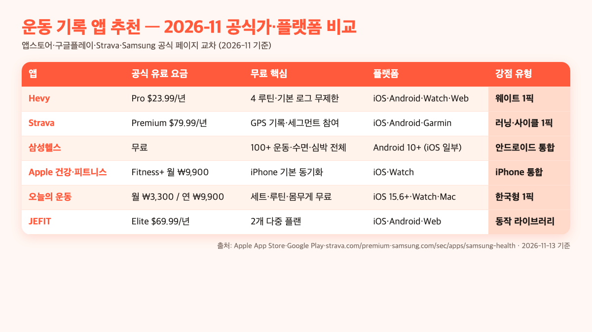
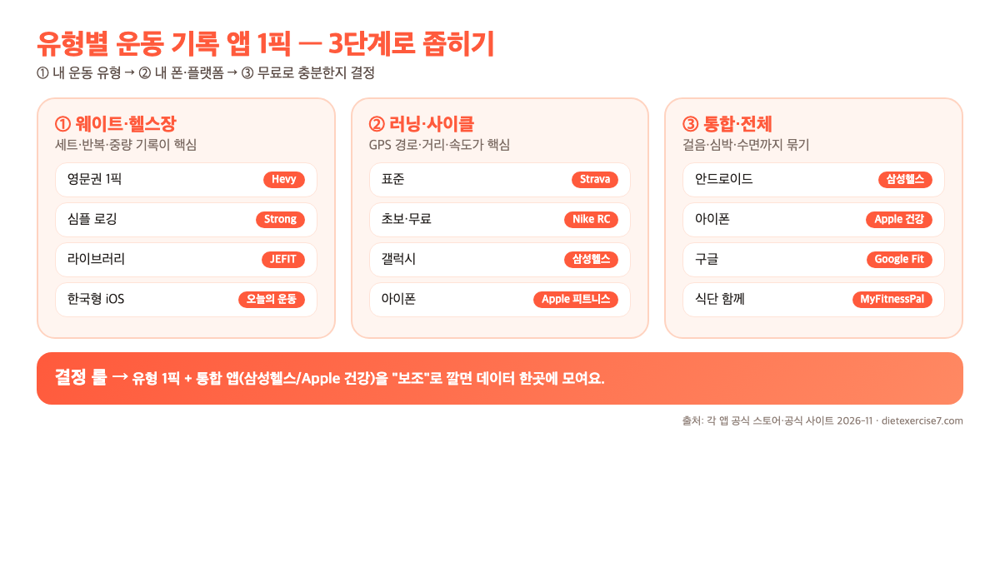

**운동 기록 앱 추천**은 "어느 앱이 1등이냐"로 한 줄 요약되지 않아요. 내가 하는 운동이 웨이트인지 러닝인지, 폰이 안드로이드인지 아이폰인지, 무료로 끝낼지 유료까지 갈지에 따라 1픽이 통째로 바뀝니다. 이 글은 쿠팡형 "TOP10 나열"이 아니라 **Apple App Store·Google Play·Strava·Samsung·Hevy 공식 페이지를 2026년 11월 13일 기준으로 교차**해, 유형별로 "이 상황이면 이거"라고 1픽만 뽑아 드리는 가이드예요.

📌 3줄 요약 (2026-11 공식가 기준)
<b>웨이트·헬스장 중심이면 Hevy가 1픽.</b> Pro 기준 연 23.99달러로 가성비가 가장 분명하고, 무료 플랜도 기본 로그 무제한·4개 루틴·세트 타이머·Apple Watch 로깅까지 열려 있어요(출처: Apple App Store·hevyapp.com).

<b>러닝·사이클 중심이면 Strava가 사실상 표준.</b> 무료로 GPS 기록·세그먼트 참여·클럽이 되고, 루트 플래너·라이브 세그먼트·심층 훈련 분석은 Premium(연 79.99달러·월 11.99달러, 2026-11 US 기준)으로 올라가요.

<b>한국 아이폰 사용자가 "그냥 세트만 빠르게 찍고 싶다"면 오늘의 운동.</b> 월 3,300원·연 9,900원(Liviet, iOS 15.6+·Apple Watch·M1 Mac 지원)로 광고 없이 쓸 수 있는 한국형 1픽이에요(출처: Apple App Store KR).

## 결론부터 — 유형별 1픽 한 번에 좁히기

운동 기록 앱의 선택은 사실상 **"운동 유형 + 폰 OS + 무료냐 유료냐"** 세 질문으로 정리됩니다. 이 글의 네 축(Hevy·Strava·삼성헬스·오늘의 운동)을 2026-11 공식가 기준으로 늘어놓고 유형별 1픽을 찍으면 이렇게 돼요.

| 상황 | 2026-11 1픽 | 이유 |
| --- | --- | --- |
| 헬스장·홈트 웨이트가 메인 | **Hevy**(무료 또는 Pro 연 $23.99) | 세트·반복·중량·휴식 타이머 전부 무료, Pro도 연 23.99달러로 경쟁앱 대비 쌈 |
| 러닝·사이클이 메인 | **Strava**(무료, 필요시 Premium 연 $79.99) | GPS·세그먼트·소셜은 무료, 루트 플래너·라이브 세그먼트가 유료 |
| 안드로이드 + 종합 건강 | **삼성헬스**(무료, Android 10+) | 공식 100+ 운동·수면·심박·수면 무호흡 감지(FDA/식약처) 전부 무료 |
| iPhone + 종합 건강 | **Apple 건강 + 피트니스+**(기본 무료, 피트니스+ 월 ₩9,900) | iOS 기본 데이터 허브, Apple Watch 자동 동기화 |
| 한국형 "세트만 빠르게" | **오늘의 운동**(iOS, 월 3,300원 또는 연 9,900원) | 한국어 UI·광고 없음·Liviet 개발, Apple Health 체중 연동 |

> ※ Apple 피트니스+(월 ₩9,900)는 요가·HIIT·근력 **영상 라이브러리** 상품이에요. 운동 기록 본체는 iOS 기본 **Apple 건강(무료)** + Apple Watch 조합으로 수집·저장되며, 피트니스+ 없이도 기록 기능은 그대로 쓸 수 있습니다.

표의 맨 왼쪽부터 보면 **운동 유형이 먼저 결정자**예요. 러닝러에게 Hevy를 권하면 쓸모없는 세트 로그만 보이고, 웨이트 위주 사용자에게 Strava를 권하면 "거리" 축이 필요 없어서 공허해요. 그래서 "TOP10 아무거나"가 아니라 **내 유형 → 폰 → 무료/유료** 순으로 좁히는 게 정석입니다.

## 왜 '운동 기록 앱 추천' 결과가 다 비슷해 보이는가

"운동 기록 앱 추천" 검색 상위 글들을 열어 보면 기묘한 공통점이 있어요. 영문권 글은 **Hevy·Strong·Jefit·Fitbod** 네 앱을 돌려가며 1·2위로 꼽고, 한국어 글은 **오늘의 운동·헬스로그·마이피트니스팔** 같은 다른 라인업을 나열합니다. 같은 키워드인데 추천 리스트가 겹치지 않는 이유는 둘로 요약돼요.

**첫째, 영문권 글은 "한국형 iOS 전용 앱"을 모릅니다.** Hevy(연 $23.99)·Jefit(연 $69.99)·Strong(연 $29.99)은 글로벌 시장 기준으로 검증된 라인업이지만, 오늘의 운동·투모어(TWOMORE)·BuiltDiff·RepCount 같은 **한국 개발사 iOS 앱**은 국내 유저 사이에서 더 자주 쓰여요(출처: Apple App Store KR 평점·리뷰 수). 영문권 랭킹과 한국어 랭킹이 안 겹치는 건 두 생태계가 다른 식으로 성숙했기 때문입니다.

**둘째, "기본 앱은 당연하니까 뺀다"는 함정이 있어요.** 안드로이드에 기본 깔린 삼성헬스, 아이폰에 기본 깔린 Apple 건강은 "이미 있어서 리뷰할 필요 없음"으로 빠지는 경우가 많습니다. 그런데 2026년 현재 삼성헬스는 공식 **100+ 운동 종류·수면 무호흡 감지(FDA/식약처 승인)·바디 피트니스 지수**를 무료로 제공하고, Apple 건강은 iPhone·Apple Watch 사이에서 **자동 데이터 집약 허브** 역할을 해요(출처: samsung.com/sec/apps/samsung-health·apple.com/health). 여기에 "써드파티 1픽을 추가"하는 게 2026년 기준 가장 효율적인 조합입니다.

**셋째, 무료의 선이 글마다 다릅니다.** 어떤 글은 "Hevy가 무료 최고"라고 하고, 다른 글은 "Strava가 무료"라고 해요. 둘 다 사실이지만 **"무료로 어디까지 되는지"의 선**이 다릅니다. Hevy는 Pro 없이도 로그 무제한이지만 루틴 저장이 4개로 제한돼요. Strava는 GPS 기록은 공짜지만 **루트 플래너·라이브 세그먼트·심층 분석**은 유료예요(출처: biketips.com strava-free-vs-paid·strava.com/premium). 그래서 "무료 1위" 라벨만 보지 말고 **내가 자주 쓸 기능이 무료 쪽에 있는지**를 확인해야 합니다.

## 유형 분류 — 웨이트·러닝·통합·한국형 네 축

운동 기록 앱은 **유형이 바뀌면 1픽이 통째로 바뀌는** 카테고리예요. 네 축으로 나누면 선택이 깔끔해집니다.

**① 웨이트·헬스장**: 세트(set)·반복(rep)·중량(kg)·휴식 시간(rest) 네 축을 세트별로 기록하는 게 핵심. 그래프로 보면 PR(개인 최고 기록) 갱신이 눈에 보여야 쓸모가 있어요. 대표 앱 Hevy·Strong·JEFIT·오늘의 운동·투모어.

**② 러닝·사이클·수영**: 거리·속도·고도·심박을 GPS·웨어러블로 자동 수집하고, 코스를 지도에 겹치는 게 핵심. 대표 앱 Strava·Nike Run Club·삼성헬스 러닝·Apple 피트니스.

**③ 종합(걸음·심박·수면·식단)**: 특정 운동이 아니라 **하루 전체 건강 데이터**를 한곳에 모으는 유형. 안드로이드는 삼성헬스, 아이폰은 Apple 건강이 기본 허브예요. 식단까지 묶으려면 MyFitnessPal·Noom 같은 식단 앱을 연동합니다.

**④ 한국형(한국어 UI·광고 적음·Apple Health 연동)**: iOS에서 광고 없이 세트 로그를 빠르게 찍는 걸 중시하는 라인업. 오늘의 운동·투모어·RepCount·BuiltDiff·머슬 메모리 등.

**축을 섞어 쓰는 게 더 현실적이에요.** 삼성헬스·Apple 건강이 자동으로 다른 앱 데이터를 모으니까 **"기본 허브 하나 + 유형 앱 하나(이상)"가 2026년 현실 세팅**입니다. 아래 세 가지가 가장 흔한 조합이에요.

🧩 추천 조합 세트 — 상황별 2~3개 묶음
<b>주 3회 헬스장 + 주말 러닝:</b> <b>Hevy</b>(웨이트 로그) + <b>Strava</b>(러닝·GPS) + <b>삼성헬스</b> 또는 <b>Apple 건강</b>(허브). 세트 기록은 Hevy, 러닝은 Strava에서 자동 수집하고 공통 허브에 집약되는 구조입니다.

<b>안드로이드 + 홈트 중심:</b> <b>삼성헬스</b>(허브·수면·심박) + <b>Hevy 무료</b>(세트 로그) + <b>Nike Run Club</b>(유산소 입문). 추가 비용 없이 2026년 공식 무료 범위 안에서 전부 돌아갑니다.

<b>iPhone + 간단 기록:</b> <b>Apple 건강</b>(허브) + <b>오늘의 운동</b>(한국어 세트 로그, 월 ₩3,300) + <b>Strava 무료</b>(주말 러닝). 광고·영문 UI 거부감 없는 iOS 전용 세팅이에요.

## 웨이트·헬스장 1픽 — Hevy vs Jefit vs Strong vs 오늘의 운동

세트·반복·중량 기록이 메인이면 선택지는 결국 네 앱으로 좁혀집니다. 공식 스토어 가격과 무료 범위를 교차하면 이렇게 돼요.

| 앱 | 공식 유료가(연) | 무료 플랜 범위 | 플랫폼 | 특장점 |
| --- | --- | --- | --- | --- |
| Hevy | Pro $23.99 | 로그 무제한·루틴 4개·세트 타이머·Apple Watch | iOS·Android·Watch·Web | 소셜 피드·가성비·4.9/5(10만+ 리뷰) |
| JEFIT | Elite $69.99 | 2개 멀티데이 플랜·1,400+ 동작 라이브러리 | iOS·Android·Watch·Web | 적응형 플랜·운동별 비디오 데모 |
| Strong | Pro $29.99 | 로그 무제한·템플릿 3개 | iOS·Watch | 가장 심플한 UI |
| 오늘의 운동 | 월 ₩3,300 / 연 ₩9,900 | 세트·루틴·체중·달력·리포트 | iOS 15.6+·Watch·M1 Mac | 한국어·광고 없음·4.7/5 |

(출처: Apple App Store · hevyapp.com · jefit.com · repcountapp.com · apps.apple.com/kr 2026-11-13 교차)

### Hevy — "웨이트 기록 앱 가성비 1픽" 근거

Hevy는 2026년 기준으로 전 세계 1,500만+ 사용자, Apple App Store 4.9/5(10만+ 리뷰)라는 수치가 있어요(출처: apps.apple.com Hevy KR). 가격 포인트가 다른 앱과 격차가 커서 "가성비 1픽"이라는 평이 영문권·한국어권 리뷰에서 거의 공통됩니다. Pro는 연 23.99달러(월 환산 약 2달러)로, Fitbod(79.99달러/년)·JEFIT(69.99달러/년) 대비 1/3 수준이에요.

무료 플랜도 쓸모가 분명합니다. **로그 무제한·루틴 4개 저장·세트 타이머·슈퍼세트·드롭세트·웜업 트래킹·개인 기록 그래프·Apple Watch 로깅**까지 공식적으로 열려 있어요. 유료로 올라가야 하는 건 Hevy Trainer(AI 코칭)·루틴 무제한·과거 기록 전 범위 접근 같은 "고급 기능"이에요(출처: hevyapp.com·apps.apple.com).

단점 두 가지. 한국어 UI가 완전히 번역되지 않아 일부 문구가 영문으로 남아요. 그리고 식단은 안 다루니 다이어트 루틴까지 묶으려면 다른 앱이 추가로 필요합니다.

### JEFIT — "운동 동작 라이브러리가 압도적"인 경우

JEFIT의 포지셔닝은 "로그 앱 + 플래너 + 라이브러리 통합"이에요. 1,400개 이상의 운동 동작마다 **데모 비디오**가 붙어 있어 "이 자세가 맞나?" 궁금할 때 바로 확인됩니다(출처: jefit.com 2026 가이드). Elite 요금제(연 $69.99)는 당신이 쌓은 기록 데이터를 분석해 **12주 적응형 플랜**을 자동 생성해 주고요.

가성비만 보면 Hevy가 나은데, 다음 조건이면 JEFIT이 1픽이 됩니다. **① 기구 쓰는 법을 처음 배워서 비디오 데모가 중요한 초보, ② 플랜을 짜 주는 "진짜 코치"가 필요한 중급, ③ 웹 브라우저에서도 로그 관리하고 싶은 사람** — 이 셋입니다.

### Strong — "iOS 미니멀 로거" 1픽

**Strong**은 iOS·Apple Watch 전용 미니멀 로거예요. 세트 하나 끝날 때마다 다음 세트의 중량·반복 숫자가 **지난 세션 기록 그대로 자동으로 뜨고**, 세트 사이 휴식 타이머가 백그라운드에서 돌아가는 흐름이 반복 사용 피드백에서 가장 매끄럽다는 평이 많아요. 무료로 템플릿 3개·로그 무제한을 쓸 수 있고, Pro(연 $29.99)에서 템플릿 무제한·커스텀 운동·진행 그래프·플레이트 계산기·Apple Health 쓰기가 전부 열립니다(출처: repcountapp.com iPhone 비교 글·apps.apple.com Strong 공식 페이지).

Strong이 1픽이 되는 결정 룰은 셋. **① "루틴을 3개만 돌리는" 단순 사용자**(5x5·푸시풀레그·상하체 2분할 등)여서 템플릿 수 제한이 안 걸리는 경우, **② 소셜 피드가 오히려 방해**라서 Hevy의 팔로우·좋아요 기능이 필요 없는 경우, **③ iPhone·Apple Watch만 쓴다**는 세 가지 중 하나가 해당되면 Strong이 Hevy보다 더 가볍고 빠릅니다. 반대로 Android 병행·Web 접근·소셜 자극이 필요하면 Hevy로 넘어가는 게 맞아요.

### 오늘의 운동 — "한국어·광고 없음" 1픽

**오늘의 운동**(Liviet)은 한국 iOS 사용자 중 "세트만 빠르게"를 중시하는 쪽의 1픽이에요. iOS 앱스토어 공식 설명 기준 월 3,300원·연 9,900원, 평점 4.7/5(약 2,800건)이며 **Apple Health 체중 연동·다크 모드·Apple Watch·M1 Mac**(iPad 앱 호환)까지 들어 있어요(출처: apps.apple.com/kr Liviet 오늘의 운동). 한국어 UI 완성도와 **광고가 아예 없는 과금 모델**이 영문권 앱(Hevy·Strong)과 가장 큰 차이예요.

오늘의 운동이 1픽이 되는 결정 룰은 셋. **① 한국어 UI가 100% 로컬라이즈되기를 원할 때**(Hevy는 공식 지원 언어에 한국어가 있지만 앱 내부 일부 문구는 영문으로 남아 있음), **② 광고·푸시 알림·소셜 피드 없이 "그날 세트만 찍고 닫고 싶을 때"**, **③ 월 3,300원 수준의 지출이면 영문권 $23~29/년보다 오히려 심리적 저항이 적은 경우**가 해당됩니다. 반대로 Android도 쓰거나 1,000개 넘는 동작 라이브러리가 필요하면 Hevy·JEFIT 쪽이 더 맞아요.

## 러닝·사이클·수영 1픽 — Strava·Nike Run Club·삼성헬스

러닝·사이클·수영처럼 **거리·속도·GPS 코스**가 중요한 운동이면 1픽은 바뀝니다.

### Strava — "러닝러의 공용어"가 된 이유

Strava는 공식 보도자료 기준(press.strava.com, 2026-06-30 공식 발표) **글로벌 1억 9,500만 명 규모의 러너·사이클리스트 네트워크**로, Garmin/Wahoo/Fitbit 등 주요 디바이스와 연동되는 사실상 **표준**이에요. 무료 플랜으로 **활동 기록·GPS·세그먼트 참여·Top-10 리더보드·클럽·안전 기능**(Beacon)이 전부 열립니다.

Premium의 공식가는 **월 $11.99 또는 연 $79.99(2026-11 미국 기준)**(출처: biketips.com strava-free-vs-paid·strava.com/premium). 추가되는 건 **루트 플래너**(원하는 거리·난이도로 자동 루프 생성), **라이브 세그먼트**(활동 중 PR 실시간 비교), **심층 분석**(심박·파워 기반 피트니스 진행), **오프라인 지도** 네 가지가 핵심이에요.

캐주얼 러너라면 무료로 충분해요. 다음 셋 중 하나에 해당하면 Premium이 돈값을 합니다. **① 새 코스를 자주 개척하는 사람(루트 플래너), ② 세그먼트 경쟁을 하는 사람(라이브 세그먼트), ③ 마라톤·장거리 훈련에 심박 존·파워 데이터를 체계적으로 쌓는 사람.**

### Nike Run Club — "초보·무료"의 1픽

Nike Run Club(NRC)은 Nike가 공식 무료로 제공하는 러닝 앱이에요(출처: apps.apple.com/kr Nike Run Club·play.google.com Nike Run Club 공식 페이지, 2026-11-13 교차). 공식 소개 기준 핵심 기능은 셋. **① Adaptive Coaching Plan** — 목표 거리(5K·10K·하프·풀 마라톤)와 달리기 가능 횟수를 입력하면 주차별 훈련 플랜을 자동 생성하고, 플랜 진행 중 세션을 빠뜨리면 다음 주차 난이도를 자동 보정합니다. **② Guided Run(오디오 가이드 러닝)** — 유명 코치·운동선수가 녹음한 음성 러닝이 **초보 첫 1km 걷기 섞인 세션부터 마라톤 롱런·스피드 인터벌·멘탈 러닝까지** 수십 종 제공돼, 이어폰만 꽂으면 코칭을 듣는 식으로 뛸 수 있어요. **③ Monthly Challenges·NRC Community** — 매달 공식 챌린지(예: "11월 100km")를 걸고, 완주하면 디지털 배지를 지급하는 구조입니다(출처: Nike 공식 앱스토어 설명 및 nike.com NRC 페이지).

단, Strava와 직접 비교하면 두 가지 약점이 분명해요. **첫째, 커뮤니티 규모 차이가 큽니다.** Strava는 공식 보도자료 기준 1억 9,500만 명 네트워크지만 NRC는 공식 사용자 수를 공개하지 않을 정도로 비교 규모가 작아, "친구가 뛴 코스 따라 달리기"처럼 소셜 밀도가 필요한 기능은 빈약해요. **둘째, 세그먼트(Segment)·KOM 리더보드가 없습니다.** Strava의 핵심 자산인 "구간별 PR 경쟁"이 NRC엔 없어서, 같은 코스를 반복해 뛰며 랭킹을 올리는 재미는 Strava로 넘어가야 합니다. 그래서 NRC는 "**시작 1년 차**"에 공식 가이드 러닝·플랜만으로 충분하고, 세그먼트·루트 공유가 필요해지면 Strava로 이사하는 게 일반적인 흐름이에요.

### 삼성헬스 러닝 — 갤럭시 사용자의 기본 러닝 앱

**삼성헬스**의 러닝 트래커는 갤럭시 폰 단독(GPS)으로도 거리·페이스·케이던스를 자동 수집하고, 갤럭시워치와 묶으면 심박·케이던스·VO₂max까지 함께 기록합니다. 2026년 공식 사이트 기준 "러닝 코치(Running Coach)" 모드가 포함돼 있어, 목표 페이스·거리를 입력하면 **실시간 음성 코칭**(지금 빠르다/느리다·심박 존 안내)을 제공하고, 운행 후에는 랜딩·스트라이드 균형·접지 시간 같은 **러닝 폼 분석 리포트**를 보여줘요(출처: samsung.com/sec/apps/samsung-health 공식 페이지). 삼성 생태계 안에서 "앱 하나로 러닝 + 심박 + 수면 + 스트레스"가 전부 수집되는 게 가장 큰 장점이에요.

또 하나 눈여겨볼 기능이 **코스 자동 검출**(Route Detection)이에요. 같은 장소에서 반복 러닝하면 과거 궤적을 학습해 "이전에 이 코스를 X번 달렸다"는 기록을 자동으로 묶어 주고, 지도상에서 평균 페이스를 비교해 보여줍니다. Strava의 세그먼트처럼 "전 세계 러너와 랭킹 경쟁"은 안 되지만, **내 코스를 내 기록으로만 비교하는 PB 트래킹**은 삼성헬스 쪽이 자동화 수준이 더 높아요.

### Apple 피트니스 — Apple Watch가 전제인 "자동 동기화 1픽"

**Apple 피트니스**(iOS 기본 피트니스 앱)는 **Apple Watch 소유가 사실상 전제**예요. iPhone 단독으로도 걸음·일부 기본 지표는 잡히지만, 러닝 세션의 핵심인 심박·VO₂max·운동 링은 Apple Watch가 있어야 자동 집계됩니다. Apple Watch Series/Ultra 사용자는 운동을 시작하면 **심박 존 1~5를 자동으로 분류**해, 세션 동안 몇 분을 어떤 존에 머물렀는지가 리포트로 떨어지고, Apple 건강 쪽에도 그대로 동기화돼요(출처: apple.com/kr/ios/health·Apple Watch 공식 지원 페이지).

Strava와의 결정적 차이는 둘이에요. **첫째, 워치 없으면 러닝 기록이 심박·고도·케이던스 등 반쪽만 모입니다** — 안드로이드 사용자가 Strava를 폰 단독으로 쓰는 것과 반대 흐름이에요. **둘째, 소셜·세그먼트 기능이 약해요** — 친구와 달린 거리·시간을 공유하는 Activity 링 공유는 있지만 Strava 수준의 커뮤니티·루트 공유는 없습니다. 반대로 **이미 Apple Watch가 있다면** Apple 피트니스 + Apple 건강 조합이 자동 동기화·배터리 효율 면에서 가장 매끄러워, 별도 러닝 앱 없이도 충분한 경우가 많아요.

## 통합 1픽 — 삼성헬스 vs Apple 건강 (기본 앱을 먼저 깔자)

"운동 기록 앱 추천" 글에서 자주 빠지는 포인트가 **기본 앱 활용법**이에요. 2026년 현재 삼성헬스·Apple 건강은 "그냥 깔려 있는 앱"이 아니라 **다른 앱 데이터를 자동으로 받아 주는 허브**로 발전했습니다.

| 항목 | 삼성헬스 | Apple 건강 |
| --- | --- | --- |
| 가격 | 무료 | 무료 (iOS 기본) |
| 플랫폼 | Android 10+ · 일부 iOS | iOS · Apple Watch |
| 공식 운동 종류 | 100+ | iOS 활동 링 + 수십 종 |
| 센서 자동 수집 | 걸음·심박·수면·스트레스·수면 무호흡(FDA/식약처) | 걸음·심박·수면·주기·청력 |
| 외부 앱 연동 | Strava·MyFitnessPal·삼성 파트너 다수 | HealthKit 수천 개 앱 |
| 특이 기능 | 처방전 OCR·심혈관 점수·BFI | 주기 예측·낙상 감지 |

(출처: samsung.com/sec/apps/samsung-health 공식·apple.com/kr/ios/health·v.daum.net 비교 기사)

삼성헬스는 **Android 10+** 디바이스에서 쓸 수 있고, 일부 기능은 Galaxy Watch·Galaxy Ring 조합이 필요해요. "운동 전용"이 아니라 **활동·수면·식단·마음챙김·생체 징후** 다섯 축을 통합합니다(출처: samsung.com 공식). 2026년 추가된 **수면 무호흡 감지**는 FDA와 한국 식약처 승인을 받은 의료기기 기능이에요.

Apple 건강은 iOS 기본 앱이라 설치할 필요가 없고, **HealthKit**이라는 표준을 통해 다른 앱이 데이터를 쓰거나 적을 수 있습니다. Hevy·Strava·오늘의 운동·투모어 모두 HealthKit 쓰기를 지원해서, iPhone 사용자는 어떤 유형 앱을 쓰든 **Apple 건강 한 곳에 전부 모여요**.

결정 룰은 간단해요. **안드로이드면 삼성헬스를 "허브"로 두고 유형 앱을 추가**, **아이폰이면 Apple 건강을 허브로 두고 유형 앱을 추가**. 삼성헬스는 iPhone에서도 쓸 수 있지만, 갤럭시 워치 데이터가 iPhone에서 제한되는 점은 유념해야 합니다(출처: 삼성 공식 가이드).

## 한국형 iOS 전용 앱 — 오늘의 운동·투모어·BuiltDiff·RepCount

영문권 상위 글들이 거의 다루지 않는 영역이에요. 한국 iOS 사용자 사이에서 입소문으로 자주 쓰는 라인업을 공식 앱스토어 정보로 모으면 이렇습니다.

| 앱 | 개발사 | 2026-11 공식가 | 특이점 |
| --- | --- | --- | --- |
| 오늘의 운동 | Liviet | 월 ₩3,300 · 연 ₩9,900 | iOS 15.6+·Apple Watch·M1 Mac, 4.7/5(2,800건) |
| 투모어(TWOMORE) | Youngjin Lee | 무료 | iOS 12.0+, Apple Health 조회 연동, 5.0/5(2건) |
| RepCount | RepCount 팀 | Premium 연 $29.99 | 2M+ 리프터, US 앱스토어 4.9/5 약 13,000건(출처: repcountapp.com) |

(출처: Apple App Store KR 각 앱 공식 페이지·repcountapp.com)

> **한국형 iOS 라인업 추가 후보** — **BuiltDiff**(리프트·세트·반복 기록 특화 미니멀 로거)·**머슬 메모리**(운동 기록 특화) 두 앱도 국내 iOS 사용자 사이에서 입소문이 있지만, 2026-11-13 기준 Apple App Store KR 공식 페이지에서 **구독·인앱 결제 가격이 노출돼 있지 않아** 본 비교 표에는 넣지 않았어요. 설치 전에 각 앱 상세 페이지에서 "앱 내 구입" 섹션의 실제 금액을 직접 확인하세요.

**한국형 앱의 공통 장점은 네 가지**. ① 한국어 UI 완성도, ② 광고 없음 또는 최소화(특히 유료 전환 시), ③ Apple Health 연동(투모어처럼 조회만 되는 경우 포함), ④ 한국 헬스장 루틴(5x5·3분할·PPL·브로 스플릿 등)을 한국어 템플릿으로 제공.

**리스크는 "개발 지속성"입니다.** 1인 개발자나 소규모 스튜디오가 많아서 **앱 서비스가 종료되면 과거 기록 복구가 어려워져요**. 그래서 한국형 앱을 쓸 땐 **Apple Health 쓰기 연동이 되는 앱을 고르면**, 최소한 몸무게·걸음·심박 같은 일부 데이터는 HealthKit에 보존됩니다. 세트·반복 기록 자체는 HealthKit 표준이 약해서 앱 안에 묶여 있는 경우가 많으니 **주기적 CSV/JSON 내보내기 기능이 있는지**를 꼭 확인하세요.

## 무료 vs 유료 — 어디까지가 무료로 충분한가

가장 자주 받는 질문이 "무료로 끝낼 수 있냐"예요. 네 축별 솔직한 답을 적어 둘게요.

**웨이트(Hevy 무료) — 대부분 무료로 충분해요.** 로그 무제한·루틴 4개·세트 타이머·Apple Watch 로깅까지 열려 있어서, 가장 많은 사용자가 쓰는 "주 3~4 루틴"은 무료 범위(루틴 4개 제한) 안에 들어와요. Pro($23.99/년)로 올라갈 이유는 **① 루틴을 5개 이상 저장**, **② Hevy Trainer AI 코칭**, **③ 과거 전 기록 분석** 세 가지 중 하나에 꽂힐 때예요(출처: hevyapp.com).

**러닝(Strava 무료) — 캐주얼 러너는 무료로 끝.** GPS 기록·세그먼트 참여·클럽·안전 기능이 무료라 "주 2~3 러닝" 수준엔 유료 전환 유인이 적어요. Premium(연 $79.99)이 돈값하는 건 **① 새 코스를 자주 개척(루트 플래너)**, **② 세그먼트 경쟁(라이브 세그먼트)**, **③ 마라톤 훈련 심층 분석** 세 가지에 해당할 때입니다(출처: biketips.com).

**통합(삼성헬스/Apple 건강) — 전부 무료.** 2026년 기준 삼성헬스·Apple 건강 모두 핵심 운동·수면·심박 기능은 무료예요. Apple 피트니스+(월 ₩9,900)는 **스튜디오형 영상 콘텐츠**(요가·HIIT 영상 라이브러리)가 본체라 기록 앱과는 결이 다른 유료 상품이에요.

**한국형(오늘의 운동 월 ₩3,300) — 광고/제한 해제에 월 3천 원.** 무료로도 기본 기능은 쓸 수 있지만 광고 노출·일부 기능 제한이 있어요. 매일 쓰는 앱에 월 3,300원은 1회 아메리카노 수준이라 유료 전환이 잦은 편입니다.

**정리하면 "무료로 어디까지"의 기준은 Hevy·Strava 둘 모두 '3~5가지 고급 기능이 실제로 필요한지'** 예요. 필요하면 유료, 아니면 무료로 1년 이상 버티는 사용자 비중이 높습니다.

## 데이터 이전·백업 리스크 — 운동 기록이 사라지지 않게

운동 기록 앱에서 상위 글들이 거의 다루지 않는 포인트가 **데이터 백업·이전**이에요. 매일 1~2년 쌓은 세트·반복 기록이 앱 종료·구독 해지·폰 교체 한 번에 날아가면 복구가 어렵습니다. 2026년 기준 다섯 가지 체크포인트가 있어요.

1. **공식 내보내기(Export) 기능 유무**. Strava는 Settings → My Account → Download Your Data에서 전체 활동을 ZIP(.gpx·CSV)으로 내려받을 수 있어요(출처: strava.com 공식 Help). Hevy는 설정 → Export Workouts에서 CSV 다운로드가 되고요. 이 기능이 공식적으로 없는 앱은 **장기 사용에 리스크**가 있습니다.
2. **클라우드 동기화 vs 로컬 저장**. Hevy·Strava·삼성헬스·Apple 건강은 서버/클라우드 동기화가 기본이라 폰을 바꿔도 로그인만 하면 데이터가 따라와요. 로컬 저장만 하는 앱은 **폰 초기화하면 통째로 사라집니다**.
3. **HealthKit·Health Connect 쓰기 연동**. iOS는 HealthKit, Android는 Google Health Connect가 표준인데, 쓰기 연동을 지원하는 앱이면 **최소한 몸무게·걸음·칼로리 같은 공통 데이터**는 OS 허브에 남아요. 앱이 망해도 허브에는 데이터가 유지됩니다.
4. **구독 해지 후에도 열람 가능한가**. 유료 결제를 끊었을 때 과거 로그를 **읽을 수는 있는지**를 체크하세요. "읽기는 되는데 추가 입력만 막힘"인 앱이 안전하고, "읽기도 막힘"인 앱은 피해야 합니다.
5. **앱 종료·서비스 중단 대비.** 1인 개발자 앱은 수년에 한 번 종료되는 일이 있어요. 1·3번(Export + HealthKit 쓰기)이 둘 다 되는 앱이면 서비스가 멈춰도 데이터를 살릴 수 있습니다.

⚠️ 백업 체크 3줄
① 지금 쓰는 앱의 Export(CSV·ZIP) 메뉴 위치를 미리 확인하세요.

② 매달 1회·3개월 1회 수동으로 내보내서 클라우드 드라이브에 저장해 두세요.

③ HealthKit/Health Connect 쓰기 권한을 꼭 켜 두세요(기본은 꺼져 있는 앱이 많음).

## 웨어러블 호환 — Apple Watch·갤럭시워치·Garmin·화웨이워치 공식 연동 매트릭스

운동 기록 앱의 실제 쓸모는 **웨어러블과 얼마나 매끄럽게 묶이느냐**에서 갈려요. 같은 Hevy·Strava라도 Apple Watch·갤럭시워치·Garmin·화웨이워치 중 어느 걸 차고 있느냐에 따라 자동 로깅 범위가 달라집니다. 2026년 11월 Apple App Store·Galaxy Store·Garmin Connect IQ·Samsung Health·Huawei Health 공식 페이지를 교차하면 다음과 같아요.

| 앱 | Apple Watch | 갤럭시워치(Wear OS) | Garmin | 화웨이워치 |
| --- | --- | --- | --- | --- |
| Hevy | 공식 앱 있음(로깅·루틴·타이머·심박) | 공식 앱 없음 | Connect IQ 공식 지원 없음 | 공식 앱 없음 |
| Strava | 공식 앱(활동 시작·심박·GPS) | 공식 Wear OS 앱 | Garmin Connect 자동 업로드 | Huawei Health 연동(앱 내 공유) |
| 삼성헬스 | iOS 뷰어 일부 | 완전 연동(심박·수면·운동 자동) | 공식 연동 없음(CSV 수동) | 공식 연동 없음 |
| 오늘의 운동 | 공식 Watch 앱(단독 입력·HealthKit 쓰기) | 공식 지원 없음 | 공식 지원 없음 | 공식 지원 없음 |

(출처: apps.apple.com·play.google.com·apps.garmin.com/connect-iq·samsung.com/sec/apps/samsung-health·consumer.huawei.com/health 2026-11-13 교차)

매트릭스에서 네 가지 패턴이 보여요. **첫째, Strava만 네 워치 생태계 전부와 공식적으로 연결됩니다.** 러닝·사이클이 메인이고 다음 워치를 아직 모르겠다면 Strava를 허브로 두는 게 안전해요. **둘째, Hevy·오늘의 운동 같은 웨이트 로거는 Apple Watch 쪽이 가장 두텁고 안드로이드 쪽은 공식 지원이 약합니다.** 갤럭시 사용자는 삼성헬스 자체 웨이트 로거를 보조로 쓰는 조합이 현실적이에요.

**셋째, 갤럭시워치·Garmin·화웨이워치를 섞어 쓰는 사용자는 Google Health Connect(Android 10+)를 중간 허브로 두는 게 2026년 추세예요.** Health Connect가 Samsung Health·Google Fit·써드파티 간 양방향 동기화를 담당해서, 웨이트 로거가 Health Connect 쓰기를 지원하면 OS 레벨에서 데이터가 모입니다(출처: health.google 공식). **넷째, 오늘의 운동처럼 1인 iOS 개발 앱은 Apple Watch 지원은 있어도 갤럭시·Garmin은 미지원**이 대부분이라, 플랫폼을 바꾸면 처음부터 다시 쌓아야 하는 리스크가 있습니다. 워치 교체를 1~2년 안에 고려 중이라면 Strava·삼성헬스·Apple 건강처럼 **멀티 플랫폼 공식 지원**이 되는 앱을 축으로 두세요.

## 자주 묻는 질문 (FAQ)

**Q. 운동 기록 앱 추천 "딱 하나"만 꼽는다면?**
A. 상황을 지우고 하나만 꼽는다면 **Hevy**예요. 웨이트가 메인인 사용자가 가장 많고, 무료 범위가 넓으며(로그 무제한), Pro도 연 23.99달러로 가성비가 가장 뚜렷합니다. 러닝이 메인이면 Strava, 안드로이드 종합이면 삼성헬스로 1픽이 바뀝니다. 단, 한국 사용자 관점의 단점 하나 — Hevy의 한국어 UI는 Apple App Store·Google Play 공식 지원 언어에 포함돼 있지만 **앱 내부 일부 메뉴·설명 문구는 여전히 영문**으로 남아 있어, "완전한 한글 환경"을 원한다면 오늘의 운동·투모어 같은 국내 iOS 앱이 더 매끄럽습니다.

**Q. 무료 앱만 쓰고 유료 결제를 안 하면 한계가 있나요?**
A. 2026년 기준 "거의 없다"가 답이에요. Hevy·Strava·삼성헬스·Apple 건강 모두 무료 플랜의 기본 기록 기능이 상당합니다. 유료로 올라가는 건 **AI 코칭·루트 플래너·라이브 세그먼트·심층 분석** 같은 고급 기능이라, 매일 쓰는 "세트/거리 기록" 자체는 무료로 충분해요.

**Q. 아이폰에서 Strava·Hevy 데이터가 Apple 건강에 들어가나요?**
A. 둘 다 HealthKit 쓰기를 지원해 **운동 세션·칼로리·심박 데이터**가 Apple 건강에 자동 반영돼요. 단, HealthKit은 `HKWorkoutType`·`HKQuantityType`(BodyMass·ActiveEnergy·HeartRate 등) 같은 **집합 지표**는 공식 표준 타입으로 정의하지만, **세트 수·반복 횟수·세트별 중량**에 해당하는 표준 타입은 없어요(출처: developer.apple.com HealthKit Data Types). 그래서 세부 웨이트 로그는 각 앱 안에 머물고, 백업은 앱 자체 Export(CSV·ZIP) 기능으로 따로 해 두는 걸 추천합니다.

**Q. 갤럭시 폰에서 애플워치 데이터 쓰기가 되나요?**
A. 공식적으로 Apple Watch는 안드로이드 폰과 페어링이 안 됩니다(Apple 공식 정책). 갤럭시 사용자는 Galaxy Watch·화웨이 Watch·Garmin 쪽이 삼성헬스 또는 Google Health Connect와 묶이는 게 정석이에요.

**Q. 식단까지 묶어서 기록하고 싶어요. 어떤 조합?**
A. 식단은 YMYL 영역이라 이 글에서 "식단 추천"은 안 하지만, **기록 앱 조합**은 알려드릴 수 있어요. 일반적으로 **MyFitnessPal·Noom·삼성헬스 식단·FatSecret** 같은 식단 로거를 운동 앱과 별도로 돌리고, Apple 건강 또는 삼성헬스 허브로 두 축을 묶는 조합이 흔합니다. 식단 자체 효능·수치 해석은 의료진 상담 영역이에요.

**Q. 안드로이드에서 "오늘의 운동" 같은 한국형 앱 대체재는?**
A. 오늘의 운동·투모어·BuiltDiff·RepCount는 전부 iOS 라인업이에요. 안드로이드에서 한국어 UI·광고 없는 로거를 찾는다면 **Hevy(한국어 UI 일부, Apple App Store 16개 공식 지원 언어·Google Play 78개 공식 지원 언어에 한국어 포함)·삼성헬스 자체 웨이트 로거·Google Fit + 서드파티** 조합이 현실적이에요. 완전한 한국형은 iOS 쪽이 두텁습니다.

**Q. 과거 기록을 날리지 않고 Hevy에서 Strong으로 옮길 수 있나요?**
A. 공식 "일괄 이전" 기능은 없어요. Hevy에서 CSV로 내보낸 뒤 **각 앱의 임포트 기능**(Strong은 유료에서 CSV 임포트 가능)으로 수동 이전해야 하고, 템플릿(루틴)은 다시 짜야 합니다. 그래서 기록 앱은 1년 이상 쓸 생각으로 **처음 선택할 때** 유형·플랫폼 궁합을 맞춰 두는 게 중요해요.

**Q. 무료로 광고 없는 운동 기록 앱이 있나요?**
A. **Hevy 무료 플랜·Strava 무료 플랜·투모어(TWOMORE) 무료**가 공식적으로 "무료 + 광고 삽입 모델 아님"으로 확인되는 대표 라인업이에요(각 앱 공식 설명·앱스토어 페이지 기준). **Nike Run Club**도 무료로 공식 제공되며 통상 Nike 브랜드 노출 외 서드파티 광고가 거의 없다는 평이지만, "광고 전혀 없음"은 공식 문구로 명시돼 있지 않아 설치 전에 Apple App Store·Google Play 공식 페이지의 "광고 포함" 표기 여부를 확인하는 걸 권장해요. 오늘의 운동·BuiltDiff는 무료로도 쓸 수 있지만 광고가 섞여 있고, 월 3,300원대 결제로 광고를 제거하는 모델이 많습니다.

**다음에 읽을 거리** — 아파트 홈트에서는 매트 두께·소재가 하루 운동 횟수를 좌우해요. 같은 "공식 스펙 1차 출처 교차" 방식으로 홈트 매트 5종을 두께별로 비교한 [층간소음 운동매트 추천 — 홈트 매트 5종 두께·소재 비교와 상황별 선택](/floor-noise-workout-mat/) 글을 기록 앱과 세트로 묶어 두면 매일의 기록 진입 장벽이 낮아지고, 앱 라인업 최신 업데이트는 [구글 플레이 건강·피트니스](https://play.google.com/store/apps/category/HEALTH_AND_FITNESS) 공식 카테고리에서 순위 변화를 확인하는 게 가장 빠릅니다.

---

**관련 키워드** — #운동기록앱추천 #운동기록앱 #헬스기록앱 #Hevy #Strava #삼성헬스 #애플건강 #오늘의운동 #투모어 #JEFIT #러닝앱추천 #웨이트기록앱 #아이폰운동기록앱 #안드로이드운동기록앱
