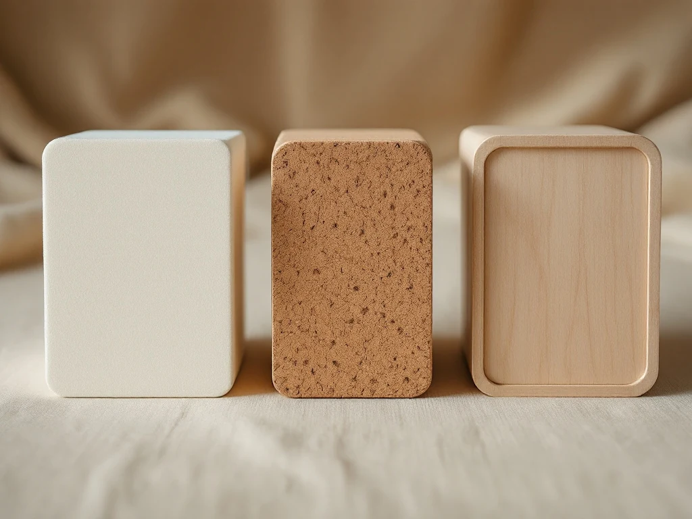

📌 3줄 요약
요가블럭은 처음이면 고밀도 EVA, 체중을 실어 짚는 동작이 많으면 코르크가 무난합니다.

두께는 10cm 안팎이 범용이고, 손이 작거나 앉기 보조용이면 7.5cm대도 괜찮습니다.

요가스트랩은 늘어나지 않는 끈이고, 키 163~178cm라면 약 2.4m(8피트)가 가장 무난합니다.

요가블럭 추천 글을 찾아보면 제품 목록은 많은데 정작 "내 몸에는 몇 cm짜리가 맞지?"에는 답이 잘 없더라고요. 결론부터 말하면요, 요가블럭은 재질로 단단함을, 두께로 높이를, 하는 동작으로 개수를 정하면 끝납니다. 저도 처음엔 요가블록과 요가블럭이 다른 물건인 줄 알고 따로 검색했어요. 그때 연달아 생긴 질문 순서 그대로 풀어 봤어요. 2026년 10월 기준 국내외 판매 페이지 사양을 모아 정리했습니다.

## 요가블록과 요가블럭, 같은 물건인가요?

네, 같은 물건입니다. 영어 block을 어떻게 적느냐의 차이라 판매 페이지에서도 두 표기가 섞여 쓰이고 검색할 땐 둘 다 넣어 보는 편이 결과가 많습니다.

요가블럭은 바닥을 끌어올려 주는 직육면체 소도구예요. 숙일 때 손이 바닥에 닿지 않으면 블록을 짚어 높이를 채우고 앉을 때는 엉덩이 밑에 깔아 씁니다. 세 면의 길이가 달라서 놓는 방향만 바꿔도 높이가 세 단계로 바뀝니다.

판매 제품 크기는 대체로 가로 약 23cm, 세로 약 15cm, 두께 7.5~10cm이고 인치로는 9×6×3~4인치 규격이 흔합니다. [요가 블록 위키백과 문서](https://en.wikipedia.org/wiki/Yoga_brick)는 요가 블록을 "a smooth block of wood or of firm but comfortable material"(나무나 단단하면서도 편안한 소재로 만든 매끈한 블록)이라고 설명합니다. 같은 문서에 따르면 정렬을 돕는 나무 블록을 처음 들인 사람이 B.K.S. 아이엥가이고, 그가 권한 크기는 22.5×11×7.5cm였어요. 무게는 폼 블록이 200~400g, 단단한 활엽수 나무 블록은 최대 약 1.1kg으로 나와 있습니다.

## 요가블럭은 어떤 재질이 좋나요?

입문자에게는 고밀도 EVA 폼, 오래 쓰며 체중을 실을 분에게는 코르크가 맞습니다. 나무는 가장 단단하지만 무겁고 쿠션이 없어 홈트 첫 블록으로는 잘 권하지 않는 편이에요.

EVA 폼은 가볍고 저렴하며 몸에 닿아도 덜 아픕니다. 제품마다 다르지만 대략 200~400g대예요(초경량 제품은 그 이하도 있음). 다만 밀도가 낮으면 체중을 실을 때 눌리고 표면이 매끈하면 땀이 묻었을 때 미끄러울 수 있습니다.

코르크는 거의 눌리지 않고 땀이 나도 그립이 유지된다는 평이 많습니다. 대신 판매 사양 기준 1kg 안팎으로 무겁고 오래 쓰면 모서리가 조금씩 부스러질 수 있어요. 스펙을 비교해보니 무게 차이가 생각보다 커서 들고 다닐 거라면 가장 먼저 따져볼 항목이더라고요.

| 재질 | 무게감 | 단단함 | 땀 났을 때 | 잘 맞는 경우 |
| --- | --- | --- | --- | --- |
| EVA 폼 | 가벼움 | 약간 말랑 | 매끈하면 미끄러움 | 입문·휴대·앉기 보조 |
| 코르크 | 무거움 | 단단함 | 그립 유지 | 짚는 동작·오래 쓰기 |
| 나무 | 무거움 | 가장 단단 | 젖으면 미끄러움 | 고정 받침용 |

## 두께는 7.5cm와 10cm 중 뭘 사야 하나요?

헷갈리면 10cm 안팎을 고르세요. 세 방향 높이가 대략 10cm, 15cm, 23cm로 나와 바닥 짚기부터 앉기 보조까지 한 개로 커버됩니다. 7.5cm대는 가장 낮은 높이가 7.5cm로 내려가는 대신 손에 쥐기 편합니다.

여기서 많이들 헷갈리는데, 두께는 높을수록 좋은 게 아닙니다. 블록 위에 앉을 때는 낮은 면을 가장 자주 쓰는데, 10cm가 높게 느껴지면 7.5cm가 더 편할 수 있어요. 숙일 때 손끝이 멀다면 두께보다 블록을 세워 높은 면을 쓰는 게 핵심입니다.

상위 글과 상세페이지 수치를 모아 상황별로 표로 묶어보면 이렇습니다. 같은 두께라도 가로·세로가 제품마다 조금씩 다르니 세 방향 크기는 직접 확인하세요.

7.5cm 블록은 7.5/15/23cm, 10cm 블록은 10/15/23cm 세 높이로 쓸 수 있어요.

| 내 상황 | 추천 두께 | 주로 쓰는 높이 |
| --- | --- | --- |
| 손이 작거나 쥐고 쓰는 일이 많음 | 7.5cm대 | 낮은 면·중간 면 |
| 앉을 때 엉덩이 밑에 받칠 용도 | 7.5~10cm | 낮은 면 |
| 숙일 때 손끝이 바닥에서 멂 | 두께 무관 | 높은 면(약 23cm) |
| 범용 한 개만 산다 | 10cm | 세 높이 모두 |

## 요가블럭은 1개면 되나요, 2개 사야 하나요?

앉기 보조나 한 손 짚기 위주라면 1개로 충분하고 양손을 동시에 짚거나 누워서 등과 머리를 함께 받칠 거라면 2개가 편합니다. 저가 EVA는 낱개와 2개 묶음이 함께 팔려서 처음부터 한 쌍을 사는 분도 있어요.

판단은 간단합니다. 따라 하는 영상에서 블록을 양손에 하나씩 짚는 장면이 자주 나오면 2개, 한쪽 손이나 엉덩이 밑에만 쓰면 1개입니다. 2개라면 높이가 똑같아야 하니 같은 제품으로 한 번에 사는 게 낫습니다.

코르크는 2개면 무게도 두 배라 코르크 1개와 EVA 1개를 섞는 조합도 괜찮아요. 단, 양손을 같은 높이로 짚을 땐 두 블록 크기가 같은지 꼭 확인하세요.

## 요가스트랩은 몇 m짜리를 사야 하나요?

키 163~178cm라면 8피트, 약 2.4m가 가장 무난합니다. 그보다 작으면 6피트(약 1.8m), 키가 크거나 몸이 많이 뻣뻣하면 10피트(약 3m)를 고르면 됩니다. 라자다 스포츠의 스트랩 길이 가이드는 163cm 미만에 6피트, 178cm 초과에 10피트를 권하고, 만두카 유럽 공식몰은 243cm를 표준으로 두되 180cm가 넘으면 304cm를 고려하라고 안내해요. 가이드마다 경계값은 조금씩 다릅니다.

| 키 | 추천 스트랩 길이 (ft / m) |
| --- | --- |
| 약 163cm 미만 | 6ft / 약 1.8m |
| 약 163~178cm | 8ft / 약 2.4m |
| 약 178cm 초과 | 10ft / 약 3m |

길이가 대부분 피트로 적혀 있어서 처음엔 cm로 감이 안 와 한참 헤맸어요. 6피트는 약 183cm, 8피트는 약 244cm, 10피트는 약 305cm입니다. 키만 본 경험칙이라 유연성이 부족하면 한 단계 긴 쪽이 여유 있습니다.

폭은 약 3.8cm(1.5인치)가 표준이고 손에 끈이 파고드는 느낌이 싫다면 약 5cm(2인치)가 편합니다. 면은 땀을 흡수해 덜 미끄럽고 나일론·폴리에스터는 닦기 쉽지만 젖으면 미끄러울 수 있어요.

💡 길이 재는 법
집에 있는 끈을 발바닥에 걸고 등을 편 채 양손으로 잡아 그 길이를 재보세요. 고리에 끼우고 손에 감을 여유분까지 생각해 그보다 넉넉한 제품을 고르면 됩니다.

## D링과 버클, 요가스트랩 고리는 뭐가 다른가요?

고정력을 원하면 금속 D링, 자주 풀었다 조이면 슬라이드형 버클입니다. D링은 끈을 두 개의 D자 고리에 통과시켜 마찰로 잡는 방식이라 당길수록 단단해지고 부서질 부품이 거의 없어요.

슬라이드형 버클은 한 번에 당겨 길이를 바꿀 수 있어 동작을 자주 바꿀 때 편합니다. 다만 플라스틱 제품은 세게 당기면 조금씩 밀릴 수 있고 옆을 눌러 여는 플라스틱 원터치형은 장력이 걸리면 풀릴 수 있어 피하라는 가이드도 있습니다.

D링의 단점은 딱딱한 바닥에 떨어질 때 나는 소리 정도예요. 매트 위에서만 다루면 크게 신경 쓰이지 않습니다. 상세페이지 사진에서 고리가 금속인지 플라스틱인지 확대해 보세요.

## 요가스트랩과 요가밴드, 요가링은 뭐가 다른가요?

요가스트랩은 늘어나지 않는 끈이고 요가밴드는 고무처럼 늘어나는 라텍스 밴드입니다. 명칭이 비슷해 "요가스트랩 추천"으로 검색해도 요가밴드 목록이 섞여 나오는데, 쓰임새가 달라요.

스트랩은 손이 닿지 않는 발이나 반대 손까지 거리를 이어주는 도구라 늘어나지 않아야 자세가 고정됩니다. 밴드는 늘어나는 저항을 쓰는 도구에 가깝고요. 저도 처음엔 둘 다 끈인 줄 알았는데, 상세페이지를 비교해보니 소재부터 면·나일론 대 라텍스로 갈렸습니다.

요가링은 손이나 다리에 끼우는 둥근 고리 모양 소도구로, 블록·스트랩과는 또 다른 물건입니다. 블록과 스트랩이 있으면 기본은 갖춘 셈이니 요가링은 필요가 생겼을 때 알아봐도 늦지 않아요.

## 다이소 요가블럭으로 시작해도 괜찮을까요?

가볍게 써보는 용도라면 괜찮습니다. 저가 EVA로 시작해 자주 쓰게 되면 그때 고밀도나 코르크로 올라가는 순서가 합리적이에요.

후기를 찾아보니 저가 블록에서 반복되는 불만은 두 가지였습니다. 체중을 실으면 눌리는 낮은 밀도, 그리고 땀에 미끄러운 매끈한 표면이에요. 무게가 유독 가볍게 적혀 있다면 밀도가 낮을 가능성도 생각해 볼 만합니다.

가격대는 저가 EVA가 몇천 원대(2026년 10월 기준, 시기마다 바뀜)이고, 코르크나 브랜드 고밀도 제품은 그보다 몇 배 높은 편이라 판매 페이지에서 확인하세요. 아직 매트가 없다면 [요가매트 고르는 법](/yoga-mat-guide/)부터 보고 블록을 고르면 조합이 깔끔합니다.

⚠️ 상세페이지에서 꼭 볼 것
세 방향 크기, 고밀도 여부, 모서리 라운딩, 표면 미끄럼 방지 패턴, 스트랩이면 길이·폭·고리 재질까지 확인하세요. 블록 위에 올라서는 용도로는 쓰지 않는 게 안전합니다.

## 자주 묻는 질문 (FAQ)

**Q. 요가블럭 초보는 어떤 걸 사야 하나요?**
A. 고밀도 EVA 폼에 두께 10cm 안팎, 모서리가 둥근 제품이 무난합니다. 가볍고 몸에 닿아도 덜 아파 처음 쓰기에 부담이 적습니다.

**Q. 코르크 요가블럭과 EVA 요가블럭 중 뭐가 나은가요?**
A. 단단함과 땀 났을 때의 그립은 코르크, 가벼움과 가격은 EVA가 낫습니다. 집에 두고 짚는 동작이 많으면 코르크, 휴대나 앉기 보조 위주면 EVA가 맞습니다.

**Q. 요가스트랩 대신 집에 있는 벨트나 수건을 써도 되나요?**
A. 잠깐 대신하는 용도로는 가능하지만 길이 조절과 고정이 불편합니다. 꾸준히 쓸 거면 고리가 달린 요가스트랩이 훨씬 편합니다.

**Q. 요가스트랩 1.8m와 2.4m 중 뭘 살까요?**
A. 키 163~178cm라면 2.4m가 무난하고 그보다 작고 유연한 편이면 1.8m도 충분합니다. 애매하면 긴 쪽을 사서 줄여 쓰는 게 짧아서 못 쓰는 것보다 낫습니다. 178cm가 넘는다면 3m(10ft)를 보세요.

이거 하나만 기억하면 돼요. 요가블럭은 재질·두께·개수, 요가스트랩은 길이와 고리 재질만 보면 됩니다.

---

**관련 키워드** — #요가블럭추천 #요가블록 #요가블록고르는방법 #요가블록재질비교 #코르크요가블럭 #EVA요가블럭 #다이소요가블럭 #요가스트랩추천 #요가스트랩길이 #요가밴드 #요가소도구 #홈트요가
